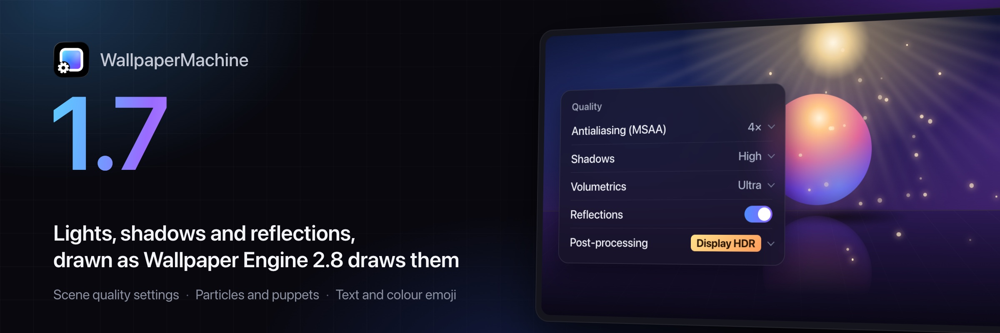
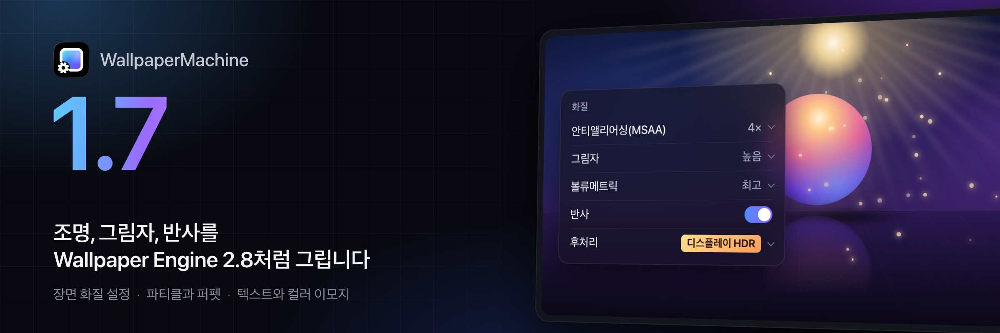
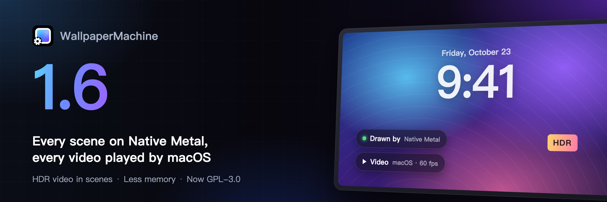
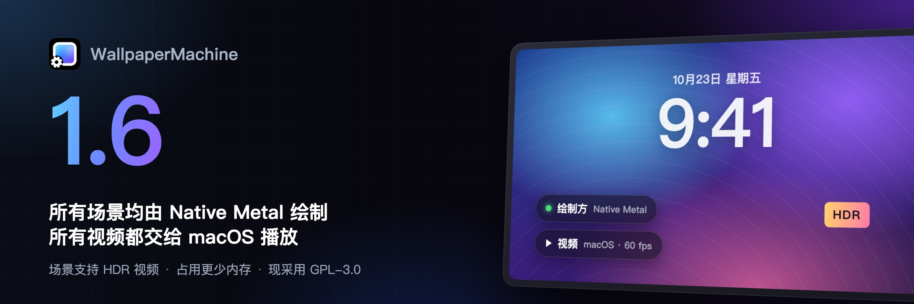
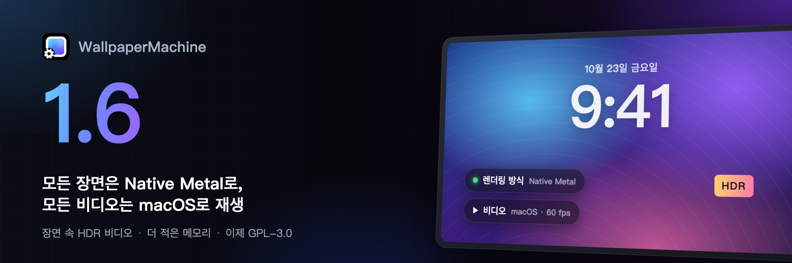
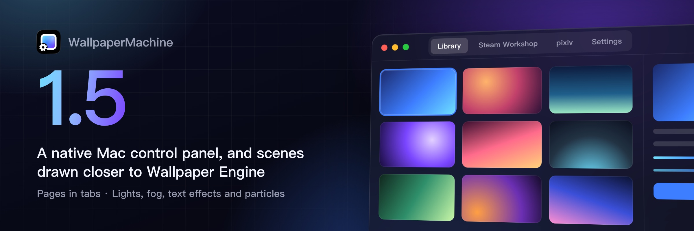
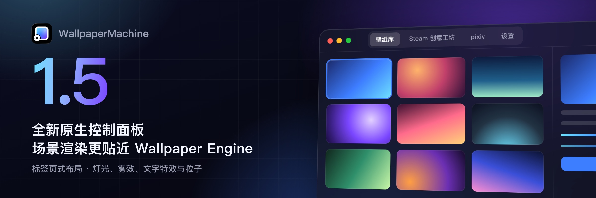

# Changelog

Every published version, newest first. Each section is written when its version is
cut, by [`scripts/release_notes.py`](scripts/release_notes.py) from the commits
between two version tags: a language model writes them up for users, where older
sections list the commits. A section's heading links the version to its comparison
with the previous one and gives the release date. Under it, the same notes in English,
Simplified Chinese and Korean (from 1.5.7; earlier sections keep their original
translations) are grouped into Features, Bug Fixes and the other categories, and
newer bullets end with the issues they close and the commits they describe. The
app's update window shows the sections of every version newer than the installed
one, in the app's language; the GitHub Release body repeats only the English notes.
See [docs/release.md](docs/release.md) for how a version is cut.

## [1.10.0](https://github.com/MMFoundation/WallpaperMachine/compare/v1.9.4...v1.10.0) (2026-11-10)

### English

This release makes the Library quicker to work with and keeps automatic wallpaper changes, web wallpapers and your saved settings dependable

#### Highlights

- The Library gains a right-click menu, drag-and-drop import and keyboard shortcuts for faster wallpaper management ([7025ba3](https://github.com/MMFoundation/WallpaperMachine/commit/7025ba39f4c92f6c1af221aa3060c62aefb0e2a2))
- Web wallpapers stay animated through Stage Manager instead of freezing (closes [#177](https://github.com/MMFoundation/WallpaperMachine/issues/177)) ([0b05669](https://github.com/MMFoundation/WallpaperMachine/commit/0b056694495d0e8bc808908905d53b17a3d670cc), [e89ee04](https://github.com/MMFoundation/WallpaperMachine/commit/e89ee04186cc5f4263e7f95cb18b14272f26ead2))
- Playlists, Focus wallpapers and mirrored displays now change wallpapers reliably through wakes, restarts and interruptions (closes [#179](https://github.com/MMFoundation/WallpaperMachine/issues/179), closes [#181](https://github.com/MMFoundation/WallpaperMachine/issues/181)) ([de5f3bc](https://github.com/MMFoundation/WallpaperMachine/commit/de5f3bc866ec9bdd1c1a2fa4914acb8f40b26b73), [2f6edf1](https://github.com/MMFoundation/WallpaperMachine/commit/2f6edf11d0d362f818c7dc16cf8e275a1fb1452d), [46945f2](https://github.com/MMFoundation/WallpaperMachine/commit/46945f22c6813b0a5bcb9a06dd38a812c63c951a), [70ae180](https://github.com/MMFoundation/WallpaperMachine/commit/70ae1805780858c812501ac6e206dada8ce45aad), [2bb19f9](https://github.com/MMFoundation/WallpaperMachine/commit/2bb19f92c9b400a039d13dfd4909a4c590a6f532))
- Your saved rules, playlists and collections are no longer wiped out when one entry cannot be read ([38cc583](https://github.com/MMFoundation/WallpaperMachine/commit/38cc5830a1f26aabd0b073f0fd9f791af6c47e95))

#### Features

- Right-click a wallpaper in the Library to apply it, use it on all displays, favorite it, show it in Finder, add it to a playlist, reinstall or trash it ([7025ba3](https://github.com/MMFoundation/WallpaperMachine/commit/7025ba39f4c92f6c1af221aa3060c62aefb0e2a2))
- Drop wallpaper files and folders onto the Library to import them ([7025ba3](https://github.com/MMFoundation/WallpaperMachine/commit/7025ba39f4c92f6c1af221aa3060c62aefb0e2a2))
- Keyboard shortcuts speed up the Library: Command-Return applies the focused wallpaper, Command-Delete trashes it, and the File menu adds Import (Command-O) and Refresh Library (Command-R) ([7025ba3](https://github.com/MMFoundation/WallpaperMachine/commit/7025ba39f4c92f6c1af221aa3060c62aefb0e2a2))
- A favorite button in the selection bar adds every selected wallpaper to your favorites, or removes them all when they already are ([7025ba3](https://github.com/MMFoundation/WallpaperMachine/commit/7025ba39f4c92f6c1af221aa3060c62aefb0e2a2))

#### Improvements

- Library actions now report their result: Add to playlist says how many it added or why they won't play, while Refresh and Next wallpaper say what happened ([0207e6d](https://github.com/MMFoundation/WallpaperMachine/commit/0207e6d107df85ad68eadb5f9fe9440ebb609818))
- Clearing history, which also resets the Last used order, and removing a time or app rule now ask for confirmation first ([0207e6d](https://github.com/MMFoundation/WallpaperMachine/commit/0207e6d107df85ad68eadb5f9fe9440ebb609818))
- Settings › About › Updates now shows status, last check and the next step in one row, with release notes in their own card and earlier versions folded away ([7d57bed](https://github.com/MMFoundation/WallpaperMachine/commit/7d57bedd58318f85350cea000bf0c19243e29fca))
- A Library that cannot be read now explains why and offers Try again instead of looking empty, and thumbnails that fail to load show a mark ([0207e6d](https://github.com/MMFoundation/WallpaperMachine/commit/0207e6d107df85ad68eadb5f9fe9440ebb609818))

#### Bug Fixes

- Web wallpapers keep animating and no longer freeze when Stage Manager switches between the desktop and apps (closes [#177](https://github.com/MMFoundation/WallpaperMachine/issues/177)) ([0b05669](https://github.com/MMFoundation/WallpaperMachine/commit/0b056694495d0e8bc808908905d53b17a3d670cc), [e89ee04](https://github.com/MMFoundation/WallpaperMachine/commit/e89ee04186cc5f4263e7f95cb18b14272f26ead2))
- Saved rules, playlists, collections and app rules are no longer erased when a single entry cannot be read, such as after returning to an older app version ([38cc583](https://github.com/MMFoundation/WallpaperMachine/commit/38cc5830a1f26aabd0b073f0fd9f791af6c47e95))
- A mirrored display keeps following its source when a playlist, rule or schedule changes the wallpaper as the Mac wakes, instead of getting stuck on one wallpaper (closes [#179](https://github.com/MMFoundation/WallpaperMachine/issues/179)) ([de5f3bc](https://github.com/MMFoundation/WallpaperMachine/commit/de5f3bc866ec9bdd1c1a2fa4914acb8f40b26b73), [2f6edf1](https://github.com/MMFoundation/WallpaperMachine/commit/2f6edf11d0d362f818c7dc16cf8e275a1fb1452d))
- Playlist rotation resumes after an interrupted change or an empty collection, and restarts with a full interval when you return to the desktop (closes [#181](https://github.com/MMFoundation/WallpaperMachine/issues/181)) ([46945f2](https://github.com/MMFoundation/WallpaperMachine/commit/46945f22c6813b0a5bcb9a06dd38a812c63c951a))
- Focus wallpapers, and the wallpaper that returns when a Focus ends, are no longer skipped when a Workshop update or scene retry reloads the display at that moment ([2bb19f9](https://github.com/MMFoundation/WallpaperMachine/commit/2bb19f92c9b400a039d13dfd4909a4c590a6f532))
- Signing in to Steam again while subscriptions are still loading no longer signs out the new session and removes it from this Mac ([dd555eb](https://github.com/MMFoundation/WallpaperMachine/commit/dd555eb31e6746888f45688daca10cb0d6ec0ec2))
- A wallpaper you apply by hand on a day and night display now stays until the next half of the day, even if the app restarts ([70ae180](https://github.com/MMFoundation/WallpaperMachine/commit/70ae1805780858c812501ac6e206dada8ce45aad))
- Shuffle again shows every wallpaper once per round when one wallpaper keeps failing to load, instead of repeating random picks ([70ae180](https://github.com/MMFoundation/WallpaperMachine/commit/70ae1805780858c812501ac6e206dada8ce45aad))
- Day and night can no longer be set to start at the same time, which kept the night wallpaper on all day ([70ae180](https://github.com/MMFoundation/WallpaperMachine/commit/70ae1805780858c812501ac6e206dada8ce45aad))

### 简体中文

本次更新让壁纸库用起来更顺手，并让自动更换壁纸、网页壁纸和已保存的设置更加可靠

#### 亮点

- 壁纸库新增右键菜单、拖放导入和键盘快捷键，管理壁纸更快捷 ([7025ba3](https://github.com/MMFoundation/WallpaperMachine/commit/7025ba39f4c92f6c1af221aa3060c62aefb0e2a2))
- 使用台前调度时，网页壁纸持续播放，不再卡住 (closes [#177](https://github.com/MMFoundation/WallpaperMachine/issues/177)) ([0b05669](https://github.com/MMFoundation/WallpaperMachine/commit/0b056694495d0e8bc808908905d53b17a3d670cc), [e89ee04](https://github.com/MMFoundation/WallpaperMachine/commit/e89ee04186cc5f4263e7f95cb18b14272f26ead2))
- 播放列表、专注模式壁纸和镜像显示器在唤醒、重启或中断后也能可靠地更换壁纸 (closes [#179](https://github.com/MMFoundation/WallpaperMachine/issues/179), closes [#181](https://github.com/MMFoundation/WallpaperMachine/issues/181)) ([de5f3bc](https://github.com/MMFoundation/WallpaperMachine/commit/de5f3bc866ec9bdd1c1a2fa4914acb8f40b26b73), [2f6edf1](https://github.com/MMFoundation/WallpaperMachine/commit/2f6edf11d0d362f818c7dc16cf8e275a1fb1452d), [46945f2](https://github.com/MMFoundation/WallpaperMachine/commit/46945f22c6813b0a5bcb9a06dd38a812c63c951a), [70ae180](https://github.com/MMFoundation/WallpaperMachine/commit/70ae1805780858c812501ac6e206dada8ce45aad), [2bb19f9](https://github.com/MMFoundation/WallpaperMachine/commit/2bb19f92c9b400a039d13dfd4909a4c590a6f532))
- 某一项无法读取时，已保存的规则、播放列表和合集不会再被整体清空 ([38cc583](https://github.com/MMFoundation/WallpaperMachine/commit/38cc5830a1f26aabd0b073f0fd9f791af6c47e95))

#### 新功能

- 在壁纸库中右键点按壁纸，无需先选中即可应用、应用到所有显示器、收藏、在访达中显示、加入播放列表、重新安装或移到废纸篓 ([7025ba3](https://github.com/MMFoundation/WallpaperMachine/commit/7025ba39f4c92f6c1af221aa3060c62aefb0e2a2))
- 将壁纸文件或文件夹拖到壁纸库即可导入 ([7025ba3](https://github.com/MMFoundation/WallpaperMachine/commit/7025ba39f4c92f6c1af221aa3060c62aefb0e2a2))
- 壁纸库支持键盘快捷键：Command-Return 应用当前选中的壁纸，Command-Delete 将其移到废纸篓，“文件”菜单新增“导入”（Command-O）和“刷新壁纸库”（Command-R） ([7025ba3](https://github.com/MMFoundation/WallpaperMachine/commit/7025ba39f4c92f6c1af221aa3060c62aefb0e2a2))
- 选择栏新增收藏按钮，可一次收藏所有选中的壁纸，若已全部收藏则一并取消 ([7025ba3](https://github.com/MMFoundation/WallpaperMachine/commit/7025ba39f4c92f6c1af221aa3060c62aefb0e2a2))

#### 改进

- 壁纸库操作现在会告诉你结果，“添加到播放列表”会说明添加了几张或为何不会播放，“刷新”和“下一张壁纸”也会说明情况 ([0207e6d](https://github.com/MMFoundation/WallpaperMachine/commit/0207e6d107df85ad68eadb5f9fe9440ebb609818))
- 清除历史记录（同时会重置“最近使用”排序）以及删除时间规则或应用规则前，现在都会先请你确认 ([0207e6d](https://github.com/MMFoundation/WallpaperMachine/commit/0207e6d107df85ad68eadb5f9fe9440ebb609818))
- “设置 › 关于 › 更新”现在用一行显示状态、上次检查时间和下一步操作，更新说明有独立卡片，旧版本默认折叠 ([7d57bed](https://github.com/MMFoundation/WallpaperMachine/commit/7d57bedd58318f85350cea000bf0c19243e29fca))
- 无法读取壁纸库时会显示原因和“重试”，不再显示为空，无法载入的缩略图也会显示标记而非空白 ([0207e6d](https://github.com/MMFoundation/WallpaperMachine/commit/0207e6d107df85ad68eadb5f9fe9440ebb609818))

#### 问题修复

- 使用台前调度在桌面与应用之间切换时，网页壁纸会持续播放，不再卡住 (closes [#177](https://github.com/MMFoundation/WallpaperMachine/issues/177)) ([0b05669](https://github.com/MMFoundation/WallpaperMachine/commit/0b056694495d0e8bc808908905d53b17a3d670cc), [e89ee04](https://github.com/MMFoundation/WallpaperMachine/commit/e89ee04186cc5f4263e7f95cb18b14272f26ead2))
- 当某一项无法读取时（例如退回旧版本后），已保存的规则、播放列表、合集和应用规则不再被全部清空 ([38cc583](https://github.com/MMFoundation/WallpaperMachine/commit/38cc5830a1f26aabd0b073f0fd9f791af6c47e95))
- Mac 唤醒期间若播放列表、规则或日程更换了壁纸，镜像显示器仍会跟随源显示器，不再停留在某张壁纸上 (closes [#179](https://github.com/MMFoundation/WallpaperMachine/issues/179)) ([de5f3bc](https://github.com/MMFoundation/WallpaperMachine/commit/de5f3bc866ec9bdd1c1a2fa4914acb8f40b26b73), [2f6edf1](https://github.com/MMFoundation/WallpaperMachine/commit/2f6edf11d0d362f818c7dc16cf8e275a1fb1452d))
- 播放列表轮换在更换被中断或合集为空后会继续进行，回到桌面时重新计算完整的间隔 (closes [#181](https://github.com/MMFoundation/WallpaperMachine/issues/181)) ([46945f2](https://github.com/MMFoundation/WallpaperMachine/commit/46945f22c6813b0a5bcb9a06dd38a812c63c951a))
- 当创意工坊更新或场景重试恰好重新载入显示器时，专注模式壁纸及专注模式结束后恢复的壁纸不再被跳过 ([2bb19f9](https://github.com/MMFoundation/WallpaperMachine/commit/2bb19f92c9b400a039d13dfd4909a4c590a6f532))
- 在订阅内容仍在读取时重新登录 Steam，新的登录不再被注销并从这台 Mac 上移除 ([dd555eb](https://github.com/MMFoundation/WallpaperMachine/commit/dd555eb31e6746888f45688daca10cb0d6ec0ec2))
- 在按昼夜切换的显示器上手动应用的壁纸，现在会保留到下一次昼夜交替，即使应用中途重启也是如此 ([70ae180](https://github.com/MMFoundation/WallpaperMachine/commit/70ae1805780858c812501ac6e206dada8ce45aad))
- 即使有一张壁纸持续载入失败，随机播放也会恢复为每轮将每张壁纸各显示一次，不再重复挑选 ([70ae180](https://github.com/MMFoundation/WallpaperMachine/commit/70ae1805780858c812501ac6e206dada8ce45aad))
- 昼夜不能再设为相同的开始时间，夜间壁纸不会再整天显示 ([70ae180](https://github.com/MMFoundation/WallpaperMachine/commit/70ae1805780858c812501ac6e206dada8ce45aad))

### 한국어

이번 업데이트로 보관함을 더 빠르게 다룰 수 있고, 자동 배경화면 변경, 웹 배경화면, 저장된 설정이 더 안정적으로 동작합니다

#### 주요 변경 사항

- 보관함에 오른쪽 클릭 메뉴, 끌어다 놓기 가져오기, 키보드 단축키가 추가되어 배경화면을 더 빠르게 관리할 수 있습니다 ([7025ba3](https://github.com/MMFoundation/WallpaperMachine/commit/7025ba39f4c92f6c1af221aa3060c62aefb0e2a2))
- 스테이지 매니저를 사용해도 웹 배경화면이 멈추지 않고 계속 움직입니다 (closes [#177](https://github.com/MMFoundation/WallpaperMachine/issues/177)) ([0b05669](https://github.com/MMFoundation/WallpaperMachine/commit/0b056694495d0e8bc808908905d53b17a3d670cc), [e89ee04](https://github.com/MMFoundation/WallpaperMachine/commit/e89ee04186cc5f4263e7f95cb18b14272f26ead2))
- 재생 목록, 집중 모드 배경화면, 미러링된 디스플레이가 잠자기 해제, 재시작, 중단 후에도 배경화면을 안정적으로 바꿉니다 (closes [#179](https://github.com/MMFoundation/WallpaperMachine/issues/179), closes [#181](https://github.com/MMFoundation/WallpaperMachine/issues/181)) ([de5f3bc](https://github.com/MMFoundation/WallpaperMachine/commit/de5f3bc866ec9bdd1c1a2fa4914acb8f40b26b73), [2f6edf1](https://github.com/MMFoundation/WallpaperMachine/commit/2f6edf11d0d362f818c7dc16cf8e275a1fb1452d), [46945f2](https://github.com/MMFoundation/WallpaperMachine/commit/46945f22c6813b0a5bcb9a06dd38a812c63c951a), [70ae180](https://github.com/MMFoundation/WallpaperMachine/commit/70ae1805780858c812501ac6e206dada8ce45aad), [2bb19f9](https://github.com/MMFoundation/WallpaperMachine/commit/2bb19f92c9b400a039d13dfd4909a4c590a6f532))
- 항목 하나를 읽을 수 없어도 저장된 규칙, 재생 목록, 컬렉션이 더 이상 통째로 지워지지 않습니다 ([38cc583](https://github.com/MMFoundation/WallpaperMachine/commit/38cc5830a1f26aabd0b073f0fd9f791af6c47e95))

#### 새로운 기능

- 보관함에서 배경화면을 오른쪽 클릭하면 선택하지 않고도 적용, 모든 디스플레이에 적용, 즐겨찾기, Finder에서 보기, 재생 목록에 추가, 재설치, 휴지통으로 이동을 할 수 있습니다 ([7025ba3](https://github.com/MMFoundation/WallpaperMachine/commit/7025ba39f4c92f6c1af221aa3060c62aefb0e2a2))
- 배경화면 파일이나 폴더를 보관함으로 끌어다 놓으면 가져올 수 있습니다 ([7025ba3](https://github.com/MMFoundation/WallpaperMachine/commit/7025ba39f4c92f6c1af221aa3060c62aefb0e2a2))
- 보관함에서 키보드 단축키를 쓸 수 있어 Command-Return으로 배경화면을 적용하고 Command-Delete로 휴지통에 버리며, 파일 메뉴에 가져오기(Command-O)와 보관함 새로 고침(Command-R)이 추가되었습니다 ([7025ba3](https://github.com/MMFoundation/WallpaperMachine/commit/7025ba39f4c92f6c1af221aa3060c62aefb0e2a2))
- 선택 막대의 즐겨찾기 버튼으로 선택한 배경화면을 한꺼번에 즐겨찾기에 추가하거나, 이미 모두 추가된 경우 한꺼번에 해제할 수 있습니다 ([7025ba3](https://github.com/MMFoundation/WallpaperMachine/commit/7025ba39f4c92f6c1af221aa3060c62aefb0e2a2))

#### 개선 사항

- 보관함 작업이 이제 결과를 알려 주어, 재생 목록에 추가는 추가한 개수나 재생되지 않는 이유를, 새로 고침과 다음 배경화면도 무슨 일이 있었는지 보여 줍니다 ([0207e6d](https://github.com/MMFoundation/WallpaperMachine/commit/0207e6d107df85ad68eadb5f9fe9440ebb609818))
- 기록 지우기(최근 사용 순서도 초기화됨)와 시간 규칙 또는 앱 규칙 삭제 전에 이제 먼저 확인을 요청합니다 ([0207e6d](https://github.com/MMFoundation/WallpaperMachine/commit/0207e6d107df85ad68eadb5f9fe9440ebb609818))
- 설정 › 정보 › 업데이트에서 상태, 마지막 확인 시각, 다음 동작을 한 줄로 보여 주며, 릴리스 노트는 별도 카드에 표시되고 이전 버전은 접혀 있습니다 ([7d57bed](https://github.com/MMFoundation/WallpaperMachine/commit/7d57bedd58318f85350cea000bf0c19243e29fca))
- 보관함을 읽을 수 없으면 비어 보이는 대신 이유와 다시 시도 버튼을 보여 주고, 불러오지 못한 썸네일에는 빈칸 대신 표시가 나타납니다 ([0207e6d](https://github.com/MMFoundation/WallpaperMachine/commit/0207e6d107df85ad68eadb5f9fe9440ebb609818))

#### 버그 수정

- 스테이지 매니저로 데스크탑과 앱 사이를 전환해도 웹 배경화면이 멈추지 않고 계속 움직입니다 (closes [#177](https://github.com/MMFoundation/WallpaperMachine/issues/177)) ([0b05669](https://github.com/MMFoundation/WallpaperMachine/commit/0b056694495d0e8bc808908905d53b17a3d670cc), [e89ee04](https://github.com/MMFoundation/WallpaperMachine/commit/e89ee04186cc5f4263e7f95cb18b14272f26ead2))
- 이전 버전으로 되돌린 경우처럼 항목 하나를 읽을 수 없어도 저장된 규칙, 재생 목록, 컬렉션, 앱 규칙이 더 이상 모두 지워지지 않습니다 ([38cc583](https://github.com/MMFoundation/WallpaperMachine/commit/38cc5830a1f26aabd0b073f0fd9f791af6c47e95))
- Mac이 깨어나는 동안 재생 목록, 규칙 또는 일정이 배경화면을 바꿔도 미러링된 디스플레이가 한 배경화면에 머무르지 않고 원본 디스플레이를 계속 따릅니다 (closes [#179](https://github.com/MMFoundation/WallpaperMachine/issues/179)) ([de5f3bc](https://github.com/MMFoundation/WallpaperMachine/commit/de5f3bc866ec9bdd1c1a2fa4914acb8f40b26b73), [2f6edf1](https://github.com/MMFoundation/WallpaperMachine/commit/2f6edf11d0d362f818c7dc16cf8e275a1fb1452d))
- 배경화면 변경이 중단되거나 컬렉션이 비어 있어도 재생 목록 순환이 다시 이어지며, 데스크탑으로 돌아오면 간격 전체를 처음부터 셉니다 (closes [#181](https://github.com/MMFoundation/WallpaperMachine/issues/181)) ([46945f2](https://github.com/MMFoundation/WallpaperMachine/commit/46945f22c6813b0a5bcb9a06dd38a812c63c951a))
- 창작마당 업데이트나 장면 재시도로 디스플레이가 다시 로드되어도 집중 모드 배경화면과 집중 모드가 끝난 뒤 돌아오는 배경화면이 더 이상 건너뛰어지지 않습니다 ([2bb19f9](https://github.com/MMFoundation/WallpaperMachine/commit/2bb19f92c9b400a039d13dfd4909a4c590a6f532))
- 구독 항목을 불러오는 중에 Steam에 다시 로그인해도 새 로그인 세션이 로그아웃되거나 이 Mac에서 삭제되지 않습니다 ([dd555eb](https://github.com/MMFoundation/WallpaperMachine/commit/dd555eb31e6746888f45688daca10cb0d6ec0ec2))
- 낮과 밤에 따라 바뀌는 디스플레이에 직접 적용한 배경화면이 앱이 다시 시작되어도 다음 낮 또는 밤이 시작될 때까지 유지됩니다 ([70ae180](https://github.com/MMFoundation/WallpaperMachine/commit/70ae1805780858c812501ac6e206dada8ce45aad))
- 배경화면 하나가 계속 로드되지 않아도 무작위 재생이 다시 한 회차에 모든 배경화면을 한 번씩 보여 주며 같은 배경화면을 반복하지 않습니다 ([70ae180](https://github.com/MMFoundation/WallpaperMachine/commit/70ae1805780858c812501ac6e206dada8ce45aad))
- 낮과 밤의 시작 시각을 더 이상 같게 설정할 수 없어 밤 배경화면이 하루 종일 표시되는 문제가 사라졌습니다 ([70ae180](https://github.com/MMFoundation/WallpaperMachine/commit/70ae1805780858c812501ac6e206dada8ce45aad))

## [1.9.4](https://github.com/MMFoundation/WallpaperMachine/compare/v1.9.3...v1.9.4) (2026-11-09)

### English

This release makes switching between desktops feel quicker and fixes a range of display, Workshop and sign-in problems

#### Improvements

- Switching to another desktop shows its wallpaper sooner, as scene, video and web wallpapers are now prepared in the background beforehand ([56878b5](https://github.com/MMFoundation/WallpaperMachine/commit/56878b5a7414924b2c061f86162a58414e6fe71e))

#### Bug Fixes

- Mission Control no longer leaves trails of foreground windows across the desktop, and wallpapers keep playing during the transition (closes [#173](https://github.com/MMFoundation/WallpaperMachine/issues/173)) ([83f07dd](https://github.com/MMFoundation/WallpaperMachine/commit/83f07ddcb7354a0283f4bc550aee35bd550cd992))
- Your Steam Workshop subscriptions no longer appear empty when loading fails, an error is shown instead and the already loaded list stays in place ([a73a03d](https://github.com/MMFoundation/WallpaperMachine/commit/a73a03dd64df3903e05beb2b0f54d39c22b172bd))
- Displays that mirror another display's wallpaper keep that setting after waking from sleep, even when macOS briefly makes them the main display (closes [#179](https://github.com/MMFoundation/WallpaperMachine/issues/179)) ([3178c20](https://github.com/MMFoundation/WallpaperMachine/commit/3178c20445e8e2d78c16e41f992af6868349eaa1))
- Saved pixiv and Steam Community sign-ins are no longer lost when the macOS keychain refuses to update them ([ac52120](https://github.com/MMFoundation/WallpaperMachine/commit/ac52120f25518f73e28cef53e8b6e5b522070764))
- Song titles and artwork on wallpapers catch up after a missed track change instead of staying on the previous song ([cbe854b](https://github.com/MMFoundation/WallpaperMachine/commit/cbe854bbef664aab9919bcb01d26c85f0ef7115f))
- Album covers in scene wallpapers stay attached to rotating models instead of drifting away from them ([db4a9b6](https://github.com/MMFoundation/WallpaperMachine/commit/db4a9b65e0ee4ab0764fe857caf177f1f6fd53f3))
- Scene wallpapers that paint over their previous image no longer lose it beneath partly drawn or blended layers ([56878b5](https://github.com/MMFoundation/WallpaperMachine/commit/56878b5a7414924b2c061f86162a58414e6fe71e))

Thanks to [@judyofficer](https://github.com/judyofficer) and [@DenseFLoe](https://github.com/DenseFLoe) for contributing to this release.

### 简体中文

本次更新让切换桌面更加迅速，并修复了显示器、创意工坊和登录方面的一系列问题

#### 改进

- 切换桌面时壁纸会更快出现，场景、视频和网页壁纸现在会提前在后台准备好 ([56878b5](https://github.com/MMFoundation/WallpaperMachine/commit/56878b5a7414924b2c061f86162a58414e6fe71e))

#### 问题修复

- 打开调度中心时，前台窗口不再在桌面上留下残影，壁纸在过渡期间也会继续播放 (closes [#173](https://github.com/MMFoundation/WallpaperMachine/issues/173)) ([83f07dd](https://github.com/MMFoundation/WallpaperMachine/commit/83f07ddcb7354a0283f4bc550aee35bd550cd992))
- Steam 创意工坊订阅加载失败时不再显示为空，而是提示错误，并保留已加载的列表 ([a73a03d](https://github.com/MMFoundation/WallpaperMachine/commit/a73a03dd64df3903e05beb2b0f54d39c22b172bd))
- 镜像其他显示器壁纸的显示器在从睡眠中唤醒后会保留该设置，即使 macOS 曾短暂将其设为主显示器 (closes [#179](https://github.com/MMFoundation/WallpaperMachine/issues/179)) ([3178c20](https://github.com/MMFoundation/WallpaperMachine/commit/3178c20445e8e2d78c16e41f992af6868349eaa1))
- 当 macOS 钥匙串拒绝更新时，已保存的 pixiv 和 Steam 社区登录信息不会再丢失 ([ac52120](https://github.com/MMFoundation/WallpaperMachine/commit/ac52120f25518f73e28cef53e8b6e5b522070764))
- 错过曲目切换后，壁纸上的歌曲信息和封面会自动更新，不再停留在上一首歌 ([cbe854b](https://github.com/MMFoundation/WallpaperMachine/commit/cbe854bbef664aab9919bcb01d26c85f0ef7115f))
- 场景壁纸中的专辑封面会紧贴旋转的模型，不再与模型脱离 ([db4a9b6](https://github.com/MMFoundation/WallpaperMachine/commit/db4a9b65e0ee4ab0764fe857caf177f1f6fd53f3))
- 在上一帧画面上继续绘制的场景壁纸，不再在部分绘制或混合的图层下丢失原有画面 ([56878b5](https://github.com/MMFoundation/WallpaperMachine/commit/56878b5a7414924b2c061f86162a58414e6fe71e))

感谢 [@judyofficer](https://github.com/judyofficer) 和 [@DenseFLoe](https://github.com/DenseFLoe) 为本版本做出的贡献。

### 한국어

이번 업데이트로 데스크탑 전환이 더 빨라지고 디스플레이, 창작마당, 로그인 관련 여러 문제가 수정되었습니다

#### 개선 사항

- 장면, 비디오, 웹 배경화면을 미리 백그라운드에서 준비하므로 다른 데스크탑으로 전환할 때 배경화면이 더 빨리 표시됩니다 ([56878b5](https://github.com/MMFoundation/WallpaperMachine/commit/56878b5a7414924b2c061f86162a58414e6fe71e))

#### 버그 수정

- Mission Control 전환 중 앞쪽 윈도우가 데스크탑에 잔상을 남기지 않으며 배경화면도 계속 재생됩니다 (closes [#173](https://github.com/MMFoundation/WallpaperMachine/issues/173)) ([83f07dd](https://github.com/MMFoundation/WallpaperMachine/commit/83f07ddcb7354a0283f4bc550aee35bd550cd992))
- Steam 창작마당 구독 목록을 불러오지 못해도 더 이상 비어 보이지 않으며, 오류를 알리고 이미 불러온 목록을 유지합니다 ([a73a03d](https://github.com/MMFoundation/WallpaperMachine/commit/a73a03dd64df3903e05beb2b0f54d39c22b172bd))
- 다른 디스플레이의 배경화면을 미러링하는 디스플레이는 macOS가 잠자기에서 깨어날 때 잠시 주 디스플레이로 바꾸더라도 그 설정을 유지합니다 (closes [#179](https://github.com/MMFoundation/WallpaperMachine/issues/179)) ([3178c20](https://github.com/MMFoundation/WallpaperMachine/commit/3178c20445e8e2d78c16e41f992af6868349eaa1))
- macOS 키체인이 업데이트를 거부해도 저장된 pixiv 및 Steam 커뮤니티 로그인 정보가 더 이상 사라지지 않습니다 ([ac52120](https://github.com/MMFoundation/WallpaperMachine/commit/ac52120f25518f73e28cef53e8b6e5b522070764))
- 곡 변경을 놓친 경우에도 배경화면의 곡 정보와 앨범 아트가 다시 갱신되어 이전 곡에 머무르지 않습니다 ([cbe854b](https://github.com/MMFoundation/WallpaperMachine/commit/cbe854bbef664aab9919bcb01d26c85f0ef7115f))
- 장면 배경화면의 앨범 커버가 회전하는 모델에서 벗어나지 않고 그대로 붙어 있습니다 ([db4a9b6](https://github.com/MMFoundation/WallpaperMachine/commit/db4a9b65e0ee4ab0764fe857caf177f1f6fd53f3))
- 이전 화면 위에 덧그리는 장면 배경화면이 부분적으로 그려지거나 혼합된 레이어 아래의 기존 이미지를 더 이상 잃지 않습니다 ([56878b5](https://github.com/MMFoundation/WallpaperMachine/commit/56878b5a7414924b2c061f86162a58414e6fe71e))

이번 릴리스에 기여해 주신 [@judyofficer](https://github.com/judyofficer), [@DenseFLoe](https://github.com/DenseFLoe) 님께 감사드립니다.

## [1.9.3](https://github.com/MMFoundation/WallpaperMachine/compare/v1.9.2...v1.9.3) (2026-11-07)

### English

This update makes the Library smoother to scroll and fixes several annoyances with playback, the desktop picture and the menu bar panel

#### Improvements

- Rapid swipes through the Library now scroll smoothly, while animated previews keep their full quality ([29250ca](https://github.com/MMFoundation/WallpaperMachine/commit/29250caa38d01b6e4b0e0d706dc6b6a58d65d440))

#### Bug Fixes

- When a wallpaper pauses for an app in front, minimizing that app's screen-filling window now resumes playback at once, without a click on the desktop ([e013fe6](https://github.com/MMFoundation/WallpaperMachine/commit/e013fe6bcefcc6ff8e061843efd6113bccb6512e))
- Wallpapers stay paused while Mission Control previews a fullscreen app's Space, then resume when the desktop becomes active (closes [#173](https://github.com/MMFoundation/WallpaperMachine/issues/173)) ([0fa20ce](https://github.com/MMFoundation/WallpaperMachine/commit/0fa20ce2a7a1b4f4540f419c68b6d45618c5033c))
- Quit in the menu bar panel closes the app completely again, even before any wallpaper has started playing ([0c7a019](https://github.com/MMFoundation/WallpaperMachine/commit/0c7a01991a5707dcbe129552b8a9076f9f4e4569))
- Square and portrait wallpaper covers in the menu bar panel no longer block clicks on the display picker (closes [#171](https://github.com/MMFoundation/WallpaperMachine/issues/171)) ([910768c](https://github.com/MMFoundation/WallpaperMachine/commit/910768c558a55d29ad94b7e771a93b3db64bc7ab))
- The macOS desktop picture now updates to match a video wallpaper even while another app covers it, instead of waiting for the desktop to show (closes [#169](https://github.com/MMFoundation/WallpaperMachine/issues/169)) ([eac7c33](https://github.com/MMFoundation/WallpaperMachine/commit/eac7c333ddf379418d26b208fd0aadc8f7494283))

### 简体中文

本次更新让壁纸库滚动更流畅，并修复了播放、桌面图片和菜单栏面板中的几处问题

#### 改进

- 在壁纸库中快速滑动时滚动更流畅，动态预览的画质保持不变 ([29250ca](https://github.com/MMFoundation/WallpaperMachine/commit/29250caa38d01b6e4b0e0d706dc6b6a58d65d440))

#### 问题修复

- 壁纸因前台应用而暂停时，最小化该应用占满屏幕的窗口即可立即恢复播放，无需再点按桌面 ([e013fe6](https://github.com/MMFoundation/WallpaperMachine/commit/e013fe6bcefcc6ff8e061843efd6113bccb6512e))
- 在调度中心预览全屏应用的空间时，壁纸会保持暂停，并在桌面重新成为活动空间后恢复播放 (closes [#173](https://github.com/MMFoundation/WallpaperMachine/issues/173)) ([0fa20ce](https://github.com/MMFoundation/WallpaperMachine/commit/0fa20ce2a7a1b4f4540f419c68b6d45618c5033c))
- 菜单栏面板中的“退出”按钮可以再次完整退出应用，即使壁纸尚未开始播放也是如此 ([0c7a019](https://github.com/MMFoundation/WallpaperMachine/commit/0c7a01991a5707dcbe129552b8a9076f9f4e4569))
- 菜单栏面板中的方形和竖版壁纸封面不再挡住对显示器选择器的点按 (closes [#171](https://github.com/MMFoundation/WallpaperMachine/issues/171)) ([910768c](https://github.com/MMFoundation/WallpaperMachine/commit/910768c558a55d29ad94b7e771a93b3db64bc7ab))
- 即使壁纸被其他应用遮挡，macOS 桌面图片也会及时更新为视频壁纸的画面，无需等到桌面露出 (closes [#169](https://github.com/MMFoundation/WallpaperMachine/issues/169)) ([eac7c33](https://github.com/MMFoundation/WallpaperMachine/commit/eac7c333ddf379418d26b208fd0aadc8f7494283))

### 한국어

이번 업데이트로 보관함 스크롤이 더 부드러워지고 재생, 데스크탑 사진, 메뉴 막대 패널의 몇 가지 불편한 점이 해결되었습니다

#### 개선 사항

- 보관함에서 빠르게 스와이프해도 스크롤이 부드럽고 움직이는 미리보기의 화질도 그대로 유지됩니다 ([29250ca](https://github.com/MMFoundation/WallpaperMachine/commit/29250caa38d01b6e4b0e0d706dc6b6a58d65d440))

#### 버그 수정

- 앞에 있는 앱 때문에 배경화면이 일시 정지된 경우 그 앱의 화면을 가득 채운 창을 최소화하면 바탕화면을 클릭하지 않아도 바로 다시 재생됩니다 ([e013fe6](https://github.com/MMFoundation/WallpaperMachine/commit/e013fe6bcefcc6ff8e061843efd6113bccb6512e))
- Mission Control에서 전체 화면 앱의 Space를 미리 보는 동안 배경화면이 일시 정지 상태를 유지하고, 데스크탑이 활성 공간이 되면 다시 재생됩니다 (closes [#173](https://github.com/MMFoundation/WallpaperMachine/issues/173)) ([0fa20ce](https://github.com/MMFoundation/WallpaperMachine/commit/0fa20ce2a7a1b4f4540f419c68b6d45618c5033c))
- 메뉴 막대 패널의 종료 버튼으로 앱이 다시 완전히 종료되며 배경화면이 아직 재생되기 전에도 마찬가지입니다 ([0c7a019](https://github.com/MMFoundation/WallpaperMachine/commit/0c7a01991a5707dcbe129552b8a9076f9f4e4569))
- 메뉴 막대 패널의 정사각형 및 세로형 배경화면 커버가 더 이상 디스플레이 선택기 클릭을 가로막지 않습니다 (closes [#171](https://github.com/MMFoundation/WallpaperMachine/issues/171)) ([910768c](https://github.com/MMFoundation/WallpaperMachine/commit/910768c558a55d29ad94b7e771a93b3db64bc7ab))
- 다른 앱이 배경화면을 가리고 있어도 macOS 데스크탑 사진이 비디오 배경화면에 맞게 바로 업데이트되며 바탕화면이 드러날 때까지 기다리지 않습니다 (closes [#169](https://github.com/MMFoundation/WallpaperMachine/issues/169)) ([eac7c33](https://github.com/MMFoundation/WallpaperMachine/commit/eac7c333ddf379418d26b208fd0aadc8f7494283))

## [1.9.2](https://github.com/MMFoundation/WallpaperMachine/compare/v1.9.1...v1.9.2) (2026-11-05)

### English

This update puts more control in the menu bar and adds new ways for wallpapers to pause when you step away, work on battery or eject the library's drive

#### Features

- Clicking the menu bar icon opens a Now Playing panel with playback controls, volume and a one-click switcher for favorite and recent wallpapers ([36e1b2b](https://github.com/MMFoundation/WallpaperMachine/commit/36e1b2b413d3dd1ce0c42fed7119fe0f93118911))
- Wallpapers can pause or stop after a chosen time without keyboard, mouse or trackpad input, and come back at your next input ([36e1b2b](https://github.com/MMFoundation/WallpaperMachine/commit/36e1b2b413d3dd1ce0c42fed7119fe0f93118911))
- On battery, a wallpaper can now pause while you work in another app, and a new On Battery submenu in the menu bar holds the battery choices ([4654af5](https://github.com/MMFoundation/WallpaperMachine/commit/4654af5f9f3701c6979af58dca15f98439e90b51))
- MP4 and MOV video wallpapers with HEVC tagged hev1, as FFmpeg often writes them, now play without re-encoding or changing the original file ([36e1b2b](https://github.com/MMFoundation/WallpaperMachine/commit/36e1b2b413d3dd1ce0c42fed7119fe0f93118911))
- Library search now also finds authors, descriptions, pasted Workshop links and collection names, ignoring case and accents ([36e1b2b](https://github.com/MMFoundation/WallpaperMachine/commit/36e1b2b413d3dd1ce0c42fed7119fe0f93118911))
- A library on an external drive is now followed, so its wallpapers stop to let the drive eject and play again when it is reconnected ([36e1b2b](https://github.com/MMFoundation/WallpaperMachine/commit/36e1b2b413d3dd1ce0c42fed7119fe0f93118911))
- Steam Workshop searches typed in Chinese, Japanese or Korean are translated into English on your Mac, with the option to search your own words instead ([36e1b2b](https://github.com/MMFoundation/WallpaperMachine/commit/36e1b2b413d3dd1ce0c42fed7119fe0f93118911))
- Timed playlists gain an optional Wait for the video to finish setting, off by default, so video wallpapers are not cut mid-clip ([36e1b2b](https://github.com/MMFoundation/WallpaperMachine/commit/36e1b2b413d3dd1ce0c42fed7119fe0f93118911))
- A new Last used sort lists the wallpapers most recently shown on a display first ([36e1b2b](https://github.com/MMFoundation/WallpaperMachine/commit/36e1b2b413d3dd1ce0c42fed7119fe0f93118911))
- Desktop icons can be hidden from the menu bar menu or Settings so they no longer cover the wallpaper ([36e1b2b](https://github.com/MMFoundation/WallpaperMachine/commit/36e1b2b413d3dd1ce0c42fed7119fe0f93118911))
- Hide the notch, off by default, turns the menu bar black on displays with a camera notch so the notch blends in ([36e1b2b](https://github.com/MMFoundation/WallpaperMachine/commit/36e1b2b413d3dd1ce0c42fed7119fe0f93118911))

#### Improvements

- Displays that are covered or behind a full-screen app now change wallpaper on schedule out of sight, so the new one is ready when they reappear ([ad9bd5c](https://github.com/MMFoundation/WallpaperMachine/commit/ad9bd5c663dde8e7d5beae0a2da3b727217bed6b))
- Scenes that mix 3D models with flat layers, or draw layers in their own order, now need much less GPU work per frame ([4654af5](https://github.com/MMFoundation/WallpaperMachine/commit/4654af5f9f3701c6979af58dca15f98439e90b51))

#### Bug Fixes

- Audio-reactive wallpapers no longer freeze after sleep or a system audio hiccup and recover on their own ([36e1b2b](https://github.com/MMFoundation/WallpaperMachine/commit/36e1b2b413d3dd1ce0c42fed7119fe0f93118911))
- Audio oscilloscope effects draw their wave instead of a dark red fill (closes [#161](https://github.com/MMFoundation/WallpaperMachine/issues/161)) ([495cea8](https://github.com/MMFoundation/WallpaperMachine/commit/495cea8020286edc5850ad9d678707928045ccc8))
- Mute All and a wallpaper's own mute switch no longer contradict each other, and each now shows what the other is doing ([7e59679](https://github.com/MMFoundation/WallpaperMachine/commit/7e59679716435761149fa55d82863dd65addc7d0))

### 简体中文

本次更新把更多控制放进菜单栏，并让壁纸在你离开、使用电池或推出壁纸库所在磁盘时有更多暂停方式

#### 新功能

- 点按菜单栏图标即可打开正在播放面板，提供播放控制和音量调节，还能一键切换到收藏或最近使用的壁纸 ([36e1b2b](https://github.com/MMFoundation/WallpaperMachine/commit/36e1b2b413d3dd1ce0c42fed7119fe0f93118911))
- 可设置在键盘、鼠标或触控板闲置一段时间后暂停或停止壁纸，再次操作时自动恢复 ([36e1b2b](https://github.com/MMFoundation/WallpaperMachine/commit/36e1b2b413d3dd1ce0c42fed7119fe0f93118911))
- 使用电池时，壁纸可在你使用其他 App 时暂停，菜单栏新增的使用电池时子菜单可直接更改相关选项 ([4654af5](https://github.com/MMFoundation/WallpaperMachine/commit/4654af5f9f3701c6979af58dca15f98439e90b51))
- FFmpeg 常输出的 hev1 标记 HEVC 格式 MP4 和 MOV 视频壁纸现可播放，无需重新编码，也不会改动原文件 ([36e1b2b](https://github.com/MMFoundation/WallpaperMachine/commit/36e1b2b413d3dd1ce0c42fed7119fe0f93118911))
- 壁纸库搜索现在也能查找作者、描述、粘贴的创意工坊链接和合集名称，且不区分大小写和重音符号 ([36e1b2b](https://github.com/MMFoundation/WallpaperMachine/commit/36e1b2b413d3dd1ce0c42fed7119fe0f93118911))
- 壁纸库位于外置磁盘时，推出磁盘会先停止壁纸以便顺利推出，重新连接后自动恢复播放 ([36e1b2b](https://github.com/MMFoundation/WallpaperMachine/commit/36e1b2b413d3dd1ce0c42fed7119fe0f93118911))
- 在 Steam 创意工坊用中文、日文或韩文搜索时，会在本机翻译成英文再搜索，也可改为按原文搜索 ([36e1b2b](https://github.com/MMFoundation/WallpaperMachine/commit/36e1b2b413d3dd1ce0c42fed7119fe0f93118911))
- 定时轮换的播放列表新增可选的等待视频播完设置，默认关闭，视频壁纸不会在中途被切换 ([36e1b2b](https://github.com/MMFoundation/WallpaperMachine/commit/36e1b2b413d3dd1ce0c42fed7119fe0f93118911))
- 新增最近使用排序方式，最近在显示器上显示过的壁纸排在最前 ([36e1b2b](https://github.com/MMFoundation/WallpaperMachine/commit/36e1b2b413d3dd1ce0c42fed7119fe0f93118911))
- 可从菜单栏菜单或设置中隐藏桌面图标，让它们不再遮挡壁纸 ([36e1b2b](https://github.com/MMFoundation/WallpaperMachine/commit/36e1b2b413d3dd1ce0c42fed7119fe0f93118911))
- 新增默认关闭的隐藏刘海选项，在带摄像头刘海的显示器上将菜单栏变黑，让刘海融入其中 ([36e1b2b](https://github.com/MMFoundation/WallpaperMachine/commit/36e1b2b413d3dd1ce0c42fed7119fe0f93118911))

#### 改进

- 被遮挡或位于全屏 App 后方的显示器现在会在后台按计划切换壁纸，重新显示时新壁纸已就绪 ([ad9bd5c](https://github.com/MMFoundation/WallpaperMachine/commit/ad9bd5c663dde8e7d5beae0a2da3b727217bed6b))
- 混合 3D 模型与平面图层或按自定顺序绘制图层的场景，每帧所需的 GPU 工作量大幅减少 ([4654af5](https://github.com/MMFoundation/WallpaperMachine/commit/4654af5f9f3701c6979af58dca15f98439e90b51))

#### 问题修复

- 音频响应壁纸不再在睡眠唤醒或系统音频异常后停止响应，并会自动恢复 ([36e1b2b](https://github.com/MMFoundation/WallpaperMachine/commit/36e1b2b413d3dd1ce0c42fed7119fe0f93118911))
- 音频示波器效果现在会正确绘制波形，不再显示为暗红色 (closes [#161](https://github.com/MMFoundation/WallpaperMachine/issues/161)) ([495cea8](https://github.com/MMFoundation/WallpaperMachine/commit/495cea8020286edc5850ad9d678707928045ccc8))
- 全部静音与单个壁纸的静音开关不再互相矛盾，两者都会显示对方的状态 ([7e59679](https://github.com/MMFoundation/WallpaperMachine/commit/7e59679716435761149fa55d82863dd65addc7d0))

### 한국어

이번 업데이트는 메뉴 막대에서 더 많은 것을 제어하게 하고, 자리를 비우거나 배터리를 쓰거나 보관함 드라이브를 추출할 때 배경화면을 멈추는 방법을 더했습니다

#### 새로운 기능

- 메뉴 막대 아이콘을 클릭하면 지금 재생 중 패널이 열려 재생 제어와 음량 조절, 즐겨찾기 및 최근 배경화면으로의 빠른 전환을 제공합니다 ([36e1b2b](https://github.com/MMFoundation/WallpaperMachine/commit/36e1b2b413d3dd1ce0c42fed7119fe0f93118911))
- 키보드, 마우스, 트랙패드 입력이 정해진 시간 동안 없으면 배경화면을 일시 정지하거나 중지하고, 다시 입력하면 재개하도록 설정할 수 있습니다 ([36e1b2b](https://github.com/MMFoundation/WallpaperMachine/commit/36e1b2b413d3dd1ce0c42fed7119fe0f93118911))
- 배터리 사용 중 다른 앱으로 작업할 때 배경화면을 일시 정지할 수 있으며, 메뉴 막대의 새 배터리 사용 시 하위 메뉴에서 바로 설정을 바꿀 수 있습니다 ([4654af5](https://github.com/MMFoundation/WallpaperMachine/commit/4654af5f9f3701c6979af58dca15f98439e90b51))
- FFmpeg가 흔히 만드는 hev1 태그 HEVC 형식의 MP4 및 MOV 동영상 배경화면을 이제 재인코딩이나 원본 변경 없이 재생합니다 ([36e1b2b](https://github.com/MMFoundation/WallpaperMachine/commit/36e1b2b413d3dd1ce0c42fed7119fe0f93118911))
- 보관함 검색에서 이제 제작자, 설명, 붙여 넣은 창작마당 링크, 컬렉션 이름도 찾으며 대소문자와 악센트를 구분하지 않습니다 ([36e1b2b](https://github.com/MMFoundation/WallpaperMachine/commit/36e1b2b413d3dd1ce0c42fed7119fe0f93118911))
- 보관함이 외장 드라이브에 있으면 드라이브를 추출할 때 배경화면이 중지되어 추출할 수 있고, 다시 연결하면 재생이 이어집니다 ([36e1b2b](https://github.com/MMFoundation/WallpaperMachine/commit/36e1b2b413d3dd1ce0c42fed7119fe0f93118911))
- Steam 창작마당에서 중국어, 일본어, 한국어로 검색하면 Mac에서 영어로 번역해 검색하며, 입력한 그대로 검색할 수도 있습니다 ([36e1b2b](https://github.com/MMFoundation/WallpaperMachine/commit/36e1b2b413d3dd1ce0c42fed7119fe0f93118911))
- 타이머로 순환하는 재생 목록에 선택 사항인 동영상 끝까지 기다리기 설정이 추가되어 기본적으로 꺼짐 상태이며, 동영상 배경화면이 중간에 끊기지 않습니다 ([36e1b2b](https://github.com/MMFoundation/WallpaperMachine/commit/36e1b2b413d3dd1ce0c42fed7119fe0f93118911))
- 새 최근 사용 정렬은 디스플레이에 가장 최근 표시된 배경화면을 맨 앞에 보여 줍니다 ([36e1b2b](https://github.com/MMFoundation/WallpaperMachine/commit/36e1b2b413d3dd1ce0c42fed7119fe0f93118911))
- 메뉴 막대 메뉴나 설정에서 데스크탑 아이콘을 숨겨 배경화면을 가리지 않게 할 수 있습니다 ([36e1b2b](https://github.com/MMFoundation/WallpaperMachine/commit/36e1b2b413d3dd1ce0c42fed7119fe0f93118911))
- 기본적으로 꺼짐 상태인 노치 숨기기 옵션은 카메라 노치가 있는 디스플레이에서 메뉴 막대를 검게 만들어 노치를 감춥니다 ([36e1b2b](https://github.com/MMFoundation/WallpaperMachine/commit/36e1b2b413d3dd1ce0c42fed7119fe0f93118911))

#### 개선 사항

- 가려졌거나 전체 화면 앱 뒤에 있는 디스플레이도 보이지 않는 동안 일정대로 배경화면을 바꿔, 다시 보일 때 새 배경화면이 준비되어 있습니다 ([ad9bd5c](https://github.com/MMFoundation/WallpaperMachine/commit/ad9bd5c663dde8e7d5beae0a2da3b727217bed6b))
- 3D 모델과 평면 레이어를 섞거나 레이어를 자체 순서로 그리는 장면은 이제 프레임당 GPU 작업이 크게 줄었습니다 ([4654af5](https://github.com/MMFoundation/WallpaperMachine/commit/4654af5f9f3701c6979af58dca15f98439e90b51))

#### 버그 수정

- 오디오 반응형 배경화면이 잠자기나 시스템 오디오 문제 이후 멈추던 현상이 사라지고 스스로 복구됩니다 ([36e1b2b](https://github.com/MMFoundation/WallpaperMachine/commit/36e1b2b413d3dd1ce0c42fed7119fe0f93118911))
- 오디오 오실로스코프 효과가 짙은 빨간색 대신 파형을 제대로 그립니다 (closes [#161](https://github.com/MMFoundation/WallpaperMachine/issues/161)) ([495cea8](https://github.com/MMFoundation/WallpaperMachine/commit/495cea8020286edc5850ad9d678707928045ccc8))
- 모두 음소거와 개별 배경화면 음소거 스위치가 더 이상 서로 어긋나지 않고 각각 상대의 상태를 보여 줍니다 ([7e59679](https://github.com/MMFoundation/WallpaperMachine/commit/7e59679716435761149fa55d82863dd65addc7d0))

## [1.9.1](https://github.com/MMFoundation/WallpaperMachine/compare/v1.8.2...v1.9.1) (2026-11-04)

### English

This release makes WallpaperMachine easier to install, brings web wallpapers to the lock screen and makes scene wallpapers smoother and lighter on the GPU

#### Highlights

- WallpaperMachine is now signed and notarized by Apple, so it opens on its first launch without a trip to System Settings ([582fb25](https://github.com/MMFoundation/WallpaperMachine/commit/582fb2506146b5061336f392cb87965d86785ebe))
- Web wallpapers now play on the experimental animated lock screen and as your screen saver ([74979d6](https://github.com/MMFoundation/WallpaperMachine/commit/74979d668c03161b6c4fbda30bf713de02d2e142))
- Library tiles now play their animated previews on their own, just like the Steam Workshop ([aac9b58](https://github.com/MMFoundation/WallpaperMachine/commit/aac9b5842e82b2d2625fbe28d55d2eed6839c21f))
- Scene wallpapers take less GPU work and play evenly on ProMotion and 120 Hz displays, while looking exactly the same ([c4598c9](https://github.com/MMFoundation/WallpaperMachine/commit/c4598c9de152c119dad15f178b9cb652711d8c00))
- Web wallpapers on Retina displays now appear at the same size as in Wallpaper Engine ([aa9db5e](https://github.com/MMFoundation/WallpaperMachine/commit/aa9db5ee7c60f0dbfda9e033543de59ca58b5d34))

#### Breaking Changes

- Copies older than 1.8.0 cannot install this version from the in-app updater, so download it from the release page instead ([582fb25](https://github.com/MMFoundation/WallpaperMachine/commit/582fb2506146b5061336f392cb87965d86785ebe))
- After this update, macOS asks once more for system audio and Apple Events access and before handing over saved pixiv and Steam sign-ins ([582fb25](https://github.com/MMFoundation/WallpaperMachine/commit/582fb2506146b5061336f392cb87965d86785ebe))

#### Features

- The app now opens on its first launch without Open Anyway in System Settings, even offline, because downloads are signed and notarized ([582fb25](https://github.com/MMFoundation/WallpaperMachine/commit/582fb2506146b5061336f392cb87965d86785ebe))
- Web wallpapers can now be shown on the experimental animated lock screen and as the screen saver instead of being refused ([74979d6](https://github.com/MMFoundation/WallpaperMachine/commit/74979d668c03161b6c4fbda30bf713de02d2e142))
- Animated previews in the Library play whenever they are on screen, and a new General setting, off by default, limits them to hover ([aac9b58](https://github.com/MMFoundation/WallpaperMachine/commit/aac9b5842e82b2d2625fbe28d55d2eed6839c21f))
- An experimental Performance switch, off by default, draws only the visible part of cropped 2D scenes, using less GPU work and memory ([c4598c9](https://github.com/MMFoundation/WallpaperMachine/commit/c4598c9de152c119dad15f178b9cb652711d8c00))

#### Improvements

- Scene wallpapers with many effects, large pictures, particles, scripts, video or audio bars now take much less GPU and CPU work and look exactly the same ([c4598c9](https://github.com/MMFoundation/WallpaperMachine/commit/c4598c9de152c119dad15f178b9cb652711d8c00))
- Connection errors with pixiv or Steam now explain that traffic is likely bypassing your proxy or VPN, and blank sign-in windows show the reason with Retry ([a4cda69](https://github.com/MMFoundation/WallpaperMachine/commit/a4cda69f6dd4fbaeed255aeb2feb59b4d2246738))
- On a Mac set to a mainland China time zone, Workshop downloads now use mainland servers instead of stalling on distant ones ([c32fb8d](https://github.com/MMFoundation/WallpaperMachine/commit/c32fb8d49e5f731bc7a34946fb6e431a0f191a30))
- Play in the Library now has a menu beside it to choose In order or Shuffle, replacing the separate Shuffle button ([4ea881e](https://github.com/MMFoundation/WallpaperMachine/commit/4ea881ea2158468c2d4e7cd04cc36eb96de9b42e))
- Wallpapers pause while another account uses the screen through fast user switching and resume the moment you switch back ([c4598c9](https://github.com/MMFoundation/WallpaperMachine/commit/c4598c9de152c119dad15f178b9cb652711d8c00))
- Muted video wallpapers no longer keep the Mac's audio output running, and no longer fail on Macs whose audio output cannot start ([c4598c9](https://github.com/MMFoundation/WallpaperMachine/commit/c4598c9de152c119dad15f178b9cb652711d8c00))
- Web wallpapers on the lock screen and screen saver now keep to their frame rate cap, which takes effect without a reload ([d7ce675](https://github.com/MMFoundation/WallpaperMachine/commit/d7ce675cd9a2f6b1b928c8e78766b2c6b0e9a7bd))
- Wallpaper presets and properties now sit right below General configuration in the inspector, so they are quicker to reach ([372b3df](https://github.com/MMFoundation/WallpaperMachine/commit/372b3df06caafa7fa51de3617b59a5781bf314f0))
- The Import popover is easier to read, with a clear header, a single duplicates row and progress in its own box ([ae7ccf4](https://github.com/MMFoundation/WallpaperMachine/commit/ae7ccf4dddad069bf054e78fb59490c20af8f90c))
- Tiles in the Library, Steam Workshop and pixiv grids stay still under the pointer instead of lifting with a shadow ([be2a22a](https://github.com/MMFoundation/WallpaperMachine/commit/be2a22aa34ff43dce33c96600e6a7337a7a68b57))
- Track info from Music or Spotify, when asked for directly, now takes less CPU while music plays ([c4598c9](https://github.com/MMFoundation/WallpaperMachine/commit/c4598c9de152c119dad15f178b9cb652711d8c00))
- A scene's energy rating now starts over when you change its resolution, quality or MetalFX upscaling, instead of mixing different settings ([c4598c9](https://github.com/MMFoundation/WallpaperMachine/commit/c4598c9de152c119dad15f178b9cb652711d8c00))

#### Bug Fixes

- Workshop downloads no longer stop with a false not-enough-free-space error on Macs that report 0 bytes available (closes [#158](https://github.com/MMFoundation/WallpaperMachine/issues/158)) ([ed30f46](https://github.com/MMFoundation/WallpaperMachine/commit/ed30f46d259b710c40aa4f559b91c1a97f961460))
- Web wallpapers on Retina displays now appear at the size Wallpaper Engine draws them, instead of twice as large and cut off ([aa9db5e](https://github.com/MMFoundation/WallpaperMachine/commit/aa9db5ee7c60f0dbfda9e033543de59ca58b5d34))
- Scenes play evenly on 120 Hz and ProMotion displays and no longer run ahead of 60 Hz ones, which delayed clicks and cursor effects ([c4598c9](https://github.com/MMFoundation/WallpaperMachine/commit/c4598c9de152c119dad15f178b9cb652711d8c00))
- Web visualisers that wait for audio no longer stay dark while Audio response is off ([aa9db5e](https://github.com/MMFoundation/WallpaperMachine/commit/aa9db5ee7c60f0dbfda9e033543de59ca58b5d34))
- Playlists that change wallpapers no longer keep filling the disk with desktop pictures that macOS caches and never deletes ([c4598c9](https://github.com/MMFoundation/WallpaperMachine/commit/c4598c9de152c119dad15f178b9cb652711d8c00))
- Scenes whose scripts loop or replay a video no longer freeze for up to two seconds while the video seeks ([c4598c9](https://github.com/MMFoundation/WallpaperMachine/commit/c4598c9de152c119dad15f178b9cb652711d8c00))
- Turning Display HDR on or off no longer leaves a scene showing an old or empty picture ([c4598c9](https://github.com/MMFoundation/WallpaperMachine/commit/c4598c9de152c119dad15f178b9cb652711d8c00))
- Audio visualizers in scenes draw each frame from one spectrum, so bars no longer mix two moments ([c4598c9](https://github.com/MMFoundation/WallpaperMachine/commit/c4598c9de152c119dad15f178b9cb652711d8c00))
- HDR scenes at Display resolution no longer stretch the picture under full composition layers on displays shaped differently from the scene ([c4598c9](https://github.com/MMFoundation/WallpaperMachine/commit/c4598c9de152c119dad15f178b9cb652711d8c00))
- The green approved trophy on Workshop and Library tiles is now easy to see in the light appearance, and Library badges match the Workshop's ([5d3bfaf](https://github.com/MMFoundation/WallpaperMachine/commit/5d3bfafa1fcfa9e7b51849624908b7c8292f2f3a))
- Long choices such as Fit with blurred backdrop no longer squeeze the Scaling mode name in the inspector to one letter wide ([60d7d8d](https://github.com/MMFoundation/WallpaperMachine/commit/60d7d8d5a2092b9bf0ef3b834dca5fea0769844b))
- The selection count and its Select all and Clear links now line up with the buttons in the Library selection bar ([23c6f74](https://github.com/MMFoundation/WallpaperMachine/commit/23c6f74afac8eeedc3fd83e9d8f65207056f9820))

### 简体中文

本次更新让 WallpaperMachine 安装更省心，网页壁纸可以显示在锁定屏幕上，场景壁纸也更流畅、GPU 负载更低

#### 亮点

- WallpaperMachine 现已签名并通过 Apple 公证，首次启动即可直接打开，无需再去系统设置里放行 ([582fb25](https://github.com/MMFoundation/WallpaperMachine/commit/582fb2506146b5061336f392cb87965d86785ebe))
- 网页壁纸现在可以在实验性的动态锁定屏幕上播放，也可用作屏幕保护程序 ([74979d6](https://github.com/MMFoundation/WallpaperMachine/commit/74979d668c03161b6c4fbda30bf713de02d2e142))
- 壁纸库中的缩略图现在会自动播放动态预览，与 Steam 创意工坊一样 ([aac9b58](https://github.com/MMFoundation/WallpaperMachine/commit/aac9b5842e82b2d2625fbe28d55d2eed6839c21f))
- 场景壁纸的 GPU 负载更低，在 ProMotion 和 120Hz 显示器上播放更平稳，画面完全不变 ([c4598c9](https://github.com/MMFoundation/WallpaperMachine/commit/c4598c9de152c119dad15f178b9cb652711d8c00))
- Retina 显示器上的网页壁纸现在与 Wallpaper Engine 中的尺寸一致 ([aa9db5e](https://github.com/MMFoundation/WallpaperMachine/commit/aa9db5ee7c60f0dbfda9e033543de59ca58b5d34))

#### 不兼容变更

- 1.8.0 之前的版本无法通过应用内更新安装此版本，请改从发布页面下载 ([582fb25](https://github.com/MMFoundation/WallpaperMachine/commit/582fb2506146b5061336f392cb87965d86785ebe))
- 更新后，macOS 会再次请求系统音频和 Apple 事件权限，并在提供已保存的 pixiv 和 Steam 登录信息前询问一次 ([582fb25](https://github.com/MMFoundation/WallpaperMachine/commit/582fb2506146b5061336f392cb87965d86785ebe))

#### 新功能

- 下载的应用现已签名并经过公证，首次启动即可打开，即使离线也无需在系统设置中点按仍要打开 ([582fb25](https://github.com/MMFoundation/WallpaperMachine/commit/582fb2506146b5061336f392cb87965d86785ebe))
- 网页壁纸现在可以显示在实验性的动态锁定屏幕上并用作屏幕保护程序，不再被拒绝 ([74979d6](https://github.com/MMFoundation/WallpaperMachine/commit/74979d668c03161b6c4fbda30bf713de02d2e142))
- 壁纸库中的动态预览只要出现在屏幕上就会播放，通用中新增默认关闭的选项，可改为仅在悬停时播放 ([aac9b58](https://github.com/MMFoundation/WallpaperMachine/commit/aac9b5842e82b2d2625fbe28d55d2eed6839c21f))
- 性能中新增实验性开关，默认关闭，对被裁切的 2D 场景只绘制可见部分，减少 GPU 负载和内存占用 ([c4598c9](https://github.com/MMFoundation/WallpaperMachine/commit/c4598c9de152c119dad15f178b9cb652711d8c00))

#### 改进

- 包含大量特效、大图、粒子、脚本、视频或音频条的场景壁纸，GPU 和 CPU 负载大幅降低，画面完全不变 ([c4598c9](https://github.com/MMFoundation/WallpaperMachine/commit/c4598c9de152c119dad15f178b9cb652711d8c00))
- 连接 pixiv 或 Steam 失败时，现在会说明流量可能未经过代理或 VPN，空白的登录窗口也会显示原因并提供重试 ([a4cda69](https://github.com/MMFoundation/WallpaperMachine/commit/a4cda69f6dd4fbaeed255aeb2feb59b4d2246738))
- 在设为中国大陆时区的 Mac 上，创意工坊下载现在会使用大陆服务器，不再卡在远端服务器上 ([c32fb8d](https://github.com/MMFoundation/WallpaperMachine/commit/c32fb8d49e5f731bc7a34946fb6e431a0f191a30))
- 壁纸库的播放按钮旁新增菜单，可选择按顺序或随机播放，取代了单独的随机播放按钮 ([4ea881e](https://github.com/MMFoundation/WallpaperMachine/commit/4ea881ea2158468c2d4e7cd04cc36eb96de9b42e))
- 使用快速用户切换时，壁纸会在其他账户使用屏幕期间暂停，切回后立即继续播放 ([c4598c9](https://github.com/MMFoundation/WallpaperMachine/commit/c4598c9de152c119dad15f178b9cb652711d8c00))
- 静音的视频壁纸不再让 Mac 的音频输出持续运行，在音频输出无法启动的 Mac 上也不再出错 ([c4598c9](https://github.com/MMFoundation/WallpaperMachine/commit/c4598c9de152c119dad15f178b9cb652711d8c00))
- 锁定屏幕和屏幕保护程序上的网页壁纸现在会遵守帧率上限，调整后无需重新载入即可生效 ([d7ce675](https://github.com/MMFoundation/WallpaperMachine/commit/d7ce675cd9a2f6b1b928c8e78766b2c6b0e9a7bd))
- 检查器中的壁纸预设和属性现在紧跟在常规配置下方，调整起来更顺手 ([372b3df](https://github.com/MMFoundation/WallpaperMachine/commit/372b3df06caafa7fa51de3617b59a5781bf314f0))
- 导入弹出框更加清晰易读，顶部有说明，重复项选项合为一行，进度单独显示在一个框中 ([ae7ccf4](https://github.com/MMFoundation/WallpaperMachine/commit/ae7ccf4dddad069bf054e78fb59490c20af8f90c))
- 壁纸库、Steam 创意工坊和 pixiv 网格中的缩略图在指针悬停时保持不动，不再浮起并带阴影 ([be2a22a](https://github.com/MMFoundation/WallpaperMachine/commit/be2a22aa34ff43dce33c96600e6a7337a7a68b57))
- 直接从音乐 App 或 Spotify 获取曲目信息时，播放音乐期间的 CPU 占用更低 ([c4598c9](https://github.com/MMFoundation/WallpaperMachine/commit/c4598c9de152c119dad15f178b9cb652711d8c00))
- 更改场景分辨率、画质或 MetalFX 放大后，场景的能耗评级会重新计算，不再混合不同设置下的数据 ([c4598c9](https://github.com/MMFoundation/WallpaperMachine/commit/c4598c9de152c119dad15f178b9cb652711d8c00))

#### 问题修复

- 在报告可用空间为 0 的 Mac 上，创意工坊下载不再因误报空间不足而无法开始 (closes [#158](https://github.com/MMFoundation/WallpaperMachine/issues/158)) ([ed30f46](https://github.com/MMFoundation/WallpaperMachine/commit/ed30f46d259b710c40aa4f559b91c1a97f961460))
- Retina 显示器上的网页壁纸现在与 Wallpaper Engine 的显示尺寸一致，不再放大一倍并被裁切 ([aa9db5e](https://github.com/MMFoundation/WallpaperMachine/commit/aa9db5ee7c60f0dbfda9e033543de59ca58b5d34))
- 场景在 120Hz 和 ProMotion 显示器上播放更平稳，在 60Hz 显示器上也不再超前，点按和光标效果不再延迟 ([c4598c9](https://github.com/MMFoundation/WallpaperMachine/commit/c4598c9de152c119dad15f178b9cb652711d8c00))
- 等待音频的网页可视化壁纸在关闭音频响应时不再一片漆黑 ([aa9db5e](https://github.com/MMFoundation/WallpaperMachine/commit/aa9db5ee7c60f0dbfda9e033543de59ca58b5d34))
- 轮换壁纸的播放列表不再让 macOS 缓存且从不删除的桌面图片不断占满磁盘 ([c4598c9](https://github.com/MMFoundation/WallpaperMachine/commit/c4598c9de152c119dad15f178b9cb652711d8c00))
- 脚本循环或重播视频的场景，在视频跳转时不再卡住最多两秒 ([c4598c9](https://github.com/MMFoundation/WallpaperMachine/commit/c4598c9de152c119dad15f178b9cb652711d8c00))
- 开启或关闭显示器 HDR 后，场景不再显示旧画面或空白 ([c4598c9](https://github.com/MMFoundation/WallpaperMachine/commit/c4598c9de152c119dad15f178b9cb652711d8c00))
- 场景中的音频可视化效果每帧使用同一份频谱，频谱条不再混杂两个时刻的数据 ([c4598c9](https://github.com/MMFoundation/WallpaperMachine/commit/c4598c9de152c119dad15f178b9cb652711d8c00))
- 以显示器分辨率绘制的 HDR 场景，在与场景比例不同的显示器上不再拉伸全合成图层下的画面 ([c4598c9](https://github.com/MMFoundation/WallpaperMachine/commit/c4598c9de152c119dad15f178b9cb652711d8c00))
- 创意工坊和壁纸库缩略图上的绿色认可奖杯在浅色外观下清晰可见，壁纸库的徽章样式也与创意工坊一致 ([5d3bfaf](https://github.com/MMFoundation/WallpaperMachine/commit/5d3bfafa1fcfa9e7b51849624908b7c8292f2f3a))
- 带模糊背景的适应等较长选项不再把检查器中的缩放模式名称挤成只剩一个字宽 ([60d7d8d](https://github.com/MMFoundation/WallpaperMachine/commit/60d7d8d5a2092b9bf0ef3b834dca5fea0769844b))
- 壁纸库选择栏中的已选数量及全选、清除链接现在与旁边的按钮对齐 ([23c6f74](https://github.com/MMFoundation/WallpaperMachine/commit/23c6f74afac8eeedc3fd83e9d8f65207056f9820))

### 한국어

이번 릴리스로 WallpaperMachine을 더 쉽게 설치할 수 있고, 웹 배경화면을 잠금 화면에 띄울 수 있으며, 장면 배경화면이 더 부드럽고 GPU 부담이 적어졌습니다

#### 주요 변경 사항

- WallpaperMachine이 이제 서명되고 Apple 공증을 받아 처음 실행할 때 시스템 설정을 거치지 않고 바로 열립니다 ([582fb25](https://github.com/MMFoundation/WallpaperMachine/commit/582fb2506146b5061336f392cb87965d86785ebe))
- 웹 배경화면이 이제 실험적 기능인 움직이는 잠금 화면과 화면 보호기에서 재생됩니다 ([74979d6](https://github.com/MMFoundation/WallpaperMachine/commit/74979d668c03161b6c4fbda30bf713de02d2e142))
- 보관함 타일이 이제 Steam 창작마당처럼 움직이는 미리보기를 알아서 재생합니다 ([aac9b58](https://github.com/MMFoundation/WallpaperMachine/commit/aac9b5842e82b2d2625fbe28d55d2eed6839c21f))
- 장면 배경화면이 화면은 그대로이면서 GPU 작업이 줄고 ProMotion 및 120Hz 디스플레이에서 고르게 재생됩니다 ([c4598c9](https://github.com/MMFoundation/WallpaperMachine/commit/c4598c9de152c119dad15f178b9cb652711d8c00))
- Retina 디스플레이의 웹 배경화면이 이제 Wallpaper Engine과 같은 크기로 표시됩니다 ([aa9db5e](https://github.com/MMFoundation/WallpaperMachine/commit/aa9db5ee7c60f0dbfda9e033543de59ca58b5d34))

#### 호환되지 않는 변경 사항

- 1.8.0 이전 버전에서는 앱 내 업데이트로 이 버전을 설치할 수 없으니 릴리스 페이지에서 직접 내려받으세요 ([582fb25](https://github.com/MMFoundation/WallpaperMachine/commit/582fb2506146b5061336f392cb87965d86785ebe))
- 이번 업데이트 후 macOS가 시스템 오디오와 Apple 이벤트 접근 권한을 한 번 더 묻고, 저장된 pixiv 및 Steam 로그인 정보를 넘기기 전에도 확인합니다 ([582fb25](https://github.com/MMFoundation/WallpaperMachine/commit/582fb2506146b5061336f392cb87965d86785ebe))

#### 새로운 기능

- 다운로드한 앱이 서명 및 공증을 거쳐, 오프라인에서도 시스템 설정의 그래도 열기 없이 처음부터 바로 열립니다 ([582fb25](https://github.com/MMFoundation/WallpaperMachine/commit/582fb2506146b5061336f392cb87965d86785ebe))
- 웹 배경화면을 이제 거부당하지 않고 실험적 기능인 움직이는 잠금 화면과 화면 보호기에 표시할 수 있습니다 ([74979d6](https://github.com/MMFoundation/WallpaperMachine/commit/74979d668c03161b6c4fbda30bf713de02d2e142))
- 보관함의 움직이는 미리보기가 화면에 보이면 자동으로 재생되며, 일반에 기본적으로 꺼짐 상태인 새 설정을 켜면 포인터를 올렸을 때만 재생됩니다 ([aac9b58](https://github.com/MMFoundation/WallpaperMachine/commit/aac9b5842e82b2d2625fbe28d55d2eed6839c21f))
- 성능에 기본적으로 꺼짐 상태의 실험적 스위치가 추가되어, 잘린 2D 장면의 보이는 부분만 그려 GPU 작업과 메모리를 줄입니다 ([c4598c9](https://github.com/MMFoundation/WallpaperMachine/commit/c4598c9de152c119dad15f178b9cb652711d8c00))

#### 개선 사항

- 효과, 큰 이미지, 파티클, 스크립트, 동영상이나 오디오 막대가 많은 장면 배경화면이 화면은 그대로이면서 GPU와 CPU 작업을 훨씬 적게 씁니다 ([c4598c9](https://github.com/MMFoundation/WallpaperMachine/commit/c4598c9de152c119dad15f178b9cb652711d8c00))
- pixiv나 Steam 연결이 끊기면 트래픽이 프록시나 VPN을 거치지 않았을 수 있다고 안내하며, 빈 로그인 창에는 이유와 다시 시도 버튼이 표시됩니다 ([a4cda69](https://github.com/MMFoundation/WallpaperMachine/commit/a4cda69f6dd4fbaeed255aeb2feb59b4d2246738))
- 중국 본토 시간대로 설정된 Mac에서 창작마당 다운로드가 먼 서버에서 멈추지 않고 본토 서버를 사용합니다 ([c32fb8d](https://github.com/MMFoundation/WallpaperMachine/commit/c32fb8d49e5f731bc7a34946fb6e431a0f191a30))
- 보관함의 재생 버튼 옆 메뉴에서 순서대로 또는 셔플을 고를 수 있으며, 별도의 셔플 버튼을 대신합니다 ([4ea881e](https://github.com/MMFoundation/WallpaperMachine/commit/4ea881ea2158468c2d4e7cd04cc36eb96de9b42e))
- 빠른 사용자 전환으로 다른 계정이 화면을 쓰는 동안 배경화면이 일시 정지되고, 다시 전환하면 바로 재생됩니다 ([c4598c9](https://github.com/MMFoundation/WallpaperMachine/commit/c4598c9de152c119dad15f178b9cb652711d8c00))
- 음소거된 동영상 배경화면이 더 이상 Mac의 오디오 출력을 계속 켜 두지 않으며, 오디오 출력을 시작할 수 없는 Mac에서도 오류가 나지 않습니다 ([c4598c9](https://github.com/MMFoundation/WallpaperMachine/commit/c4598c9de152c119dad15f178b9cb652711d8c00))
- 잠금 화면과 화면 보호기의 웹 배경화면이 이제 프레임 속도 제한을 지키며, 변경 사항은 다시 불러오지 않아도 적용됩니다 ([d7ce675](https://github.com/MMFoundation/WallpaperMachine/commit/d7ce675cd9a2f6b1b928c8e78766b2c6b0e9a7bd))
- 인스펙터에서 배경화면 프리셋과 속성이 일반 구성 바로 아래로 옮겨져 더 빨리 찾을 수 있습니다 ([372b3df](https://github.com/MMFoundation/WallpaperMachine/commit/372b3df06caafa7fa51de3617b59a5781bf314f0))
- 가져오기 팝오버가 명확한 머리글, 한 줄로 된 중복 항목 설정, 별도 상자의 진행 상황으로 더 읽기 쉬워졌습니다 ([ae7ccf4](https://github.com/MMFoundation/WallpaperMachine/commit/ae7ccf4dddad069bf054e78fb59490c20af8f90c))
- 보관함, Steam 창작마당, pixiv 그리드의 타일이 포인터를 올려도 그림자와 함께 떠오르지 않고 제자리에 있습니다 ([be2a22a](https://github.com/MMFoundation/WallpaperMachine/commit/be2a22aa34ff43dce33c96600e6a7337a7a68b57))
- 음악 앱이나 Spotify에서 곡 정보를 직접 가져올 때 음악 재생 중 CPU 사용량이 줄었습니다 ([c4598c9](https://github.com/MMFoundation/WallpaperMachine/commit/c4598c9de152c119dad15f178b9cb652711d8c00))
- 장면 해상도, 품질 또는 MetalFX 업스케일링을 바꾸면 장면의 에너지 등급이 다른 설정과 섞이지 않고 새로 측정됩니다 ([c4598c9](https://github.com/MMFoundation/WallpaperMachine/commit/c4598c9de152c119dad15f178b9cb652711d8c00))

#### 버그 수정

- 사용 가능한 공간을 0으로 보고하는 Mac에서 창작마당 다운로드가 여유 공간 부족이라는 잘못된 오류로 멈추지 않습니다 (closes [#158](https://github.com/MMFoundation/WallpaperMachine/issues/158)) ([ed30f46](https://github.com/MMFoundation/WallpaperMachine/commit/ed30f46d259b710c40aa4f559b91c1a97f961460))
- Retina 디스플레이의 웹 배경화면이 두 배로 커져 잘리지 않고 Wallpaper Engine과 같은 크기로 표시됩니다 ([aa9db5e](https://github.com/MMFoundation/WallpaperMachine/commit/aa9db5ee7c60f0dbfda9e033543de59ca58b5d34))
- 120Hz 및 ProMotion 디스플레이에서 장면이 고르게 재생되고, 60Hz 디스플레이에서 앞서 나가 클릭과 커서 효과가 늦어지던 문제도 사라졌습니다 ([c4598c9](https://github.com/MMFoundation/WallpaperMachine/commit/c4598c9de152c119dad15f178b9cb652711d8c00))
- 오디오를 기다리는 웹 시각화 배경화면이 오디오 반응이 꺼져 있을 때도 더 이상 어둡게 멈춰 있지 않습니다 ([aa9db5e](https://github.com/MMFoundation/WallpaperMachine/commit/aa9db5ee7c60f0dbfda9e033543de59ca58b5d34))
- 배경화면을 바꾸는 재생 목록이 macOS가 캐시하고 지우지 않는 데스크탑 사진으로 디스크를 계속 채우지 않습니다 ([c4598c9](https://github.com/MMFoundation/WallpaperMachine/commit/c4598c9de152c119dad15f178b9cb652711d8c00))
- 스크립트로 동영상을 반복하거나 다시 재생하는 장면이 동영상 위치를 찾는 동안 최대 2초간 멈추지 않습니다 ([c4598c9](https://github.com/MMFoundation/WallpaperMachine/commit/c4598c9de152c119dad15f178b9cb652711d8c00))
- 디스플레이 HDR을 켜거나 꺼도 장면에 이전 화면이나 빈 화면이 더 이상 남지 않습니다 ([c4598c9](https://github.com/MMFoundation/WallpaperMachine/commit/c4598c9de152c119dad15f178b9cb652711d8c00))
- 장면의 오디오 시각화가 프레임마다 하나의 스펙트럼을 사용해 막대가 서로 다른 순간을 섞어 보여 주지 않습니다 ([c4598c9](https://github.com/MMFoundation/WallpaperMachine/commit/c4598c9de152c119dad15f178b9cb652711d8c00))
- 디스플레이 해상도의 HDR 장면이 비율이 다른 디스플레이에서 전체 합성 레이어 아래 화면을 늘어뜨리지 않습니다 ([c4598c9](https://github.com/MMFoundation/WallpaperMachine/commit/c4598c9de152c119dad15f178b9cb652711d8c00))
- 창작마당과 보관함 타일의 초록색 승인 트로피가 라이트 모드에서도 잘 보이며, 보관함 배지가 창작마당과 같은 모양이 됩니다 ([5d3bfaf](https://github.com/MMFoundation/WallpaperMachine/commit/5d3bfafa1fcfa9e7b51849624908b7c8292f2f3a))
- 흐린 배경으로 맞추기 같은 긴 항목 때문에 인스펙터의 배율 모드 이름이 한 글자 폭으로 좁아지지 않습니다 ([60d7d8d](https://github.com/MMFoundation/WallpaperMachine/commit/60d7d8d5a2092b9bf0ef3b834dca5fea0769844b))
- 보관함 선택 막대의 선택 개수와 전체 선택, 지우기 링크가 옆 버튼과 나란히 정렬됩니다 ([23c6f74](https://github.com/MMFoundation/WallpaperMachine/commit/23c6f74afac8eeedc3fd83e9d8f65207056f9820))

## [1.8.2](https://github.com/MMFoundation/WallpaperMachine/compare/v1.8.1...v1.8.2) (2026-11-02)

### English

This update gets pixiv working again for signed-in accounts and makes large scene videos play smoother with far less graphics memory

#### Features

- Wallpapers can mute or pause while another app is in front and resume when you click the desktop, a new choice in Playback settings, off by default ([320784e](https://github.com/MMFoundation/WallpaperMachine/commit/320784ecd881a8696053f353d733933c3c8bd308))

#### Improvements

- Getting the shared scene resources now downloads only about 360 MB instead of the whole Wallpaper Engine app ([30fc183](https://github.com/MMFoundation/WallpaperMachine/commit/30fc18392b9b8ccf5db46d60329b69355441ff90))
- Scenes with large videos use far less graphics memory, about 0.5 GB instead of 4.5 GB for a 7232x3100 clip at 60 fps ([1fc0e44](https://github.com/MMFoundation/WallpaperMachine/commit/1fc0e44decb61d00dacffab2d921666ddff51955))
- When pixiv's Cloudflare protection blocks your connection, the app now says so, shows the error reference and suggests trying another proxy node or network ([f04bc9c](https://github.com/MMFoundation/WallpaperMachine/commit/f04bc9c4d6b608245b86e030b48c3a614dbe2d9a))
- The diagnostics log now records whether a quit came from the app's own menu or from another app or program ([f16cd82](https://github.com/MMFoundation/WallpaperMachine/commit/f16cd821d5484c34c6f297489758b041821e8267))

#### Bug Fixes

- Browsing, searching and downloading on pixiv work again after signing in, instead of failing with an access denied error ([cb08b69](https://github.com/MMFoundation/WallpaperMachine/commit/cb08b692db74cd74ce6647dcadaabc9106409068))
- Video wallpapers that the Mac cannot decode at full speed now play on at a lower frame rate instead of freezing every few seconds (closes [#151](https://github.com/MMFoundation/WallpaperMachine/issues/151)) ([414be4e](https://github.com/MMFoundation/WallpaperMachine/commit/414be4e2362018351919133533f6e9dc00274b38))
- Imported videos now show a picture from the clip on their library tile instead of an empty placeholder, including videos imported earlier (closes [#152](https://github.com/MMFoundation/WallpaperMachine/issues/152)) ([218fcdf](https://github.com/MMFoundation/WallpaperMachine/commit/218fcdf178c46e75b01f6bd9ab8b23fd461f2769))
- Text layers that fade in, such as a clock after a wallpaper's intro, now appear on cue instead of showing from the start ([252e8d0](https://github.com/MMFoundation/WallpaperMachine/commit/252e8d07c0858c588adc979275f10516295f1e47))
- Old update downloads no longer pile up on disk, since only the latest downloaded update is kept (closes [#148](https://github.com/MMFoundation/WallpaperMachine/issues/148)) ([6511e10](https://github.com/MMFoundation/WallpaperMachine/commit/6511e108d908d41b6889d57b99e178173c403b1e))

Thanks to [@BxnIceLemon](https://github.com/BxnIceLemon) for contributing to this release.

### 简体中文

本次更新让已登录的 pixiv 账户恢复正常使用，并让场景中的大尺寸视频播放更流畅、占用的显存大幅减少

#### 新功能

- 使用其他 App 时可让壁纸静音或暂停，点按桌面即恢复播放，可在“播放”设置中选择，默认关闭 ([320784e](https://github.com/MMFoundation/WallpaperMachine/commit/320784ecd881a8696053f353d733933c3c8bd308))

#### 改进

- 获取场景共享资源时现在只需下载约 360 MB，不再下载整个 Wallpaper Engine 应用 ([30fc183](https://github.com/MMFoundation/WallpaperMachine/commit/30fc18392b9b8ccf5db46d60329b69355441ff90))
- 含大尺寸视频的场景占用的显存大幅减少，一段 7232x3100、60 fps 的视频从约 4.5 GB 降至约 0.5 GB ([1fc0e44](https://github.com/MMFoundation/WallpaperMachine/commit/1fc0e44decb61d00dacffab2d921666ddff51955))
- 当 pixiv 的 Cloudflare 防护拦截连接时，App 现在会明确说明，显示错误编号，并建议更换代理节点或网络 ([f04bc9c](https://github.com/MMFoundation/WallpaperMachine/commit/f04bc9c4d6b608245b86e030b48c3a614dbe2d9a))
- 诊断日志现在会记录退出请求来自 App 自身的菜单，还是来自其他 App 或程序 ([f16cd82](https://github.com/MMFoundation/WallpaperMachine/commit/f16cd821d5484c34c6f297489758b041821e8267))

#### 问题修复

- 登录 pixiv 后浏览、搜索和下载恢复正常，不再提示访问被拒绝 ([cb08b69](https://github.com/MMFoundation/WallpaperMachine/commit/cb08b692db74cd74ce6647dcadaabc9106409068))
- Mac 无法全速解码的视频壁纸现在会以较低帧率继续播放，不再每隔几秒卡住 (closes [#151](https://github.com/MMFoundation/WallpaperMachine/issues/151)) ([414be4e](https://github.com/MMFoundation/WallpaperMachine/commit/414be4e2362018351919133533f6e9dc00274b38))
- 导入的视频现在会在壁纸库缩略图上显示片中画面，不再是空白占位图，之前导入的视频也一样 (closes [#152](https://github.com/MMFoundation/WallpaperMachine/issues/152)) ([218fcdf](https://github.com/MMFoundation/WallpaperMachine/commit/218fcdf178c46e75b01f6bd9ab8b23fd461f2769))
- 淡入的文字图层（例如壁纸开场后出现的时钟）现在会按时出现，不再一开始就显示 ([252e8d0](https://github.com/MMFoundation/WallpaperMachine/commit/252e8d07c0858c588adc979275f10516295f1e47))
- 旧的更新下载文件不再堆积占用磁盘，现在只保留最新下载的一个 (closes [#148](https://github.com/MMFoundation/WallpaperMachine/issues/148)) ([6511e10](https://github.com/MMFoundation/WallpaperMachine/commit/6511e108d908d41b6889d57b99e178173c403b1e))

感谢 [@BxnIceLemon](https://github.com/BxnIceLemon) 为本版本做出的贡献。

### 한국어

이번 업데이트로 로그인한 pixiv 계정을 다시 사용할 수 있으며, 장면 속 대용량 동영상이 더 부드럽게 재생되고 그래픽 메모리도 훨씬 적게 사용합니다

#### 새로운 기능

- 다른 앱을 사용하는 동안 배경화면을 음소거하거나 일시 정지하고 데스크톱을 클릭하면 다시 재생할 수 있으며, 재생 설정에서 고를 수 있고 기본적으로 꺼짐 상태입니다 ([320784e](https://github.com/MMFoundation/WallpaperMachine/commit/320784ecd881a8696053f353d733933c3c8bd308))

#### 개선 사항

- 장면 공유 리소스를 받을 때 이제 Wallpaper Engine 앱 전체 대신 약 360MB만 다운로드합니다 ([30fc183](https://github.com/MMFoundation/WallpaperMachine/commit/30fc18392b9b8ccf5db46d60329b69355441ff90))
- 대용량 동영상이 들어 있는 장면의 그래픽 메모리 사용량이 크게 줄어, 7232x3100 60fps 영상 기준 4.5GB에서 약 0.5GB가 됩니다 ([1fc0e44](https://github.com/MMFoundation/WallpaperMachine/commit/1fc0e44decb61d00dacffab2d921666ddff51955))
- pixiv의 Cloudflare 보호 기능이 연결을 차단하면 이제 그 사실과 오류 참조 번호를 알려 주고 다른 프록시 노드나 네트워크를 사용해 보도록 안내합니다 ([f04bc9c](https://github.com/MMFoundation/WallpaperMachine/commit/f04bc9c4d6b608245b86e030b48c3a614dbe2d9a))
- 진단 로그에 이제 앱 종료 요청이 자체 메뉴에서 왔는지 다른 앱이나 프로그램에서 왔는지 기록됩니다 ([f16cd82](https://github.com/MMFoundation/WallpaperMachine/commit/f16cd821d5484c34c6f297489758b041821e8267))

#### 버그 수정

- pixiv에 로그인한 뒤 둘러보기, 검색, 다운로드가 접근 거부 오류 없이 다시 작동합니다 ([cb08b69](https://github.com/MMFoundation/WallpaperMachine/commit/cb08b692db74cd74ce6647dcadaabc9106409068))
- Mac이 최대 속도로 디코딩하지 못하는 동영상 배경화면이 이제 몇 초마다 멈추지 않고 낮은 프레임 레이트로 계속 재생됩니다 (closes [#151](https://github.com/MMFoundation/WallpaperMachine/issues/151)) ([414be4e](https://github.com/MMFoundation/WallpaperMachine/commit/414be4e2362018351919133533f6e9dc00274b38))
- 가져온 동영상이 이제 보관함 타일에 빈 자리 대신 영상 속 장면을 보여 주며, 예전에 가져온 동영상도 마찬가지입니다 (closes [#152](https://github.com/MMFoundation/WallpaperMachine/issues/152)) ([218fcdf](https://github.com/MMFoundation/WallpaperMachine/commit/218fcdf178c46e75b01f6bd9ab8b23fd461f2769))
- 배경화면 인트로 뒤에 나타나는 시계처럼 서서히 나타나는 텍스트 레이어가 이제 처음부터 보이지 않고 제때 나타납니다 ([252e8d0](https://github.com/MMFoundation/WallpaperMachine/commit/252e8d07c0858c588adc979275f10516295f1e47))
- 이제 가장 최근에 받은 업데이트만 남기므로 예전 업데이트 파일이 디스크에 쌓이지 않습니다 (closes [#148](https://github.com/MMFoundation/WallpaperMachine/issues/148)) ([6511e10](https://github.com/MMFoundation/WallpaperMachine/commit/6511e108d908d41b6889d57b99e178173c403b1e))

이번 릴리스에 기여해 주신 [@BxnIceLemon](https://github.com/BxnIceLemon) 님께 감사드립니다.

## [1.8.1](https://github.com/MMFoundation/WallpaperMachine/compare/v1.8.0...v1.8.1) (2026-11-02)

### English

#### Bug Fixes

- WallpaperMachine opens again on macOS 15.0 to 15.3, where versions 1.7.1 and 1.8.0 quit before showing anything (closes [#149](https://github.com/MMFoundation/WallpaperMachine/issues/149)) ([e66f436](https://github.com/MMFoundation/WallpaperMachine/commit/e66f436eefa261759eea1c5558100853f7e908fc))

### 简体中文

#### 问题修复

- WallpaperMachine 现可在 macOS 15.0 至 15.3 上正常打开，此前 1.7.1 和 1.8.0 版本会在显示任何内容前直接退出 (closes [#149](https://github.com/MMFoundation/WallpaperMachine/issues/149)) ([e66f436](https://github.com/MMFoundation/WallpaperMachine/commit/e66f436eefa261759eea1c5558100853f7e908fc))

### 한국어

#### 버그 수정

- macOS 15.0~15.3에서 WallpaperMachine이 다시 열리며, 1.7.1 및 1.8.0 버전에서 아무것도 표시되기 전에 종료되던 문제가 해결되었습니다 (closes [#149](https://github.com/MMFoundation/WallpaperMachine/issues/149)) ([e66f436](https://github.com/MMFoundation/WallpaperMachine/commit/e66f436eefa261759eea1c5558100853f7e908fc))

## [1.8.0](https://github.com/MMFoundation/WallpaperMachine/compare/v1.7.1...v1.8.0) (2026-11-02)

### English

This release lets WallpaperMachine update itself to notarized, Developer ID signed downloads and adds an easy way to join its community, alongside fixes for desktops, Steam sign-in and scenes

#### Highlights

- WallpaperMachine can now update itself to releases signed with its Apple Developer ID and notarized by Apple ([6172d14](https://github.com/MMFoundation/WallpaperMachine/commit/6172d14ef4526fdc7f4fc1cd789d061bdf375a29))
- Join MMFoundation's Discord from About or the Help menu to talk with the people who build the app and other users ([8c438e9](https://github.com/MMFoundation/WallpaperMachine/commit/8c438e99b101a4f3a501c3a904cff9a50c6d0101))
- Different wallpaper for each desktop now also works on Macs that used to report desktop information as unavailable (closes [#139](https://github.com/MMFoundation/WallpaperMachine/issues/139)) ([bfc1391](https://github.com/MMFoundation/WallpaperMachine/commit/bfc13912c4c6a425f38dbdf3299a0a289df4c64d))
- Styled text in scenes now renders cleanly with .otf and CJK fonts instead of putting each character inside a box ([ff1dbf3](https://github.com/MMFoundation/WallpaperMachine/commit/ff1dbf379bfed48a245b73998d6ad984457a7b8c))

#### Features

- The in-app updater now installs releases signed with WallpaperMachine's Apple Developer ID, so this version can move on to notarized downloads ([6172d14](https://github.com/MMFoundation/WallpaperMachine/commit/6172d14ef4526fdc7f4fc1cd789d061bdf375a29))
- Join Discord in About and the Help menu opens MMFoundation's Discord server, where you can ask questions and share ideas ([8c438e9](https://github.com/MMFoundation/WallpaperMachine/commit/8c438e99b101a4f3a501c3a904cff9a50c6d0101))
- After about three weeks of use, WallpaperMachine invites you once to its Discord, and Not now dismisses the invitation for good ([8c438e9](https://github.com/MMFoundation/WallpaperMachine/commit/8c438e99b101a4f3a501c3a904cff9a50c6d0101))
- An MMFoundation button in About opens the website of the organization behind WallpaperMachine and its other open-source Mac apps ([5f12486](https://github.com/MMFoundation/WallpaperMachine/commit/5f12486a81a1af6aa981ef1019cce3038d4605cc))

#### Bug Fixes

- Different wallpaper for each desktop no longer reports desktop information as unavailable, and the first desktop can now get its own wallpaper (closes [#139](https://github.com/MMFoundation/WallpaperMachine/issues/139)) ([bfc1391](https://github.com/MMFoundation/WallpaperMachine/commit/bfc13912c4c6a425f38dbdf3299a0a289df4c64d))
- Steam account names starting with an underscore can sign in and download from the Workshop again, and their saved sign-ins work again (closes [#140](https://github.com/MMFoundation/WallpaperMachine/issues/140)) ([31d52b5](https://github.com/MMFoundation/WallpaperMachine/commit/31d52b56ca103cc0fd1ff1f1f4e0d0f555477d7d))
- Styled text layers using .otf fonts or macOS CJK fallback fonts no longer draw each character inside a solid box ([ff1dbf3](https://github.com/MMFoundation/WallpaperMachine/commit/ff1dbf379bfed48a245b73998d6ad984457a7b8c))
- Surfaces lit at a grazing angle, such as a planet's rings, no longer show fine light and dark stripes with Shadows on High or Ultra (closes [#141](https://github.com/MMFoundation/WallpaperMachine/issues/141)) ([0da387c](https://github.com/MMFoundation/WallpaperMachine/commit/0da387c324ccbc6f8e80e0c54014311167980621))

Thanks to [@BxnIceLemon](https://github.com/BxnIceLemon) for contributing to this release.

### 简体中文

本次更新让 WallpaperMachine 能够自动更新到经过公证、使用 Developer ID 签名的版本，新增加入社区的便捷入口，并修复了桌面、Steam 登录和场景中的问题

#### 亮点

- WallpaperMachine 现在可以自动更新到使用其 Apple Developer ID 签名并经过 Apple 公证的版本 ([6172d14](https://github.com/MMFoundation/WallpaperMachine/commit/6172d14ef4526fdc7f4fc1cd789d061bdf375a29))
- 在“关于”或“帮助”菜单中即可加入 MMFoundation 的 Discord，与开发者和其他用户交流 ([8c438e9](https://github.com/MMFoundation/WallpaperMachine/commit/8c438e99b101a4f3a501c3a904cff9a50c6d0101))
- 为每个桌面设置不同壁纸的功能，现在在此前提示桌面信息不可用的 Mac 上也能正常使用 (closes [#139](https://github.com/MMFoundation/WallpaperMachine/issues/139)) ([bfc1391](https://github.com/MMFoundation/WallpaperMachine/commit/bfc13912c4c6a425f38dbdf3299a0a289df4c64d))
- 场景中带样式的文字使用 .otf 和中日韩字体时显示清晰，不再把每个字符框在方块里 ([ff1dbf3](https://github.com/MMFoundation/WallpaperMachine/commit/ff1dbf379bfed48a245b73998d6ad984457a7b8c))

#### 新功能

- 应用内更新现在可以安装使用 WallpaperMachine 的 Apple Developer ID 签名的版本，从此版本起可升级到经过公证的下载版本 ([6172d14](https://github.com/MMFoundation/WallpaperMachine/commit/6172d14ef4526fdc7f4fc1cd789d061bdf375a29))
- “关于”和“帮助”菜单新增“加入 Discord”，可前往 MMFoundation 的 Discord 服务器提问和分享想法 ([8c438e9](https://github.com/MMFoundation/WallpaperMachine/commit/8c438e99b101a4f3a501c3a904cff9a50c6d0101))
- 使用约三周后，WallpaperMachine 会邀请你加入 Discord，仅此一次，选择“以后再说”即不再出现 ([8c438e9](https://github.com/MMFoundation/WallpaperMachine/commit/8c438e99b101a4f3a501c3a904cff9a50c6d0101))
- “关于”中新增 MMFoundation 按钮，可打开开发 WallpaperMachine 及其他开源 Mac 应用的组织的网站 ([5f12486](https://github.com/MMFoundation/WallpaperMachine/commit/5f12486a81a1af6aa981ef1019cce3038d4605cc))

#### 问题修复

- 为每个桌面设置不同壁纸时不再提示桌面信息不可用，第一个桌面也可以设置自己的壁纸了 (closes [#139](https://github.com/MMFoundation/WallpaperMachine/issues/139)) ([bfc1391](https://github.com/MMFoundation/WallpaperMachine/commit/bfc13912c4c6a425f38dbdf3299a0a289df4c64d))
- 以下划线开头的 Steam 帐户名可以重新登录并从创意工坊下载，已保存的登录状态也恢复正常 (closes [#140](https://github.com/MMFoundation/WallpaperMachine/issues/140)) ([31d52b5](https://github.com/MMFoundation/WallpaperMachine/commit/31d52b56ca103cc0fd1ff1f1f4e0d0f555477d7d))
- 使用 .otf 字体或 macOS 中日韩备用字体的带样式文字图层，不再把每个字符画在实心方块中 ([ff1dbf3](https://github.com/MMFoundation/WallpaperMachine/commit/ff1dbf379bfed48a245b73998d6ad984457a7b8c))
- 阴影设为高或极高时，以掠射角受光的表面（如行星光环）不再出现细密的明暗条纹 (closes [#141](https://github.com/MMFoundation/WallpaperMachine/issues/141)) ([0da387c](https://github.com/MMFoundation/WallpaperMachine/commit/0da387c324ccbc6f8e80e0c54014311167980621))

感谢 [@BxnIceLemon](https://github.com/BxnIceLemon) 为本版本做出的贡献。

### 한국어

이번 릴리스로 WallpaperMachine은 Developer ID로 서명되고 공증된 버전으로 스스로 업데이트할 수 있으며, 커뮤니티에 쉽게 참여할 수 있고 데스크탑, Steam 로그인, 장면 문제도 수정되었습니다

#### 주요 변경 사항

- 이제 WallpaperMachine은 Apple Developer ID로 서명되고 Apple의 공증을 받은 릴리스로 스스로 업데이트할 수 있습니다 ([6172d14](https://github.com/MMFoundation/WallpaperMachine/commit/6172d14ef4526fdc7f4fc1cd789d061bdf375a29))
- 정보 또는 도움말 메뉴에서 MMFoundation의 Discord에 참여해 개발자 및 다른 사용자와 이야기할 수 있습니다 ([8c438e9](https://github.com/MMFoundation/WallpaperMachine/commit/8c438e99b101a4f3a501c3a904cff9a50c6d0101))
- 데스크탑마다 다른 배경화면 기능이 이전에 데스크탑 정보를 사용할 수 없다고 표시하던 Mac에서도 작동합니다 (closes [#139](https://github.com/MMFoundation/WallpaperMachine/issues/139)) ([bfc1391](https://github.com/MMFoundation/WallpaperMachine/commit/bfc13912c4c6a425f38dbdf3299a0a289df4c64d))
- 장면의 스타일 텍스트가 .otf 및 한중일 글꼴에서 글자마다 상자에 갇히지 않고 깔끔하게 표시됩니다 ([ff1dbf3](https://github.com/MMFoundation/WallpaperMachine/commit/ff1dbf379bfed48a245b73998d6ad984457a7b8c))

#### 새로운 기능

- 앱 내 업데이트가 WallpaperMachine의 Apple Developer ID로 서명된 릴리스를 설치할 수 있어, 이 버전부터 공증된 다운로드로 넘어갈 수 있습니다 ([6172d14](https://github.com/MMFoundation/WallpaperMachine/commit/6172d14ef4526fdc7f4fc1cd789d061bdf375a29))
- 정보와 도움말 메뉴의 Discord 참여를 누르면 MMFoundation의 Discord 서버로 이동해 질문하고 아이디어를 나눌 수 있습니다 ([8c438e9](https://github.com/MMFoundation/WallpaperMachine/commit/8c438e99b101a4f3a501c3a904cff9a50c6d0101))
- 약 3주 동안 사용하면 WallpaperMachine이 Discord 참여를 한 번 제안하며, 나중에를 누르면 다시 표시되지 않습니다 ([8c438e9](https://github.com/MMFoundation/WallpaperMachine/commit/8c438e99b101a4f3a501c3a904cff9a50c6d0101))
- 정보에 추가된 MMFoundation 버튼으로 WallpaperMachine과 다른 오픈 소스 Mac 앱을 만드는 조직의 웹사이트를 열 수 있습니다 ([5f12486](https://github.com/MMFoundation/WallpaperMachine/commit/5f12486a81a1af6aa981ef1019cce3038d4605cc))

#### 버그 수정

- 데스크탑마다 다른 배경화면에서 데스크탑 정보를 사용할 수 없다는 메시지가 더 이상 나타나지 않으며, 첫 번째 데스크탑에도 배경화면을 따로 지정할 수 있습니다 (closes [#139](https://github.com/MMFoundation/WallpaperMachine/issues/139)) ([bfc1391](https://github.com/MMFoundation/WallpaperMachine/commit/bfc13912c4c6a425f38dbdf3299a0a289df4c64d))
- 밑줄로 시작하는 Steam 계정 이름으로 다시 로그인하고 창작마당에서 다운로드할 수 있으며, 저장된 로그인도 다시 작동합니다 (closes [#140](https://github.com/MMFoundation/WallpaperMachine/issues/140)) ([31d52b5](https://github.com/MMFoundation/WallpaperMachine/commit/31d52b56ca103cc0fd1ff1f1f4e0d0f555477d7d))
- .otf 글꼴이나 macOS 한중일 대체 글꼴을 쓰는 스타일 텍스트 레이어에서 글자마다 채워진 상자가 더 이상 그려지지 않습니다 ([ff1dbf3](https://github.com/MMFoundation/WallpaperMachine/commit/ff1dbf379bfed48a245b73998d6ad984457a7b8c))
- 그림자를 높음 또는 울트라로 설정했을 때 행성 고리처럼 비스듬히 빛을 받는 표면에 가는 명암 줄무늬가 더 이상 생기지 않습니다 (closes [#141](https://github.com/MMFoundation/WallpaperMachine/issues/141)) ([0da387c](https://github.com/MMFoundation/WallpaperMachine/commit/0da387c324ccbc6f8e80e0c54014311167980621))

이번 릴리스에 기여해 주신 [@BxnIceLemon](https://github.com/BxnIceLemon) 님께 감사드립니다.

## [1.7.1](https://github.com/MMFoundation/WallpaperMachine/compare/v1.6.6...v1.7.1) (2026-10-31)

### English

This release brings Wallpaper Engine scenes much closer to how they look there, from lighting and text to puppets and particles, and adds scene quality and per-wallpaper settings. Version 1.7.1 replaces the unpublished 1.7.0

#### Highlights

- Scene wallpapers now show lights, shadows, reflections and volumetric light shafts and fog the way Wallpaper Engine draws them ([b1a3cdb](https://github.com/MMFoundation/WallpaperMachine/commit/b1a3cdbdc66c32618a62fc7cf49c5122cd7d48e8))
- Pick scene quality in Settings → Performance and tune each wallpaper with Wallpaper Engine's own colour, filter, flip, parallax and speed options ([3769014](https://github.com/MMFoundation/WallpaperMachine/commit/37690143757a61859875ff5e6f1cd03538c21b02))
- Text in scenes gets proper kerning, ligatures, outlines, shadows and colour emoji, so clocks and captions look as intended ([9e331a2](https://github.com/MMFoundation/WallpaperMachine/commit/9e331a2e0af1b9374d5ae2a28617a5adf69d7d26))
- Puppets, 3D models and particle effects move much more like they do in Wallpaper Engine ([093d492](https://github.com/MMFoundation/WallpaperMachine/commit/093d492f95b0c809f25fd1f3f1632d68afa54c5c), [6e49742](https://github.com/MMFoundation/WallpaperMachine/commit/6e49742a013ca4c4215fcf48a6cc3f22f201e786))
- Signed in to Steam, Workshop search now shows the same wallpapers Steam shows your account, including age-rated ones ([81a7948](https://github.com/MMFoundation/WallpaperMachine/commit/81a79487ec63dfcdb76a9de6c5d9ad824b64b9ac))

#### Features

- Settings → Performance now offers Wallpaper Engine's scene quality settings for antialiasing, shadows, volumetrics, reflections and post-processing, and shows the quality in effect ([3769014](https://github.com/MMFoundation/WallpaperMachine/commit/37690143757a61859875ff5e6f1cd03538c21b02))
- Adjust colours, image filter, flip, mouse parallax and playback rate for each scene or video wallpaper, with changes shown on the desktop, in the preview and on the lock screen ([3769014](https://github.com/MMFoundation/WallpaperMachine/commit/37690143757a61859875ff5e6f1cd03538c21b02))
- On an HDR display, the Display HDR quality draws scene bloom and highlights brighter than standard white ([b1a3cdb](https://github.com/MMFoundation/WallpaperMachine/commit/b1a3cdbdc66c32618a62fc7cf49c5122cd7d48e8))

#### Improvements

- Scenes are lit as in Wallpaper Engine, with shadows, planar reflections, volumetric light and fog, and scripted ambient light, skylight and fog that change every frame ([b1a3cdb](https://github.com/MMFoundation/WallpaperMachine/commit/b1a3cdbdc66c32618a62fc7cf49c5122cd7d48e8))
- Text layers now handle kerning, ligatures and complex scripts, draw outlines, blur, shadows and colour emoji, and borrow missing characters from Wallpaper Engine's fallback fonts ([9e331a2](https://github.com/MMFoundation/WallpaperMachine/commit/9e331a2e0af1b9374d5ae2a28617a5adf69d7d26))
- Puppets and 3D models blend their animations, follow IK chains, swing ropes in gravity and wind, run bone physics and keep blinking as Wallpaper Engine shows them ([093d492](https://github.com/MMFoundation/WallpaperMachine/commit/093d492f95b0c809f25fd1f3f1632d68afa54c5c))
- Particle effects match Wallpaper Engine 2.8 more closely, with its noise, turbulence, vortices, flocking, cursor-following control points and rope trails ([6e49742](https://github.com/MMFoundation/WallpaperMachine/commit/6e49742a013ca4c4215fcf48a6cc3f22f201e786))
- More scripted scenes work, with more of Wallpaper Engine 2.8's scripting, script data saved per wallpaper and display, and clicks handled as in Wallpaper Engine ([1ea87c3](https://github.com/MMFoundation/WallpaperMachine/commit/1ea87c3a4b118bf86249aaa8d3d8be8750edf7d4))
- Volume textures and every Wallpaper Engine texture format now load in scenes, and textures look sharper at steep angles ([b1a3cdb](https://github.com/MMFoundation/WallpaperMachine/commit/b1a3cdbdc66c32618a62fc7cf49c5122cd7d48e8))
- Scenes with unusual shaders keep playing: more of them now translate, and one that cannot compile shows Wallpaper Engine's fallback instead of stopping the scene ([ca70c04](https://github.com/MMFoundation/WallpaperMachine/commit/ca70c04d2d54bd63ff67d242a2f28a08484d065e), [b1a3cdb](https://github.com/MMFoundation/WallpaperMachine/commit/b1a3cdbdc66c32618a62fc7cf49c5122cd7d48e8))

#### Bug Fixes

- Workshop search no longer shows far fewer Questionable and Mature wallpapers than Steam when you are signed in to Steam on the Steam Workshop page ([81a7948](https://github.com/MMFoundation/WallpaperMachine/commit/81a79487ec63dfcdb76a9de6c5d9ad824b64b9ac))
- With a video wallpaper, the menu bar and Mission Control no longer show the previous picture for up to 15 seconds after it loads ([68ed5d8](https://github.com/MMFoundation/WallpaperMachine/commit/68ed5d817475868c117250f0fa4d28221a9aa18d))
- Removing a video wallpaper from a display now brings back your own desktop picture instead of leaving the video's last frame ([68ed5d8](https://github.com/MMFoundation/WallpaperMachine/commit/68ed5d817475868c117250f0fa4d28221a9aa18d))
- Media wallpapers that fade in each album cover, such as Music Visualizer | iOS Style, show the cover again instead of an empty grey square ([59eb679](https://github.com/MMFoundation/WallpaperMachine/commit/59eb6791f12ba70f2ec078a2001dd6c57bb0bf87))

Thanks to [@Hoshino-Yumetsuki](https://github.com/Hoshino-Yumetsuki) for contributing to this release.

### 简体中文

本版本让 Wallpaper Engine 场景的呈现更接近原版，从光照、文字到人偶和粒子都有改进，并新增场景画质和单张壁纸设置。1.7.1 版取代了未发布的 1.7.0 版

#### 亮点

- 场景壁纸现在会像 Wallpaper Engine 一样呈现灯光、阴影、反射以及体积光束和雾效 ([b1a3cdb](https://github.com/MMFoundation/WallpaperMachine/commit/b1a3cdbdc66c32618a62fc7cf49c5122cd7d48e8))
- 可在“设置 → 性能”中选择场景画质，并用 Wallpaper Engine 自带的色彩、滤镜、翻转、视差和速度选项单独调整每张壁纸 ([3769014](https://github.com/MMFoundation/WallpaperMachine/commit/37690143757a61859875ff5e6f1cd03538c21b02))
- 场景中的文字现在有正确的字距、连字、描边、阴影和彩色表情符号，时钟和标题显示得与原作一致 ([9e331a2](https://github.com/MMFoundation/WallpaperMachine/commit/9e331a2e0af1b9374d5ae2a28617a5adf69d7d26))
- 人偶、3D 模型和粒子效果的动态与 Wallpaper Engine 中更加接近 ([093d492](https://github.com/MMFoundation/WallpaperMachine/commit/093d492f95b0c809f25fd1f3f1632d68afa54c5c), [6e49742](https://github.com/MMFoundation/WallpaperMachine/commit/6e49742a013ca4c4215fcf48a6cc3f22f201e786))
- 登录 Steam 后，创意工坊搜索结果将与 Steam 向你的账户显示的内容一致，包括有年龄分级的壁纸 ([81a7948](https://github.com/MMFoundation/WallpaperMachine/commit/81a79487ec63dfcdb76a9de6c5d9ad824b64b9ac))

#### 新功能

- “设置 → 性能”新增 Wallpaper Engine 的场景画质设置，包括抗锯齿、阴影、体积效果、反射和后期处理，并显示当前生效的画质 ([3769014](https://github.com/MMFoundation/WallpaperMachine/commit/37690143757a61859875ff5e6f1cd03538c21b02))
- 可为每张场景或视频壁纸单独调整色彩、图像滤镜、翻转、鼠标视差和播放速率，效果会同步到桌面、预览和锁定屏幕 ([3769014](https://github.com/MMFoundation/WallpaperMachine/commit/37690143757a61859875ff5e6f1cd03538c21b02))
- 在 HDR 显示器上，Display HDR 画质会让场景的泛光和高光超出标准白色的亮度 ([b1a3cdb](https://github.com/MMFoundation/WallpaperMachine/commit/b1a3cdbdc66c32618a62fc7cf49c5122cd7d48e8))

#### 改进

- 场景光照与 Wallpaper Engine 一致，支持阴影、平面反射、体积光和雾效，脚本控制的环境光、天空光和雾也会逐帧变化 ([b1a3cdb](https://github.com/MMFoundation/WallpaperMachine/commit/b1a3cdbdc66c32618a62fc7cf49c5122cd7d48e8))
- 文字图层现在支持字距调整、连字和复杂文字，可绘制描边、模糊、阴影和彩色表情符号，缺失的字符会从 Wallpaper Engine 的备用字体中补齐 ([9e331a2](https://github.com/MMFoundation/WallpaperMachine/commit/9e331a2e0af1b9374d5ae2a28617a5adf69d7d26))
- 人偶和 3D 模型会像在 Wallpaper Engine 中一样混合动画、遵循 IK 链、让绳索随重力和风摆动、运行骨骼物理并保持眨眼 ([093d492](https://github.com/MMFoundation/WallpaperMachine/commit/093d492f95b0c809f25fd1f3f1632d68afa54c5c))
- 粒子效果更贴近 Wallpaper Engine 2.8，包括噪波、湍流、漩涡、群集、跟随光标的控制点和绳状拖尾 ([6e49742](https://github.com/MMFoundation/WallpaperMachine/commit/6e49742a013ca4c4215fcf48a6cc3f22f201e786))
- 更多带脚本的场景可以正常运行：支持更多 Wallpaper Engine 2.8 脚本功能，脚本数据按壁纸和显示器保存，点击处理方式与 Wallpaper Engine 一致 ([1ea87c3](https://github.com/MMFoundation/WallpaperMachine/commit/1ea87c3a4b118bf86249aaa8d3d8be8750edf7d4))
- 场景现在可以加载体积纹理和各种 Wallpaper Engine 纹理格式，倾斜角度下的纹理也更清晰 ([b1a3cdb](https://github.com/MMFoundation/WallpaperMachine/commit/b1a3cdbdc66c32618a62fc7cf49c5122cd7d48e8))
- 使用特殊着色器的场景可以继续播放：更多着色器可被转换，无法编译的会改用 Wallpaper Engine 的备用着色器，而不会让场景停住 ([ca70c04](https://github.com/MMFoundation/WallpaperMachine/commit/ca70c04d2d54bd63ff67d242a2f28a08484d065e), [b1a3cdb](https://github.com/MMFoundation/WallpaperMachine/commit/b1a3cdbdc66c32618a62fc7cf49c5122cd7d48e8))

#### 问题修复

- 在 Steam 创意工坊页面登录 Steam 后，搜索结果中的“存疑”和“成人”分级壁纸不会再比 Steam 上少很多 ([81a7948](https://github.com/MMFoundation/WallpaperMachine/commit/81a79487ec63dfcdb76a9de6c5d9ad824b64b9ac))
- 使用视频壁纸时，菜单栏和调度中心不会再在壁纸加载后最多 15 秒内仍显示之前的图片 ([68ed5d8](https://github.com/MMFoundation/WallpaperMachine/commit/68ed5d817475868c117250f0fa4d28221a9aa18d))
- 从显示器移除视频壁纸后会恢复你自己的桌面图片，而不再残留视频的最后一帧 ([68ed5d8](https://github.com/MMFoundation/WallpaperMachine/commit/68ed5d817475868c117250f0fa4d28221a9aa18d))
- 逐首淡入专辑封面的媒体壁纸（如 Music Visualizer | iOS Style）现在会显示封面，而不是空白的灰色方块 ([59eb679](https://github.com/MMFoundation/WallpaperMachine/commit/59eb6791f12ba70f2ec078a2001dd6c57bb0bf87))

感谢 [@Hoshino-Yumetsuki](https://github.com/Hoshino-Yumetsuki) 为本版本做出的贡献。

### 한국어

이번 릴리스는 조명과 텍스트부터 퍼핏과 파티클까지 Wallpaper Engine 장면을 원래 모습에 훨씬 가깝게 보여 주며, 장면 품질 설정과 배경화면별 설정을 추가합니다. 1.7.1 버전은 공개되지 않은 1.7.0 버전을 대체합니다

#### 주요 변경 사항

- 이제 장면 배경화면에 Wallpaper Engine과 같은 방식으로 조명, 그림자, 반사, 볼류메트릭 광선과 안개가 표시됩니다 ([b1a3cdb](https://github.com/MMFoundation/WallpaperMachine/commit/b1a3cdbdc66c32618a62fc7cf49c5122cd7d48e8))
- 설정 → 성능에서 장면 품질을 고르고 Wallpaper Engine 고유의 색상, 필터, 뒤집기, 시차, 속도 옵션으로 배경화면마다 따로 조정할 수 있습니다 ([3769014](https://github.com/MMFoundation/WallpaperMachine/commit/37690143757a61859875ff5e6f1cd03538c21b02))
- 장면 속 텍스트에 올바른 자간, 합자, 외곽선, 그림자, 컬러 이모지가 적용되어 시계와 문구가 원래 의도대로 보입니다 ([9e331a2](https://github.com/MMFoundation/WallpaperMachine/commit/9e331a2e0af1b9374d5ae2a28617a5adf69d7d26))
- 퍼핏, 3D 모델, 파티클 효과가 Wallpaper Engine에서와 훨씬 비슷하게 움직입니다 ([093d492](https://github.com/MMFoundation/WallpaperMachine/commit/093d492f95b0c809f25fd1f3f1632d68afa54c5c), [6e49742](https://github.com/MMFoundation/WallpaperMachine/commit/6e49742a013ca4c4215fcf48a6cc3f22f201e786))
- Steam에 로그인하면 창작마당 검색 결과가 연령 등급 항목을 포함해 Steam이 내 계정에 보여 주는 것과 같아집니다 ([81a7948](https://github.com/MMFoundation/WallpaperMachine/commit/81a79487ec63dfcdb76a9de6c5d9ad824b64b9ac))

#### 새로운 기능

- 설정 → 성능에 안티앨리어싱, 그림자, 볼류메트릭, 반사, 후처리를 위한 Wallpaper Engine 장면 품질 설정이 추가되고 현재 적용된 품질이 표시됩니다 ([3769014](https://github.com/MMFoundation/WallpaperMachine/commit/37690143757a61859875ff5e6f1cd03538c21b02))
- 장면 및 동영상 배경화면마다 색상, 이미지 필터, 뒤집기, 마우스 시차, 재생 속도를 조정할 수 있으며 데스크탑, 미리보기, 잠금 화면에 반영됩니다 ([3769014](https://github.com/MMFoundation/WallpaperMachine/commit/37690143757a61859875ff5e6f1cd03538c21b02))
- HDR 디스플레이에서 Display HDR 품질을 사용하면 장면의 블룸과 하이라이트가 표준 흰색보다 밝게 표시됩니다 ([b1a3cdb](https://github.com/MMFoundation/WallpaperMachine/commit/b1a3cdbdc66c32618a62fc7cf49c5122cd7d48e8))

#### 개선 사항

- 장면이 Wallpaper Engine처럼 조명되며 그림자, 평면 반사, 볼류메트릭 조명과 안개, 매 프레임 바뀌는 스크립트 제어 주변광, 하늘광, 안개가 표시됩니다 ([b1a3cdb](https://github.com/MMFoundation/WallpaperMachine/commit/b1a3cdbdc66c32618a62fc7cf49c5122cd7d48e8))
- 텍스트 레이어가 자간, 합자, 복잡한 문자 체계를 처리하고 외곽선, 흐림, 그림자, 컬러 이모지를 그리며 없는 글자는 Wallpaper Engine 대체 글꼴에서 가져옵니다 ([9e331a2](https://github.com/MMFoundation/WallpaperMachine/commit/9e331a2e0af1b9374d5ae2a28617a5adf69d7d26))
- 퍼핏과 3D 모델이 Wallpaper Engine처럼 애니메이션을 혼합하고 IK 체인을 따르며 중력과 바람에 로프가 흔들리고 뼈 물리와 눈 깜박임이 유지됩니다 ([093d492](https://github.com/MMFoundation/WallpaperMachine/commit/093d492f95b0c809f25fd1f3f1632d68afa54c5c))
- 파티클 효과가 노이즈, 난류, 소용돌이, 군집, 커서를 따라가는 제어점, 로프 궤적까지 Wallpaper Engine 2.8에 더 가깝게 표현됩니다 ([6e49742](https://github.com/MMFoundation/WallpaperMachine/commit/6e49742a013ca4c4215fcf48a6cc3f22f201e786))
- Wallpaper Engine 2.8 스크립트 기능을 더 지원하고 스크립트 데이터를 배경화면과 디스플레이별로 저장하며 클릭도 똑같이 처리해 더 많은 스크립트 장면이 작동합니다 ([1ea87c3](https://github.com/MMFoundation/WallpaperMachine/commit/1ea87c3a4b118bf86249aaa8d3d8be8750edf7d4))
- 이제 장면에서 볼륨 텍스처와 모든 Wallpaper Engine 텍스처 형식을 불러오며 비스듬한 각도에서도 텍스처가 더 선명합니다 ([b1a3cdb](https://github.com/MMFoundation/WallpaperMachine/commit/b1a3cdbdc66c32618a62fc7cf49c5122cd7d48e8))
- 더 많은 셰이더가 변환되고 컴파일할 수 없는 셰이더는 장면을 멈추는 대신 Wallpaper Engine 대체 셰이더로 그려져 특수한 셰이더를 쓰는 장면도 계속 재생됩니다 ([ca70c04](https://github.com/MMFoundation/WallpaperMachine/commit/ca70c04d2d54bd63ff67d242a2f28a08484d065e), [b1a3cdb](https://github.com/MMFoundation/WallpaperMachine/commit/b1a3cdbdc66c32618a62fc7cf49c5122cd7d48e8))

#### 버그 수정

- Steam 창작마당 페이지에서 Steam에 로그인하면 검색 결과의 '의심' 및 '성인' 등급 배경화면이 Steam보다 훨씬 적게 나오던 문제가 해결되었습니다 ([81a7948](https://github.com/MMFoundation/WallpaperMachine/commit/81a79487ec63dfcdb76a9de6c5d9ad824b64b9ac))
- 동영상 배경화면을 쓸 때 로드 후 최대 15초 동안 메뉴 막대와 Mission Control에 이전 그림이 보이던 문제가 해결되었습니다 ([68ed5d8](https://github.com/MMFoundation/WallpaperMachine/commit/68ed5d817475868c117250f0fa4d28221a9aa18d))
- 디스플레이에서 동영상 배경화면을 제거하면 동영상의 마지막 프레임 대신 원래 데스크탑 사진이 돌아옵니다 ([68ed5d8](https://github.com/MMFoundation/WallpaperMachine/commit/68ed5d817475868c117250f0fa4d28221a9aa18d))
- Music Visualizer | iOS Style처럼 앨범 표지를 페이드인하는 미디어 배경화면에 빈 회색 사각형 대신 표지가 표시됩니다 ([59eb679](https://github.com/MMFoundation/WallpaperMachine/commit/59eb6791f12ba70f2ec078a2001dd6c57bb0bf87))

이번 릴리스에 기여해 주신 [@Hoshino-Yumetsuki](https://github.com/Hoshino-Yumetsuki) 님께 감사드립니다.

## [1.6.6](https://github.com/WallpaperMachine/WallpaperMachine/compare/v1.6.5...v1.6.6) (2026-10-29)

### English

This update keeps Steam downloads and sign-in working when Valve updates SteamCMD, and lets WallpaperMachine update itself where GitHub can't be reached

#### Features

- Where GitHub can't be reached, such as mainland China without a VPN, update checks and downloads now go through public download proxies, with every update still verified before installing ([682cffb](https://github.com/WallpaperMachine/WallpaperMachine/commit/682cffbd6481de762056d5262774f4775093036e))
- An installed Workshop wallpaper's More actions menu in the Library now offers Subscribe on Steam or Unsubscribe while you're signed in to Steam Community (closes [#126](https://github.com/WallpaperMachine/WallpaperMachine/issues/126)) ([bbd1003](https://github.com/WallpaperMachine/WallpaperMachine/commit/bbd1003b641157365aeea12414334ce4ef65f565))
- More by this author in the same menu opens the author's other wallpapers without searching the Workshop (closes [#126](https://github.com/WallpaperMachine/WallpaperMachine/issues/126)) ([bbd1003](https://github.com/WallpaperMachine/WallpaperMachine/commit/bbd1003b641157365aeea12414334ce4ef65f565))

#### Improvements

- WallpaperMachine now keeps SteamCMD up to date by itself, checking at most once a day, and a waiting download continues on its own afterwards ([8820e47](https://github.com/WallpaperMachine/WallpaperMachine/commit/8820e47edcad5d9e28cede97092be5548151bb38))
- Update downloads that stall or slow to a trickle switch to another source and continue from where they stopped ([682cffb](https://github.com/WallpaperMachine/WallpaperMachine/commit/682cffbd6481de762056d5262774f4775093036e))
- Diagnostics reports now include what SteamCMD printed during recent failed downloads and sign-ins, with account names, email addresses, Steam IDs and tokens removed ([8820e47](https://github.com/WallpaperMachine/WallpaperMachine/commit/8820e47edcad5d9e28cede97092be5548151bb38))

#### Bug Fixes

- Steam sign-in no longer stalls after approving Steam Guard when Valve releases a new SteamCMD, and an interrupted download is retried once ([8820e47](https://github.com/WallpaperMachine/WallpaperMachine/commit/8820e47edcad5d9e28cede97092be5548151bb38))
- Scene wallpapers whose scripts build their own particles or trails now play instead of stopping, drawn through their layers' effects as in Wallpaper Engine ([e20f622](https://github.com/WallpaperMachine/WallpaperMachine/commit/e20f6223bddb39048e5785dfdfd5d76da546d325))
- Wallpapers that switch between scenes no longer show both scenes' clocks on top of each other (closes [#127](https://github.com/WallpaperMachine/WallpaperMachine/issues/127)) ([2bcf883](https://github.com/WallpaperMachine/WallpaperMachine/commit/2bcf8831356ea59232b9b7f61b758d3d5148f8f0))

Thanks to [@pandemoniummm](https://github.com/pandemoniummm) for contributing to this release.

### 简体中文

此版本让 Steam 下载和登录在 Valve 更新 SteamCMD 后依然可用，并让 WallpaperMachine 在无法访问 GitHub 时也能完成更新

#### 新功能

- 在无法访问 GitHub 的地区（例如未使用 VPN 的中国大陆），检查和下载更新现在会通过公共下载代理进行，安装前仍会验证每个更新 ([682cffb](https://github.com/WallpaperMachine/WallpaperMachine/commit/682cffbd6481de762056d5262774f4775093036e))
- 登录 Steam 社区后，壁纸库中已安装的创意工坊壁纸的“更多操作”菜单现在提供“在 Steam 上订阅”或“取消订阅” (closes [#126](https://github.com/WallpaperMachine/WallpaperMachine/issues/126)) ([bbd1003](https://github.com/WallpaperMachine/WallpaperMachine/commit/bbd1003b641157365aeea12414334ce4ef65f565))
- 同一菜单中的“该作者的更多作品”可直接打开作者的其他壁纸，无需在创意工坊中搜索 (closes [#126](https://github.com/WallpaperMachine/WallpaperMachine/issues/126)) ([bbd1003](https://github.com/WallpaperMachine/WallpaperMachine/commit/bbd1003b641157365aeea12414334ce4ef65f565))

#### 改进

- WallpaperMachine 现在会自动将 SteamCMD 保持为最新版本，每天最多检查一次，等待中的下载会在检查后自动继续 ([8820e47](https://github.com/WallpaperMachine/WallpaperMachine/commit/8820e47edcad5d9e28cede97092be5548151bb38))
- 更新下载卡住或速度过慢时，会切换到其他下载源并从中断处继续 ([682cffb](https://github.com/WallpaperMachine/WallpaperMachine/commit/682cffbd6481de762056d5262774f4775093036e))
- 诊断报告现在包含最近失败的下载和登录中 SteamCMD 的输出，并已移除帐户名、电子邮件地址、Steam ID 和令牌 ([8820e47](https://github.com/WallpaperMachine/WallpaperMachine/commit/8820e47edcad5d9e28cede97092be5548151bb38))

#### 问题修复

- Valve 发布新版 SteamCMD 后，Steam 登录不再在批准 Steam 令牌后卡住，意外中断的下载也会自动重试一次 ([8820e47](https://github.com/WallpaperMachine/WallpaperMachine/commit/8820e47edcad5d9e28cede97092be5548151bb38))
- 通过脚本自行生成粒子或拖尾的场景壁纸现在可以正常播放而不会中止，并会像在 Wallpaper Engine 中一样经过图层效果绘制 ([e20f622](https://github.com/WallpaperMachine/WallpaperMachine/commit/e20f6223bddb39048e5785dfdfd5d76da546d325))
- 在场景间切换的壁纸不再同时叠加显示两个场景的时钟 (closes [#127](https://github.com/WallpaperMachine/WallpaperMachine/issues/127)) ([2bcf883](https://github.com/WallpaperMachine/WallpaperMachine/commit/2bcf8831356ea59232b9b7f61b758d3d5148f8f0))

感谢 [@pandemoniummm](https://github.com/pandemoniummm) 为本版本做出的贡献。

### 한국어

이번 업데이트로 Valve가 SteamCMD를 업데이트해도 Steam 다운로드와 로그인이 계속 작동하며, GitHub에 접속할 수 없는 곳에서도 WallpaperMachine을 업데이트할 수 있습니다

#### 새로운 기능

- VPN 없이 중국 본토처럼 GitHub에 접속할 수 없는 곳에서도 이제 공개 다운로드 프록시로 업데이트를 확인하고 내려받으며, 설치 전에는 모든 업데이트를 검증합니다 ([682cffb](https://github.com/WallpaperMachine/WallpaperMachine/commit/682cffbd6481de762056d5262774f4775093036e))
- Steam 커뮤니티에 로그인하면 보관함에 설치된 창작마당 배경화면의 추가 작업 메뉴에서 Steam 구독이나 구독 취소를 할 수 있습니다 (closes [#126](https://github.com/WallpaperMachine/WallpaperMachine/issues/126)) ([bbd1003](https://github.com/WallpaperMachine/WallpaperMachine/commit/bbd1003b641157365aeea12414334ce4ef65f565))
- 같은 메뉴의 이 제작자의 다른 작품을 선택하면 창작마당을 검색하지 않고도 제작자의 다른 배경화면을 바로 볼 수 있습니다 (closes [#126](https://github.com/WallpaperMachine/WallpaperMachine/issues/126)) ([bbd1003](https://github.com/WallpaperMachine/WallpaperMachine/commit/bbd1003b641157365aeea12414334ce4ef65f565))

#### 개선 사항

- WallpaperMachine이 이제 하루에 최대 한 번 확인해 SteamCMD를 자동으로 최신 상태로 유지하며, 대기 중인 다운로드는 확인 후 알아서 이어집니다 ([8820e47](https://github.com/WallpaperMachine/WallpaperMachine/commit/8820e47edcad5d9e28cede97092be5548151bb38))
- 업데이트 다운로드가 멈추거나 매우 느려지면 다른 다운로드 경로로 전환해 중단된 지점부터 이어서 받습니다 ([682cffb](https://github.com/WallpaperMachine/WallpaperMachine/commit/682cffbd6481de762056d5262774f4775093036e))
- 진단 보고서에 이제 최근 실패한 다운로드와 로그인에서 SteamCMD가 출력한 내용이 포함되며, 계정 이름, 이메일 주소, Steam ID와 토큰은 제거됩니다 ([8820e47](https://github.com/WallpaperMachine/WallpaperMachine/commit/8820e47edcad5d9e28cede97092be5548151bb38))

#### 버그 수정

- Valve가 새 SteamCMD를 출시해도 Steam Guard 승인 후 Steam 로그인이 멈추지 않으며, 중단된 다운로드는 한 번 자동으로 다시 시도합니다 ([8820e47](https://github.com/WallpaperMachine/WallpaperMachine/commit/8820e47edcad5d9e28cede97092be5548151bb38))
- 스크립트로 파티클이나 궤적을 직접 만드는 장면 배경화면이 이제 멈추지 않고 재생되며, Wallpaper Engine처럼 레이어 효과를 거쳐 그려집니다 ([e20f622](https://github.com/WallpaperMachine/WallpaperMachine/commit/e20f6223bddb39048e5785dfdfd5d76da546d325))
- 장면을 전환하는 배경화면에서 두 장면의 시계가 겹쳐 보이던 문제가 해결되었습니다 (closes [#127](https://github.com/WallpaperMachine/WallpaperMachine/issues/127)) ([2bcf883](https://github.com/WallpaperMachine/WallpaperMachine/commit/2bcf8831356ea59232b9b7f61b758d3d5148f8f0))

이번 릴리스에 기여해 주신 [@pandemoniummm](https://github.com/pandemoniummm) 님께 감사드립니다.

## [1.6.5](https://github.com/WallpaperMachine/WallpaperMachine/compare/v1.6.4...v1.6.5) (2026-10-27)

### English

This update lets you play a collection with one click, brings scripted particles, cameras and puppets plus colour emoji to scene wallpapers, and adds Steam subscriptions to the Workshop

#### Features

- Play and Shuffle buttons in the Library and in a collection's menu start rotating a display through all wallpapers, Favorites or that collection right away ([c1dde08](https://github.com/WallpaperMachine/WallpaperMachine/commit/c1dde0879fa9cb44daf020d53eee1ad6a081bde2))
- The Now Playing bar names what a display rotates through, and its new Playlist button shows the order and next change, with Change now and Stop ([c1dde08](https://github.com/WallpaperMachine/WallpaperMachine/commit/c1dde0879fa9cb44daf020d53eee1ad6a081bde2))
- Scene wallpapers whose scripts control particles, the camera, puppet bones or layer parenting now work, so click-to-burst effects and scripted camera moves play ([9eac2e4](https://github.com/WallpaperMachine/WallpaperMachine/commit/9eac2e4b9f5100022e903dd8288b240f9c9c6583))
- Emoji in scene text layers, such as a clock or a song title, now appear in colour instead of being left out ([9eac2e4](https://github.com/WallpaperMachine/WallpaperMachine/commit/9eac2e4b9f5100022e903dd8288b240f9c9c6583))
- Signed in to Steam, the Steam Workshop page marks your subscriptions and presets, and lets you subscribe, unsubscribe and read an item's newest comments ([9eac2e4](https://github.com/WallpaperMachine/WallpaperMachine/commit/9eac2e4b9f5100022e903dd8288b240f9c9c6583))
- A new Halloween look under Appearance dresses the window in pumpkin orange and papercut scenery, on by itself during Halloween week or set to Always or Off ([b39a773](https://github.com/WallpaperMachine/WallpaperMachine/commit/b39a773043cb5e80490f5f1f5424a69043335869))
- Optional MetalFX upscaling under Performance, off by default, enlarges scenes drawn at a lowered render scale more sharply instead of stretching them (closes [#96](https://github.com/WallpaperMachine/WallpaperMachine/issues/96)) ([f4ea93b](https://github.com/WallpaperMachine/WallpaperMachine/commit/f4ea93bb90fc8aa0fe493822220ac3b061d92fa8))
- Anyone with a Crowdin account can now help translate WallpaperMachine without waiting for approval ([1207823](https://github.com/WallpaperMachine/WallpaperMachine/commit/1207823d4b3acb1c1ab334f8c80a88dc8724b003))

#### Improvements

- The Steam Workshop page keeps your last sort and filters after the app is relaunched or updated (closes [#113](https://github.com/WallpaperMachine/WallpaperMachine/issues/113)) ([b0a9116](https://github.com/WallpaperMachine/WallpaperMachine/commit/b0a9116358f9ead38be71d3e27a1b376407daeaa))
- Updates install only when their code signature is intact, and official releases accept only updates signed with the release certificate ([9eac2e4](https://github.com/WallpaperMachine/WallpaperMachine/commit/9eac2e4b9f5100022e903dd8288b240f9c9c6583))
- Downloading a preset names its base wallpaper and size, stops early when the base will not fit, and offers the preset as an update when its base changes ([9eac2e4](https://github.com/WallpaperMachine/WallpaperMachine/commit/9eac2e4b9f5100022e903dd8288b240f9c9c6583))
- Buttons in scene wallpapers now click when you release the mouse, and dragging off before letting go cancels the click, as in Wallpaper Engine ([9eac2e4](https://github.com/WallpaperMachine/WallpaperMachine/commit/9eac2e4b9f5100022e903dd8288b240f9c9c6583))

#### Bug Fixes

- Video wallpapers no longer flash black for a moment now and then (closes [#110](https://github.com/WallpaperMachine/WallpaperMachine/issues/110)) ([427d195](https://github.com/WallpaperMachine/WallpaperMachine/commit/427d1956b77e8b131fa48e0b1975461afcee2fa3))
- Some scenes that showed only their fog on black now show all their layers (closes [#117](https://github.com/WallpaperMachine/WallpaperMachine/issues/117)) ([2650061](https://github.com/WallpaperMachine/WallpaperMachine/commit/26500615219da7c646927b68314132758a04948a))
- Scene effects that scripts adjust no longer stop or turn black ([9eac2e4](https://github.com/WallpaperMachine/WallpaperMachine/commit/9eac2e4b9f5100022e903dd8288b240f9c9c6583))
- The experimental animated lock screen no longer falls back to the macOS wallpaper when macOS briefly ends it while the Mac is unlocked (closes [#109](https://github.com/WallpaperMachine/WallpaperMachine/issues/109)) ([fbb10de](https://github.com/WallpaperMachine/WallpaperMachine/commit/fbb10de84887278154d7e628a2842a7b54705149))
- The menu bar no longer flips between dark and light while a web wallpaper starts (closes [#118](https://github.com/WallpaperMachine/WallpaperMachine/issues/118)) ([f821ab4](https://github.com/WallpaperMachine/WallpaperMachine/commit/f821ab412c0ba1cb4d2ef6f77a9ba0668e1d25fe))
- Steam accounts whose login name is an email address can now sign in and download wallpapers (closes [#103](https://github.com/WallpaperMachine/WallpaperMachine/issues/103)) ([e24348a](https://github.com/WallpaperMachine/WallpaperMachine/commit/e24348a6e78a5f00c4026013f76b5560c434a037))
- Alert sounds, the volume click and Hey Siri no longer mute or pause wallpapers when they are set to react to other apps' sound ([9eac2e4](https://github.com/WallpaperMachine/WallpaperMachine/commit/9eac2e4b9f5100022e903dd8288b240f9c9c6583))
- A video wallpaper's desktop picture in Mission Control now matches where the clip is playing instead of its opening frame (closes [#110](https://github.com/WallpaperMachine/WallpaperMachine/issues/110)) ([427d195](https://github.com/WallpaperMachine/WallpaperMachine/commit/427d1956b77e8b131fa48e0b1975461afcee2fa3))
- Puppet wallpapers now show parts such as eyelids fading in and out instead of leaving them fully opaque ([9eac2e4](https://github.com/WallpaperMachine/WallpaperMachine/commit/9eac2e4b9f5100022e903dd8288b240f9c9c6583))
- Dialogs and popovers such as Steam sign-in, Downloads and Now Playing now switch language together with the window ([af61263](https://github.com/WallpaperMachine/WallpaperMachine/commit/af6126325ccfdbc98beec42916e36430147e187f))
- The SteamCMD dialog keeps its buttons on one row while SteamCMD installs ([b882e77](https://github.com/WallpaperMachine/WallpaperMachine/commit/b882e779c8caeeb496adb5404f1df5c3b5a45d17))

Thanks to [@opastorello](https://github.com/opastorello) for contributing to this release.

### 简体中文

本次更新支持一键播放合集，为场景壁纸带来脚本控制的粒子、镜头、骨骼和彩色表情符号，并在创意工坊中加入 Steam 订阅功能

#### 新功能

- 壁纸库和合集菜单中新增播放和随机播放按钮，可立即让显示器轮播全部壁纸、个人收藏或该合集 ([c1dde08](https://github.com/WallpaperMachine/WallpaperMachine/commit/c1dde0879fa9cb44daf020d53eee1ad6a081bde2))
- 正在播放栏会显示显示器当前轮播的内容，新的播放列表按钮可查看顺序和下次切换时间，并可立即切换或停止 ([c1dde08](https://github.com/WallpaperMachine/WallpaperMachine/commit/c1dde0879fa9cb44daf020d53eee1ad6a081bde2))
- 通过脚本控制粒子、镜头、木偶骨骼或图层父子关系的场景壁纸现在可以正常运行，点击迸发特效和脚本镜头运动都能播放 ([9eac2e4](https://github.com/WallpaperMachine/WallpaperMachine/commit/9eac2e4b9f5100022e903dd8288b240f9c9c6583))
- 场景文字图层中的表情符号（如时钟或歌曲名中的）现在以彩色显示，不再被省略 ([9eac2e4](https://github.com/WallpaperMachine/WallpaperMachine/commit/9eac2e4b9f5100022e903dd8288b240f9c9c6583))
- 登录 Steam 后，Steam 创意工坊页面会标出你订阅的项目和预设，并可直接订阅、取消订阅和查看最新评论 ([9eac2e4](https://github.com/WallpaperMachine/WallpaperMachine/commit/9eac2e4b9f5100022e903dd8288b240f9c9c6583))
- 外观中新增万圣节主题，为窗口换上南瓜橙配色和剪纸风景，默认在万圣节周自动开启，也可设为始终开启或关闭 ([b39a773](https://github.com/WallpaperMachine/WallpaperMachine/commit/b39a773043cb5e80490f5f1f5424a69043335869))
- 性能中新增可选的 MetalFX 放大（默认关闭），可将以较低渲染比例绘制的场景更清晰地放大，而不是简单拉伸 (closes [#96](https://github.com/WallpaperMachine/WallpaperMachine/issues/96)) ([f4ea93b](https://github.com/WallpaperMachine/WallpaperMachine/commit/f4ea93bb90fc8aa0fe493822220ac3b061d92fa8))
- 现在任何拥有 Crowdin 账户的人都可以直接参与翻译 WallpaperMachine，无需等待审批 ([1207823](https://github.com/WallpaperMachine/WallpaperMachine/commit/1207823d4b3acb1c1ab334f8c80a88dc8724b003))

#### 改进

- 重新打开或更新 App 后，Steam 创意工坊页面会保留上次使用的排序和筛选条件 (closes [#113](https://github.com/WallpaperMachine/WallpaperMachine/issues/113)) ([b0a9116](https://github.com/WallpaperMachine/WallpaperMachine/commit/b0a9116358f9ead38be71d3e27a1b376407daeaa))
- 更新仅在代码签名完整时才会安装，正式版只接受使用发布证书签名的更新 ([9eac2e4](https://github.com/WallpaperMachine/WallpaperMachine/commit/9eac2e4b9f5100022e903dd8288b240f9c9c6583))
- 下载预设时会显示其基础壁纸的名称和大小，空间不足时提前停止，基础壁纸有变化时也会提示更新预设 ([9eac2e4](https://github.com/WallpaperMachine/WallpaperMachine/commit/9eac2e4b9f5100022e903dd8288b240f9c9c6583))
- 场景壁纸中的按钮现在在松开鼠标时才响应，按下后拖离按钮即可取消点击，与 Wallpaper Engine 一致 ([9eac2e4](https://github.com/WallpaperMachine/WallpaperMachine/commit/9eac2e4b9f5100022e903dd8288b240f9c9c6583))

#### 问题修复

- 视频壁纸不再偶尔短暂黑屏 (closes [#110](https://github.com/WallpaperMachine/WallpaperMachine/issues/110)) ([427d195](https://github.com/WallpaperMachine/WallpaperMachine/commit/427d1956b77e8b131fa48e0b1975461afcee2fa3))
- 部分场景此前只在黑色背景上显示雾效，现在可完整显示所有图层 (closes [#117](https://github.com/WallpaperMachine/WallpaperMachine/issues/117)) ([2650061](https://github.com/WallpaperMachine/WallpaperMachine/commit/26500615219da7c646927b68314132758a04948a))
- 由脚本调整的场景特效不再停止或变黑 ([9eac2e4](https://github.com/WallpaperMachine/WallpaperMachine/commit/9eac2e4b9f5100022e903dd8288b240f9c9c6583))
- 实验性的动态锁定屏幕在 Mac 解锁期间被 macOS 短暂结束后，不再退回到 macOS 壁纸 (closes [#109](https://github.com/WallpaperMachine/WallpaperMachine/issues/109)) ([fbb10de](https://github.com/WallpaperMachine/WallpaperMachine/commit/fbb10de84887278154d7e628a2842a7b54705149))
- 网页壁纸启动时，菜单栏不再在深色和浅色之间来回切换 (closes [#118](https://github.com/WallpaperMachine/WallpaperMachine/issues/118)) ([f821ab4](https://github.com/WallpaperMachine/WallpaperMachine/commit/f821ab412c0ba1cb4d2ef6f77a9ba0668e1d25fe))
- 以电子邮件地址作为登录名的 Steam 账户现在可以登录并下载壁纸 (closes [#103](https://github.com/WallpaperMachine/WallpaperMachine/issues/103)) ([e24348a](https://github.com/WallpaperMachine/WallpaperMachine/commit/e24348a6e78a5f00c4026013f76b5560c434a037))
- 设置为在其他 App 播放声音时静音或暂停后，提示音、音量调节声和“嘿 Siri”不再触发壁纸静音或暂停 ([9eac2e4](https://github.com/WallpaperMachine/WallpaperMachine/commit/9eac2e4b9f5100022e903dd8288b240f9c9c6583))
- 调度中心里视频壁纸的桌面图片现在与当前播放位置一致，不再停留在开头画面 (closes [#110](https://github.com/WallpaperMachine/WallpaperMachine/issues/110)) ([427d195](https://github.com/WallpaperMachine/WallpaperMachine/commit/427d1956b77e8b131fa48e0b1975461afcee2fa3))
- 木偶壁纸中眼睑等部件现在会正常淡入淡出，不再始终完全不透明 ([9eac2e4](https://github.com/WallpaperMachine/WallpaperMachine/commit/9eac2e4b9f5100022e903dd8288b240f9c9c6583))
- Steam 登录、下载和正在播放等对话框与弹出面板现在会随窗口一起切换语言 ([af61263](https://github.com/WallpaperMachine/WallpaperMachine/commit/af6126325ccfdbc98beec42916e36430147e187f))
- 安装 SteamCMD 时，对话框中的按钮会保持在同一行 ([b882e77](https://github.com/WallpaperMachine/WallpaperMachine/commit/b882e779c8caeeb496adb5404f1df5c3b5a45d17))

感谢 [@opastorello](https://github.com/opastorello) 为本版本做出的贡献。

### 한국어

이번 업데이트에서는 컬렉션을 클릭 한 번으로 재생할 수 있고, 장면 배경화면에서 스크립트로 제어하는 파티클, 카메라, 퍼펫과 컬러 이모지가 표시되며, 창작마당에서 Steam 구독을 관리할 수 있습니다

#### 새로운 기능

- 보관함과 컬렉션 메뉴의 재생 및 셔플 버튼으로 모든 배경화면, 즐겨찾기 또는 해당 컬렉션을 디스플레이에서 바로 순환 재생할 수 있습니다 ([c1dde08](https://github.com/WallpaperMachine/WallpaperMachine/commit/c1dde0879fa9cb44daf020d53eee1ad6a081bde2))
- 지금 재생 중 막대에 디스플레이가 순환 재생하는 대상이 표시되고, 새 재생 목록 버튼에서 순서와 다음 전환 시점을 확인하고 바로 전환하거나 중지할 수 있습니다 ([c1dde08](https://github.com/WallpaperMachine/WallpaperMachine/commit/c1dde0879fa9cb44daf020d53eee1ad6a081bde2))
- 스크립트로 파티클, 카메라, 퍼펫 본 또는 레이어 부모 관계를 제어하는 장면 배경화면이 이제 작동하여 클릭 폭발 효과와 카메라 움직임이 재생됩니다 ([9eac2e4](https://github.com/WallpaperMachine/WallpaperMachine/commit/9eac2e4b9f5100022e903dd8288b240f9c9c6583))
- 시계나 노래 제목 같은 장면 텍스트 레이어의 이모지가 이제 빠지지 않고 컬러로 표시됩니다 ([9eac2e4](https://github.com/WallpaperMachine/WallpaperMachine/commit/9eac2e4b9f5100022e903dd8288b240f9c9c6583))
- Steam에 로그인하면 Steam 창작마당 페이지에 구독한 항목과 프리셋이 표시되며, 구독, 구독 취소와 최신 댓글 보기를 할 수 있습니다 ([9eac2e4](https://github.com/WallpaperMachine/WallpaperMachine/commit/9eac2e4b9f5100022e903dd8288b240f9c9c6583))
- 화면 모드에 새 핼러윈 테마가 추가되어 창을 호박색과 종이 공예 풍경으로 꾸미며, 핼러윈 주간에 자동으로 켜지거나 항상 또는 끔으로 설정할 수 있습니다 ([b39a773](https://github.com/WallpaperMachine/WallpaperMachine/commit/b39a773043cb5e80490f5f1f5424a69043335869))
- 성능에 선택 사항인 MetalFX 업스케일링이 추가되어(기본적으로 꺼짐) 낮춘 렌더링 배율로 그린 장면을 단순히 늘이지 않고 더 선명하게 확대합니다 (closes [#96](https://github.com/WallpaperMachine/WallpaperMachine/issues/96)) ([f4ea93b](https://github.com/WallpaperMachine/WallpaperMachine/commit/f4ea93bb90fc8aa0fe493822220ac3b061d92fa8))
- 이제 Crowdin 계정이 있으면 누구나 승인을 기다리지 않고 WallpaperMachine 번역에 참여할 수 있습니다 ([1207823](https://github.com/WallpaperMachine/WallpaperMachine/commit/1207823d4b3acb1c1ab334f8c80a88dc8724b003))

#### 개선 사항

- 앱을 다시 실행하거나 업데이트해도 Steam 창작마당 페이지가 마지막으로 사용한 정렬과 필터를 유지합니다 (closes [#113](https://github.com/WallpaperMachine/WallpaperMachine/issues/113)) ([b0a9116](https://github.com/WallpaperMachine/WallpaperMachine/commit/b0a9116358f9ead38be71d3e27a1b376407daeaa))
- 업데이트는 코드 서명이 온전할 때만 설치되며, 정식 버전은 릴리스 인증서로 서명된 업데이트만 받아들입니다 ([9eac2e4](https://github.com/WallpaperMachine/WallpaperMachine/commit/9eac2e4b9f5100022e903dd8288b240f9c9c6583))
- 프리셋을 다운로드할 때 기본 배경화면의 이름과 크기를 보여 주고, 공간이 부족하면 미리 멈추며, 기본 배경화면이 바뀌면 프리셋 업데이트를 제안합니다 ([9eac2e4](https://github.com/WallpaperMachine/WallpaperMachine/commit/9eac2e4b9f5100022e903dd8288b240f9c9c6583))
- 장면 배경화면의 버튼은 이제 마우스를 놓을 때 반응하며, 놓기 전에 버튼 밖으로 끌면 클릭이 취소되어 Wallpaper Engine과 같게 동작합니다 ([9eac2e4](https://github.com/WallpaperMachine/WallpaperMachine/commit/9eac2e4b9f5100022e903dd8288b240f9c9c6583))

#### 버그 수정

- 동영상 배경화면이 가끔 잠깐씩 검게 깜빡이던 문제가 해결되었습니다 (closes [#110](https://github.com/WallpaperMachine/WallpaperMachine/issues/110)) ([427d195](https://github.com/WallpaperMachine/WallpaperMachine/commit/427d1956b77e8b131fa48e0b1975461afcee2fa3))
- 검은 화면에 안개만 보이던 일부 장면이 이제 모든 레이어를 표시합니다 (closes [#117](https://github.com/WallpaperMachine/WallpaperMachine/issues/117)) ([2650061](https://github.com/WallpaperMachine/WallpaperMachine/commit/26500615219da7c646927b68314132758a04948a))
- 스크립트로 조정하는 장면 효과가 더 이상 멈추거나 검게 변하지 않습니다 ([9eac2e4](https://github.com/WallpaperMachine/WallpaperMachine/commit/9eac2e4b9f5100022e903dd8288b240f9c9c6583))
- 실험적 기능인 애니메이션 잠금 화면이 Mac 잠금 해제 중 macOS가 잠시 종료해도 더 이상 macOS 배경화면으로 되돌아가지 않습니다 (closes [#109](https://github.com/WallpaperMachine/WallpaperMachine/issues/109)) ([fbb10de](https://github.com/WallpaperMachine/WallpaperMachine/commit/fbb10de84887278154d7e628a2842a7b54705149))
- 웹 배경화면이 시작될 때 메뉴 막대가 어두운 색과 밝은 색 사이를 오가지 않습니다 (closes [#118](https://github.com/WallpaperMachine/WallpaperMachine/issues/118)) ([f821ab4](https://github.com/WallpaperMachine/WallpaperMachine/commit/f821ab412c0ba1cb4d2ef6f77a9ba0668e1d25fe))
- 로그인 이름이 이메일 주소인 Steam 계정도 이제 로그인하고 배경화면을 다운로드할 수 있습니다 (closes [#103](https://github.com/WallpaperMachine/WallpaperMachine/issues/103)) ([e24348a](https://github.com/WallpaperMachine/WallpaperMachine/commit/e24348a6e78a5f00c4026013f76b5560c434a037))
- 다른 앱이 소리를 낼 때 음소거하거나 일시 정지하도록 설정해도 알림음, 음량 조절음, Siri야 호출이 더 이상 배경화면을 멈추지 않습니다 ([9eac2e4](https://github.com/WallpaperMachine/WallpaperMachine/commit/9eac2e4b9f5100022e903dd8288b240f9c9c6583))
- Mission Control에 보이는 동영상 배경화면의 데스크탑 사진이 이제 첫 장면 대신 현재 재생 중인 위치와 일치합니다 (closes [#110](https://github.com/WallpaperMachine/WallpaperMachine/issues/110)) ([427d195](https://github.com/WallpaperMachine/WallpaperMachine/commit/427d1956b77e8b131fa48e0b1975461afcee2fa3))
- 퍼펫 배경화면에서 눈꺼풀 같은 부위가 이제 완전히 불투명하게 남지 않고 자연스럽게 나타났다 사라집니다 ([9eac2e4](https://github.com/WallpaperMachine/WallpaperMachine/commit/9eac2e4b9f5100022e903dd8288b240f9c9c6583))
- Steam 로그인, 다운로드, 지금 재생 중 같은 대화상자와 팝오버가 이제 창과 함께 언어가 바뀝니다 ([af61263](https://github.com/WallpaperMachine/WallpaperMachine/commit/af6126325ccfdbc98beec42916e36430147e187f))
- SteamCMD를 설치하는 동안 대화상자의 버튼이 한 줄로 유지됩니다 ([b882e77](https://github.com/WallpaperMachine/WallpaperMachine/commit/b882e779c8caeeb496adb5404f1df5c3b5a45d17))

이번 릴리스에 기여해 주신 [@opastorello](https://github.com/opastorello) 님께 감사드립니다.

## [1.6.4](https://github.com/WallpaperMachine/WallpaperMachine/compare/v1.6.3...v1.6.4) (2026-10-26)

### English

This update makes WallpaperMachine safer to update and use, and makes it easier to find, download and control your wallpapers

#### A note from the developer

This bug has had the biggest impact of any I have run into so far, so I want to say a few words about it as the developer.

Recently many of you approved the sign-in on your phone and still could not download, with the message that SteamCMD exited before completing the download. After tracing it, the most likely cause is that Valve released a new SteamCMD on October 21, while WallpaperMachine kept using the copy it installed and never updated it. Our own code made things worse: the sign-in could call a mobile approval an emailed code, kept asking you to type a code below after you had submitted it, and then blamed the failure on whether you own Wallpaper Engine. Those wrong prompts are fixed in this version.

If you still cannot sign in after updating, open Settings → Library & Steam, click Reinstall… to get the latest SteamCMD, and try again.

The cause may lie with Valve, but not catching it sooner is on me. The app has been getting a lot of attention lately, and I need to hold its development and releases to a higher standard instead of slacking off. Once again, I am sorry for this bug.

#### Features

- Browse the wallpapers you marked as favorites on Steam in a new Your favorites list in Steam Workshop, sorted the way Steam sorts them ([0132969](https://github.com/WallpaperMachine/WallpaperMachine/commit/0132969c177ee7676eb8aef3a2deea52d99a74ab))
- Check compatibility now tells you whether Native Metal can draw a scene and which files it lacks, and asks before applying a scene it would refuse ([1b03f98](https://github.com/WallpaperMachine/WallpaperMachine/commit/1b03f98f2fa1a2bc872b53ca43e0a94d035e7511))
- In Downloads, move a waiting item to the front with Download next, or retry every failed or cancelled download at once with Retry failed ([0132969](https://github.com/WallpaperMachine/WallpaperMachine/commit/0132969c177ee7676eb8aef3a2deea52d99a74ab))
- Wallpapers you paused before quitting stay paused when WallpaperMachine opens again, without leaving any display empty ([0132969](https://github.com/WallpaperMachine/WallpaperMachine/commit/0132969c177ee7676eb8aef3a2deea52d99a74ab))
- While the control panel is open, new View, Wallpaper, Window and Help menus let you switch pages, control playback and open the WallpaperMachine guides ([0126f10](https://github.com/WallpaperMachine/WallpaperMachine/commit/0126f10d3e5d8685e08961b59995ec06caf3ba27), [0132969](https://github.com/WallpaperMachine/WallpaperMachine/commit/0132969c177ee7676eb8aef3a2deea52d99a74ab))
- Make the tiles in Library, Steam Workshop and pixiv larger or smaller from the View menu, and the size is remembered ([0132969](https://github.com/WallpaperMachine/WallpaperMachine/commit/0132969c177ee7676eb8aef3a2deea52d99a74ab))
- The control panel, menus, update window and lock screen are now available in Brazilian Portuguese, chosen automatically on a Mac set to Portuguese ([ac28368](https://github.com/WallpaperMachine/WallpaperMachine/commit/ac28368794434bbe825bb0b1080c5c367aa7fe22), [1b03f98](https://github.com/WallpaperMachine/WallpaperMachine/commit/1b03f98f2fa1a2bc872b53ca43e0a94d035e7511))

#### Improvements

- Updates are installed only when they carry the project's release signature, and any other download is refused ([0132969](https://github.com/WallpaperMachine/WallpaperMachine/commit/0132969c177ee7676eb8aef3a2deea52d99a74ab))
- Older web wallpapers that load scripts, pictures or data over plain http now work as they do in Wallpaper Engine ([0132969](https://github.com/WallpaperMachine/WallpaperMachine/commit/0132969c177ee7676eb8aef3a2deea52d99a74ab))
- Switching to a web wallpaper keeps the previous picture until the new page has actually drawn, so slow pages no longer flash empty ([0132969](https://github.com/WallpaperMachine/WallpaperMachine/commit/0132969c177ee7676eb8aef3a2deea52d99a74ab))
- Bug reports now include the wallpaper options you changed and any files a scene is missing, making problems easier to reproduce ([1b03f98](https://github.com/WallpaperMachine/WallpaperMachine/commit/1b03f98f2fa1a2bc872b53ca43e0a94d035e7511))
- Diagnostics reports now include the errors and warnings a web wallpaper reports itself, helping find out why it shows nothing ([0132969](https://github.com/WallpaperMachine/WallpaperMachine/commit/0132969c177ee7676eb8aef3a2deea52d99a74ab))

#### Bug Fixes

- Wallpapers can no longer exploit memory bugs in image and sound decoding or gain access to a folder you did not choose ([49cba35](https://github.com/WallpaperMachine/WallpaperMachine/commit/49cba35d473cbd4b89a5653885afaaaa3454c8c4))
- Signing in to Steam to download now shows the Steam Guard step Steam actually asked for, and an unfinished sign-in offers to try again (closes [#102](https://github.com/WallpaperMachine/WallpaperMachine/issues/102)) ([a3758a2](https://github.com/WallpaperMachine/WallpaperMachine/commit/a3758a2468b1761e35d5a3ac10e3d832fc5ffbc0))
- Video wallpapers mirrored across displays no longer play their sound twice and out of step ([1b03f98](https://github.com/WallpaperMachine/WallpaperMachine/commit/1b03f98f2fa1a2bc872b53ca43e0a94d035e7511))
- Scenes with back-and-forth animations or mouse-driven sliders and buttons now behave as their authors made them ([0132969](https://github.com/WallpaperMachine/WallpaperMachine/commit/0132969c177ee7676eb8aef3a2deea52d99a74ab))
- Apply now always sets the wallpaper on the display selected when you pressed it, even when checking the scene takes a while ([1b03f98](https://github.com/WallpaperMachine/WallpaperMachine/commit/1b03f98f2fa1a2bc872b53ca43e0a94d035e7511))

Thanks to [@opastorello](https://github.com/opastorello) for contributing to this release.

### 简体中文

本次更新让 WallpaperMachine 的更新与使用更加安全，查找、下载和控制壁纸也更加方便

#### 开发者的话

这个 bug 是我目前遇到过影响最大的一个，所以想以开发者的身份专门说几句。

最近不少人在登录 Steam 下载壁纸时，手机令牌明明已经批准了，下载却失败，提示“SteamCMD 在下载完成前就退出了”。我追查后发现，最可能的原因是 Valve 在 10 月 21 日发布了新版 SteamCMD，而 WallpaperMachine 一直沿用安装时的那份 SteamCMD，从不自动更新。我们自己的代码也让情况更糟：登录时可能把令牌验证错标成“邮件验证码”，提交验证码后界面还在让你“在下方输入”，失败时又笼统地让你确认是否拥有 Wallpaper Engine。这些错误的提示在本版本中已经修复。

如果更新后仍然无法登录，请到 设置 → 壁纸库与 Steam，点击“重新安装…”换上最新的 SteamCMD，然后再试一次。

问题的源头也许在 Valve，但没能及早发现、没有把好关，责任在我。最近软件的热度确实有点高，我需要对开发和发布提出更高的要求，不能再摆烂了。再次为这个 bug 给大家带来的麻烦道歉。

#### 新功能

- Steam 创意工坊新增“你的收藏”列表，可浏览你在 Steam 上收藏的壁纸，并按与 Steam 相同的方式排序 ([0132969](https://github.com/WallpaperMachine/WallpaperMachine/commit/0132969c177ee7676eb8aef3a2deea52d99a74ab))
- 兼容性检查现在会告诉你 Native Metal 能否绘制某个场景以及缺少哪些文件，并在应用无法绘制的场景前先询问你 ([1b03f98](https://github.com/WallpaperMachine/WallpaperMachine/commit/1b03f98f2fa1a2bc872b53ca43e0a94d035e7511))
- 在“下载”中，可将等待中的项目移到队列最前面，也可一键重试所有失败或已取消的下载 ([0132969](https://github.com/WallpaperMachine/WallpaperMachine/commit/0132969c177ee7676eb8aef3a2deea52d99a74ab))
- 退出前暂停的壁纸，下次打开 WallpaperMachine 时仍保持暂停，且不会让任何显示器出现空白 ([0132969](https://github.com/WallpaperMachine/WallpaperMachine/commit/0132969c177ee7676eb8aef3a2deea52d99a74ab))
- 控制面板打开时，菜单栏新增“显示”“壁纸”“窗口”和“帮助”菜单，可切换页面、控制播放并打开 WallpaperMachine 使用指南 ([0126f10](https://github.com/WallpaperMachine/WallpaperMachine/commit/0126f10d3e5d8685e08961b59995ec06caf3ba27), [0132969](https://github.com/WallpaperMachine/WallpaperMachine/commit/0132969c177ee7676eb8aef3a2deea52d99a74ab))
- 可通过“显示”菜单放大或缩小壁纸库、Steam 创意工坊和 pixiv 中的缩略图，所选大小会被记住 ([0132969](https://github.com/WallpaperMachine/WallpaperMachine/commit/0132969c177ee7676eb8aef3a2deea52d99a74ab))
- 控制面板、菜单、更新窗口和锁定屏幕现已支持巴西葡萄牙语，Mac 设为葡萄牙语时会自动启用 ([ac28368](https://github.com/WallpaperMachine/WallpaperMachine/commit/ac28368794434bbe825bb0b1080c5c367aa7fe22), [1b03f98](https://github.com/WallpaperMachine/WallpaperMachine/commit/1b03f98f2fa1a2bc872b53ca43e0a94d035e7511))

#### 改进

- 只有带有本项目发布签名的更新才会被安装，其他下载一律拒绝 ([0132969](https://github.com/WallpaperMachine/WallpaperMachine/commit/0132969c177ee7676eb8aef3a2deea52d99a74ab))
- 通过普通 http 加载脚本、图片或数据的旧网页壁纸，现在能像在 Wallpaper Engine 中一样正常运行 ([0132969](https://github.com/WallpaperMachine/WallpaperMachine/commit/0132969c177ee7676eb8aef3a2deea52d99a74ab))
- 切换到网页壁纸时，旧画面会保留到新页面真正绘制完成，加载较慢的页面不再闪现空白 ([0132969](https://github.com/WallpaperMachine/WallpaperMachine/commit/0132969c177ee7676eb8aef3a2deea52d99a74ab))
- 错误报告现在会附上你修改过的壁纸选项和场景缺少的文件，问题更容易重现 ([1b03f98](https://github.com/WallpaperMachine/WallpaperMachine/commit/1b03f98f2fa1a2bc872b53ca43e0a94d035e7511))
- 诊断报告现在会包含网页壁纸自身报告的错误和警告，便于查明它为何没有显示内容 ([0132969](https://github.com/WallpaperMachine/WallpaperMachine/commit/0132969c177ee7676eb8aef3a2deea52d99a74ab))

#### 问题修复

- 壁纸无法再利用图像和声音解码中的内存漏洞，也无法访问你未选择的文件夹 ([49cba35](https://github.com/WallpaperMachine/WallpaperMachine/commit/49cba35d473cbd4b89a5653885afaaaa3454c8c4))
- 登录 Steam 进行下载时，现在会显示 Steam 实际要求的 Steam Guard 验证步骤，登录未完成时也会提示重新登录 (closes [#102](https://github.com/WallpaperMachine/WallpaperMachine/issues/102)) ([a3758a2](https://github.com/WallpaperMachine/WallpaperMachine/commit/a3758a2468b1761e35d5a3ac10e3d832fc5ffbc0))
- 在多台显示器上镜像播放的视频壁纸，不再出现声音重复且不同步的问题 ([1b03f98](https://github.com/WallpaperMachine/WallpaperMachine/commit/1b03f98f2fa1a2bc872b53ca43e0a94d035e7511))
- 带有往返动画或鼠标操控滑块、按钮的场景，现在会按作者的设计正常运行 ([0132969](https://github.com/WallpaperMachine/WallpaperMachine/commit/0132969c177ee7676eb8aef3a2deea52d99a74ab))
- 即使检查场景耗时较长，“应用”现在也总会把壁纸设到按下时所选的显示器上 ([1b03f98](https://github.com/WallpaperMachine/WallpaperMachine/commit/1b03f98f2fa1a2bc872b53ca43e0a94d035e7511))

感谢 [@opastorello](https://github.com/opastorello) 为本版本做出的贡献。

### 한국어

이번 업데이트로 WallpaperMachine을 더 안전하게 업데이트하고 사용할 수 있으며, 배경화면을 찾고 내려받고 제어하기도 더 편해졌습니다

#### 개발자의 말

이 버그는 지금까지 겪은 것 중 가장 영향이 컸기 때문에, 개발자로서 따로 몇 마디 남기고 싶습니다.

최근 많은 분들이 휴대폰에서 로그인을 승인했는데도 다운로드에 실패하고, SteamCMD가 다운로드를 마치기 전에 종료되었다는 메시지를 보셨습니다. 원인을 추적해 보니, 가장 유력한 원인은 Valve가 10월 21일에 새 SteamCMD를 배포했는데 WallpaperMachine은 설치할 때의 SteamCMD를 그대로 쓰고 한 번도 업데이트하지 않았다는 점입니다. 저희 코드도 상황을 더 나쁘게 만들었습니다. 로그인 중 휴대폰 승인을 '이메일 인증 코드'로 잘못 표시하거나, 코드를 제출한 뒤에도 아래에 입력하라고 계속 안내하고, 실패하면 Wallpaper Engine을 소유하고 있는지 확인하라고만 했습니다. 이 잘못된 안내는 이번 버전에서 수정되었습니다.

업데이트 후에도 로그인할 수 없다면 설정 → 보관함 및 Steam에서 '다시 설치…'를 눌러 최신 SteamCMD로 바꾼 뒤 다시 시도해 주세요.

문제의 원인은 Valve 쪽에 있을지 모르지만, 더 일찍 발견하지 못한 책임은 저에게 있습니다. 최근 앱이 꽤 주목을 받고 있는 만큼, 대충 하지 않고 개발과 릴리스에 더 높은 기준을 세우겠습니다. 이 버그로 불편을 드린 점 다시 한번 사과드립니다.

#### 새로운 기능

- Steam 창작마당에 새 즐겨찾기 목록이 추가되어 Steam에서 즐겨찾기한 배경화면을 Steam과 같은 기준으로 정렬해 볼 수 있습니다 ([0132969](https://github.com/WallpaperMachine/WallpaperMachine/commit/0132969c177ee7676eb8aef3a2deea52d99a74ab))
- 호환성 검사가 이제 Native Metal이 장면을 그릴 수 있는지와 빠진 파일을 알려 주고, 그릴 수 없는 장면을 적용하기 전에 먼저 묻습니다 ([1b03f98](https://github.com/WallpaperMachine/WallpaperMachine/commit/1b03f98f2fa1a2bc872b53ca43e0a94d035e7511))
- 다운로드에서 대기 중인 항목을 맨 앞으로 옮기거나, 실패하거나 취소된 다운로드를 한 번에 모두 다시 시도할 수 있습니다 ([0132969](https://github.com/WallpaperMachine/WallpaperMachine/commit/0132969c177ee7676eb8aef3a2deea52d99a74ab))
- 종료 전에 일시 정지한 배경화면은 WallpaperMachine을 다시 열어도 일시 정지 상태로 유지되며, 빈 화면으로 시작하는 디스플레이도 없습니다 ([0132969](https://github.com/WallpaperMachine/WallpaperMachine/commit/0132969c177ee7676eb8aef3a2deea52d99a74ab))
- 제어판이 열려 있으면 새 보기, 배경화면, 윈도우, 도움말 메뉴에서 페이지를 전환하고 재생을 제어하며 WallpaperMachine 가이드를 열 수 있습니다 ([0126f10](https://github.com/WallpaperMachine/WallpaperMachine/commit/0126f10d3e5d8685e08961b59995ec06caf3ba27), [0132969](https://github.com/WallpaperMachine/WallpaperMachine/commit/0132969c177ee7676eb8aef3a2deea52d99a74ab))
- 보기 메뉴에서 보관함, Steam 창작마당, pixiv의 타일을 크게 하거나 작게 할 수 있으며 크기가 기억됩니다 ([0132969](https://github.com/WallpaperMachine/WallpaperMachine/commit/0132969c177ee7676eb8aef3a2deea52d99a74ab))
- 제어판, 메뉴, 업데이트 창과 잠금 화면이 이제 브라질 포르투갈어를 지원하며, Mac이 포르투갈어로 설정되어 있으면 자동으로 적용됩니다 ([ac28368](https://github.com/WallpaperMachine/WallpaperMachine/commit/ac28368794434bbe825bb0b1080c5c367aa7fe22), [1b03f98](https://github.com/WallpaperMachine/WallpaperMachine/commit/1b03f98f2fa1a2bc872b53ca43e0a94d035e7511))

#### 개선 사항

- 프로젝트의 릴리스 서명이 있는 업데이트만 설치되며, 그 밖의 다운로드는 거부됩니다 ([0132969](https://github.com/WallpaperMachine/WallpaperMachine/commit/0132969c177ee7676eb8aef3a2deea52d99a74ab))
- 일반 http로 스크립트, 이미지, 데이터를 불러오는 오래된 웹 배경화면이 이제 Wallpaper Engine에서처럼 작동합니다 ([0132969](https://github.com/WallpaperMachine/WallpaperMachine/commit/0132969c177ee7676eb8aef3a2deea52d99a74ab))
- 웹 배경화면으로 전환할 때 새 페이지가 실제로 그려질 때까지 이전 화면이 유지되어 느린 페이지도 빈 화면으로 깜박이지 않습니다 ([0132969](https://github.com/WallpaperMachine/WallpaperMachine/commit/0132969c177ee7676eb8aef3a2deea52d99a74ab))
- 버그 보고서에 변경한 배경화면 옵션과 장면에 빠진 파일이 포함되어 문제를 더 쉽게 재현할 수 있습니다 ([1b03f98](https://github.com/WallpaperMachine/WallpaperMachine/commit/1b03f98f2fa1a2bc872b53ca43e0a94d035e7511))
- 진단 보고서에 웹 배경화면이 직접 보고한 오류와 경고가 포함되어 아무것도 표시되지 않는 원인을 찾기 쉬워졌습니다 ([0132969](https://github.com/WallpaperMachine/WallpaperMachine/commit/0132969c177ee7676eb8aef3a2deea52d99a74ab))

#### 버그 수정

- 배경화면이 더 이상 이미지와 소리 디코딩의 메모리 버그를 악용하거나 선택하지 않은 폴더에 접근할 수 없습니다 ([49cba35](https://github.com/WallpaperMachine/WallpaperMachine/commit/49cba35d473cbd4b89a5653885afaaaa3454c8c4))
- 다운로드를 위해 Steam에 로그인할 때 Steam이 실제로 요청한 Steam Guard 단계가 표시되며, 로그인이 끝나지 않으면 다시 로그인하도록 안내합니다 (closes [#102](https://github.com/WallpaperMachine/WallpaperMachine/issues/102)) ([a3758a2](https://github.com/WallpaperMachine/WallpaperMachine/commit/a3758a2468b1761e35d5a3ac10e3d832fc5ffbc0))
- 여러 디스플레이에 미러링된 비디오 배경화면의 소리가 더 이상 두 번씩 어긋나게 재생되지 않습니다 ([1b03f98](https://github.com/WallpaperMachine/WallpaperMachine/commit/1b03f98f2fa1a2bc872b53ca43e0a94d035e7511))
- 왕복 애니메이션이나 마우스로 조작하는 슬라이더와 버튼이 있는 장면이 이제 제작자의 의도대로 작동합니다 ([0132969](https://github.com/WallpaperMachine/WallpaperMachine/commit/0132969c177ee7676eb8aef3a2deea52d99a74ab))
- 장면 확인에 시간이 걸리더라도 적용을 누른 시점에 선택된 디스플레이에 항상 배경화면이 설정됩니다 ([1b03f98](https://github.com/WallpaperMachine/WallpaperMachine/commit/1b03f98f2fa1a2bc872b53ca43e0a94d035e7511))

이번 릴리스에 기여해 주신 [@opastorello](https://github.com/opastorello) 님께 감사드립니다.

## [1.6.3](https://github.com/WallpaperMachine/WallpaperMachine/compare/v1.6.2...v1.6.3) (2026-10-25)

### English

This release adds an update window that shows what is new before you install, makes scene puppets more lifelike and fixes several scene wallpapers that did not draw correctly

#### Breaking Changes

- The What's New window no longer opens after an update, because the update window now shows the release notes before you install ([fd967f9](https://github.com/WallpaperMachine/WallpaperMachine/commit/fd967f9c7d15b5fbf4d8291b7213c7c9248bbae6))

#### Features

- When an update is available, a window shows the new version and the notes of every release since yours, readable in English, Simplified Chinese or Korean ([fd967f9](https://github.com/WallpaperMachine/WallpaperMachine/commit/fd967f9c7d15b5fbf4d8291b7213c7c9248bbae6))
- From the update window you can install with a progress bar and restart into the new version, skip that version or be reminded on the next launch ([fd967f9](https://github.com/WallpaperMachine/WallpaperMachine/commit/fd967f9c7d15b5fbf4d8291b7213c7c9248bbae6))
- A new option in the update window and in Settings, About downloads updates in the background and installs them while the display sleeps or the Mac is locked, off by default ([fd967f9](https://github.com/WallpaperMachine/WallpaperMachine/commit/fd967f9c7d15b5fbf4d8291b7213c7c9248bbae6))
- Scene puppets now play texture animations such as eye blinks, so Swimming Kirby blinks just as it does in Wallpaper Engine (closes [#88](https://github.com/WallpaperMachine/WallpaperMachine/issues/88)) ([9684d3f](https://github.com/WallpaperMachine/WallpaperMachine/commit/9684d3f03e695ce69fbbf3bc1905c8af2ef9777b))

#### Bug Fixes

- Scene wallpapers whose layers use each other's images, or whose scripts switch layer effects, now draw correctly (closes [#89](https://github.com/WallpaperMachine/WallpaperMachine/issues/89)) ([417ce05](https://github.com/WallpaperMachine/WallpaperMachine/commit/417ce059837ac131063b59aa9da0025971251871))
- Puppets with effects no longer show small, chopped copies of their own picture beside them (closes [#88](https://github.com/WallpaperMachine/WallpaperMachine/issues/88)) ([9684d3f](https://github.com/WallpaperMachine/WallpaperMachine/commit/9684d3f03e695ce69fbbf3bc1905c8af2ef9777b))

### 简体中文

本次更新带来全新的更新窗口，安装前即可查看更新内容，同时让场景中的人偶更加生动，并修复了部分场景壁纸的显示问题

#### 不兼容变更

- 更新后不再弹出“新功能”窗口，更新说明改为在安装前的更新窗口中显示 ([fd967f9](https://github.com/WallpaperMachine/WallpaperMachine/commit/fd967f9c7d15b5fbf4d8291b7213c7c9248bbae6))

#### 新功能

- 有可用更新时，会弹出窗口显示新版本及自当前版本以来的全部更新说明，并可切换为英文、简体中文或韩文 ([fd967f9](https://github.com/WallpaperMachine/WallpaperMachine/commit/fd967f9c7d15b5fbf4d8291b7213c7c9248bbae6))
- 在更新窗口中可以直接安装并查看下载进度，完成后自动重启到新版本，也可以跳过此版本或在下次启动时再提醒 ([fd967f9](https://github.com/WallpaperMachine/WallpaperMachine/commit/fd967f9c7d15b5fbf4d8291b7213c7c9248bbae6))
- 更新窗口和设置的“关于”中新增自动更新选项，可在后台下载并在显示器睡眠或 Mac 锁定时安装，默认关闭 ([fd967f9](https://github.com/WallpaperMachine/WallpaperMachine/commit/fd967f9c7d15b5fbf4d8291b7213c7c9248bbae6))
- 场景中的人偶现在会播放眨眼等贴图动画，Swimming Kirby 会像在 Wallpaper Engine 中一样眨眼 (closes [#88](https://github.com/WallpaperMachine/WallpaperMachine/issues/88)) ([9684d3f](https://github.com/WallpaperMachine/WallpaperMachine/commit/9684d3f03e695ce69fbbf3bc1905c8af2ef9777b))

#### 问题修复

- 图层之间相互引用画面或由脚本切换图层效果的场景壁纸现在可以正确显示 (closes [#89](https://github.com/WallpaperMachine/WallpaperMachine/issues/89)) ([417ce05](https://github.com/WallpaperMachine/WallpaperMachine/commit/417ce059837ac131063b59aa9da0025971251871))
- 带有效果的人偶旁边不再出现自身画面被切碎的小副本 (closes [#88](https://github.com/WallpaperMachine/WallpaperMachine/issues/88)) ([9684d3f](https://github.com/WallpaperMachine/WallpaperMachine/commit/9684d3f03e695ce69fbbf3bc1905c8af2ef9777b))

### 한국어

이번 릴리스에서는 설치 전에 변경 사항을 확인할 수 있는 새 업데이트 창이 추가되고, 장면 속 퍼펫이 더 생생해졌으며, 일부 장면 배경화면의 표시 문제가 수정되었습니다

#### 호환되지 않는 변경 사항

- 업데이트 후 새로운 기능 창이 더 이상 열리지 않으며, 릴리스 노트는 이제 설치 전에 업데이트 창에서 확인할 수 있습니다 ([fd967f9](https://github.com/WallpaperMachine/WallpaperMachine/commit/fd967f9c7d15b5fbf4d8291b7213c7c9248bbae6))

#### 새로운 기능

- 업데이트가 있으면 새 버전과 현재 버전 이후의 모든 릴리스 노트를 보여 주는 창이 열리며, 영어, 간체 중국어, 한국어로 읽을 수 있습니다 ([fd967f9](https://github.com/WallpaperMachine/WallpaperMachine/commit/fd967f9c7d15b5fbf4d8291b7213c7c9248bbae6))
- 업데이트 창에서 진행률을 보며 설치하고 새 버전으로 다시 시작하거나, 이 버전을 건너뛰거나, 다음 실행 시 다시 알림을 받을 수 있습니다 ([fd967f9](https://github.com/WallpaperMachine/WallpaperMachine/commit/fd967f9c7d15b5fbf4d8291b7213c7c9248bbae6))
- 기본적으로 꺼짐 상태인 자동 업데이트 옵션이 업데이트 창과 설정의 정보에 추가되어, 백그라운드에서 내려받고 디스플레이가 잠자거나 Mac이 잠겨 있을 때 설치합니다 ([fd967f9](https://github.com/WallpaperMachine/WallpaperMachine/commit/fd967f9c7d15b5fbf4d8291b7213c7c9248bbae6))
- 장면 속 퍼펫이 이제 눈 깜빡임 같은 텍스처 애니메이션을 재생하여, Swimming Kirby가 Wallpaper Engine에서처럼 눈을 깜빡입니다 (closes [#88](https://github.com/WallpaperMachine/WallpaperMachine/issues/88)) ([9684d3f](https://github.com/WallpaperMachine/WallpaperMachine/commit/9684d3f03e695ce69fbbf3bc1905c8af2ef9777b))

#### 버그 수정

- 레이어가 서로의 이미지를 사용하거나 스크립트로 레이어 효과를 전환하는 장면 배경화면이 이제 올바르게 표시됩니다 (closes [#89](https://github.com/WallpaperMachine/WallpaperMachine/issues/89)) ([417ce05](https://github.com/WallpaperMachine/WallpaperMachine/commit/417ce059837ac131063b59aa9da0025971251871))
- 효과가 적용된 퍼펫 옆에 자기 그림의 작고 잘린 복사본이 더 이상 나타나지 않습니다 (closes [#88](https://github.com/WallpaperMachine/WallpaperMachine/issues/88)) ([9684d3f](https://github.com/WallpaperMachine/WallpaperMachine/commit/9684d3f03e695ce69fbbf3bc1905c8af2ef9777b))

## [1.6.2](https://github.com/WallpaperMachine/WallpaperMachine/compare/v1.6.1...v1.6.2) (2026-10-24)

### English

#### Bug Fixes

- Long names on narrow Quick Settings tiles now shrink slightly to fit instead of being cut off with an ellipsis

### 简体中文

#### 问题修复

- 快捷设置磁贴较窄时，较长的名称现在会略微缩小以完整显示，不再被省略号截断

### 한국어

#### 버그 수정

- 빠른 설정 타일이 좁을 때 긴 이름이 말줄임표로 잘리지 않고 살짝 작아져 전체가 표시됩니다

## [1.6.1](https://github.com/WallpaperMachine/WallpaperMachine/compare/v1.6.0...v1.6.1) (2026-10-24)

### English

Each desktop can now have its own wallpaper and the library can live on an external drive, and Mission Control pictures no longer fill the disk on macOS 26 and later

#### Breaking Changes

- The app now sends one daily count that it ran, with its version but no install ID, even when Send performance data is off

#### Features

- Each desktop (Space) can now play a wallpaper or playlist of its own and resumes where you left it, off by default and turned on in Quick Settings
- The wallpaper library and downloads can now live on an external drive, moved from Storage in Settings, with new downloads going straight there

#### Improvements

- Report on GitHub now opens a bug report form with the wallpaper, app version and any error filled in, and asks what happened and what you expected

#### Bug Fixes

- Mission Control pictures no longer fill the disk on macOS 26 and later, since the app now retakes them only when a display's wallpaper changes
- Aerial, dynamic and other moving macOS wallpapers come back as you left them when you quit, instead of a still picture on every desktop
- Muted scene wallpapers stay silent while they load, instead of playing a moment of music when a playlist switches to them
- Video wallpapers with a sound track loop smoothly instead of freezing for about a quarter of a second at each seam
- Scene layers that drew nothing now appear, such as the eyes and hair in Pastel Bloom and the alternate backgrounds some wallpapers offer
- Recoloured particles in scenes saved with newer Wallpaper Engine editors are no longer tinted twice, so the snow in The Winter Nothingness [4K] shows again
- A scene's first frame now shows with its own scaling instead of appearing fitted for a moment and then jumping to Fill
- After an update, What's New and the control panel open in front of other apps instead of hiding behind them

### 简体中文

现在每个桌面都能拥有自己的壁纸，壁纸库也可以存放在外置磁盘上，同时修复了 macOS 26 及更高版本上调度中心图片占满磁盘的问题

#### 不兼容变更

- 即使关闭了“发送性能数据”，应用现在也会每天发送一次运行计数，包含版本信息但不含安装标识

#### 新功能

- 每个桌面（空间）现在可以播放各自的壁纸或播放列表，切回时从离开处继续，此功能默认关闭，可在快速设置中开启
- 壁纸库和下载内容现在可以存放在外置磁盘上，在设置的存储中即可移动，之后的新下载会直接保存到该磁盘

#### 改进

- “在 GitHub 上报告”现在会打开问题报告表单，自动填入壁纸、应用版本和错误信息，并请你描述发生了什么以及预期结果

#### 问题修复

- 在 macOS 26 及更高版本上，调度中心的桌面图片不再反复生成副本占满磁盘，现在仅在显示器的壁纸变化时才会更新
- 退出应用后，航拍、动态等会动的 macOS 壁纸会恢复原样，不再在每个桌面上留下一张静态图片
- 已静音的场景壁纸在加载时保持静音，播放列表切换时不再先播放片刻音乐
- 带音轨的视频壁纸现在可以平滑循环，不再在每次循环时停顿约四分之一秒
- 之前不显示的场景图层现在可以正常绘制，例如 Pastel Bloom 中人物的眼睛和头发，以及部分壁纸提供的备选背景
- 使用较新 Wallpaper Engine 编辑器保存的场景中，重新着色的粒子不再被重复着色，The Winter Nothingness [4K] 的落雪重新可见
- 场景壁纸的第一帧现在直接按其缩放方式显示，不再先短暂适应屏幕再跳到填充
- 更新后，“新功能”窗口和控制面板会显示在其他应用前面，不再被遮挡在后方

### 한국어

이제 데스크탑마다 자체 배경화면을 둘 수 있고 보관함을 외장 드라이브에 보관할 수 있으며, macOS 26 이상에서 Mission Control 사진이 디스크를 채우던 문제가 해결되었습니다

#### 호환되지 않는 변경 사항

- 이제 성능 데이터 보내기가 꺼져 있어도 앱이 실행되었다는 사실을 하루에 한 번 보내며, 앱 버전은 포함하지만 설치 ID는 포함하지 않습니다

#### 새로운 기능

- 이제 데스크탑(Space)마다 각자의 배경화면이나 재생목록을 재생하고 돌아오면 멈춘 곳부터 이어지며, 기본적으로 꺼짐 상태로 빠른 설정에서 켤 수 있습니다
- 이제 설정의 저장 공간에서 보관함과 다운로드를 외장 드라이브로 옮길 수 있으며, 이후 새 다운로드도 그 드라이브에 바로 저장됩니다

#### 개선 사항

- GitHub에 보고하기가 이제 배경화면, 앱 버전, 오류가 미리 채워진 버그 보고 양식을 열고 무슨 일이 있었는지와 기대한 결과를 묻습니다

#### 버그 수정

- macOS 26 이상에서 Mission Control용 데스크탑 사진의 사본이 디스크를 채우지 않으며, 이제 디스플레이의 배경화면이 바뀔 때만 다시 찍습니다
- 앱을 종료하면 항공 영상, 다이내믹 등 움직이는 macOS 배경화면이 원래대로 돌아오며, 더 이상 모든 데스크탑에 정지 사진이 남지 않습니다
- 음소거된 씬 배경화면이 불러오는 동안에도 조용히 유지되며, 재생목록이 전환될 때 음악이 잠깐 재생되지 않습니다
- 사운드 트랙이 있는 동영상 배경화면이 반복될 때마다 약 0.25초씩 멈추지 않고 매끄럽게 반복됩니다
- Pastel Bloom의 눈과 머리카락, 일부 배경화면이 제공하는 대체 배경처럼 보이지 않던 씬 레이어가 이제 제대로 나타납니다
- 최신 Wallpaper Engine 편집기로 저장한 씬에서 색을 바꾼 파티클이 두 번 칠해지지 않아 The Winter Nothingness [4K]의 눈이 다시 보입니다
- 씬의 첫 프레임이 잠깐 화면에 맞춤으로 보였다가 채우기로 바뀌지 않고 처음부터 자체 크기 조정으로 표시됩니다
- 업데이트 후 새로운 기능 창과 제어판이 다른 앱 뒤에 숨지 않고 앞에 열립니다

## [1.6.0](https://github.com/WallpaperMachine/WallpaperMachine/compare/v1.5.9...v1.6.0) (2026-10-23)

### English

WallpaperMachine 1.6 draws every scene with Native Metal, hands video wallpapers to the macOS video player, uses less memory, and is now free software under the GNU GPL version 3

#### Highlights

- Native Metal now draws every scene wallpaper, and the older Compatibility renderer is gone
- Video wallpapers play through the macOS hardware video player by default, at their own frame rate, on the desktop and in the preview window
- Scenes with 10-bit and HDR videos now stay on Native Metal and show those videos tone mapped to standard range
- Scene wallpapers and the control panel use much less memory, especially when one wallpaper runs on several displays
- WallpaperMachine is now licensed under GPL-3.0-only, with the renderer it inherited rewritten from the ground up

#### Breaking Changes

- The Scene renderer and Video playback choices are gone from Settings › Performance › Advanced; settings saved by earlier versions still load
- A scene Native Metal cannot draw is no longer handed to another renderer: it keeps its last picture, or shows its preview, and the reason appears under Drawn by
- Videos macOS cannot play, such as AVI files or AV1 on a Mac without hardware AV1 decoding, are refused when you apply them, with a message that names the format and how to convert it
- Fit with blurred backdrop shows black bars around plain video wallpapers; scene wallpapers keep their blurred backdrop

#### Features

- Horizontal position and Vertical position now move video wallpapers that macOS plays, and Center puts them back
- The preview window plays video wallpapers with the same players as the desktop, with sound when you unmute it
- On the optional animated lock screen and in the screen saver, plain video wallpapers play through the macOS hardware video player, always without sound
- When the lock screen cannot show a scene or video, it keeps its last frame and the lock screen status in the app says why

#### Improvements

- Displays showing the same scene share its pictures, saving tens to hundreds of megabytes of GPU memory for each extra display
- Videos inside scenes are read from disk instead of being copied into memory, so a 150 MB clip no longer briefly needs about 300 MB while the scene loads
- Scenes with many layers need less video memory, and 4K videos keep fewer decoded frames waiting
- The control panel lets go of thumbnails and animated previews you have scrolled past or cannot see, and a thumbnail you scroll back to appears at once
- Scenes with a clock or readout whose width keeps changing stay smooth instead of reloading the whole scene each time
- Messages about scene rendering, Energy use and the lock screen now appear in Korean

#### Bug Fixes

- The optional animated lock screen recovers by itself when its renderer stops or a display sleeps while the Mac is locked, instead of falling back to a black or default picture
- Particle effects whose colour a scene overrides take on the right tint, so fire that should burn red no longer turns pink and magenta
- Web wallpapers built with React, such as the Bocchi the Rock! album player, no longer stay black and silent
- A background picture you choose is no longer darkened by the scene's colour, and pass-through, fullscreen and resized layers stay where they belong
- Composite layers, perspective picture layers, cover art over a composite and height fog from older Workshop packages draw as the scene describes
- Scene scripts follow Wallpaper Engine more closely for conditions, effect visibility, start-up order, sound layers and rotation
- A scene with a shader that cannot be compiled keeps its picture and names the shader, instead of drawing with a part missing
- Scenes whose scripts create layers from certain models no longer crash a few seconds in
- More Workshop wallpapers' shaders now compile for Native Metal
- The lock screen keeps working when your wallpapers are reached through a folder alias

### 简体中文

WallpaperMachine 1.6 用 Native Metal 绘制所有场景，把视频壁纸交给 macOS 视频播放器，占用更少内存，并改为以 GNU GPL 第 3 版发布的自由软件

#### 亮点

- 现在所有场景壁纸都由 Native Metal 绘制，旧的兼容模式渲染器已移除
- 视频壁纸默认通过 macOS 硬件视频播放器播放，按视频自身的帧率运行，桌面和预览窗口均如此
- 含 10 位和 HDR 视频的场景现在会留在 Native Metal 上，并将这些视频色调映射到标准动态范围显示
- 场景壁纸和控制面板占用的内存大幅减少，在多台显示器上运行同一壁纸时尤为明显
- WallpaperMachine 现以 GPL-3.0-only 许可发布，继承而来的渲染器已从头重写

#### 不兼容变更

- 设置 › 性能 › 高级 中的“场景渲染器”和“视频播放”选项已移除；旧版本保存的设置仍可正常载入
- Native Metal 无法绘制的场景不再交给其他渲染器：它会保留最后一帧画面或显示预览图，原因显示在“绘制方”下
- macOS 无法播放的视频（例如 AVI 文件，或在不支持硬件 AV1 解码的 Mac 上的 AV1 视频）会在应用时被拒绝，提示信息会说明格式及转换方法
- 适应（模糊背景）在普通视频壁纸周围显示黑边；场景壁纸仍保留模糊背景

#### 新功能

- 水平位置和垂直位置现在也能移动由 macOS 播放的视频壁纸，居中可将其复位
- 预览窗口使用与桌面相同的播放器播放视频壁纸，取消静音后可听到声音
- 在可选的动态锁定屏幕和屏幕保护程序中，普通视频壁纸通过 macOS 硬件视频播放器播放，且始终静音
- 锁定屏幕无法显示某个场景或视频时会保留最后一帧，应用中的锁定屏幕状态会说明原因

#### 改进

- 显示同一场景的多台显示器会共享其图片，每多一台显示器可节省数十到数百 MB 显存
- 场景中的视频直接从磁盘读取，不再整个复制到内存，150 MB 的视频在场景载入时不再短暂占用约 300 MB
- 图层众多的场景所需显存更少，4K 视频等待中的已解码帧也更少
- 控制面板会释放已滚过或看不到的缩略图和动态预览，滚回时缩略图会立即出现
- 带有宽度不断变化的时钟或读数的场景保持流畅，不再每次都重新载入整个场景
- 有关场景渲染、能耗和锁定屏幕的提示现在提供韩语版本

#### 问题修复

- 可选的动态锁定屏幕在渲染器停止或 Mac 锁定期间显示器休眠时会自行恢复，不再退回黑屏或默认图片
- 场景覆盖了颜色的粒子效果现在会呈现正确的色调，本应燃烧成红色的火焰不再变成粉色和品红色
- 使用 React 构建的网页壁纸（例如《孤独摇滚！》专辑播放器）不再一直黑屏无声
- 你选择的背景图片不再被场景颜色压暗，穿透、全屏和调整过大小的图层也会留在正确位置
- 合成图层、透视图片图层、合成图层上的封面以及旧版创意工坊包中的高度雾现在都按场景描述绘制
- 场景脚本在条件、效果可见性、启动顺序、声音图层和旋转方面更贴近 Wallpaper Engine
- 含有无法编译的着色器的场景会保留画面并指出是哪个着色器，不再缺少部分内容继续绘制
- 脚本用某些模型创建图层的场景不再在几秒后崩溃
- 更多创意工坊壁纸的着色器现在可以为 Native Metal 编译
- 通过文件夹替身访问壁纸时，锁定屏幕也能正常工作

### 한국어

WallpaperMachine 1.6은 모든 장면을 Native Metal로 그리고, 비디오 배경화면을 macOS 비디오 플레이어에 맡기며, 메모리를 덜 사용하고, 이제 GNU GPL 버전 3을 따르는 자유 소프트웨어입니다

#### 주요 변경 사항

- 이제 모든 장면 배경화면을 Native Metal이 그리며, 이전 호환 렌더러는 제거되었습니다
- 비디오 배경화면은 기본적으로 macOS 하드웨어 비디오 플레이어로 재생되며, 데스크톱과 미리보기 창 모두에서 원래 프레임 속도로 재생됩니다
- 10비트 및 HDR 비디오가 들어 있는 장면도 이제 Native Metal에서 그려지며, 해당 비디오는 표준 다이내믹 레인지로 톤 매핑되어 표시됩니다
- 장면 배경화면과 제어판의 메모리 사용량이 크게 줄었으며, 특히 하나의 배경화면을 여러 디스플레이에서 실행할 때 효과가 큽니다
- WallpaperMachine은 이제 GPL-3.0-only 라이선스로 제공되며, 물려받은 렌더러는 처음부터 새로 작성되었습니다

#### 호환되지 않는 변경 사항

- 설정 › 성능 › 고급의 장면 렌더러 및 비디오 재생 선택 항목이 제거되었습니다. 이전 버전에서 저장한 설정은 그대로 불러옵니다
- Native Metal이 그릴 수 없는 장면은 더 이상 다른 렌더러로 넘어가지 않습니다. 마지막 화면을 유지하거나 미리보기를 보여 주며, 이유는 렌더링 방식 아래에 표시됩니다
- AVI 파일이나 하드웨어 AV1 디코딩을 지원하지 않는 Mac의 AV1 비디오처럼 macOS가 재생할 수 없는 비디오는 적용할 때 거부되며, 형식과 변환 방법을 알려 주는 메시지가 표시됩니다
- 맞춤, 흐린 배경은 일반 비디오 배경화면 주위에 검은 여백을 표시합니다. 장면 배경화면은 흐린 배경을 그대로 유지합니다

#### 새로운 기능

- 가로 위치와 세로 위치로 이제 macOS가 재생하는 비디오 배경화면도 옮길 수 있으며, 중앙을 누르면 원래 위치로 돌아갑니다
- 미리보기 창이 데스크톱과 같은 플레이어로 비디오 배경화면을 재생하며, 음소거를 해제하면 소리도 들립니다
- 선택 사항인 움직이는 잠금 화면과 화면 보호기에서 일반 비디오 배경화면이 macOS 하드웨어 비디오 플레이어로 재생되며, 소리는 항상 꺼져 있습니다
- 잠금 화면에서 장면이나 비디오를 표시할 수 없으면 마지막 프레임을 유지하고, 앱의 잠금 화면 상태에 그 이유가 표시됩니다

#### 개선 사항

- 같은 장면을 표시하는 디스플레이들이 그림을 공유하여, 디스플레이가 하나 늘어날 때마다 GPU 메모리를 수십에서 수백 MB 절약합니다
- 장면 속 비디오를 메모리에 통째로 복사하지 않고 디스크에서 바로 읽으므로, 150MB 클립이 장면을 불러오는 동안 잠깐 약 300MB를 차지하는 일이 없어졌습니다
- 레이어가 많은 장면에 필요한 비디오 메모리가 줄었고, 4K 비디오가 대기시켜 두는 디코딩된 프레임도 줄었습니다
- 제어판이 스크롤해 지나갔거나 보이지 않는 썸네일과 움직이는 미리보기를 해제하며, 다시 스크롤해 돌아온 썸네일은 즉시 나타납니다
- 폭이 계속 바뀌는 시계나 수치 표시가 있는 장면이 매번 장면 전체를 다시 불러오지 않고 부드럽게 유지됩니다
- 장면 렌더링, 에너지 사용량, 잠금 화면에 관한 메시지가 이제 한국어로 표시됩니다

#### 버그 수정

- 선택 사항인 움직이는 잠금 화면이 렌더러가 멈추거나 Mac이 잠긴 동안 디스플레이가 잠자기에 들어가도 스스로 복구되며, 검은 화면이나 기본 그림으로 돌아가지 않습니다
- 장면이 색상을 덮어쓴 파티클 효과가 올바른 색조를 띠므로, 붉게 타올라야 할 불꽃이 더 이상 분홍색과 자홍색으로 변하지 않습니다
- 봇치 더 록! 앨범 플레이어처럼 React로 만든 웹 배경화면이 더 이상 검은 화면에 소리 없이 멈춰 있지 않습니다
- 직접 고른 배경 그림이 장면 색상 때문에 어두워지지 않으며, 패스스루·전체 화면·크기를 조정한 레이어도 제자리에 머뭅니다
- 합성 레이어, 원근 그림 레이어, 합성 레이어 위의 커버, 이전 창작마당 패키지의 높이 안개가 장면에 적힌 대로 그려집니다
- 장면 스크립트가 조건, 효과 표시 여부, 시작 순서, 사운드 레이어, 회전에서 Wallpaper Engine과 더 가깝게 동작합니다
- 컴파일할 수 없는 셰이더가 있는 장면은 일부가 빠진 채 그려지지 않고, 화면을 유지하며 해당 셰이더를 알려 줍니다
- 스크립트가 특정 모델로 레이어를 만드는 장면이 몇 초 뒤 충돌하지 않습니다
- 더 많은 창작마당 배경화면의 셰이더가 이제 Native Metal용으로 컴파일됩니다
- 폴더 별칭을 통해 배경화면에 접근하는 경우에도 잠금 화면이 제대로 동작합니다

## [1.5.9](https://github.com/WallpaperMachine/WallpaperMachine/compare/v1.5.8...v1.5.9) (2026-10-21)

### English

This update lets fitted wallpapers fill empty screen space with a blurred backdrop and makes music-player scenes and multi-display setups behave more reliably

#### Features

- Scene and video wallpapers can now fit the whole picture on screen and fill the space around it with a soft blurred copy instead of black bars

#### Bug Fixes

- Each display keeps its own wallpaper when macOS switches the main display, without reloading, flashing or jumping onto a monitor you switched off
- Some scene wallpapers that showed only a grey background now draw their full picture
- Scripted music players in scene wallpapers stay in one piece and remain on screen instead of breaking apart and fading away
- Album covers and their shadows in music-player wallpapers stay on their 3D model when the mouse moves or the album tilts
- Music-player wallpapers show their default album art until a track plays, so blurred backgrounds and cover fades no longer stay flat grey
- Wallpapers with a background for each screen shape show only the one you chose, and the cover fade now plays on every new track
- Audio visualizer bars in some music wallpapers now move with the music instead of staying flat

### 简体中文

本次更新让适应屏幕的壁纸可以用模糊背景填满空白区域，并让音乐播放器场景壁纸和多显示器设置更加稳定可靠

#### 新功能

- 场景和视频壁纸现在可以完整显示画面，并用柔和的模糊副本填充周围空白，而不再显示黑边

#### 问题修复

- macOS 切换主显示器时，每台显示器都会保留自己的壁纸，不再重新载入、闪烁或出现在已关闭壁纸的显示器上
- 部分原本只显示灰色背景的场景壁纸现在可以完整显示画面
- 场景壁纸中带脚本的音乐播放器现在保持完整并持续显示，不再散开或逐渐消失
- 音乐播放器壁纸中的专辑封面及其阴影在鼠标移动或专辑倾斜时会始终贴合 3D 模型
- 音乐播放器壁纸在播放曲目前会显示默认专辑封面，模糊背景和封面淡入效果不再停留在单调的灰色
- 为不同屏幕比例准备了背景的壁纸现在只显示所选比例的背景，切换曲目时封面淡入效果也能正常播放
- 部分音乐壁纸中的音频可视化条现在会随音乐跳动，不再一直静止

### 한국어

이번 업데이트에서는 화면에 맞춘 배경화면의 빈 공간을 흐린 배경으로 채울 수 있으며, 음악 플레이어 장면과 다중 디스플레이 환경이 더 안정적으로 동작합니다

#### 새로운 기능

- 이제 장면 및 비디오 배경화면을 화면에 전체로 맞추고 주변 공간을 검은 여백 대신 부드럽게 흐린 사본으로 채울 수 있습니다

#### 버그 수정

- macOS에서 주 디스플레이가 바뀌어도 각 디스플레이가 자기 배경화면을 유지하며, 다시 불러오거나 깜박이거나 꺼 둔 모니터로 옮겨가지 않습니다
- 회색 배경만 보이던 일부 장면 배경화면이 이제 전체 화면을 제대로 그립니다
- 장면 배경화면의 스크립트 음악 플레이어가 흩어지거나 사라지지 않고 온전한 모습으로 화면에 계속 표시됩니다
- 음악 플레이어 배경화면의 앨범 커버와 그림자가 마우스를 움직이거나 앨범이 기울어져도 3D 모델 위에 그대로 붙어 있습니다
- 음악 플레이어 배경화면이 곡을 재생하기 전까지 기본 앨범 아트를 보여 주므로 흐린 배경과 커버 전환이 더 이상 회색으로 남지 않습니다
- 화면 비율별 배경이 있는 배경화면은 선택한 비율의 배경만 보여 주며, 새 곡마다 커버 전환 효과가 재생됩니다
- 일부 음악 배경화면의 오디오 시각화 막대가 이제 멈춰 있지 않고 음악에 맞춰 움직입니다

## [1.5.8](https://github.com/WallpaperMachine/WallpaperMachine/compare/v1.5.7...v1.5.8) (2026-10-20)

### English

This update brings scene wallpapers closer to how they look in Wallpaper Engine and makes the Steam Workshop clearer when Steam is busy

#### Bug Fixes

- Scene wallpapers show their lighting, height fog, rotating models and blur effects again, including wallpapers from older Workshop packages
- Steam Workshop and Collections now retry on their own when Steam is busy and say so, instead of wrongly claiming Steam changed its page
- Wallpapers that use frosted noise or audio line effects display those layers again instead of leaving them out

### 简体中文

本次更新让场景壁纸的效果更接近 Wallpaper Engine，并在 Steam 繁忙时给出更清楚的 Steam 创意工坊提示

#### 问题修复

- 场景壁纸重新正确显示光照、高度雾、模型旋转和模糊效果，较旧的创意工坊壁纸包也同样适用
- Steam 繁忙时，Steam 创意工坊和合集会自动重试并如实提示，不再误报 Steam 页面已更改
- 使用磨砂噪点或音频线条效果的壁纸，现在会重新显示这些图层，不再缺失

### 한국어

이번 업데이트로 장면 배경화면이 Wallpaper Engine에서 보이는 모습에 더 가까워지고, Steam이 혼잡할 때 Steam 창작마당 안내가 더 명확해집니다

#### 버그 수정

- 장면 배경화면에서 조명, 높이 안개, 모델 회전, 흐림 효과가 다시 표시되며 오래된 창작마당 패키지의 배경화면도 마찬가지입니다
- Steam이 혼잡하면 Steam 창작마당과 컬렉션이 자동으로 다시 시도하고 그 상황을 알려 주며, 더 이상 Steam 페이지가 바뀌었다고 잘못 안내하지 않습니다
- 서리 낀 노이즈나 오디오 라인 효과를 쓰는 배경화면에서 해당 레이어가 빠지지 않고 다시 표시됩니다

## [1.5.7](https://github.com/WallpaperMachine/WallpaperMachine/compare/v1.5.6...v1.5.7) (2026-10-19)

### English

WallpaperMachine now speaks Korean, and sunrise and sunset rules and Steam sign-in take less setup

#### Features

- The control panel, settings, menus, dialogs and lock screen are now available in Korean, following your macOS language or chosen in the language setting
- What's New shows release notes in Korean when the app uses Korean, with English shown for older releases
- Import every subscribed Workshop wallpaper missing from your library straight from the Steam page of the welcome guide
- Sunrise and sunset rules can now switch at two fixed clock times you choose, with rule offsets still applied
- A new Automatic option lets sunrise and sunset follow your Mac's approximate location, with a link to System Settings if access is refused

#### Improvements

- Your Steam Community sign-in now survives quitting the app and renews itself, so Your subscriptions should not ask you to sign in again for months
- Scene and web wallpapers show the current track without an extra opt-in, while choices you already saved are kept

#### Bug Fixes

- A second display resumes its wallpaper after wake or unlock without needing a click or refresh
- Applying a scene wallpaper before shared scene resources are installed opens their setup instead of failing with an error
- The Dock icon stays while the control panel is minimized or a Steam or pixiv sign-in window is open, so the panel can be brought back
- Restoring a backup keeps your sunrise and sunset settings intact, including backups made by older versions

### 简体中文

WallpaperMachine 现已支持韩语，日出日落规则和 Steam 登录也更省心

#### 新功能

- 控制面板、设置、菜单、对话框和锁定屏幕现已支持韩语，可跟随 macOS 语言，也可在语言设置中选择
- 应用语言为韩语时，新功能窗口会显示韩语更新说明，较早的版本则显示英文
- 在欢迎向导的 Steam 页面中，可直接导入壁纸库里还没有的所有已订阅创意工坊壁纸
- 日出日落规则现在可以按你设定的两个固定时间切换，规则的时间偏移依然生效
- 新增“自动”选项，日出日落时间可跟随 Mac 的大致位置；若位置访问被拒绝，会提供前往系统设置的链接

#### 改进

- Steam 社区的登录状态现在退出应用后仍会保留并自动续期，“我的订阅”数月内通常无需重新登录
- 场景和网页壁纸无需额外开启即可显示当前播放的曲目，已保存的设置保持不变

#### 问题修复

- 唤醒或解锁后，第二台显示器上的壁纸会自动继续播放，无需点击或刷新
- 在共享场景资源安装前应用场景壁纸，现在会打开资源安装步骤，而不是报错失败
- 控制面板最小化或 Steam、pixiv 登录窗口仍打开时，Dock 图标不再消失，面板可以照常恢复
- 恢复备份时会完整保留日出日落设置，包括旧版本创建的备份

### 한국어

WallpaperMachine이 이제 한국어를 지원하며, 일출·일몰 규칙과 Steam 로그인도 더 간편해졌습니다

#### 새로운 기능

- 제어판, 설정, 메뉴, 대화상자와 잠금 화면을 이제 한국어로 사용할 수 있으며, macOS 언어를 따르거나 언어 설정에서 선택할 수 있습니다
- 앱 언어가 한국어이면 새로운 기능 창에 한국어 릴리스 노트가 표시되며, 이전 버전은 영어로 표시됩니다
- 시작 가이드의 Steam 페이지에서 보관함에 없는 구독한 창작마당 배경화면을 모두 바로 가져올 수 있습니다
- 일출·일몰 규칙이 이제 직접 지정한 두 고정 시각에 전환할 수 있으며, 규칙의 시간 오프셋도 그대로 적용됩니다
- 새 자동 옵션으로 일출·일몰이 Mac의 대략적인 위치를 따르며, 위치 접근이 거부되면 시스템 설정으로 가는 링크가 표시됩니다

#### 개선 사항

- Steam 커뮤니티 로그인이 이제 앱을 종료해도 유지되고 자동으로 갱신되어, 내 구독을 보려고 몇 달 동안 다시 로그인하지 않아도 됩니다
- 장면 및 웹 배경화면이 별도로 켜지 않아도 현재 재생 중인 곡을 표시하며, 이미 저장한 설정은 그대로 유지됩니다

#### 버그 수정

- 잠자기나 잠금을 해제한 뒤 두 번째 디스플레이의 배경화면이 클릭이나 새로 고침 없이 다시 재생됩니다
- 공유 장면 리소스를 설치하기 전에 장면 배경화면을 적용하면 오류 대신 리소스 설치 화면이 열립니다
- 제어판이 최소화되어 있거나 Steam 또는 pixiv 로그인 창이 열려 있으면 Dock 아이콘이 유지되어 제어판을 다시 열 수 있습니다
- 백업을 복원할 때 이전 버전에서 만든 백업을 포함해 일출·일몰 설정이 그대로 유지됩니다

## [1.5.6](https://github.com/WallpaperMachine/WallpaperMachine/compare/v1.5.5...v1.5.6) (2026-10-17)

### English

This update makes more scene wallpapers look the way they do in Wallpaper Engine, fixes a problem that could stop the app from quitting, and adds a way to reset all settings

#### Features

- Settings › General has a new Reset section that, after a confirmation, returns every setting to its default while keeping your library, playlists, collections and sign-ins

#### Improvements

- A wide window now shows the target display's name in the toolbar, so you can see at a glance which screen gets wallpapers
- Wallpaper details now slide in and out from the window's right edge, matching the Filters sidebar

#### Bug Fixes

- Quitting WallpaperMachine no longer fails with a missing-file error when the desktop picture you used before it has since been deleted
- Scenes and Workshop presets with a chosen background picture now show that picture instead of turning the whole wallpaper black
- Full-screen effects inside a group, such as the CRT screen of terminal wallpapers, no longer show a shrunken or shifted copy of the scene
- Moving the mouse no longer makes wallpapers with a full-screen post-processing layer, such as film grain, show the picture twice
- Clock widgets and other layers that zoom on hover no longer disappear right after a wallpaper starts
- Wallpaper settings chosen from a list, such as a clock's date format, now follow your choice instead of always showing the same option
- Resized animated picture layers now appear at their saved size, so the CRT monitor in Makima is Listening fills its bezel without a grey border
- On the Compatibility renderer, effects that build on the previous frame, such as fluid simulations, no longer start from a bright screen on some Macs

### 简体中文

本次更新让更多场景壁纸的显示效果与 Wallpaper Engine 一致，修复了可能导致应用无法退出的问题，并新增了重置全部设置的功能

#### 新功能

- 设置 › 通用新增“重置”部分，确认后可将所有设置恢复为默认值，同时保留你的壁纸库、播放列表、合集和登录信息

#### 改进

- 窗口较宽时，工具栏会显示目标显示器的名称，一眼就能看出壁纸将应用到哪块屏幕
- 壁纸详情栏现在会从窗口右侧滑入滑出，与筛选边栏的动画保持一致

#### 问题修复

- 如果使用 WallpaperMachine 之前的桌面图片已被删除，退出应用时不再因找不到文件而失败
- 选择了背景图片的场景或自带背景图片的创意工坊预设现在会正常显示该图片，不再整屏发黑
- 图层组内的全屏效果（如终端类壁纸的 CRT 屏幕效果）不再显示缩小或错位的场景画面
- 带有全屏后期处理图层（如胶片颗粒）的壁纸在移动鼠标时不再出现画面重影
- 时钟等悬停时会放大的小部件不再在壁纸启动后立即消失
- 从列表中选择的壁纸设置（如时钟的日期格式）现在会按你的选择生效，不再始终显示同一选项
- 调整过大小的动态图片图层现在按场景保存的尺寸显示，Makima is Listening 中的 CRT 显示器屏幕会填满边框，不再留有灰边
- 使用兼容渲染器时，流体模拟等基于上一帧的效果在部分 Mac 上不再从全亮画面开始

## [1.5.5](https://github.com/WallpaperMachine/WallpaperMachine/compare/v1.4.1...v1.5.5) (2026-10-17)

### English

This release rebuilds the control panel as a native macOS window and brings scene wallpapers much closer to how they look and behave in Wallpaper Engine

#### Highlights

- The control panel is now a native macOS window, with tabs in the title bar, a sliding Filters sidebar and a Now Playing bar
- Scenes now show their lights, distance and height fog, camera shake and light shafts, as they do in Wallpaper Engine
- 2D scene wallpapers are drawn at your display's resolution by default, so edges and fine detail stay sharp
- Text, particles, ripples and media widgets in scenes look and behave much closer to Wallpaper Engine

#### Breaking Changes

- Clicking a tag chip in Filters now shows only wallpapers with that tag; to hide a tag, Option-click it or choose Hide this tag

#### Features

- Library, Steam Workshop, pixiv and Settings are tabs in the title bar, and what is playing sits in a bar along the bottom
- Filters open in a sidebar that slides out beside the grid, and collections are created, renamed and deleted in its Collections group
- Settings is laid out like System Settings, with a search that finds any setting, Quick Settings tiles and new icons
- Point, spot, tube and directional lights now light the layers and 3D models of scenes that use them
- Distance and height fog now appear in scenes that use them
- Camera shake now works in scenes that ask for it, following the wallpaper's own settings
- Text layers now show their outline, blur and drop shadow
- Light shafts made with the Wallpaper Engine editor's shape objects now appear in scenes
- A new 2D scene resolution choice in Performance settings lets you draw at canvas size instead, using less GPU time and memory
- Scene scripts get much more of Wallpaper Engine 2.8's scripting, so more interactive wallpapers and widgets run as their authors intended
- Steam Workshop wallpapers have a Share button in their details, and About adds Share WallpaperMachine and Star on GitHub
- You can choose to send a small daily performance report that helps find slow wallpapers and crashes; it stays off until you turn it on
- The What's New window shows a banner and highlights for feature releases, in the language you read the notes in

#### Improvements

- Scrolling the wallpaper grids stays smooth, even with animated previews playing or the details column open
- Quick Settings now says which battery, Low Power Mode or heat rule is pausing wallpapers or lowering quality, and Performance shows the frame rate in force
- Particle effects such as snow, leaves and stars start fully populated, scale with their layer and spawn where Wallpaper Engine puts them
- Camera parallax now moves at Wallpaper Engine's speed, and clocks, labels and composited layers move in step with the layers around them
- Bloom, HDR and layer brightness follow Wallpaper Engine's rules and defaults, so glowing scenes look closer to the original
- Large pictures in scenes are drawn from their full-size image, so they no longer look soft on high-resolution displays
- Clocks and other changing text update promptly instead of reloading their fonts every time
- Wallpaper settings bound to a scene's bloom, parallax or zoom now take effect while the wallpaper runs
- More scenes now stay on the Native Metal renderer instead of switching to Compatibility
- The title bar shows WallpaperMachine and its version again, each page has its search bar at the top, and filter groups fold smoothly

#### Bug Fixes

- Text layers in scenes now use the right fonts, size, alignment and spacing, with no dark edges, and stay visible under effects
- Cursor ripple and fluid effects now move, getting one push per click instead of one every frame the button is held
- Media widgets hide while nothing is playing, show their cover art, and tell a playing track from a paused one
- Layers animated in size, rotation or colour now move and change as they do in Wallpaper Engine
- Dragging on a web wallpaper no longer drops a copy of its picture onto the desktop or stops Finder from selecting icons
- Web audio visualizers such as osu!flower Enhanced now start and react to sound
- Clicking in another window, the menu bar or the Dock no longer counts as a click on the scene wallpaper behind it
- With Only play on the display I'm using on, other displays keep playing while a full-screen app covers your current display
- A video inside a scene no longer jumps back to its start or freezes when a clock drawn over it changes
- AV1 videos inside scene wallpapers play again
- Workshop effects that drew nothing, such as audio bars, colour grading, shadow and fluid simulation, now show
- Pictures under a post-processing layer now fill the frame, and such layers no longer show a displaced copy of the screen
- Lit 3D models no longer show sparkles or hard highlights, glows stay behind the models in front of them, and heads follow the cursor correctly
- Layers that blend with the screen no longer vanish or appear upside down, and layers tied to a wallpaper's choices or scripts show when they should
- Paused, resumed or finished downloads update at once in the Downloads list, and Chinese download progress shows its percent sign
- Searching Settings no longer leaves the contents of an open section showing without its title

### 简体中文

本版本将控制面板重建为原生 macOS 窗口，并让场景壁纸的外观和表现更接近 Wallpaper Engine

#### 亮点

- 控制面板现为原生 macOS 窗口，标题栏中设有标签页，并配有可滑出的筛选侧栏和“正在播放”栏
- 场景壁纸现在会呈现光源、距离雾与高度雾、镜头抖动和光束，和在 Wallpaper Engine 中一样
- 2D 场景壁纸默认按显示器分辨率渲染，边缘和细节更加清晰
- 场景中的文字、粒子、涟漪和媒体小组件，外观和表现都更接近 Wallpaper Engine

#### 不兼容变更

- 在筛选中点按标签现在只显示带有该标签的壁纸；如需隐藏某个标签，请按住 Option 点按或选择“隐藏此标签”

#### 新功能

- 壁纸库、Steam 创意工坊、pixiv 和设置以标签页形式位于标题栏，正在播放的壁纸显示在窗口底部的栏中
- 筛选条件显示在网格旁滑出的侧栏中，可在其中的“合集”分组里新建、重命名和删除合集
- 设置采用与系统设置相同的布局，可搜索任意设置项，并提供快捷设置磁贴和全新图标
- 使用点光源、聚光灯、管状光源或平行光的场景，现在会照亮其中的图层和 3D 模型
- 设有距离雾或高度雾的场景现在会显示雾效
- 需要镜头抖动的场景现在会按壁纸自身的设置抖动镜头
- 文字图层现在会显示描边、模糊和投影
- 用 Wallpaper Engine 编辑器形状对象制作的光束现在会显示在场景中
- 性能设置新增 2D 场景分辨率选项，可改为按画布尺寸渲染，占用更少的 GPU 时间和内存
- 场景脚本支持更多 Wallpaper Engine 2.8 的脚本功能，更多交互式壁纸和小组件可按作者的设计运行
- Steam 创意工坊壁纸的详情中新增“分享”按钮，“关于”中新增分享 WallpaperMachine 和在 GitHub 上加星标
- 可选择每天发送一份简短的性能报告，帮助发现运行缓慢的壁纸和崩溃问题；此功能在你开启前保持关闭
- “新功能”窗口会为功能版本显示横幅和亮点，并使用你阅读说明时所选的语言

#### 改进

- 滚动壁纸网格更加流畅，即使正在播放动态预览或打开了详情栏也不卡顿
- 快捷设置现在会说明是哪条电池、低电量模式或过热规则暂停了壁纸或降低了画质，性能页也会显示当前生效的帧率
- 雪花、落叶、星光等粒子效果一开始即已铺满，随图层缩放，并在与 Wallpaper Engine 相同的位置生成
- 镜头视差现在以 Wallpaper Engine 的速度移动，时钟、文字标签和合成图层会与周围图层同步移动
- 泛光、HDR 和图层亮度遵循 Wallpaper Engine 的规则与默认值，发光场景更接近原作效果
- 场景中的大尺寸图片改用原尺寸图像绘制，在高分辨率显示器上不再显得模糊
- 时钟等不断变化的文字不再每次都重新载入字体，刷新更加及时
- 绑定到场景泛光、视差或缩放的壁纸属性，现在在壁纸运行时即可生效
- 更多场景现在会继续使用原生 Metal 渲染器，而不再切换到兼容渲染器
- 标题栏重新显示 WallpaperMachine 及其版本号，每个页面顶部都有搜索栏，筛选分组的展开和收起也更顺滑

#### 问题修复

- 场景中的文字图层现在使用正确的字体、大小、对齐和间距，边缘不再发黑，套用效果后也不会消失
- 鼠标涟漪和流体效果现在会动起来，每次点按推动一次，而不是按住时每帧都推动
- 没有播放内容时媒体小组件会自动隐藏，显示其封面图，并能正确区分播放和暂停
- 设有缩放、旋转或颜色动画的图层现在会像在 Wallpaper Engine 中一样动起来
- 在网页壁纸上拖移时，不再会把图片拷贝到桌面，也不再影响在访达中框选图标
- osu!flower Enhanced 等网页音频可视化壁纸现在能正常启动并随声音变化
- 在其他窗口、菜单栏或程序坞中点按，不再被当作对后方场景壁纸的点按
- 开启“仅在我正在使用的显示器上播放”后，当前显示器被全屏 App 遮挡时，其他显示器会继续播放
- 场景中的视频不再因上方的时钟变化而跳回开头或卡住
- 场景壁纸中的 AV1 视频恢复播放
- 音频柱、调色、阴影、流体模拟等此前不显示的创意工坊效果现在可以正常显示
- 后期处理图层下的图片现在会铺满画面，这类图层也不再显示错位的屏幕副本
- 受光照的 3D 模型不再出现闪点和生硬高光，光晕会被前方模型正确遮挡，头部也能正确跟随鼠标转动
- 与屏幕混合的图层不再消失或上下颠倒，与壁纸选项或脚本关联的图层也会在该显示时正常显示
- 在“下载”列表中暂停、继续或完成下载时状态会立即更新，简体中文下的下载进度也会显示百分号
- 搜索设置时，已展开部分的内容不再在标题隐藏后仍然显示

## [1.4.1](https://github.com/WallpaperMachine/WallpaperMachine/compare/v1.3.3...v1.4.1) (2026-10-14)

### English

Native Metal becomes the default scene renderer, live property previews and wallpaper positioning arrive, and many scene, video, experimental lock screen and Workshop download problems are fixed

#### Breaking Changes

- Scene wallpapers now play on the Native Metal renderer by default, switched once on first launch; choose Compatibility in Performance settings to keep the previous renderer

#### Features

- The Wallpaper Preview window now follows property edits as you make them, including sliders and colors while you drag, without reloading or touching your desktop
- An optional setting, off by default, shows a scene wallpaper's property edits on your desktop as you make them, before you apply changes
- Scene and video wallpapers can now be moved on each display with Horizontal position and Vertical position sliders in the inspector, following the slider live
- In Settings > Performance > Playback, Low Power Mode, heat and low battery can now switch wallpapers to reduced quality instead of pausing or stopping them
- A new When the battery is low rule, off by default, pauses or stops wallpapers on battery at 10%, 20% or 30% charge
- An optional Playback switch, off by default, keeps playing only the display your pointer is on and pauses the others
- Mute Wallpapers silences every wallpaper at once from the menu bar, Settings, links, Shortcuts or a shortcut key, without changing saved volumes
- Random Wallpaper picks a different wallpaper for a display from all or only favorites, from the menu bar, links, Shortcuts or a shortcut key
- With two or more displays, the menu bar menu has a submenu for each display with Previous, Next, Recently used and Remove from Display
- Apply to all displays sets a wallpaper on every display in one step from the inspector, a link or Shortcuts
- Workshop wallpapers in Discover can now be downloaded and applied to the target display in one step
- Pasting a Workshop item link or id into the Discover search box now shows that item directly instead of searching for the text
- Discover has a new Recently updated sort that lists wallpapers by when they last changed
- Playlists can now change wallpaper each time the Mac is unlocked
- A new switch in Settings > General lets you stop WallpaperMachine from changing the macOS desktop picture, so Mission Control keeps your own picture
- Installed Workshop wallpapers can be reinstalled from the Workshop, keeping your options and the current copy until the new download completes
- Wallpaper properties have a Restore all defaults link that resets every setting to the artist's values in one click
- The inspector can check an installed video for baked-in black bars and set the scale factor that crops them in Fill mode
- Import finds projects in Wallpaper Engine and Steam library folders, accepts a project's own files, recognizes renamed Workshop projects and can replace changed ones
- Wallpaper settings now show the wallpaper's own translated names, and built-in Wallpaper Engine identifiers appear as readable words
- Workshop downloads now show the time left, and the menu bar menu shows how many downloads are running and their progress
- A wallpaper that crashed the app twice while loading is held back at launch, and a banner names it with a Try again button
- A scene that stopped after a rendering failure has a Retry button in the live diagnostics of Performance settings
- On a MacBook, the inspector's energy rating also shows about how much of a full battery charge a wallpaper uses per hour
- An optional switch, off by default, lets Safari's Web Inspector debug web wallpapers
- The diagnostics report now includes macOS resource and hang reports, the wallpaper load history and memory use, and the log explains why wallpapers changed

#### Improvements

- Switching to a scene, web page or video on the optional native video playback now keeps the previous picture until the new one appears, instead of flashing black
- Native Metal now draws wallpapers with scene lights, motion trails, fluid and ripple effects and perspective effects instead of handing them to Compatibility
- Customizable scene wallpapers no longer hold memory for layers their settings hide, and Native Metal needs less image memory for heavy wallpapers
- Web wallpapers now honor the frame-rate limit and Internal render scale, and can follow a fast display's full refresh rate when you choose it
- Reapply wallpaper now restarts the wallpaper on the display, so a frozen or blank wallpaper can be revived without choosing another
- Installed tiles show still covers and animate only the preview under the pointer, so a large library no longer keeps the panel busy
- Installed keeps its search, sort, filters and scroll position when you close and reopen the control panel
- The inspector now shows Displays and Collections before a wallpaper's properties, so long property lists no longer push them out of reach
- Property groups now appear as section headings, making long property lists easier to scan
- The Wallpaper Preview window now shows the wallpaper in the shape of the display it previews for
- When launched at login, WallpaperMachine now waits in the menu bar instead of opening the control panel
- Discover keeps listing wallpapers when Steam changes its Workshop page, with a note that the list may be incomplete
- Importing a project identical to one already installed now skips it instead of copying it again
- Backups no longer include the saved Steam sign-in, partial downloads or thumbnail caches, while your library is still backed up
- The update available alert now waits until wallpapers are showing again instead of appearing over full-screen apps or the locked screen

#### Bug Fixes

- Many Workshop effects that were silently missing now appear, including water caustics, sine wave, pixelate, audio bars, color grading, halftone, procedural noise and progress bars
- Image layer colors chosen by a preset or your settings, and effects your settings switch on or off, now take effect
- Wallpapers that change with the time of day now show the right picture instead of a clock on a black screen
- Scene wallpapers whose scripts check the device, create layers from a model or rebuild their layers now run those scripts, so missing bars and elements appear
- Text, clock, scan-line, wave and compose layer effects that read other layers or themselves now show instead of being blank or missing
- A scene that stops after a rendering error, or after the Mac wakes, now restarts by itself instead of staying frozen
- On Native Metal, 3D models no longer show hidden faces, parallax follows the cursor at the right speed and depth matches Compatibility
- Clearing the shader cache while a wallpaper loaded on Native Metal no longer crashes the app
- A scene wallpaper that fails to load no longer leaves the display black, and the previous wallpaper stays
- Trails and echo effects no longer freeze partway with Update only when the scene changes turned on
- Playlists no longer refill a display you cleared, replace a wallpaper you just chose, or forget their shuffle round after a relaunch
- With optional native video playback, Fit, Original size and the scale factor now work, and portrait clips show upright in Mission Control
- With optional native video playback, a clip that freezes after wake or never shows a picture is repaired or handed to Compatibility instead of staying black
- With optional native video playback, a sleeping disk no longer holds up other displays and switching quickly no longer flashes the wallpapers in between
- The experimental animated lock screen no longer goes black or loses its wallpaper because of a stale renderer or unanswered system requests
- Turning on the experimental animated lock screen now explains a switched-off renderer and ends leftover renderers instead of timing out
- The experimental animated lock screen no longer stays frozen after a missed wake, and one sleeping display no longer pauses another
- On macOS 27, Mission Control shows the wallpaper picture again, and quitting is no longer blocked by a desktop picture macOS holds on to
- Quitting, logging out, restarting and shutting down no longer hang while the desktop picture is restored, and a failed restore is explained
- Stopping the app from Terminal now restores the desktop picture first, and an import file picker closing early no longer ends the app
- Workshop downloads retry a dropped connection, restart after the Mac wakes and check free space first instead of stalling or blaming your purchase
- Download progress no longer jumps backwards, and a preset whose base wallpaper failed to download now says so clearly
- Audio-reactive wallpapers recover after you switch the output device, such as connecting headphones
- A display that briefly drops out or reports no size while connecting no longer reloads wallpapers or makes applying fail on other displays
- Plugging in or unplugging the charger while the Mac sleeps is now noticed on wake, so battery settings apply correctly
- Opening a second copy of WallpaperMachine now brings the running one forward instead of sharing the library with it
- The control panel and its windows open on the current Space, and a minimized panel comes back when you open it
- Launch at login now explains when WallpaperMachine must be allowed in Login Items and offers a button to open them
- Wallpaper settings that depend on other options now show and hide correctly for more of Wallpaper Engine's rules
- Web wallpapers that load files inside a frame no longer stall, and audio visualizers no longer freeze mid-decay when music stops
- Paused web wallpapers are now actually suspended, even when the page ignores the pause
- Web wallpapers now receive only changed properties after the first update, so pages no longer redo setup on every edit
- On a MacBook with macOS 27, Energy use in Performance settings shows the battery share per hour again

### 简体中文

Native Metal 成为默认场景渲染器，新增实时属性预览和壁纸位置调整，并修复了大量场景、视频、实验性锁定屏幕和 Workshop 下载问题

#### 不兼容变更

- 场景壁纸现在默认使用 Native Metal 渲染器，首次启动时会自动切换一次；如需继续使用原渲染器，请在性能设置中选择兼容渲染器

#### 新功能

- 壁纸预览窗口现在会随你编辑属性实时更新，拖动滑块和颜色时也会跟随，且不会重新载入或影响桌面
- 新增可选设置（默认关闭），可在应用更改之前就把场景壁纸的属性编辑实时显示在桌面上
- 现在可以在检查器中用水平位置和垂直位置滑块调整场景和视频壁纸在每台显示器上的位置，拖动时实时跟随
- 在 设置 > 性能 > 播放 中，低电量模式、Mac 过热和电池电量低时现在可以选择降低画质，而不是暂停或停止壁纸
- 新增电池电量低规则（默认关闭），可在电池供电且电量降至 10%、20% 或 30% 时暂停或停止壁纸
- 播放中新增可选开关（默认关闭），只让指针所在的显示器继续播放，其他显示器暂停
- 静音壁纸功能可从菜单栏、设置、链接、快捷指令或快捷键一次静音所有壁纸，且不改变已保存的音量
- 随机壁纸可从全部壁纸或仅收藏中为显示器换一张不同的壁纸，可通过菜单栏、链接、快捷指令或快捷键使用
- 连接两台或更多显示器时，菜单栏菜单为每台显示器提供子菜单，包含上一张、下一张、最近使用和从显示器移除
- 应用到所有显示器可通过检查器、链接或快捷指令一步将壁纸应用到每台显示器
- 发现中的 Workshop 壁纸现在可以一步完成下载并应用到目标显示器
- 在发现的搜索框中粘贴 Workshop 项目链接或编号，现在会直接显示该项目，而不是按文字搜索
- 发现新增最近更新排序，按壁纸最后更新时间列出
- 播放列表现在可以在每次解锁 Mac 时更换壁纸
- 设置 > 通用 中新增开关，可让 WallpaperMachine 不再更改 macOS 桌面图片，使调度中心保留你自己的图片
- 已安装的 Workshop 壁纸可以从 Workshop 重新安装，保留你的选项，并在新下载完成前保留当前副本
- 壁纸属性新增恢复全部默认值链接，一键将所有设置恢复为作者设定的值
- 检查器可以检查已安装视频中是否有内嵌黑边，并设置在填充模式下裁掉黑边的缩放比例
- 导入现在能在 Wallpaper Engine 和 Steam 资料库文件夹中找到项目，接受项目自身的文件，识别改名的 Workshop 项目，并可替换已更改的项目
- 壁纸设置现在显示壁纸自带的翻译名称，Wallpaper Engine 内置标识符也会显示为可读的文字
- Workshop 下载现在会显示剩余时间，菜单栏菜单也会显示正在进行的下载数量和进度
- 加载时两次导致应用崩溃的壁纸会在启动时暂缓载入，并有横幅指出该壁纸并提供重试按钮
- 因渲染失败而停止的场景会在性能设置的实时诊断中提供重试按钮
- 在 MacBook 上，检查器的能耗评级还会显示壁纸每小时大约消耗多少电池电量
- 新增可选开关（默认关闭），允许用 Safari 的 Web 检查器调试网页壁纸
- 诊断报告现在包含 macOS 资源和无响应报告、壁纸载入记录和内存占用，日志也会说明壁纸为何更换

#### 改进

- 切换到场景、网页或可选原生视频播放中的视频时，现在会保留上一张画面直到新壁纸出现，不再黑屏闪烁
- Native Metal 现在可以绘制带场景光照、运动拖尾、流体和涟漪效果以及透视效果的壁纸，不再交给兼容渲染器
- 可自定义的场景壁纸不再为设置隐藏的图层占用内存，Native Metal 绘制复杂壁纸所需的图像内存也更少
- 网页壁纸现在遵循帧率上限和内部渲染比例，并可在你选择时跟随高刷新率显示器的完整刷新率
- 重新应用壁纸现在会在显示器上重启该壁纸，无需先选择其他壁纸即可恢复卡住或空白的壁纸
- 已安装中的缩略图显示静态封面，只播放指针所在的预览，大型壁纸库不再让面板一直忙碌
- 关闭并重新打开控制面板时，已安装会保留搜索、排序、筛选和滚动位置
- 检查器现在把显示器和收藏集放在壁纸属性之前，较长的属性列表不再把它们挤到远处
- 属性分组现在显示为分节标题，让较长的属性列表更易浏览
- 壁纸预览窗口现在按所预览显示器的比例显示壁纸
- 登录时启动后，WallpaperMachine 现在会停留在菜单栏，而不会自动打开控制面板
- Steam 更改 Workshop 页面时，发现仍会列出壁纸，并提示列表可能不完整
- 导入与已安装项目完全相同的内容时，现在会跳过而不再重复复制
- 备份不再包含已保存的 Steam 登录信息、未完成的下载和缩略图缓存，壁纸库仍会照常备份
- 有可用更新的提醒现在会等到壁纸重新显示时再出现，不再弹在全屏应用或锁定屏幕上方

#### 问题修复

- 许多此前被悄悄略过的 Workshop 效果现在会显示，包括水面焦散、正弦波、像素化、音频条、调色、半色调、程序噪声和进度条
- 由预设或你的设置选择的图层颜色，以及设置中开关的效果，现在都会生效
- 随一天时间变化的壁纸现在会显示对应画面，不再只在黑屏上显示时钟
- 脚本会检查设备、从模型创建图层或重建图层的场景壁纸，现在能正常运行这些脚本，缺失的音频条和元素会显示出来
- 读取其他图层或自身的文字、时钟、扫描线、波形和组合图层效果现在会正常显示，不再空白或缺失
- 因渲染错误或 Mac 唤醒后停止的场景现在会自动重新启动，而不是一直卡住
- 在 Native Metal 上，3D 模型不再显示应隐藏的面，视差以正确速度跟随指针，深度表现与兼容渲染器一致
- 在 Native Metal 载入壁纸时清除着色器缓存不再导致应用崩溃
- 场景壁纸载入失败时不再让显示器变黑，会保留之前的壁纸
- 开启仅在场景变化时更新后，拖尾和回声效果不再中途冻结
- 播放列表不再为你清空的显示器重新放入壁纸，不再替换你刚选择的壁纸，重启后也不会忘记随机轮次
- 使用可选的原生视频播放时，适应、原始大小和缩放比例现在都能生效，竖拍视频在调度中心中也会正立显示
- 使用可选的原生视频播放时，唤醒后冻结或始终不出画面的视频会被修复或交给兼容模式，不再一直黑屏
- 使用可选的原生视频播放时，休眠的磁盘不再拖慢其他显示器，快速切换时也不再闪现中间的壁纸
- 实验性的动态锁定屏幕不再因旧的渲染进程或未响应的系统请求而变黑或丢失壁纸
- 开启实验性的动态锁定屏幕时，现在会说明渲染器已被关闭并结束残留的渲染进程，不再等待超时
- 实验性的动态锁定屏幕在漏掉唤醒通知后不再冻结，一台显示器休眠也不再暂停另一台
- 在 macOS 27 上，调度中心重新显示壁纸画面，退出也不再被 macOS 保留的桌面图片阻止
- 退出、注销、重启和关机时不再因恢复桌面图片而卡住，恢复失败时也会给出说明
- 从终端停止应用时现在会先恢复桌面图片，导入文件选择器提前关闭也不再导致应用退出
- Workshop 下载会在连接中断时重试、在 Mac 唤醒后重新开始，并预先检查可用空间，不再卡住或误报购买问题
- 下载进度不再倒退，预设的基础壁纸下载失败时现在也会明确说明
- 切换输出设备后（例如连接耳机），音频响应壁纸会恢复正常
- 短暂断开或连接时未报告尺寸的显示器，不再导致壁纸重新载入或在其他显示器上应用失败
- 在 Mac 睡眠时插拔充电器，现在会在唤醒时被识别，电池相关设置会正确生效
- 打开第二个 WallpaperMachine 副本时，现在会把正在运行的副本调到前台，而不是与其共用壁纸库
- 控制面板及其窗口会在当前空间中打开，最小化的面板在你打开时也会恢复
- 登录时启动现在会说明何时需要在登录项中允许 WallpaperMachine，并提供打开登录项的按钮
- 依赖其他选项的壁纸设置现在能按更多 Wallpaper Engine 规则正确显示和隐藏
- 在框架内载入文件的网页壁纸不再卡住，音乐停止时音频可视化也不再在衰减中途冻结
- 暂停的网页壁纸现在会被真正挂起，即使网页本身忽略暂停请求
- 网页壁纸在首次更新后只接收已更改的属性，网页不再在每次编辑时重复初始化
- 在运行 macOS 27 的 MacBook 上，性能设置中的能耗再次显示每小时电池占比

## [1.4.0](https://github.com/WallpaperMachine/WallpaperMachine/compare/v1.3.3...v1.4.0) (2026-10-13)

### English

WallpaperMachine 1.4.0 makes Native Metal the default scene renderer, lets you see property edits and position wallpapers live, and adds menu bar, playlist and download controls

#### Breaking Changes

- Scene wallpapers now play on the Native Metal renderer by default, and you can choose Compatibility again in Settings > Performance

#### Features

- An optional setting, off by default, shows a scene wallpaper's property edits on the desktop as you make them, before you apply them
- The Wallpaper Preview window now follows property edits for scene and web wallpapers, including sliders and colors while you drag them
- New Horizontal position and Vertical position sliders set where a scene or video wallpaper sits on each display, and the wallpaper follows while you drag
- Low Power Mode, a hot Mac and a low battery can now reduce wallpaper quality instead of pausing, set in Settings > Performance > Playback
- A new When the battery is low rule, off by default, pauses or stops wallpapers at 10%, 20% or 30% charge
- An optional Playback switch, off by default, plays wallpapers only on the display your pointer is on and pauses the others
- Mute every wallpaper at once from the menu bar, Settings, a link, Shortcuts or a shortcut key without changing any saved volume
- A new Random Wallpaper command picks a different wallpaper for a display from all wallpapers or your favorites
- With two or more displays, the menu bar menu has a submenu for each display with Previous, Next, Recently used and Remove from Display
- Apply a wallpaper to every display in one step from its inspector, a link or Shortcuts
- Playlists can now change the wallpaper each time the Mac is unlocked
- The menu bar menu shows running Workshop downloads with their overall progress and opens Discover when chosen
- Download a Workshop wallpaper and apply it to your display in one step
- Paste a Workshop link or item id into the Discover search box to open that item directly
- Discover can sort wallpapers by when they were last updated
- Reinstall an installed Workshop wallpaper from the Workshop while keeping your options and collections and without deleting the current copy first
- Import finds projects in Wallpaper Engine and Steam folders, recognizes renamed Workshop projects and can replace an installed project that changed
- A new switch in Settings > General stops WallpaperMachine from changing the macOS desktop picture
- Check an installed video for baked-in black bars and set the scale factor that crops them with one click
- Restore all defaults puts every property of a wallpaper back to the values its artist chose in one click
- Reapply wallpaper now restarts a frozen or blank wallpaper on its display
- A scene that stopped after a rendering failure offers a Retry button in Settings > Performance
- On a MacBook, a wallpaper's energy rating in the inspector also shows the share of a full battery charge it uses per hour
- An optional switch, off by default, lets Safari's Web Inspector debug web wallpapers

#### Improvements

- Native Metal now draws wallpapers with scene lights, motion trails, fluid and ripple effects and perspective effects instead of switching them to Compatibility
- Customizable scene wallpapers no longer hold memory for layers their settings hide, cutting one wallpaper's memory use from about 12.7 GB to 1.6 GB
- Switching wallpapers keeps the previous picture on screen until the new one is ready instead of showing a black screen
- Web wallpapers now follow the render scale and frame-rate limit, and can draw at a fast display's full refresh rate when you choose it
- Workshop downloads retry a dropped connection up to three times and restart on their own when the connection stalls after the Mac wakes
- Workshop downloads show the estimated time left, and their progress no longer jumps backwards
- Discover keeps listing wallpapers when Steam changes its Workshop page, with a note that the list may be incomplete
- Long property lists are easier to scan, with groups shown as section headings and Displays and Collections placed above the properties
- Wallpaper settings show the wallpaper's own translations and readable names instead of internal identifiers
- More wallpaper settings now appear and hide along with the options they depend on
- Installed keeps its search, filters, sort and scroll position when you close and reopen the control panel
- Installed shows still covers and plays a preview only for the tile under the pointer, so large libraries stay responsive
- The Wallpaper Preview window shows wallpapers in the proportions of the display they are for
- When launched at login, the app stays in the menu bar instead of opening the control panel
- The update alert now waits until wallpapers are showing again instead of appearing over full-screen apps or the locked screen
- Time Machine no longer backs up your Steam sign-in, partial downloads or thumbnail caches

#### Bug Fixes

- Many Workshop effects that were silently missing now draw, including water caustics, sine wave, pixelate, audio bars, color grading, halftone and procedural noise
- Wallpapers that change with the time of day no longer show only a clock on a black screen
- Presets such as Black and white and your color settings now change the colors of image layers
- Effects that a wallpaper's settings switch on or off now follow the option you choose
- Scene wallpapers whose scripts check the device, rebuild their layers or build audio visualizer bars from models now work
- Scrolling text strips, clock outlines, scan lines and other layers that show another layer or themselves now appear instead of staying empty or black
- Trail and echo effects no longer freeze partway when Update only when the scene changes is on
- A scene wallpaper that stops after a rendering error or after the Mac wakes now restarts by itself
- The app no longer crashes at every launch because of a wallpaper that crashes while loading; the panel names it and offers Try again
- Native Metal no longer draws hidden faces of 3D models, moves parallax too fast or crashes the app when the shader cache is cleared
- Native video now honors Fit, Original size and the scale factor, and Mission Control shows portrait clips upright
- Native video wallpapers that show no picture, stall after a wake or wait on a slow disk now recover or switch to Compatibility instead of staying black
- Switching quickly between native video wallpapers no longer flashes the ones in between
- The experimental animated Lock screen and screen saver no longer freeze after a wake, lose their wallpaper or stay black after a reinstall
- Turning on the experimental animated Lock screen no longer waits about 30 seconds when its renderer is switched off or left over from another copy
- Mission Control shows the wallpaper again on macOS 27, and quitting is no longer blocked while macOS restores the desktop
- Quitting no longer hangs or holds up logout, restart and shutdown, and stopping the app from Terminal restores your desktop picture
- Playlists remember their shuffle round across relaunches, no longer refill a display you cleared and never replace a wallpaper you just picked
- A failed switch to a scene wallpaper no longer leaves the display black
- A display that briefly disconnects or reports no size no longer reloads wallpapers or makes applying fail on other displays
- A paused web wallpaper now stops completely, so its animations and videos no longer keep running behind it
- Web wallpapers that load files inside a frame no longer stall, and their audio visualizers settle when the music stops
- Audio-reactive wallpapers recover after you switch the audio output device
- Plugging in or unplugging the charger while the Mac sleeps is now noticed when it wakes
- A Workshop download that cannot fit on the disk stops at once and says how much space it needs instead of stalling
- When only a preset's base wallpaper fails to download, the error now says so
- The control panel and other windows open on your current Space, and a minimized panel comes back when you open it
- Opening a second copy of WallpaperMachine no longer runs it beside the first on the same library
- Launch at login now explains when WallpaperMachine needs approval in Login Items and opens that setting for you
- On macOS 27, Settings > Performance shows how much of a full battery charge the app uses per hour again
- The app no longer quits suddenly when a helper process, such as the import file picker, ends first

### 简体中文

WallpaperMachine 1.4.0 将 Native Metal 设为默认场景渲染器，支持实时查看属性编辑和调整壁纸位置，并新增菜单栏、播放列表和下载相关控制

#### 不兼容变更

- 场景壁纸现默认使用 Native Metal 渲染器播放，你可以在“设置 > 性能”中重新选择兼容渲染器

#### 新功能

- 新增可选设置（默认关闭），在你编辑场景壁纸属性时，桌面会在应用前即时显示改动
- 壁纸预览窗口现会跟随场景和网页壁纸的属性编辑更新，拖动滑块和颜色时也会同步显示
- 新增水平位置和垂直位置滑块，可设置场景或视频壁纸在每台显示器上的位置，拖动时壁纸实时跟随
- 低电量模式、Mac 过热和电池电量低时，现可选择降低壁纸画质而不是暂停，可在“设置 > 性能 > 播放”中设置
- 新增“电池电量低时”规则（默认关闭），可在电量降至 10%、20% 或 30% 时暂停或停止壁纸
- 播放设置新增可选开关（默认关闭），仅在指针所在的显示器上播放壁纸，并暂停其他显示器
- 可通过菜单栏、设置、链接、快捷指令或快捷键一次将所有壁纸静音，不会更改任何已保存的音量
- 新增“随机壁纸”命令，可从全部壁纸或收藏中为显示器随机换上另一张壁纸
- 连接两台或以上显示器时，菜单栏菜单为每台显示器提供子菜单，包含上一张、下一张、最近使用和从显示器移除
- 可在检查器、链接或快捷指令中一步将壁纸应用到所有显示器
- 播放列表现在可以在每次解锁 Mac 时更换壁纸
- 菜单栏菜单会显示正在进行的 Workshop 下载及总体进度，选择后会打开“发现”
- 可一步下载 Workshop 壁纸并将其应用到显示器
- 在“发现”的搜索框中粘贴 Workshop 链接或物品 ID，即可直接打开该物品
- “发现”现在可以按最近更新时间排序壁纸
- 可从 Workshop 重新安装已安装的壁纸，保留你的选项和收藏，且不会先删除现有副本
- 导入现可在 Wallpaper Engine 和 Steam 文件夹中查找项目，识别改名的 Workshop 项目，并可替换已更改的已安装项目
- “设置 > 通用”新增开关，可让 WallpaperMachine 不再更改 macOS 桌面图片
- 可检查已安装视频是否自带黑边，并一键设置裁去黑边所需的缩放系数
- “全部恢复默认”可一键将壁纸的所有属性恢复为作者设定的值
- “重新应用壁纸”现在会在显示器上重启卡住或空白的壁纸
- 因渲染故障而停止的场景会在“设置 > 性能”中提供重试按钮
- 在 MacBook 上，检查器中壁纸的能耗评级还会显示其每小时消耗的满电量比例
- 新增可选开关（默认关闭），允许使用 Safari 网页检查器调试网页壁纸

#### 改进

- Native Metal 现可直接绘制带场景光照、运动拖尾、流体与波纹效果及透视效果的壁纸，不再将其切换到兼容渲染器
- 可自定义的场景壁纸不再为设置中隐藏的图层占用内存，其中一款壁纸的内存占用从约 12.7 GB 降至 1.6 GB
- 切换壁纸时会保留上一张画面，直到新壁纸准备就绪，不再显示黑屏
- 网页壁纸现在遵循渲染比例和帧率上限，并可在你选择时以高刷新率显示器的完整刷新率绘制
- Workshop 下载在连接中断时最多自动重试三次，Mac 唤醒后连接停滞时也会自行重新开始
- Workshop 下载现在会显示预计剩余时间，进度也不再倒退
- Steam 更改其 Workshop 页面后，“发现”仍会列出壁纸，并提示列表可能不完整
- 较长的属性列表更易浏览，分组显示为小标题，显示器和收藏部分也移到了属性上方
- 壁纸设置现在显示壁纸自带的翻译和易读的名称，而不是内部标识符
- 更多壁纸设置现会随其依赖的选项一起显示或隐藏
- 关闭并重新打开控制面板后，“已安装”会保留搜索、筛选、排序和滚动位置
- “已安装”显示静态封面，仅播放指针所在卡片的预览，大型壁纸库也能保持流畅
- 壁纸预览窗口会按目标显示器的比例显示壁纸
- 登录时启动的应用会停留在菜单栏中，不再自动打开控制面板
- 更新提示现在会等到壁纸重新显示后再出现，不再弹出在全屏应用或锁定的屏幕上
- Time Machine 不再备份你的 Steam 登录信息、未完成的下载和缩略图缓存

#### 问题修复

- 许多此前悄然缺失的 Workshop 效果现可正常绘制，包括水面焦散、正弦波、像素化、音频条、调色、半色调和程序噪点
- 随时间变化的壁纸不再只在黑屏上显示一个时钟
- “黑白”等预设和你的颜色设置现在能正确改变图像图层的颜色
- 由壁纸设置开启或关闭的效果现在会按你选择的选项生效
- 脚本会检测设备、重建图层或用模型生成音频可视化条的场景壁纸现在可以正常运行
- 滚动文字条、时钟描边、扫描线等显示其他图层或自身的图层现在能正常出现，不再空白或全黑
- 开启“仅在场景变化时更新”后，拖尾和回声效果不再中途冻结
- 因渲染错误或 Mac 唤醒后停止的场景壁纸现在会自行重新启动
- 应用不再因某个加载时崩溃的壁纸而每次启动都崩溃；面板会显示该壁纸并提供重试按钮
- Native Metal 不再绘制 3D 模型被隐藏的面、不再让视差移动过快，清除着色器缓存时也不再导致应用崩溃
- 原生视频现在会遵循适合、原始大小和缩放系数设置，调度中心也会正向显示竖拍视频
- 不显示画面、唤醒后停滞或等待慢速磁盘的原生视频壁纸现会自行恢复或切换到兼容渲染器，不再保持黑屏
- 快速切换原生视频壁纸时不再闪现中间的壁纸
- 实验性的动态锁定屏幕和屏幕保护程序不再在唤醒后冻结、丢失壁纸或在重新安装后保持黑屏
- 当渲染器被关闭或残留自其他副本时，开启实验性的动态锁定屏幕不再需要等待约 30 秒
- 在 macOS 27 上调度中心重新显示壁纸，macOS 恢复桌面时退出也不再被阻止
- 退出不再卡住，也不再拖延注销、重启和关机，从终端停止应用时也会恢复你的桌面图片
- 播放列表在重新启动后会记住随机轮次，不再重新填充你已清空的显示器，也不会替换你刚选的壁纸
- 切换场景壁纸失败后，显示器不再保持黑屏
- 短暂断开或未报告尺寸的显示器不再导致壁纸重新加载，也不再让其他显示器应用壁纸失败
- 暂停的网页壁纸现在会被完全停止，其动画和视频不再在后台继续运行
- 在框架内加载文件的网页壁纸不再卡住，音乐停止后其音频可视化也会正常回落
- 切换音频输出设备后，音频响应壁纸会恢复正常
- Mac 睡眠期间接上或拔下充电器后，唤醒时现在能识别这一变化
- 磁盘空间不足的 Workshop 下载会立即停止并说明所需空间，不再卡住
- 仅预设所依赖的基础壁纸下载失败时，错误信息现在会明确说明
- 控制面板和其他窗口会在当前空间打开，已最小化的面板在再次打开时会恢复显示
- 再次打开 WallpaperMachine 时，不会再有第二个副本与第一个副本同时使用同一壁纸库
- 登录时启动现在会说明 WallpaperMachine 需要在登录项中获得允许，并可直接打开该设置
- 在 macOS 27 上，“设置 > 性能”重新显示应用每小时消耗的满电量比例
- 导入文件选择器等辅助进程先行结束时，应用不再突然退出

## [1.3.3](https://github.com/WallpaperMachine/WallpaperMachine/compare/v1.3.2...v1.3.3) (2026-10-11)

### English

This release lets playlists rotate at any interval you choose and makes many scene wallpapers, especially audio visualizers, look and move as they do in Wallpaper Engine

#### Features

- Playlists can now rotate at any whole number of minutes from 1 to 10,080 by choosing Custom under How often

#### Improvements

- On Macs with an XDR display, changes in HDR brightness no longer make the app refresh every display and redraw the control panel over and over
- Dragging property sliders and other control panel updates respond more quickly
- The app no longer stalls for hundreds of milliseconds during bursts of screen changes
- With the experimental animated lock screen or the screen saver on, the app no longer rereads macOS wallpaper settings and writes to disk when nothing has changed
- The Energy use readout in Settings > Performance now notes that figures shown right after applying a wallpaper include loading it
- Scene assets that Steam installs or removes while the app is running are now picked up when you return to the control panel

#### Bug Fixes

- Audio-reactive wallpapers now show thin, separate bars of varying length that move with the music, as in Wallpaper Engine
- Audio visualizers built from imported Workshop assets show their bars again instead of nothing
- Blended puppet shadows now darken what is behind them instead of showing a shrunken copy of the wallpaper with grey blocks
- Motion blur trails no longer show faint, misplaced copies of other layers
- Rotated layers aligned to an edge now turn about that edge and stay where their authors placed them
- Web wallpapers no longer freeze briefly when you move the pointer while Show Desktop reveals them
- The Energy use readout no longer shows videos played with optional native video playback as almost free and no longer rates them

### 简体中文

此版本允许播放列表按你设定的任意间隔轮换，并让许多场景壁纸（尤其是音频可视化壁纸）的外观和动态与 Wallpaper Engine 中一致

#### 新功能

- 在播放列表的轮换频率中选择“自定义”，即可按 1 至 10,080 之间的任意整数分钟轮换壁纸

#### 改进

- 在配备 XDR 显示器的 Mac 上，HDR 亮度变化不再导致应用反复刷新所有显示器并重绘控制面板
- 拖动属性滑块及控制面板的其他更新响应更快
- 屏幕连续发生变化时，应用不再卡顿数百毫秒
- 开启实验性的动态锁定屏幕或屏幕保护程序时，应用不再在没有变化的情况下重复读取 macOS 壁纸设置并写入磁盘
- 设置 > 性能中的能耗读数现会注明，刚应用壁纸后的数值包含了加载壁纸的消耗
- 应用运行期间由 Steam 安装或移除的场景资源，现会在你返回控制面板时被识别

#### 问题修复

- 音频响应壁纸现会像在 Wallpaper Engine 中一样，显示随音乐跳动、长短不一且彼此分开的细条
- 使用导入的 Workshop 资源制作的音频可视化效果重新显示音频条，不再一片空白
- 混合模式的人偶阴影现会正常压暗其后方内容，不再显示缩小的壁纸副本和灰色色块
- 动态模糊拖影不再出现其他图层的模糊错位副本
- 对齐到边缘的图层旋转时现会以该边缘为轴，并保持在作者设定的位置
- 通过“显示桌面”露出网页壁纸时移动指针，网页壁纸不再短暂卡住
- 能耗读数不再将使用可选原生视频播放的视频显示为几乎没有消耗，也不再对其评级

## [1.3.2](https://github.com/WallpaperMachine/WallpaperMachine/compare/v1.2.6...v1.3.2) (2026-10-08)

### English

This release adds playlists, per-display wallpaper history, automatic wallpaper choices and saved multi-display layouts, and keeps the Mission Control picture closer to your actual wallpaper

#### Features

- Create reorderable playlists that automatically skip wallpapers that fail to play, within a set limit
- Each display keeps a history of recent wallpapers, and Previous takes you back to the one before
- Choose wallpapers automatically by weekday, solar times, light or dark appearance, and Focus
- Save layouts for multiple displays, copy or swap them between displays, and restore a saved layout
- Use Shortcuts to control playlists, property presets and display layouts
- Scene, Video and Web wallpapers each get their own muted preview
- Experimental: choose a different wallpaper for each desktop Space
- Settings › General adds an option, off by default, to update the Mission Control picture every 5 minutes for wallpapers that change over time

#### Improvements

- Mission Control shows a more current wallpaper picture, retaken shortly after a wallpaper starts, changes or resumes, and after Space changes and wake
- Wallpapers you pick yourself now take priority over pending automatic changes
- The app now explains which options cannot be used with the experimental animated lock screen

#### Bug Fixes

- Web wallpapers no longer pause their animation during desktop transitions
- With the animated lock screen on, Mission Control no longer shows a black picture for wallpapers that fade in
- The file picker for importing wallpapers no longer becomes unresponsive while waiting for you to choose or cancel

### 简体中文

此版本新增播放列表、按显示器记录的壁纸历史、自动选择壁纸和多显示器布局保存，并让调度中心中的画面更贴近实际壁纸

#### 新功能

- 可创建能调整顺序的播放列表，并在一定限度内自动跳过无法播放的壁纸
- 每个显示器都会保留最近使用的壁纸记录，可通过“上一个”返回之前的壁纸
- 可按星期、太阳时段、浅色或深色外观以及专注模式自动选择壁纸
- 可保存多显示器布局，在显示器之间复制或交换，并恢复已保存的布局
- 可通过快捷指令控制播放列表、属性预设和显示器布局
- 场景、视频和网页壁纸各自拥有独立的静音预览
- 实验性功能：可为每个桌面空间选择不同的壁纸
- 设置 › 通用新增一个默认关闭的选项，可每 5 分钟更新一次调度中心中的壁纸画面，适合随时间变化的壁纸

#### 改进

- 调度中心中的壁纸画面更及时，会在壁纸启动、切换或恢复后不久以及切换空间和唤醒后重新截取
- 你手动选择的壁纸现在会优先于待执行的自动切换
- 应用现在会说明哪些选项无法与实验性的动态锁定屏幕同时使用

#### 问题修复

- 网页壁纸在桌面切换过渡期间不再出现动画暂停
- 开启动态锁定屏幕时，调度中心不再为淡入显示的壁纸显示黑色画面
- 导入壁纸时的文件选择器在等待选择或取消时不再失去响应

## [1.3.1](https://github.com/WallpaperMachine/WallpaperMachine/compare/v1.2.6...v1.3.1) (2026-10-08)

### English

This release adds reorderable playlists, a Previous button, scheduled wallpaper changes, saved multi-display layouts and Shortcuts actions, and keeps the Mission Control picture closer to what is playing

#### Features

- Create playlists you can reorder, and a playlist now skips a limited number of wallpapers that fail to load instead of stopping
- Each display keeps a history of recent wallpapers, and Previous takes you back to the one before
- Wallpapers can change automatically by weekday, sunrise and sunset, light or dark appearance, or the current Focus
- Save wallpaper layouts for multiple displays, restore them later, and copy or swap wallpapers between displays
- Shortcuts can now start playlists and apply property presets and saved layouts
- Preview Scene, Video and Web wallpapers independently, muted, before using them
- Experimental option to choose a different wallpaper for each desktop Space
- Settings › General adds an option, off by default, to update the Mission Control picture every 5 minutes for wallpapers that change over time

#### Improvements

- The Mission Control picture is retaken shortly after a wallpaper starts, changes or resumes, and refreshed after switching Spaces or waking the Mac
- Wallpapers you pick yourself now take priority over pending automatic changes
- The app now explains when an option cannot be used with the experimental animated lock screen

#### Bug Fixes

- Web wallpapers no longer pause their animation during desktop transitions such as switching Spaces
- With the experimental animated lock screen on, Mission Control no longer shows a black picture for wallpapers that fade in

### 简体中文

此版本新增可重新排序的播放列表、上一张按钮、定时切换壁纸、多显示器布局保存和快捷指令操作，并让调度中心中的壁纸画面更贴近实际播放内容

#### 新功能

- 可以创建能重新排序的播放列表，遇到无法加载的壁纸时会跳过有限数量的壁纸，而不是停止播放
- 每个显示器都会保留最近使用的壁纸记录，可以用上一张返回之前的壁纸
- 壁纸可以按星期、日出日落、浅色或深色外观以及当前专注模式自动切换
- 可以保存多显示器的壁纸布局并在之后恢复，还可以在显示器之间复制或交换壁纸
- 现在可以通过快捷指令启动播放列表、应用属性预设和已保存的布局
- 使用前可以分别静音预览场景、视频和网页壁纸
- 新增实验性选项，可为每个桌面空间选择不同的壁纸
- 设置 › 通用新增默认关闭的选项，可每 5 分钟更新一次调度中心中的壁纸画面，适合随时间变化的壁纸

#### 改进

- 壁纸启动、切换或恢复播放后不久会重新截取调度中心中的画面，切换空间或唤醒 Mac 后也会刷新
- 你手动选择的壁纸现在优先于待执行的自动切换
- 当某个选项无法与实验性的动态锁定屏幕同时使用时，应用现在会给出说明

#### 问题修复

- 网页壁纸在切换空间等桌面过渡期间不再暂停动画
- 开启实验性的动态锁定屏幕时，调度中心不再为淡入效果的壁纸显示黑色画面

## [1.3.0](https://github.com/WallpaperMachine/WallpaperMachine/compare/v1.2.6...v1.3.0) (2026-10-08)

### English

This release adds playlists, wallpaper history, schedules, multi-display layouts and Shortcuts, keeps the Mission Control picture current and keeps web wallpapers animating during desktop transitions

#### Features

- Create playlists you can reorder, and wallpapers that fail to load are skipped so playback keeps going
- Each display keeps a recent wallpaper history, so you can go back to the previous wallpaper
- Switch wallpapers automatically by weekday, sunrise and sunset, light or dark appearance, or Focus
- Save layouts for multiple displays, copy or swap wallpapers between displays, and restore a saved layout
- Use Shortcuts to start playlists, apply property presets and switch layouts
- General settings add an option, off by default, to update the Mission Control picture every 5 minutes for wallpapers that change over time
- Experimental: choose a different wallpaper for each desktop Space
- Scene, video and web wallpapers can each be previewed separately, with sound muted

#### Improvements

- Mission Control now shows the wallpaper as it looks a few seconds after it starts, and refreshes the picture when you switch Spaces or wake your Mac
- Wallpapers you choose yourself now take priority over scheduled or automatic changes
- The Mission Control picture is now saved faster and takes about a third of the space
- The app now explains when an option does not work with the experimental animated lock screen

#### Bug Fixes

- Web wallpapers no longer briefly pause their animation during desktop transitions
- With the experimental animated lock screen on, Mission Control no longer shows a black picture for wallpapers that fade in

### 简体中文

本版本新增播放列表、壁纸历史、自动切换条件、多显示器布局和快捷指令，让调度中心画面保持最新，并让网页壁纸在桌面过渡时持续播放动画

#### 新功能

- 可创建能重新排序的播放列表，无法加载的壁纸会被跳过，播放可以继续进行
- 每台显示器都会保留最近的壁纸历史，你可以返回上一张壁纸
- 可按星期、日出日落、浅色或深色外观以及专注模式自动切换壁纸
- 可保存多显示器布局，在显示器之间复制或交换壁纸，并恢复已保存的布局
- 可通过快捷指令启动播放列表、应用属性预设和切换布局
- 通用设置新增默认关闭的选项，可每 5 分钟更新一次调度中心画面，适合会随时间变化的壁纸
- 实验性功能：可为每个桌面空间选择不同的壁纸
- 场景、视频和网页壁纸都可以分别预览，预览时静音

#### 改进

- 调度中心现在会显示壁纸启动几秒后的样子，并在切换空间或唤醒 Mac 时刷新画面
- 你手动选择的壁纸现在会优先于计划或自动切换
- 调度中心画面的保存速度更快，占用空间约为原来的三分之一
- 当某个选项与实验性的动态锁定屏幕不兼容时，应用现在会给出说明

#### 问题修复

- 网页壁纸在桌面过渡期间不再短暂暂停动画
- 开启实验性的动态锁定屏幕后，调度中心不再为淡入的壁纸显示黑色画面

## [1.2.6](https://github.com/WallpaperMachine/WallpaperMachine/compare/v1.2.5...v1.2.6) (2026-10-07)

### English

This release gets Discover working again with Steam's current Workshop pages and makes your subscriptions easier to find. It also fixes many problems with playlists, identical monitors, large downloads and the experimental animated lock screen

#### Features

- Discover now opens with Wallpapers, Collections and Your subscriptions tabs, and Your subscriptions shows your sign-in, subscription count and a prominent download button
- Discover shows an Open on Steam button that opens the Steam page listing what is currently on show

#### Improvements

- With Questionable or Mature hidden, as by default, Collections pages are now filled to 30 tiles instead of showing only a handful
- Sound-reactive web wallpapers no longer keep the app reading audio while paused, and reading starts again with playback
- Your Steam sign-in is no longer sent along when Steam redirects a request to another address
- Download the ones not in your library is now disabled when there is nothing to download
- The Discover list tabs can now be switched with the arrow, Home and End keys, like the page tabs
- The top tabs no longer all grey out while a page opens, and the Filter button is disabled while its change is saved

#### Bug Fixes

- Discover no longer shows Workshop unavailable for every search after Steam changed its browse page format
- Your subscriptions lists your subscribed wallpapers again when signed in to Steam, instead of reporting an unreadable Workshop page
- Large Workshop downloads no longer fail with SteamCMD timed out while they are still downloading
- Two identical monitors no longer swap wallpapers after macOS renumbers displays, and duplicate display entries in settings are cleaned up on next launch
- Updates without a usable checksum are now refused as unverifiable before downloading, instead of being installed without a check
- Turning on the experimental animated lock screen no longer reports success before it draws, which left it off again after a relaunch
- The experimental animated lock screen and wallpaper screen saver now repair conflicts with other copies of WallpaperMachine automatically
- With only Use wallpaper as screen saver on, the desktop picture in Mission Control and when switching Spaces follows wallpaper changes again
- When switching wallpapers, the old wallpaper's still picture no longer takes the desktop back or stops the new one from showing
- A playlist change that falls due while windows cover a display now happens as soon as the desktop shows again
- Change now and Next Wallpaper now move a playlist along while its display is paused, covered or waiting on a scheduled change
- Links, keyboard shortcuts and Shortcuts no longer report success when a playlist has no other wallpaper to change to or cannot change
- A display that failed to pause or resume its wallpaper and was unplugged meanwhile now pauses or resumes correctly when reconnected
- If the renderer fails to start, opening the control panel from a link, keyboard shortcut or Shortcuts now works at once instead of failing after 15 seconds
- Error alerts from Play/Pause in the menu bar or from files opened at launch no longer stall the app or hang quitting
- Help with emailed codes, shown while Steam waits for a Steam Guard code, now opens Steam's help page
- A quick second change to the same control, such as another slider move or search, is no longer dropped after the first was rejected
- When a Discover list fails to open, the previous list no longer stays on screen, and Try again reloads the list that failed
- Pages hidden entirely by the age rating filters now say so and offer the next page, instead of saying you subscribe to nothing
- Changing the search while a Collections page fills no longer mixes in the old search's collections

### 简体中文

本版本让发现重新适配 Steam 当前的 Workshop 页面，并让你的订阅更容易找到。它还修复了播放列表、相同型号显示器、大型下载和实验性锁定屏幕动画的诸多问题

#### 新功能

- 发现现在顶部提供壁纸、合集和你的订阅标签页，你的订阅会显示登录状态、订阅数量和醒目的下载按钮
- 发现新增在 Steam 上打开按钮，可打开当前所示内容对应的 Steam 列表页面

#### 改进

- 在默认隐藏 Questionable 或 Mature 内容时，合集每页现在会填满 30 项，不再只显示寥寥几个
- 响应声音的网页壁纸暂停时，应用不再持续读取音频，恢复播放后再重新开始读取
- 当 Steam 将请求重定向到其他地址时，你的 Steam 登录信息不再随之发送
- 没有可下载的内容时，下载不在壁纸库中的项目按钮现在会被禁用
- 发现中的列表标签页现在可以像页面标签页一样用方向键、Home 和 End 键切换
- 页面打开时顶部标签页不再全部变灰，筛选按钮在其更改保存期间会被禁用

#### 问题修复

- Steam 更改浏览页面格式后，发现中每次搜索都显示 Workshop 不可用的问题已修复
- 登录 Steam 后，你的订阅会再次列出已订阅的壁纸，不再提示 Workshop 页面无法读取
- 仍在下载中的大型 Workshop 项目不再因 SteamCMD 超时而失败
- macOS 重新编号显示器后，两台相同型号的显示器不再互换壁纸，设置中重复的显示器条目也会在下次启动时清理
- 缺少可用校验和的更新现在会在下载前被视为无法验证而拒绝，不再未经检查就安装
- 开启实验性的锁定屏幕动画时，不再在画面绘制前就报告已启用，从而避免重新启动后又被关闭
- 实验性的锁定屏幕动画和壁纸屏幕保护程序现在会自动修复与其他 WallpaperMachine 副本之间的冲突
- 仅开启将壁纸用作屏幕保护程序时，调度中心和切换空间时显示的桌面图片会再次跟随壁纸变化
- 切换壁纸时，旧壁纸的静态图片不再夺回桌面，也不再阻止新图片显示
- 窗口遮挡显示器期间到期的播放列表切换，现在会在桌面重新露出时立即进行
- 显示器暂停、被遮挡或正在等待计划切换时，立即切换和下一张壁纸现在也会让播放列表前进
- 当播放列表没有其他可切换的壁纸或无法切换时，链接、键盘快捷键和快捷指令不再报告成功
- 暂停或恢复壁纸失败且期间被拔出的显示器，重新连接后会正确暂停或恢复
- 渲染器无法启动时，通过链接、键盘快捷键或快捷指令打开控制面板现在会立即成功，不再等待 15 秒后失败
- 菜单栏中播放/暂停或启动时打开文件产生的错误提示，不再使应用卡住或导致退出时挂起
- 等待 Steam Guard 邮件验证码时显示的邮件验证码帮助，现在会打开 Steam 的帮助页面
- 前一次更改被拒绝后，紧接着对同一控件的更改（例如再次拖动滑块或搜索）不再被丢弃
- 发现中的列表打开失败时，上一个列表不再留在屏幕上，重试会重新加载失败的列表
- 被年龄分级筛选完全隐藏的页面现在会说明情况并提供下一页，不再显示你没有任何订阅
- 在合集页面加载期间更改搜索，不再混入旧搜索的合集

## [1.2.5](https://github.com/WallpaperMachine/WallpaperMachine/compare/v1.2.4...v1.2.5) (2026-10-05)

### English

This update fixes a control panel freeze, stalled wallpaper changes after display changes and an empty Your subscriptions list, along with several wallpaper playback problems

#### Improvements

- When Steam returns a Workshop page the app cannot read, it now says so instead of showing an empty list

#### Bug Fixes

- The control panel no longer freezes after a failed redraw when you switch tabs, and instead shows the error in its banner and keeps responding
- After a display is rearranged, changes resolution or wakes from sleep, applying a wallpaper no longer hangs for 90 seconds and wrongly restores the previous one
- Your subscriptions now lists your subscribed wallpapers after signing in to Steam, and Download the ones not in your library finds them too
- Web wallpapers that load local files no longer stay stuck on their loading screen
- Workshop presets that bring their own background pictures or videos now show them instead of a black screen
- With the optional native video playback, video wallpapers keep playing without sound when the Mac's audio output cannot start, instead of switching to Compatibility playback
- WallpaperMachine no longer retries endlessly on desktops whose still wallpaper macOS refuses, and tries again when you switch to them or the Mac wakes
- Day/night switches in Workshop presets now keep their pill shape and appear where the preset places them, without leaving the optional Native Metal renderer

### 简体中文

本次更新修复了控制面板卡死、显示器变化后应用壁纸停滞以及“你的订阅”列表为空的问题，并解决了多项壁纸播放问题

#### 改进

- 当 Steam 返回无法读取的 Workshop 页面时，应用现在会明确提示，而不是显示为空列表

#### 问题修复

- 切换标签页时若重绘失败，控制面板不再整窗卡死，而是在错误横幅中显示问题并继续响应操作
- 显示器重新排列、更改分辨率或从睡眠中唤醒后，应用壁纸不再卡住 90 秒并错误地恢复为之前的壁纸
- 登录 Steam 后，“你的订阅”现在会列出已订阅的壁纸，“下载不在壁纸库中的项目”也能找到它们
- 读取本地文件的网页壁纸不再停留在加载画面
- 自带背景图片或视频的 Workshop 预设现在会显示这些内容，而不再是黑屏
- 启用可选的原生视频播放时，即使 Mac 的音频输出无法启动，视频壁纸也会继续无声播放，而不再切换到兼容播放
- 对于 macOS 一直拒绝设置静态壁纸的桌面，WallpaperMachine 不再无休止地重试，而是在切换到该桌面或 Mac 唤醒时再试
- Workshop 预设中的日夜切换开关现在会保持药丸形状并出现在预设指定的位置，且不再退出可选的原生 Metal 渲染器

## [1.2.4](https://github.com/WallpaperMachine/WallpaperMachine/compare/v1.2.3...v1.2.4) (2026-10-04)

### English

This release fixes many scene rendering problems, stops the control panel from freezing in Discover and keeps paused downloads across restarts

#### Improvements

- Paused Steam Workshop and pixiv downloads now resume after you restart the app
- Wallpapers whose files change on disk now reload with the new content
- The app stays responsive while preparing an update, and update installations no longer overlap
- The Retry wallpaper button now appears only for web wallpapers whose page failed to load, while other errors stay visible
- The library repeats less work when it updates, and JPEG images decode faster on Apple silicon

#### Bug Fixes

- The control panel no longer freezes repeatedly while animated previews play in Discover
- Switching wallpapers no longer needs repeated Apply clicks when background updates arrive during loading
- Software-decoded videos now show their frames instead of a black screen
- 3D scene characters no longer disappear, and scene cameras follow their intended shots, paths and field of view
- Intro animations now finish instead of leaving part of the wallpaper permanently covered
- Lit 2D scene artwork no longer loses its lighting and looks too dark
- Animated characters no longer appear over-lit or show patches around their eyes
- Hair, limbs and other puppet parts stay attached when animation layers overlap
- Nested cut-out layers such as heads and flowers now move together with their background during parallax
- 3D scenes no longer show large solid bands or repeated sprites, and thin lines keep their full strength
- Some scene effects that were previously missing now appear
- Transparent areas and soft edges in scenes are now preserved
- Live Solar System shows its bright sun again and no longer has an oversized dwarf planet covering the view
- The color picker now opens next to its control instead of at a mirrored position
- Some videos no longer play with the wrong orientation
- Imported wallpaper files are no longer lost after a failed write, overlapping imports or a cancelled selection
- Imports keep running when you cancel quitting the app
- Cancelled pixiv downloads no longer come back as paused after a crash
- Opening Your subscriptions in Discover without a Steam sign-in now offers Sign in to Steam instead of an old list with a Retry button that could never succeed

### 简体中文

此版本修复了大量场景渲染问题，解决了控制面板在“发现”中卡住的情况，并在重启后保留已暂停的下载

#### 改进

- 已暂停的 Steam Workshop 和 pixiv 下载现在会在重启应用后继续
- 磁盘上文件发生变化的壁纸现在会重新载入新内容
- 准备更新时应用保持响应，更新安装也不会再重叠进行
- “重试壁纸”按钮现在只在网页壁纸页面加载失败时显示，其他错误仍会保持可见
- 壁纸库更新时减少了重复工作，JPEG 图片在 Apple 芯片上解码更快

#### 问题修复

- 在“发现”中播放动态预览时，控制面板不再反复卡住
- 载入期间收到后台更新时，切换壁纸不再需要反复点击“应用”
- 软件解码的视频现在会显示画面，而不是黑屏
- 3D 场景中的角色不再消失，场景镜头也会按设定的机位、路径和视角播放
- 开场动画现在会完整播放，不再让壁纸的一部分一直被遮住
- 带光照的 2D 场景图像不再丢失光照而显得过暗
- 动画角色不再出现过度打光或眼睛周围的色块
- 多个动画层叠加时，头发、四肢等角色部件不再分离
- 头部、花朵等嵌套的剪贴图层在视差移动时现在会与背景一起移动
- 3D 场景不再出现大片纯色条带或重复的精灵图，细线也保持原有清晰度
- 一些之前缺失的场景特效现在会正常显示
- 场景中的透明区域和柔和边缘现在会被保留
- Live Solar System 重新显示明亮的太阳，也不再有过大的矮行星遮挡画面
- 颜色选择器现在会在其控件旁打开，而不是出现在上下颠倒的位置
- 部分视频不再以错误的方向播放
- 写入失败、导入重叠或取消选择后，已导入的壁纸文件不再丢失
- 取消退出应用时，导入会继续进行
- 已取消的 pixiv 下载在崩溃后不再以暂停状态重新出现
- 未登录 Steam 时在“发现”中打开“我的订阅”，现在会提供“登录 Steam”，而不是显示旧列表和一个永远无法成功的“重试”按钮

## [1.2.3](https://github.com/WallpaperMachine/WallpaperMachine/compare/v1.2.2...v1.2.3) (2026-10-02)

### English

SteamCMD now runs natively on Apple silicon, Workshop presets arrive with their base wallpapers, and many scene, web, video and multi-display problems are fixed

#### Breaking Changes

- Existing Intel-only SteamCMD copies must be reinstalled from Settings → Library & Steam, and the app guides you through it

#### Features

- Workshop presets can now be imported together with their base wallpaper, which downloads automatically if missing, as one self-contained library entry

#### Improvements

- SteamCMD now installs and runs natively on Apple silicon without Rosetta, keeping your sign-in, saved sessions and Workshop downloads
- Download errors now recognize connection problems and rate limits instead of blaming your Steam credentials for unknown failures
- Pixiv downloads refused by the server now explain that access was denied instead of suggesting that a short wait will help

#### Bug Fixes

- A deleted wallpaper assigned to one display no longer stops wallpapers from applying on other displays, and reinstalling it restores the assignment
- Web wallpapers that load WebAssembly from their own files, such as those built with Unity, now start correctly
- Video wallpapers in formats macOS cannot open itself, such as MKV, are no longer rejected and now try compatibility playback
- Scenes whose camera parallax has no delay no longer show a flat grey screen and now follow the cursor immediately
- With Compatibility rendering, some layers no longer show another layer's picture, such as a stained-glass window turning dark
- Web wallpapers that react to music now receive audio even when no scene wallpaper is running
- Brightness pulse effects in some scenes now stay inside the areas their authors intended instead of spreading across the picture
- When the experimental animated lock screen fails to start, your screen saver setting is now kept instead of being changed
- The frame rate slider in Performance can now cap at your display's full refresh rate, with No limit as its own position

### 简体中文

SteamCMD 现可在 Apple 芯片上原生运行，Workshop 预设会连同其基础壁纸一起导入，同时修复了场景、网页、视频和多显示器方面的诸多问题

#### 不兼容变更

- 现有的仅限 Intel 的 SteamCMD 需要在设置 → 壁纸库与 Steam 中重新安装，应用会引导你完成

#### 新功能

- 现在可以将 Workshop 预设连同其基础壁纸一起导入，缺少的基础壁纸会自动下载，并合成为一个独立的壁纸库条目

#### 改进

- SteamCMD 现可在 Apple 芯片上原生安装和运行，无需 Rosetta，并保留你的登录状态、已保存会话和 Workshop 下载
- 下载错误现在能识别网络连接问题和频率限制，不再把未知故障归咎于你的 Steam 账号凭据
- 被服务器拒绝的 pixiv 下载现在会说明访问被拒绝，而不是提示稍等片刻即可解决

#### 问题修复

- 分配给某个显示器的壁纸被删除后不再导致其他显示器无法应用壁纸，重新安装该壁纸即可恢复分配
- 从自身文件加载 WebAssembly 的网页壁纸（例如使用 Unity 制作的壁纸）现在可以正常启动
- macOS 自身无法打开的视频壁纸格式（例如 MKV）不再被拒绝，现在会尝试使用兼容播放
- 相机视差没有延迟的场景不再显示为一片灰屏，现在会立即跟随光标移动
- 使用兼容渲染时，部分图层不再显示其他图层的画面，例如彩色玻璃窗变暗的问题
- 随音乐变化的网页壁纸现在即使没有运行场景壁纸也能获取音频
- 部分场景中的亮度脉冲效果现在会保持在作者设定的区域内，不再扩散到整个画面
- 实验性的动态锁定屏幕启动失败时，现在会保留你的屏幕保护程序设置，而不会将其更改
- 性能中的帧率滑块现在可以限制在显示器的完整刷新率，“无限制”单独作为一个档位

## [1.2.2](https://github.com/WallpaperMachine/WallpaperMachine/compare/v1.2.1...v1.2.2) (2026-10-01)

### English

This release adds wallpaper collections, playlists, presets and settings backups, and fixes several problems with restoring your original desktop and lock screen wallpapers

#### Breaking Changes

- Workshop downloads now require a Steam account that owns Wallpaper Engine, and you can check again after buying it

#### Features

- Organize installed wallpapers into your own collections and reusable playlists
- Save wallpaper properties as named presets, apply them anytime and exchange them with others
- Back up your settings and, optionally, your wallpaper files, then preview a restore before applying it and undo it if needed
- Mute web wallpapers and adjust media volume
- Position and zoom imported images separately on each display
- Choose which displays an action applies to in Shortcuts
- Wallpapers now come with an explanation of their compatibility

#### Bug Fixes

- Quitting now restores your original wallpaper on each display and Space, even after a relaunch, and leaves the system wallpaper alone when no original can be recovered
- Quitting now waits for your original wallpaper to be restored and is cancelled with an error if restoring fails, instead of leaving a still frame behind
- After a cancelled quit, the desktop still frame resumes updating without needing another wallpaper or settings change
- The experimental animated lock screen can now be turned on when macOS shares its default wallpaper between the lock screen and screen saver
- Turning on only the experimental lock screen no longer times out when a Space inherits its wallpaper, and your screen saver choice is kept
- When lock screen wallpaper recovery fails because of damaged saved data, your wallpapers and recovery data are now kept so recovery can be retried

### 简体中文

此版本新增壁纸合集、播放列表、预设和设置备份，并修复了恢复原桌面和锁定屏幕壁纸时的多个问题

#### 不兼容变更

- Workshop 下载现在需要拥有 Wallpaper Engine 的 Steam 账户，购买后可重新检查

#### 新功能

- 可将已安装的壁纸整理为自定义合集和可重复使用的播放列表
- 可将壁纸属性保存为命名预设，随时应用，并可与他人交换
- 可备份设置并选择是否包含壁纸文件，恢复前可预览，必要时还可撤销恢复
- 可将网页壁纸静音，并调节媒体音量
- 可在每台显示器上分别调整导入图片的位置和缩放
- 可在快捷指令中选择操作要应用到的显示器
- 壁纸现在附带兼容性说明

#### 问题修复

- 退出时会在每台显示器和每个空间恢复原壁纸，重新启动后也是如此；无法找回原壁纸时不再改动系统壁纸
- 退出时会等待原壁纸恢复完成；恢复失败时会取消退出并显示错误，不再留下静止画面
- 取消退出后，桌面静止画面会恢复更新，无需再次更换壁纸或修改设置
- 当 macOS 在锁定屏幕和屏幕保护程序之间共用默认壁纸时，现在也可以开启实验性的动态锁定屏幕
- 当空间沿用继承的壁纸时，仅开启实验性锁定屏幕不再超时，屏幕保护程序的选择也会保留
- 因保存的数据损坏导致锁定屏幕壁纸恢复失败时，现在会保留壁纸和恢复数据，以便重新尝试恢复

## [1.2.1](https://github.com/WallpaperMachine/WallpaperMachine/compare/v1.2.0...v1.2.1) (2026-09-30)

### English

This release adds an experimental option to use applied wallpapers as macOS screen savers, restores glow and live updates in scene wallpapers, and gives Settings a clearer, roomier layout

#### Features

- Try an experimental setting on macOS 26 and later that shows applied scene, video, web and still wallpapers as screen savers and restores your previous choice when turned off
- What's New opens in a larger window with English and Simplified Chinese tabs and starts in the app's current language
- After you first apply a downloaded wallpaper, the app asks once whether you would like to star it on GitHub or become a Supporter, and is easy to dismiss

#### Improvements

- All Settings pages have roomier spacing, cleaner separators and controls that stack in narrow windows, with library and installation paths shown full width
- Advanced performance controls are split into video, scene and experimental groups, with renderer choices first and running status in collapsible Live diagnostics sections
- The energy readout in Settings leads with total power and an energy grade, shows CPU and GPU separately and tucks details into an expandable section
- Workshop download errors now explain that a Steam account that purchased Wallpaper Engine is required, with guidance on buying it or switching accounts
- The experimental animated lock screen now shows a specific error when macOS loads an incompatible app copy or its configuration fails to load
- Expand and collapse arrows in Settings are bolder and easier to read, turning accent-colored when open
- The welcome guide's language picker has a balanced layout, with System (Auto) on its own row above equal language tiles

#### Bug Fixes

- Scene wallpapers show bright glows, bloom and emissive highlights correctly again, and bloom no longer grows out of bounds
- Scene wallpapers with clocks, text, audio bars and interactive properties update live again
- Perspective scenes and full-screen effects render at the selected display resolution without losing texture detail, and translucent glows keep their backgrounds
- Scene wallpapers that rely on scripted layers, templates, hidden textures or perspective particles display their full content again
- Navigation in the control panel stays visible in full-screen and Split View, and the title bar returns normally on exit
- The Import file picker now matches the app language right after you change it, without restarting wallpapers
- The active display filter label in Installed stays on one line without being shrunk or cut off

### 简体中文

此版本新增实验性选项，可将已应用的壁纸用作 macOS 屏幕保护程序，恢复了场景壁纸的光晕效果与实时更新，并让设置页面布局更清晰、更宽松

#### 新功能

- 在 macOS 26 及更高版本上可试用一项实验性设置，将已应用的场景、视频、网页和静态壁纸用作屏幕保护程序，关闭后恢复你之前的选择
- 新功能窗口现在以更大的尺寸打开，提供英文和简体中文标签页，并默认显示应用当前的语言
- 首次应用下载的壁纸后，应用会询问一次是否愿意在 GitHub 上加星或成为支持者，并且可以轻松关闭

#### 改进

- 所有设置页面的间距更宽松、分隔线更整洁，窄窗口中控件会纵向排列，壁纸库和安装路径以全宽显示
- 高级性能控件分为视频、场景和实验性三组，渲染器选项排在最前，运行状态放在可折叠的实时诊断区域中
- 设置中的能耗读数首先显示总功率和能耗等级，分别显示 CPU 和 GPU 读数，并将详细信息收进可展开的区域
- Workshop 下载出错时会说明需要已购买 Wallpaper Engine 的 Steam 账户，并提供购买或切换账户的指引
- 实验性动态锁定屏幕现在会在 macOS 加载了不兼容的应用副本或配置加载失败时显示具体错误
- 设置中的展开和折叠箭头更粗、更易辨认，展开时会显示强调色
- 欢迎向导中的语言选择器布局更均衡，“系统（自动）”单独占一行，下方为等宽的语言选项

#### 问题修复

- 场景壁纸重新正确显示明亮光晕、泛光和自发光高光，泛光也不再过度扩散
- 带有时钟、文字、音频条和交互属性的场景壁纸重新能够实时更新
- 透视场景和全屏效果按所选显示器分辨率渲染且不丢失纹理细节，半透明光晕后方的背景也得以保留
- 依赖脚本图层、模板、隐藏纹理或透视粒子的场景壁纸重新完整显示内容
- 控制面板的导航在全屏和分屏浏览中保持可见，退出后标题栏也会正常恢复
- 更改应用语言后，导入文件选择器会立即使用新语言，且无需重启壁纸
- 已安装中当前显示器筛选标签保持单行显示，不再被缩小或截断

## [1.2.0](https://github.com/WallpaperMachine/WallpaperMachine/compare/v1.1.0...v1.2.0) (2026-09-29)

### English

This release adds pixiv, playlists, Workshop updates and subscriptions, picture import, keyboard shortcuts and Shortcuts actions, and Traditional Chinese and Japanese, and makes the experimental animated lock screen more dependable.

#### Features

- A new pixiv tab browses rankings and tag search with filters, and saves any illustration page to Installed as a still wallpaper
- Sign in to pixiv to see members-only works and, if your account allows it, choose to include R-18 works
- Settings → Displays gives each display a Playlist that rotates through all wallpapers, your favorites or its own list, in order or shuffled, from every 5 minutes to every day, or switches between a day and a night wallpaper
- Add wallpapers to a display's playlist from their details or a selection, and the menu bar's Next Wallpaper follows a rotating display's playlist
- Once a day the app asks Steam which of your installed Workshop wallpapers have been updated, sending only their ids; update one or all of them from Installed and they keep their settings, and Settings → Library & Steam can turn the check off
- Discover can browse Workshop collections, more wallpapers by an author and your Steam subscriptions, and download the subscribed wallpapers you don't have yet
- Import JPEG, PNG, GIF, WebP, HEIC, TIFF, BMP and AVIF pictures up to 512 MB as still wallpapers with Image fit and background colour options
- Drop files or folders on WallpaperMachine in the Dock, or open them with it from Finder, to import them
- Settings → General can record global keyboard shortcuts to play or pause wallpapers, go to the next wallpaper and open the control panel; none is set until you record one
- The Shortcuts app gains WallpaperMachine actions that Siri and Spotlight can run too, and the same commands work as wallpapermachine:// links
- Settings → Performance → Playback can pause or stop wallpapers in Low Power Mode or when the Mac is hot, off until you choose
- Add the WallpaperMachine Focus filter in System Settings to pause, mute or stop wallpapers while a Focus is on
- WallpaperMachine is now also in Traditional Chinese and Japanese, chosen in Settings → General → Language or used automatically when your Mac is set to one of them
- After an update, a What's New window lists the changes since your previous version in English and Simplified Chinese, and can be turned off

#### Bug Fixes

- The experimental animated lock screen now resumes where it left off after the display wakes, instead of reloading and restarting its animation
- The experimental animated lock screen no longer briefly shows the background behind the wallpaper
- The experimental animated lock screen no longer clears its wallpaper when displays are connected, removed or change resolution
- A waking display shows black instead of white until its wallpaper draws again
- Wallpapers are no longer reset when a display wakes and macOS only moves their windows

### 简体中文

此版本新增 pixiv、播放列表、创意工坊更新与订阅、图片导入、键盘快捷键与快捷指令操作，以及繁体中文和日语，并让实验性的动态锁定屏幕更加可靠。

#### 新功能

- 新增 pixiv 标签页，可按条件筛选浏览排行榜和标签搜索，并将任意插画页面保存到已安装，作为静态壁纸使用
- 登录 pixiv 后可查看仅限会员的作品，若账户允许，还可选择显示 R-18 作品
- 设置 → 显示器为每台显示器提供播放列表，可在全部壁纸、个人收藏或它自己的列表中按顺序或随机轮换，间隔从 5 分钟到 1 天，也可在白天和夜晚各显示一张壁纸
- 可从壁纸详情或多选中把壁纸加入显示器的播放列表，菜单栏的“下一张壁纸”会跟随正在轮换的显示器的播放列表
- 应用每天向 Steam 查询一次已安装的创意工坊壁纸是否有更新，只发送壁纸 ID；可在已安装中更新单个或全部壁纸，壁纸设置会保留，也可在 设置 → 壁纸库与 Steam 中关闭检查
- 发现页可以浏览创意工坊合集、作者的更多作品和你的 Steam 订阅，并可下载库中还没有的订阅壁纸
- 可导入最大 512 MB 的 JPEG、PNG、GIF、WebP、HEIC、TIFF、BMP 和 AVIF 图片作为静态壁纸，并可设置图像适配方式和背景颜色
- 将文件或文件夹拖到程序坞中的 WallpaperMachine 上，或在访达中用它打开，即可导入
- 设置 → 通用可录制全局键盘快捷键，用于播放或暂停壁纸、切换到下一张壁纸和打开控制面板，录制之前不会设置任何快捷键
- 快捷指令 App 新增 WallpaperMachine 操作，Siri 和聚焦搜索也能运行，同样的命令也可以通过 wallpapermachine:// 链接调用
- 设置 → 性能 → 播放新增选项，可在低电量模式下或 Mac 过热时暂停或停止壁纸，选择前默认关闭
- 在系统设置中添加 WallpaperMachine 的专注模式过滤条件，即可在专注模式开启时暂停、静音或停止壁纸
- WallpaperMachine 新增繁体中文和日语，可在 设置 → 通用 → 语言 中选择，Mac 使用这两种语言时也会自动采用
- 更新后会显示“更新内容”窗口，用中英双语列出自上个版本以来的变化，也可以关闭

#### 问题修复

- 实验性的动态锁定屏幕在显示器唤醒后会从中断处继续播放，不再重新加载并从头开始动画
- 实验性的动态锁定屏幕不再短暂露出壁纸下方的背景
- 连接、移除显示器或更改分辨率时，实验性的动态锁定屏幕不再清除壁纸
- 显示器唤醒时，壁纸重新绘制之前显示黑色而不是白色
- 显示器唤醒且 macOS 只是移动壁纸窗口时，壁纸不再被重置

## [1.1.0](https://github.com/WallpaperMachine/WallpaperMachine/compare/v1.0.3...v1.1.0) (2026-09-28)

### English

Wallpapers now pause when windows cover the desktop and use less memory, and actions queue and run in order instead of showing an error.

#### Features

- Wallpapers pause when windows cover the desktop and resume once any of it shows, set in Settings → Performance → Playback with Pause as default or Keep running

#### Improvements

- Actions from the control panel and menu bar now queue and run in order, and clicking several wallpapers in a row applies the last one
- The tile being applied shows a progress ring, and wallpapers queued behind it are marked
- Wallpapers use less memory by loading textures sized for your display and releasing renderers and allocations they are not using
- The experimental animated lock screen keeps a still poster while unlocked and loads its scene only when it can be shown
- Discover releases preview animations for tiles scrolled out of view, and the control panel frees its web resources when closed
- Favorites, Show in Finder and the delete confirmation no longer wait for or hold up other actions
- The default frame rate limit is now 60 fps

#### Bug Fixes

- Switching wallpapers while another action was running no longer shows a red "Wait for the current action to finish" banner
- Frame rate limits now reach their target, where a 60 fps limit previously delivered about 50 frames a second
- Library refreshes after downloads and imports no longer fail while a wallpaper is being applied
- The Updates and license cards in Settings → About now leave the same space below their last line as other cards

### 简体中文

窗口盖住桌面时壁纸会暂停，并且占用更少内存；各项操作会排队按顺序执行，而不再显示错误。

#### 新功能

- 窗口盖住桌面时壁纸会暂停，一旦桌面有任何部分露出就恢复。可在设置 → 性能 → 播放中设置，默认为“暂停”，也可选“继续运行”

#### 改进

- 控制面板和菜单栏中的操作现在会排队按顺序执行；连续点击多张壁纸时，会应用最后点的那一张
- 正在应用的磁贴会显示进度环，排在它后面的壁纸也会被标出
- 壁纸会按你的显示器尺寸加载纹理，并释放未在使用的渲染器和内存分配，从而占用更少内存
- 实验性的锁定屏幕动态壁纸在未锁定时保持一张静止海报，只在能够显示时才加载场景
- “发现”会释放滚出视野的磁贴预览动画；控制面板关闭时会释放它的网页资源
- 收藏、“在访达中显示”和删除确认不再等待其他操作，也不再挡住它们
- 默认帧率上限现在是 60 fps

#### 问题修复

- 在另一项操作进行中切换壁纸时，不再显示红色的“请等待当前操作完成”横幅
- 帧率上限现在能达到设定目标；以前设为 60 fps 时，大约只有每秒 50 帧
- 正在应用壁纸时，下载和导入之后的壁纸库刷新不再失败
- 设置 → 关于中的更新卡片和许可证卡片，最后一行下方现在留出与其他卡片相同的间距

## [1.0.3](https://github.com/WallpaperMachine/WallpaperMachine/compare/v1.0.2...v1.0.3) (2026-09-28)

### English

This release stops wallpapers from flashing and restarting after unlocking, makes Restart to Update work again, and keeps the control panel open after you apply a wallpaper.

#### Breaking Changes

- Applying a wallpaper no longer hides the control panel by default; a choice already made in Settings → General → Hide window after applying a wallpaper is kept

#### Features

- File → Close (Command-W) now closes the control panel, like its close button, while the app keeps running in the menu bar

#### Improvements

- Apply and Quit respond promptly even while the app is handling a burst of updates, such as after unlocking the Mac
- Update checks no longer use up GitHub's hourly limit on anonymous requests, which is shared by every device on the same network

#### Bug Fixes

- Wallpapers no longer flash white and restart their opening animation again and again after unlocking the Mac, a problem introduced in 1.0.2
- Restart to Update now quits and reopens on the new version instead of closing the window and doing nothing
- With the experimental Animate Lock Screen on, macOS 15 and later no longer asks at every launch to allow access to data from other apps
- The experimental animated lock screen keeps moving when you lock the Mac instead of showing a still frame
- Applying a wallpaper, changing a display setting or switching the video backend no longer reloads unchanged wallpapers on other displays, which made them flash white
- A wallpaper applied while a frame-rate cap is on now starts at the capped rate
- About no longer reports a connection failure when GitHub's hourly update-check limit runs out; it says when the limit resets and waits until then

### 简体中文

此版本让解锁后壁纸不再闪一下并重新开始，使“重启并更新”重新可用，并在你应用壁纸后保持控制面板打开。

#### 不兼容变更

- 应用壁纸后默认不再隐藏控制面板；若已在设置 → 通用 → 应用壁纸后隐藏窗口中做过选择，该选择会保留

#### 新功能

- 文件 → 关闭（Command-W）现在会关闭控制面板，与它的关闭按钮一样，应用仍在菜单栏中继续运行

#### 改进

- 即使应用正在处理一阵密集的更新，例如解锁 Mac 之后，“应用”和“退出”也会及时响应
- 更新检查不再用尽 GitHub 对匿名请求的每小时限额；该限额由同一网络上的每台设备共享

#### 问题修复

- 解锁 Mac 后，壁纸不再反复闪白并重新播放开场动画；这个问题是 1.0.2 引入的
- “重启并更新”现在会退出并在新版本上重新打开，而不再只是关掉窗口、什么也不做
- 开启实验性的“锁定屏幕动态壁纸”后，macOS 15 及更高版本不再在每次启动时询问是否允许访问其他 App 的数据
- 锁定 Mac 时，实验性的锁定屏幕动态壁纸会继续播放，而不再停在一帧上
- 应用壁纸、更改显示器设置或切换视频后端时，不再重新加载其他显示器上没有变化的壁纸，那些壁纸因此不再闪白
- 在帧率上限开启时应用的壁纸，现在会以该上限速率开始
- GitHub 每小时的更新检查限额用尽时，“关于”不再报告连接失败；它会说明限额何时重置，并等到那时

## [1.0.2](https://github.com/WallpaperMachine/WallpaperMachine/compare/v1.0.1...v1.0.2) (2026-09-27)

### English

WallpaperMachine 1.0.2 adds drag selection in Installed, makes in-app updates safer and keeps macOS privacy permissions across updates. Wallpapers and the control panel also do less repeated and background work.

#### Features

- Hold a tile in Installed and drag across others to select a run of wallpapers, with auto-scroll at the edges
- A tip in the selection row explains drag selection until you use it once or dismiss it

#### Improvements

- Wallpapers skip redrawing frames that would repeat an unchanged picture, and scenes follow the Scene render optimisation setting for this
- Sound output starts only while a wallpaper is playing unmuted, and system audio is captured only for scenes or web wallpapers that use it
- Paused or covered scenes stop tracking the pointer, and web wallpapers track it only while a page is live
- Video and scene playback do less background work, with fewer decode wakes and hidden particles skipped while their simulation continues
- The control panel does less work while inactive, and Discover samples colours only while it is visible
- Reselecting the same lock screen wallpaper no longer repeats the compatibility check
- Tiles in Installed no longer enlarge on hover

#### Bug Fixes

- Restarting to install an update no longer removes the current version first, and reopens the previous version if the install fails
- macOS privacy permissions granted to the app are no longer lost after an update
- Scene wallpapers no longer risk failing when their display surface is replaced while the scene is still loading at startup

### 简体中文

WallpaperMachine 1.0.2 在“已安装”中增加拖拽选择，让应用内更新更安全，并在更新后保留 macOS 隐私权限。壁纸和控制面板也会减少重复的工作和后台工作。

#### 新功能

- 在“已安装”中按住一张磁贴并拖过其他磁贴，即可选中连续的一段壁纸，拖到边缘时会自动滚动
- 选择行里的提示会说明拖拽选择，直到你使用过一次或关掉它

#### 改进

- 壁纸会跳过只会重复未变化画面的重绘；场景是否这样做，遵循“场景渲染优化”设置
- 只有壁纸正在播放且未静音时才开始输出声音；只有使用系统音频的场景或网页壁纸才会采集它
- 已暂停或被盖住的场景不再跟踪指针；网页壁纸只在页面处于活动状态时跟踪指针
- 视频和场景播放减少后台工作：解码唤醒更少，隐藏的粒子在其模拟继续时会被跳过
- 控制面板在不活动时少做工作；“发现”只在可见时采样颜色
- 再次选择同一张锁屏壁纸时，不再重复兼容性检查
- “已安装”中的磁贴在悬停时不再放大

#### 问题修复

- 为安装更新而重启时，不再先移除当前版本；如果安装失败，会重新打开先前的版本
- 授予本应用的 macOS 隐私权限在更新后不再丢失
- 启动时如果场景仍在加载、其显示表面被替换，场景壁纸不再因此可能失败

## [1.0.1](https://github.com/WallpaperMachine/WallpaperMachine/compare/v1.0.0...v1.0.1) (2026-09-27)

### English

WallpaperMachine now checks for updates on its own, adds a rebuilt Performance page with an energy readout and battery options, and fixes a launch crash after changing the render scale.

#### Features

- WallpaperMachine checks for updates after the library loads and every six hours, and where it can update in place it downloads them and offers Restart to Update
- WallpaperMachine runs on macOS 15 Sequoia
- Settings → Performance shows the app's CPU and GPU power, a grade, its share of the battery and a before/after comparison when you change a setting
- On battery you can choose to keep running, drop to a render scale and frame rate you pick, or pause, and this stays off until you choose
- Playback rules can pause or mute wallpapers while chosen apps are frontmost or another app is playing audio
- The menu bar item adds Next Wallpaper, which applies the next playable library wallpaper to the target display, and Lock Screen
- Settings → General adds Hide window after applying a wallpaper, on by default, which you can turn off to keep the window open for previewing
- The inspector shows each wallpaper's energy rating
- Settings can save a redacted diagnostics report to attach to a GitHub issue
- The welcome guide gains a Performance step

#### Improvements

- Settings → Performance is rebuilt as a single page covering energy use first, then quality, then playback
- The frame-rate cap now follows the display's native refresh rate by default
- A display that goes to sleep now stops its wallpaper
- After choosing Later on an update, the menu bar item keeps offering it until the app restarts

#### Bug Fixes

- The app no longer crashes at launch right after applying a render scale
- Reopening the app from the Dock now keeps you on the page you were viewing

### 简体中文

WallpaperMachine 现在会自行检查更新，新增了重建后的“性能”页面，带有能耗读数和电池选项，并修复了更改渲染比例后启动崩溃的问题。

#### 新功能

- WallpaperMachine 会在壁纸库加载后以及每隔六小时检查更新；在能够就地更新时会下载更新，并提供“重启并更新”
- WallpaperMachine 可在 macOS 15 Sequoia 上运行
- 设置 → 性能显示本应用的 CPU 和 GPU 功耗、等级、占电池的比例，以及你更改一项设置时的前后对比
- 使用电池时，可以选择继续运行、降到你选定的渲染比例和帧率，或暂停；在你选择之前，此功能保持关闭
- 播放规则可以在所选应用位于最前，或其他应用正在播放音频时，暂停或静音壁纸
- 菜单栏项目增加了“下一张壁纸”和“锁定屏幕”。“下一张壁纸”会把壁纸库中下一张可播放的壁纸应用到目标显示器
- 设置 → 通用增加了“应用壁纸后隐藏窗口”，默认开启；可以关掉它，以便预览时保持窗口打开
- 壁纸详情显示每张壁纸的能耗等级
- 设置可以保存一份已脱敏的诊断报告，以便附到 GitHub issue
- 欢迎指南增加了一个“性能”步骤

#### 改进

- 设置 → 性能重建为单一页面，依次涵盖能耗、画质和播放
- 帧率上限现在默认跟随显示器的原生刷新率
- 进入睡眠的显示器现在会停止它的壁纸
- 在更新提示上选择“稍后”之后，菜单栏项目会一直提供该更新，直到应用重启

#### 问题修复

- 刚应用渲染比例之后，应用在启动时不再崩溃
- 从程序坞重新打开应用时，会留在你正在查看的页面

## [1.0.0](https://github.com/WallpaperMachine/WallpaperMachine/compare/v0.5.0...v1.0.0) (2026-09-26)

### English

WallpaperMachine 1.0 ships as a drag-to-install disk image and adds a first-run guide with Steam sign-in, optional now-playing support for music wallpapers and many scene rendering fixes.

#### Features

- Downloads and in-app updates now come as a drag-to-install disk image with first-launch steps under System Settings → Privacy & Security → Open Anyway
- A first-run welcome guide sets language and appearance, signs in to Steam and shares tips, and can be reopened from Settings → Library & Steam
- Music wallpapers can optionally show the current track, cover art and playback state from your Mac's now-playing information once you allow media access
- Play, pause, next and previous buttons inside music wallpapers can now control the player you are using, starting on the action the button's name suggests
- Choose how many Workshop downloads run at once in Settings → Library & Steam → Downloads at once, from 1 to 6
- Settings → General has a Language picker for System (Auto), English and Simplified Chinese that switches the panel in place
- The control panel has a Wallpaper Engine-style filter sidebar with Workshop filters for type, age rating, resolution and tags, plus more Discover sort orders
- Installed can be filtered with the same sidebar boxes as Discover and sorted by name, type, favorites, file size or date added
- Wallpapers that let you choose your own picture now show the picture you pick instead of the packaged artwork
- Tiles show corner marks for staff-approved items, favorites and wallpapers already in your library
- Report a problem on GitHub now opens with the wallpaper's details filled in
- Choose between new branded app icons
- Settings → About shows what changed in the newest release
- The optional Native Metal renderer now draws effects, video, text layers, puppets, particle trails and sprite sheets

#### Improvements

- Scenes with many large images open much faster because their images are decoded once and in parallel
- Newly connected displays start enabled with the main display's wallpaper, and turning one off is remembered across reconnections
- The Discover download ring names the current step, such as Connecting or Signing in, and shows Finishing while files are checked and imported
- Discover previews download once, are kept on disk and play sooner, and resizing the window no longer reloads the page
- The frame rate limit you set is now respected by wallpapers that react to the pointer
- Changing tracks on a music wallpaper no longer reloads the whole wallpaper or restarts its videos
- Heavy 3D wallpapers get more time to show their first frame, and later launches reach it faster
- Scene wallpapers do less redundant drawing work while playing
- Control panel text is rewritten in plain language and every message, menu and error is now translated into Simplified Chinese
- Checking for updates no longer reports an error when no release has been published yet

#### Bug Fixes

- Wallpapers no longer disappear when you hide the app with Cmd-H or after activating a wallpaper
- The app restores your own wallpapers at launch instead of posters or selections inherited from another display
- Scene video textures no longer freeze after half a second, and 4K video scenes no longer fail with no first frame
- The internal render scale setting now takes effect on scene wallpapers
- Wallpaper buttons no longer stay stuck shrunk after being pressed
- Sounds bound to a wallpaper's volume slider now follow the slider
- Camera intros in 2D scenes play, and masked or parallax layers stay in place instead of sliding out of view
- 2D wallpapers with a camera layer no longer show only a small patch in one corner
- Blurred layers no longer flatten into a grey wash in the Compatibility renderer
- Effects written for Wallpaper Engine that were silently dropped now appear on their layers
- Audio-responsive elements react to sound on the Native Metal renderer instead of turning black
- Heavy 3D scenes no longer collapse to a column or lose skies, rings and large meshes
- Mouse trails follow the cursor near screen edges instead of drifting away from it
- Parallax no longer pushes grouped layers aside and uncovers what is beneath them
- Scripted dock icons in wallpapers now scale, fade and open as intended
- Album covers keep their authored shape instead of turning into circles
- Music wallpapers no longer go blank after changing a setting until playback is paused and resumed
- The lock screen status row now shows the real reason the experimental animated lock screen failed to start
- Applying a wallpaper no longer turns a mirrored display back into an independent one
- Installed tiles no longer show a leftover Discover preview animation
- Web wallpaper options keep their types and authored order
- Some control panel error messages no longer appear in English when the panel is in Chinese

### 简体中文

WallpaperMachine 1.0 以拖拽安装的磁盘映像发布，并增加了带 Steam 登录的首次运行指南、音乐壁纸可选的“正在播放”支持，以及多项场景渲染修复。

#### 新功能

- 下载和应用内更新现在以拖拽安装的磁盘映像提供，首次启动的步骤在系统设置 → 隐私与安全性 → 仍要打开
- 首次运行的欢迎指南用于设置语言和外观、登录 Steam 并提供使用提示，可从设置 → 壁纸库与 Steam 重新打开
- 允许媒体访问后，音乐壁纸可以选择显示 Mac“正在播放”信息中的当前曲目、封面和播放状态
- 音乐壁纸内的播放、暂停、下一首和上一首按钮现在可以控制你正在使用的播放器，并从按钮名称所表示的操作开始
- 可在设置 → 壁纸库与 Steam → 同时下载数中选择同时进行的创意工坊下载数，从 1 到 6
- 设置 → 通用有语言选择器，可选“跟随系统（自动）”、English 和简体中文，并就地切换面板
- 控制面板有 Wallpaper Engine 风格的筛选侧边栏，创意工坊可按类型、年龄分级、分辨率和标签筛选，“发现”还有更多排序方式
- “已安装”可用与“发现”相同的侧边栏条件筛选，并按名称、类型、收藏、文件大小或添加日期排序
- 允许自选图片的壁纸现在会显示你选的图片，而不是自带的配图
- 磁贴会为工作人员认可的项目、收藏，以及已在壁纸库中的壁纸显示角标
- 在 GitHub 上反馈问题现在会打开，并填入该壁纸的详情
- 可在新的品牌应用图标之间选择
- 设置 → 关于会显示最新版本改了什么
- 可选的原生 Metal 渲染器现在可以绘制效果、视频、文字图层、木偶、粒子拖尾和精灵表

#### 改进

- 含有许多大图的场景打开快得多，因为图片只解码一次，并且并行解码
- 新连接的显示器一开始就是启用的，并使用主显示器的壁纸；关掉某一台会在重新连接后仍然记住
- “发现”的下载环会标出当前步骤，例如“连接中”或“登录中”，并在检查和导入文件时显示“收尾中”
- “发现”的预览只下载一次、保存在磁盘上并更早开始播放；调整窗口大小不再重新加载页面
- 你设置的帧率上限现在对响应指针的壁纸同样生效
- 在音乐壁纸上换曲不再重新加载整张壁纸，也不再重新开始其中的视频
- 较重的 3D 壁纸有更多时间来显示第一帧，之后的启动也会更快到达第一帧
- 场景壁纸播放时减少多余的绘制
- 控制面板文案改写成通俗语言，每条消息、菜单和错误现在都译成了简体中文
- 尚未发布任何版本时，检查更新不再报告错误

#### 问题修复

- 用 Cmd-H 隐藏应用后，或激活一张壁纸后，壁纸不再消失
- 启动时应用会恢复你自己的壁纸，而不是海报或从另一台显示器继承的选择
- 场景视频纹理不再在半秒后卡住，4K 视频场景也不再因为没有第一帧而失败
- 内部渲染比例设置现在对场景壁纸生效
- 壁纸按钮按下后不再一直保持缩小
- 绑定到壁纸音量滑块的声音现在会跟随滑块
- 2D 场景中的摄像机开场会播放；遮罩图层和视差图层留在原位，而不再滑出视野
- 带摄像机图层的 2D 壁纸不再只在一个角落显示一小块
- 在兼容模式渲染器中，模糊图层不再糊成一片灰色
- 为 Wallpaper Engine 编写、以前被静默丢弃的效果现在会出现在对应图层上
- 在原生 Metal 渲染器上，随音频变化的元素会响应声音，而不再变成黑色
- 较重的 3D 场景不再塌成一列，也不再丢失天空、环和大网格
- 鼠标拖尾在靠近屏幕边缘时会跟随光标，而不再从光标飘开
- 视差不再把成组的图层推开，也不再露出它们下面的内容
- 壁纸中由脚本控制的程序坞图标现在会按预期缩放、淡化和打开
- 专辑封面保持作者设定的形状，而不再变成圆形
- 更改设置后，音乐壁纸不再变成空白，不必等到暂停再继续播放才恢复
- 锁屏状态行现在会显示实验性锁定屏幕动态壁纸未能启动的真实原因
- 应用壁纸不再把镜像显示器变回独立显示器
- “已安装”磁贴不再显示残留的“发现”预览动画
- 网页壁纸的选项保持其类型和作者设定的顺序
- 面板为中文时，部分控制面板错误信息不再显示为英文

## [0.5.0](https://github.com/bobbyhuang-dev/WallpaperMachine/compare/v0.4.0...v0.5.0) (2026-09-18)

### English

#### Features

- **panel** — Steam sign-in guides, logout wording, filter rail and top bar ([bda404d](https://github.com/bobbyhuang-dev/WallpaperMachine/commit/bda404d))
- **scene,web** — Static subgraph reuse, web audio/media APIs, user file properties ([dd01e58](https://github.com/bobbyhuang-dev/WallpaperMachine/commit/dd01e58))
- **quality** — Internal render scale, quality settings, shared video decode ([48b8df2](https://github.com/bobbyhuang-dev/WallpaperMachine/commit/48b8df2))
- **native video** — Enhance rejectNativeVideo method with admission key and update related structures ([47b12b1](https://github.com/bobbyhuang-dev/WallpaperMachine/commit/47b12b1))
- **native video** — Implement native video wallpaper support and diagnostics ([c0461f7](https://github.com/bobbyhuang-dev/WallpaperMachine/commit/c0461f7))
- **presentation** — Enhance wallpaper suspension with per-display control ([e39f0c4](https://github.com/bobbyhuang-dev/WallpaperMachine/commit/e39f0c4))

Plus 2 documentation, test and tooling commits.

### 简体中文

#### 新功能

- **panel** — Steam 登录引导、退出登录文案、筛选栏和顶栏 ([bda404d](https://github.com/bobbyhuang-dev/WallpaperMachine/commit/bda404d))
- **scene,web** — 静态子图复用、网页音频/媒体 API、用户文件属性 ([dd01e58](https://github.com/bobbyhuang-dev/WallpaperMachine/commit/dd01e58))
- **quality** — 内部渲染比例、画质设置、共享视频解码 ([48b8df2](https://github.com/bobbyhuang-dev/WallpaperMachine/commit/48b8df2))
- **native video** — 增强 rejectNativeVideo 方法，为其加入 admission key，并更新相关结构 ([47b12b1](https://github.com/bobbyhuang-dev/WallpaperMachine/commit/47b12b1))
- **native video** — 实现原生视频壁纸支持与诊断 ([c0461f7](https://github.com/bobbyhuang-dev/WallpaperMachine/commit/c0461f7))
- **presentation** — 增强壁纸暂停，支持按显示器控制 ([e39f0c4](https://github.com/bobbyhuang-dev/WallpaperMachine/commit/e39f0c4))

另有 2 个文档、测试和工具相关的提交。

## [0.4.0](https://github.com/bobbyhuang-dev/WallpaperMachine/compare/v0.3.2...v0.4.0) (2026-09-18)

### English

#### Features

- **workshop** — Concurrent downloads, tile download rings and grid-sized Discover pages ([b0eaeed](https://github.com/bobbyhuang-dev/WallpaperMachine/commit/b0eaeed))
- **panel** — Batch deletion, cached thumbnails, resizable layout and display names ([6dc8c32](https://github.com/bobbyhuang-dev/WallpaperMachine/commit/6dc8c32))

#### Bug Fixes

- **renderer** — Drive vector material timelines and their events ([511f59d](https://github.com/bobbyhuang-dev/WallpaperMachine/commit/511f59d))

#### Performance Improvements

- **playback** — Reduce steady-state rendering and input work ([084c054](https://github.com/bobbyhuang-dev/WallpaperMachine/commit/084c054))

### 简体中文

#### 新功能

- **workshop** — 并发下载、磁贴下载环，以及按网格尺寸分页的“发现”页面 ([b0eaeed](https://github.com/bobbyhuang-dev/WallpaperMachine/commit/b0eaeed))
- **panel** — 批量删除、缓存的缩略图、可调整大小的布局和显示器名称 ([6dc8c32](https://github.com/bobbyhuang-dev/WallpaperMachine/commit/6dc8c32))

#### 问题修复

- **renderer** — 驱动矢量材质的时间线及其事件 ([511f59d](https://github.com/bobbyhuang-dev/WallpaperMachine/commit/511f59d))

#### 性能改进

- **playback** — 减少稳态下的渲染和输入工作 ([084c054](https://github.com/bobbyhuang-dev/WallpaperMachine/commit/084c054))

## [0.3.2](https://github.com/bobbyhuang-dev/WallpaperMachine/compare/v0.3.1...v0.3.2) (2026-09-17)

### English

#### Features

- **web** — Host web wallpapers in WKWebView with mouse input ([42a8fd8](https://github.com/bobbyhuang-dev/WallpaperMachine/commit/42a8fd8))

#### Bug Fixes

- **scene** — Map cursor input through the presented wallpaper ([3bb8899](https://github.com/bobbyhuang-dev/WallpaperMachine/commit/3bb8899))
- **renderer** — Script side-effect writes, puppet animation layers, cursor coverage ([2385923](https://github.com/bobbyhuang-dev/WallpaperMachine/commit/2385923))

Plus 1 documentation, test and tooling commit.

### 简体中文

#### 新功能

- **web** — 在 WKWebView 中承载网页壁纸，并支持鼠标输入 ([42a8fd8](https://github.com/bobbyhuang-dev/WallpaperMachine/commit/42a8fd8))

#### 问题修复

- **scene** — 经当前呈现的壁纸映射光标输入 ([3bb8899](https://github.com/bobbyhuang-dev/WallpaperMachine/commit/3bb8899))
- **renderer** — 脚本副作用写入、木偶动画图层、光标覆盖范围 ([2385923](https://github.com/bobbyhuang-dev/WallpaperMachine/commit/2385923))

另有 1 个文档、测试和工具相关的提交。

## [0.3.1](https://github.com/bobbyhuang-dev/WallpaperMachine/compare/v0.3.0...v0.3.1) (2026-09-16)

### English

#### Bug Fixes

- **updates** — Restore Settings About check-for-updates controls ([3a653ec](https://github.com/bobbyhuang-dev/WallpaperMachine/commit/3a653ec))

#### Other Changes

- Update property-script evaluation to persist state across frames ([169eba6](https://github.com/bobbyhuang-dev/WallpaperMachine/commit/169eba6))
- **workspace** — Reorganize the tree and build a documentation set ([518ff23](https://github.com/bobbyhuang-dev/WallpaperMachine/commit/518ff23))

Plus 1 documentation, test and tooling commit.

### 简体中文

#### 问题修复

- **updates** — 恢复设置 → 关于中的检查更新控件 ([3a653ec](https://github.com/bobbyhuang-dev/WallpaperMachine/commit/3a653ec))

#### 其他变更

- 更新属性脚本的求值，使状态在帧与帧之间保持 ([169eba6](https://github.com/bobbyhuang-dev/WallpaperMachine/commit/169eba6))
- **workspace** — 重组目录树并建立一套文档 ([518ff23](https://github.com/bobbyhuang-dev/WallpaperMachine/commit/518ff23))

另有 1 个文档、测试和工具相关的提交。

## [0.3.0](https://github.com/bobbyhuang-dev/WallpaperMachine/compare/v0.2.1...v0.3.0) (2026-09-16)

### English

#### Features

- **appearance** — Add light theme, system adaptation and customization ([07ba75e](https://github.com/bobbyhuang-dev/WallpaperMachine/commit/07ba75e))
- **downloads** — Report real transfer speed and byte progress ([d22b49b](https://github.com/bobbyhuang-dev/WallpaperMachine/commit/d22b49b))

#### Bug Fixes

- **downloads** — Expose NetworkReceiveMeter initializer ([fca8f87](https://github.com/bobbyhuang-dev/WallpaperMachine/commit/fca8f87))
- **text** — Center each line inside the layer box ([4cb3819](https://github.com/bobbyhuang-dev/WallpaperMachine/commit/4cb3819))
- **scene** — Leave callback-only property scripts on their base value ([8a09bd9](https://github.com/bobbyhuang-dev/WallpaperMachine/commit/8a09bd9))
- **scene** — Drive the global camera from the general.zoom animation ([c0a9641](https://github.com/bobbyhuang-dev/WallpaperMachine/commit/c0a9641))
- **mdl** — Keep the authored MDLS3 skeleton and pivots ([463b4c4](https://github.com/bobbyhuang-dev/WallpaperMachine/commit/463b4c4))

#### Other Changes

- 0.3.0 ([fadecdb](https://github.com/bobbyhuang-dev/WallpaperMachine/commit/fadecdb))
- Optimize continuous playback resource reuse ([8f53466](https://github.com/bobbyhuang-dev/WallpaperMachine/commit/8f53466))
- Reduce idle wallpaper background work ([b03f6c4](https://github.com/bobbyhuang-dev/WallpaperMachine/commit/b03f6c4))

Plus 2 documentation, test and tooling commits.

### 简体中文

#### 新功能

- **appearance** — 增加浅色主题、跟随系统以及自定义 ([07ba75e](https://github.com/bobbyhuang-dev/WallpaperMachine/commit/07ba75e))
- **downloads** — 报告真实的传输速度和字节进度 ([d22b49b](https://github.com/bobbyhuang-dev/WallpaperMachine/commit/d22b49b))

#### 问题修复

- **downloads** — 公开 NetworkReceiveMeter 的初始化器 ([fca8f87](https://github.com/bobbyhuang-dev/WallpaperMachine/commit/fca8f87))
- **text** — 使每一行在图层框内居中 ([4cb3819](https://github.com/bobbyhuang-dev/WallpaperMachine/commit/4cb3819))
- **scene** — 让仅含回调的属性脚本保持在其基础值上 ([8a09bd9](https://github.com/bobbyhuang-dev/WallpaperMachine/commit/8a09bd9))
- **scene** — 由 general.zoom 动画驱动全局摄像机 ([c0a9641](https://github.com/bobbyhuang-dev/WallpaperMachine/commit/c0a9641))
- **mdl** — 保留作者设定的 MDLS3 骨架和枢轴 ([463b4c4](https://github.com/bobbyhuang-dev/WallpaperMachine/commit/463b4c4))

#### 其他变更

- 0.3.0 ([fadecdb](https://github.com/bobbyhuang-dev/WallpaperMachine/commit/fadecdb))
- 优化连续播放时的资源复用 ([8f53466](https://github.com/bobbyhuang-dev/WallpaperMachine/commit/8f53466))
- 减少空闲壁纸的后台工作 ([b03f6c4](https://github.com/bobbyhuang-dev/WallpaperMachine/commit/b03f6c4))

另有 2 个文档、测试和工具相关的提交。

## [0.2.1](https://github.com/bobbyhuang-dev/WallpaperMachine/compare/v0.2.0...v0.2.1) (2026-09-16)

### English

#### Bug Fixes

- **lockscreen** — Always hand the desktop back to the poster provider ([9e21b68](https://github.com/bobbyhuang-dev/WallpaperMachine/commit/9e21b68))
- Keep Workshop page turns off the main tab path ([7525e25](https://github.com/bobbyhuang-dev/WallpaperMachine/commit/7525e25))

#### Other Changes

- 0.2.1 ([7180677](https://github.com/bobbyhuang-dev/WallpaperMachine/commit/7180677))
- Fix presentation suspension and frame timing regressions ([f56e00d](https://github.com/bobbyhuang-dev/WallpaperMachine/commit/f56e00d))
- Add WallpaperPresentationPolicy to suspend rendering when occluded ([7db2382](https://github.com/bobbyhuang-dev/WallpaperMachine/commit/7db2382))

Plus 1 documentation, test and tooling commit.

### 简体中文

#### 问题修复

- **lockscreen** — 始终把桌面交还给海报提供方 ([9e21b68](https://github.com/bobbyhuang-dev/WallpaperMachine/commit/9e21b68))
- 使创意工坊的翻页不经过主标签路径 ([7525e25](https://github.com/bobbyhuang-dev/WallpaperMachine/commit/7525e25))

#### 其他变更

- 0.2.1 ([7180677](https://github.com/bobbyhuang-dev/WallpaperMachine/commit/7180677))
- 修复呈现暂停和帧计时的回归 ([f56e00d](https://github.com/bobbyhuang-dev/WallpaperMachine/commit/f56e00d))
- 增加 WallpaperPresentationPolicy，在被遮挡时暂停渲染 ([7db2382](https://github.com/bobbyhuang-dev/WallpaperMachine/commit/7db2382))

另有 1 个文档、测试和工具相关的提交。

## [0.2.0](https://github.com/bobbyhuang-dev/WallpaperMachine/compare/v0.1.8...v0.2.0) (2026-09-15)

### English

#### Other Changes

- 0.2.0 ([ccda129](https://github.com/bobbyhuang-dev/WallpaperMachine/commit/ccda129))
- Replace native SwiftUI panels with the WebKit control panel ([7b83b4e](https://github.com/bobbyhuang-dev/WallpaperMachine/commit/7b83b4e))

### 简体中文

#### 其他变更

- 0.2.0 ([ccda129](https://github.com/bobbyhuang-dev/WallpaperMachine/commit/ccda129))
- 用 WebKit 控制面板替换原生 SwiftUI 面板 ([7b83b4e](https://github.com/bobbyhuang-dev/WallpaperMachine/commit/7b83b4e))

## [0.1.8](https://github.com/bobbyhuang-dev/WallpaperMachine/compare/v0.1.5...v0.1.8) (2026-09-15)

### English

#### Other Changes

- Hand the staging claim to SteamCMD and fail closed without it ([180fc3c](https://github.com/bobbyhuang-dev/WallpaperMachine/commit/180fc3c))
- Require proof nothing is writing before reclaiming staging ([8ac6f88](https://github.com/bobbyhuang-dev/WallpaperMachine/commit/8ac6f88))
- Reclaim download staging stranded by a crash ([eeb5e88](https://github.com/bobbyhuang-dev/WallpaperMachine/commit/eeb5e88))
- Pin the Download Details sheet environment with an offscreen test ([57aa2eb](https://github.com/bobbyhuang-dev/WallpaperMachine/commit/57aa2eb))

### 简体中文

#### 其他变更

- 把暂存认领交给 SteamCMD，没有它时按失败关闭处理 ([180fc3c](https://github.com/bobbyhuang-dev/WallpaperMachine/commit/180fc3c))
- 在回收暂存区之前，要求证明没有任何写入 ([8ac6f88](https://github.com/bobbyhuang-dev/WallpaperMachine/commit/8ac6f88))
- 回收因崩溃而滞留的下载暂存区 ([eeb5e88](https://github.com/bobbyhuang-dev/WallpaperMachine/commit/eeb5e88))
- 用离屏测试固定“下载详情”表单所读取的环境 ([57aa2eb](https://github.com/bobbyhuang-dev/WallpaperMachine/commit/57aa2eb))

## [0.1.5](https://github.com/bobbyhuang-dev/WallpaperMachine/compare/v0.1.4...v0.1.5) (2026-09-15)

### English

#### Other Changes

- Give sheet content the environment it reads ([3987685](https://github.com/bobbyhuang-dev/WallpaperMachine/commit/3987685))

### 简体中文

#### 其他变更

- 向表单内容提供它所读取的环境 ([3987685](https://github.com/bobbyhuang-dev/WallpaperMachine/commit/3987685))

## [0.1.4](https://github.com/bobbyhuang-dev/WallpaperMachine/compare/v0.1.3...v0.1.4) (2026-09-15)

### English

#### Other Changes

- Drop the download mark from the private SteamCMD copy ([15cf07f](https://github.com/bobbyhuang-dev/WallpaperMachine/commit/15cf07f))

### 简体中文

#### 其他变更

- 从私有的 SteamCMD 副本中去掉下载标记 ([15cf07f](https://github.com/bobbyhuang-dev/WallpaperMachine/commit/15cf07f))

## [0.1.3](https://github.com/bobbyhuang-dev/WallpaperMachine/compare/v0.1.1...v0.1.3) (2026-09-15)

### English

#### Other Changes

- Keep the library grid out of the type checker's limit ([59857dd](https://github.com/bobbyhuang-dev/WallpaperMachine/commit/59857dd))
- Validate SteamCMD the way dyld does and build releases in CI ([b0bc639](https://github.com/bobbyhuang-dev/WallpaperMachine/commit/b0bc639))

### 简体中文

#### 其他变更

- 让壁纸库网格避开类型检查器的上限 ([59857dd](https://github.com/bobbyhuang-dev/WallpaperMachine/commit/59857dd))
- 按 dyld 的方式校验 SteamCMD，并在 CI 中构建发布版本 ([b0bc639](https://github.com/bobbyhuang-dev/WallpaperMachine/commit/b0bc639))

## [0.1.1](https://github.com/bobbyhuang-dev/WallpaperMachine/compare/v0.1.0...v0.1.1) (2026-09-15)

### English

#### Other Changes

- Fix one-click SteamCMD install for signed CLI tools and updater links ([3a4033b](https://github.com/bobbyhuang-dev/WallpaperMachine/commit/3a4033b))

### 简体中文

#### 其他变更

- 修复已签名命令行工具和更新器链接的一键 SteamCMD 安装 ([3a4033b](https://github.com/bobbyhuang-dev/WallpaperMachine/commit/3a4033b))

## [0.1.0](https://github.com/bobbyhuang-dev/WallpaperMachine/commits/v0.1.0) (2026-09-15)

### English

#### Other Changes

- Remove unused updater leftovers and ignore local verification artifacts ([eb72174](https://github.com/bobbyhuang-dev/WallpaperMachine/commit/eb72174))
- Add confirmed GitHub Release updates so installed builds can download and restart-install ([3338eb8](https://github.com/bobbyhuang-dev/WallpaperMachine/commit/3338eb8))
- Add version bump CI triggered by release: commits ([d882916](https://github.com/bobbyhuang-dev/WallpaperMachine/commit/d882916))
- Improve native wallpaper workflows and SteamCMD installation ([aa7c22c](https://github.com/bobbyhuang-dev/WallpaperMachine/commit/aa7c22c))
- Integrate native lock-screen wallpapers and harden audio capture lifecycle ([ecfe88f](https://github.com/bobbyhuang-dev/WallpaperMachine/commit/ecfe88f))
- Document native verification, renderer probes, and desktop tooling ([311ab7a](https://github.com/bobbyhuang-dev/WallpaperMachine/commit/311ab7a))
- Queue concurrent Workshop downloads and safely adopt completed imports ([db27a08](https://github.com/bobbyhuang-dev/WallpaperMachine/commit/db27a08))
- Fix renderer compatibility and render-target lifetime regressions ([e455b6b](https://github.com/bobbyhuang-dev/WallpaperMachine/commit/e455b6b))
- Publish complete project snapshot including completed agent changes ([1fb3048](https://github.com/bobbyhuang-dev/WallpaperMachine/commit/1fb3048))
- Publish initial source snapshot excluding concurrent agent work ([9f33787](https://github.com/bobbyhuang-dev/WallpaperMachine/commit/9f33787))

### 简体中文

#### 其他变更

- 移除未使用的更新器残留，并忽略本地验证产物 ([eb72174](https://github.com/bobbyhuang-dev/WallpaperMachine/commit/eb72174))
- 增加已经确认的 GitHub Release 更新，使已安装的构建可以下载并重启安装 ([3338eb8](https://github.com/bobbyhuang-dev/WallpaperMachine/commit/3338eb8))
- 增加由 release: 提交触发的版本号提升 CI ([d882916](https://github.com/bobbyhuang-dev/WallpaperMachine/commit/d882916))
- 改进原生壁纸流程和 SteamCMD 安装 ([aa7c22c](https://github.com/bobbyhuang-dev/WallpaperMachine/commit/aa7c22c))
- 集成原生锁屏壁纸，并加固音频采集的生命周期 ([ecfe88f](https://github.com/bobbyhuang-dev/WallpaperMachine/commit/ecfe88f))
- 为原生验证、渲染器探测和桌面工具编写文档 ([311ab7a](https://github.com/bobbyhuang-dev/WallpaperMachine/commit/311ab7a))
- 为并发的创意工坊下载排队，并安全接纳已完成的导入 ([db27a08](https://github.com/bobbyhuang-dev/WallpaperMachine/commit/db27a08))
- 修复渲染器兼容性和渲染目标生命周期的回归 ([e455b6b](https://github.com/bobbyhuang-dev/WallpaperMachine/commit/e455b6b))
- 发布包含已完成代理更改的完整项目快照 ([1fb3048](https://github.com/bobbyhuang-dev/WallpaperMachine/commit/1fb3048))
- 发布不包含并发代理工作的初始源码快照 ([9f33787](https://github.com/bobbyhuang-dev/WallpaperMachine/commit/9f33787))
