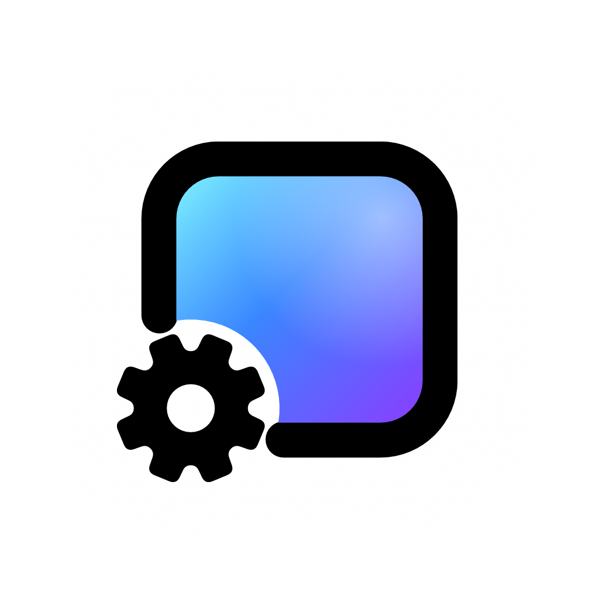

<!-- README.md in 한국어: change both together. Wording follows the app's ko catalog
     (App/Resources/Localizable.xcstrings); the website has no Korean pages, so its links point to the English site.
     The Supporter list between the markers is written by scripts/update_sponsors.py, as in README.md. -->
<p align="center"><sub><a href="README.md">English</a>&ensp;·&ensp;<a href="README.zh-CN.md">简体中文</a>&ensp;·&ensp;<b>한국어</b>&ensp;·&ensp;<a href="README.pt-BR.md">Português</a></sub></p>

<a href="https://www.wallpapermachine.app">
  
</a>

<h3 align="center">Wallpaper Engine 배경화면, 이제 macOS에서.</h3>

<p align="center">
  Wallpaper Engine의 장면, 동영상, 웹 배경화면을 Steam 창작마당에서 받아<br>
  데스크탑에서 재생하는 무료 오픈 소스 Mac 앱입니다. Mac에서 Wallpaper Engine을 쓰고 싶었던 분들을 위해 만들었습니다.
</p>

<p align="center">
  <a href="https://github.com/WallpaperMachine/WallpaperMachine/releases/latest"></a>
  <a href="https://github.com/WallpaperMachine/WallpaperMachine/actions/workflows/version.yml"></a>
  <a href="LICENSE"></a>
  
  <a href="https://github.com/WallpaperMachine/WallpaperMachine/stargazers"></a>
</p>

<p align="center">
  <a href="https://www.wallpapermachine.app/download"></a>
  &ensp;
  <a href="https://www.wallpapermachine.app/#app"></a>
</p>

<p align="center">
  <sub>macOS 15 Sequoia 이상&ensp;·&ensp;Apple 실리콘(M1 이상)&ensp;·&ensp;<a href="https://github.com/WallpaperMachine/WallpaperMachine/releases/latest">릴리스 노트 및 체크섬</a></sub>
</p>

<p align="center">
  <a href="#빠른-시작">빠른 시작</a>&ensp;·&ensp;
  <a href="#앱-소개">앱 소개</a>&ensp;·&ensp;
  <a href="#보안과-투명성">보안과 투명성</a>&ensp;·&ensp;
  <a href="#자주-묻는-질문">자주 묻는 질문</a>&ensp;·&ensp;
  <a href="#오픈-소스와-직접-빌드">직접 빌드하기</a>&ensp;·&ensp;
  <a href="https://www.wallpapermachine.app/guides/">가이드(영문)</a>&ensp;·&ensp;
  <a href="docs/README.md">문서(영문)</a>&ensp;·&ensp;
  <a href="SPONSORS.md">후원하기</a>
</p>

<p align="center">
  
</p>

<p align="center">
  <sub>가운데에 보관함, 오른쪽에 선택한 배경화면의 옵션, 아래쪽에 재생 중인 항목이 있습니다. <b>배경화면 적용</b>을 누르면 데스크탑이 바뀝니다.</sub>
</p>

<p align="center">
  이 프로젝트가 도움이 됐다면 ⭐를 눌러 주세요.
</p>

## 빠른 시작

1. **다운로드**: 최신 버전의 [무료 디스크 이미지](https://www.wallpapermachine.app/download)를 받습니다.
2. **설치**: 디스크 이미지를 열고 WallpaperMachine을 응용 프로그램 폴더로 드래그합니다.
3. **실행**: 1.8.2 이후 버전은 Apple의 공증을 받아 바로 열립니다. 1.8.2 이하 버전은
   공증을 받지 않은 빌드라서 macOS가 첫 실행을 막습니다. 시스템 설정 → 개인정보 보호 및 보안에서
   **그래도 열기**를 클릭하세요(처음 한 번만 필요합니다).

[Homebrew](https://brew.sh)를 쓴다면 명령 하나로 다운로드와 설치를 한 번에 끝낼 수 있습니다.

```bash
brew install --cask wallpapermachine
```

이후 과정은 시작 가이드에서 안내하고, 그다음부터는 앱이 스스로 업데이트합니다.
[설치 가이드](https://www.wallpapermachine.app/guides/install/)(영문)에서 모든 단계를
그림과 함께 볼 수 있습니다.

- **계정 없이 쓸 수 있는 것:** 기본 제공되는 동영상 배경화면 Aurora Drift, pixiv 일러스트,
  내 동영상과 사진, 그리고 창작마당 전체 둘러보기.
- **Wallpaper Engine을 보유한 Steam 계정이 있으면 쓸 수 있는 것:** 창작마당 다운로드와 장면
  배경화면. 장면 배경화면은 내 Wallpaper Engine의 공유 리소스를 사용합니다.

직접 빌드하는 방법은 [오픈 소스와 직접 빌드](#오픈-소스와-직접-빌드)를 참고하세요.

## 앱 소개

앱은 창 하나로 되어 있습니다. 위쪽에 보관함(모든 배경화면, 즐겨찾기, 내 컬렉션), Steam 창작마당, pixiv, 설정 탭이 있고, 아래쪽 막대에 지금 재생 중인 항목이 표시됩니다.
웹사이트의 [브라우저 데모](https://www.wallpapermachine.app/#app)에서 샘플 보관함으로 직접 써 볼 수 있습니다.
창을 닫아도 앱은 메뉴 막대에서 계속 실행되며, 여기서 일시 정지, 재개, 음소거를 하거나
이전·다음·무작위 배경화면으로 전환합니다. 디스플레이가 여러 대라면 각각 따로 조작합니다.
로그인 시 자동 실행하도록 설정하면 창을 열지 않고 메뉴 막대에서 시작합니다.

| 기능 | 설명 |
| --- | --- |
| [**적용**](docs/features/control-panel.md#selection-versus-apply) | 장면, 동영상, [웹](docs/features/web-wallpapers.md) 배경화면: **배경화면 적용**을 눌러야 데스크탑이 바뀝니다. 목록에서 선택하는 것만으로는 적용되지 않습니다. |
| [**미리보기**](docs/features/wallpaper-properties.md#live-preview) | 데스크탑을 바꾸기 전에 설치된 장면, 동영상, 웹 배경화면을 별도 창에서 미리 확인합니다. 현재 옵션이 그대로 적용되고, 재생 컨트롤은 따로 있습니다. 슬라이더, 색상, 스위치를 바꾸면 바로 반영됩니다. |
| [**창작마당**](docs/features/workshop-downloads.md) | 실시간 Steam 창작마당을 로그인 없이 둘러볼 수 있고, [Steam에 로그인하면 컬렉션과 작성자별 배경화면, 내 구독과 즐겨찾기](docs/features/workshop-downloads.md#collections-authors-and-subscriptions)도 표시됩니다. 로그인 상태에서는 앱 안에서 구독하거나 구독 취소하고, 항목의 최신 [댓글](docs/features/workshop-downloads.md#comments)을 읽을 수 있습니다. 다운로드는 Wallpaper Engine을 보유한 Steam 계정으로 앱 안에서 여러 개를 동시에 진행합니다. 구독 중인 배경화면의 [업데이트](docs/features/workshop-downloads.md#updates)는 하루에 한 번 확인하며, 버튼을 눌러 설치합니다. |
| [**pixiv**](docs/features/pixiv.md) | pixiv 일러스트 랭킹과 태그 검색. 작품에서 원하는 페이지를 정지 이미지 배경화면으로 저장합니다. pixiv에 로그인하면 회원 전용 작품과, 계정에서 허용한 경우 R-18 작품도 볼 수 있습니다. |
| [**설정**](docs/features/wallpaper-properties.md#properties) | 제작자가 만든 모든 옵션과 장면·동영상 배경화면용 [Wallpaper Engine 자체의 색상 조정, 이미지 필터, 좌우 반전, 마우스 시차, 재생 속도](docs/features/wallpaper-properties.md#wallpaper-engine-options)를 조절할 수 있고, 변경 사항을 적용하면 저장됩니다. [이름을 붙인 속성 프리셋](docs/features/wallpaper-properties.md#property-presets)으로 여러 버전을 보관하고 내보내거나 가져올 수 있습니다. 설정에서 스위치를 켜면 [편집 내용이 데스크탑에 바로 표시됩니다](docs/features/wallpaper-properties.md#showing-edits-on-the-desktop). |
| [**음악**](docs/features/audio-response.md) | **오디오 반응**을 켜면 이 기능을 지원하는 배경화면이 Mac에서 재생 중인 오디오에 맞춰 움직입니다. [미디어 연동](docs/features/media-integration.md)은 기본적으로 켜져 있어서, 곡 정보를 표시하는 배경화면에 지금 재생 중인 곡이 나타납니다. |
| [**재생목록**](docs/features/playlists.md) | 디스플레이마다 모든 배경화면, 즐겨찾기, 전용 목록 또는 [로컬 컬렉션](docs/features/control-panel.md#local-collections)을 정해진 시간마다 또는 Mac 잠금을 해제할 때마다 바꿔 가며 재생합니다. 컬렉션에서 **재생**이나 **임의 재생**을 눌러 시작할 수도 있습니다. 목록 순서 변경, 이름을 붙인 재생 계획 저장, 낮과 밤 배경화면 전환도 지원합니다. 적용에 실패한 항목은 잠시 건너뜁니다. |
| [**디스플레이**](docs/features/control-panel.md#target-display) | 디스플레이마다 고유한 배경화면을 쓰거나 다른 디스플레이를 미러링하며, 크기 조절, 위치, 프레임률, 음량도 따로 정합니다. [맞춤, 흐린 배경](docs/features/wallpaper-properties.md#fit-with-blurred-backdrop)은 비율이 다른 화면에서도 배경화면 전체를 보여 주고, 남는 가장자리를 검은 여백 대신 흐린 배경화면으로 채웁니다. [배경화면 하나를 모든 디스플레이에 적용하고, 배경화면을 복사하거나 맞바꾸고, 여러 디스플레이 배치를 저장](docs/features/display-layouts.md)할 수 있습니다. 저장한 배치는 설정이나 단축어에서 다시 불러옵니다. |
| [**배터리**](docs/features/performance.md#playback) | 배터리 사용 중에는 계속 실행하거나, 직접 고른 렌더링 배율과 프레임률로 낮추거나, 일시 정지하거나, 다른 앱으로 작업하는 동안에만 일시 정지합니다. 저전력 모드, Mac 고온 상태, 배터리 부족 시에도 일시 정지 대신 같은 방식으로 화질을 낮출 수 있습니다. 직접 선택하기 전까지는 꺼져 있습니다. 나머지 재생 및 화질 설정은 [성능](docs/features/performance.md)에 있습니다. |
| [**에너지**](docs/features/performance.md#energy-use) | 설정 → 성능에서 앱이 쓰는 전력을 보여 주고, 노트북에서는 시간당 배터리 소모량도 보여 줍니다. 여기서 설정을 바꾸면 변경 전후를 비교합니다. 설치된 배경화면은 측정이 끝나면 각각 에너지 등급이 표시됩니다. |
| [**네이티브**](docs/features/appearance.md) | 다른 macOS 앱처럼 라이트, 다크, 강조 색상을 따르며, English, [简体中文, 繁體中文, 日本語, 한국어, Português](docs/features/control-panel.md#language)를 지원합니다. |
| [**가져오기**](docs/features/control-panel.md#downloads-and-import) | 갖고 있는 Wallpaper Engine 폴더나 내 동영상과 사진을 가져옵니다. 보관함이나 Dock 아이콘에 끌어다 놓거나 **가져오기**를 사용하세요. 앱은 파일을 복사하고 원본은 그대로 둡니다. |
| [**설정 보관**](docs/features/backup-restore.md#local-backup-and-restore) | 설정과 앱이 보관한 파일을 내보내고, 원하면 배경화면 보관함 전체도 함께 내보냅니다. 복원은 다음 실행 때 적용되며 되돌릴 수 있고, 적용 전에 충돌을 미리 확인합니다. 로그인 정보와 비밀번호는 이 Mac에만 남습니다. |
| [**외장 드라이브**](docs/features/library-location.md) | 배경화면 보관함과 다운로드를 외장 드라이브나 다른 폴더에 두고, 언제든 이 Mac으로 다시 옮길 수 있습니다. 설정과 Steam 로그인 정보는 이 Mac에 남습니다. |
| [**이미지 배치**](docs/features/wallpaper-properties.md#image-placement) | 가져온 사진과 저장한 pixiv 페이지의 위치와 크기를 디스플레이마다 따로 조정합니다. 원본 이미지는 바뀌지 않습니다. |
| [**자동 일시 정지**](docs/architecture.md#desktop-wallpaper-windows-and-private-api-handling) | 가려진 디스플레이의 배경화면은 멈추고, 잠자기나 잠금 상태에서는 모두 일시 정지합니다. [재생 규칙](docs/features/performance.md#playback)으로 다른 앱이 소리를 낼 때, 다른 앱이나 지정한 앱이 맨 앞에 있을 때, 지정한 앱이 실행 중일 때, 배터리가 부족할 때, 저전력 모드일 때, Mac이 고온 상태일 때, 집중 모드 중에, 한동안 키보드나 마우스, 트랙패드 입력이 없을 때도 일시 정지하거나 음소거할 수 있습니다. 디스플레이가 여러 대라면 지금 쓰는 디스플레이만 재생하도록 할 수도 있습니다. 직접 멈춘 배경화면은 다시 재생할 때까지 멈춰 있습니다. |
| [**자동화**](docs/features/automation.md) | 요일과 시간 예약, 현재 위치의 일출·일몰 시각, 라이트/다크 화면 모드별 선택, [데스크탑마다 다른 배경화면](docs/features/spaces.md), 집중 모드 동안만 쓰는 임시 배경화면이나 재생목록. 단축키, 단축어, Siri, Spotlight, 링크로 재생을 제어하고, 모든 배경화면을 음소거하고, 무작위 배경화면을 고르고, 배경화면, 저장된 재생목록, 속성 프리셋을 적용할 수 있습니다. |
| [**잠금 화면**](docs/features/lock-screen.md) | 장면, 동영상, 웹 및 정지 이미지 배경화면으로 잠금 화면도 움직이게 할 수 있습니다. 실험적 기능이며 기본적으로 꺼져 있습니다. |
| [**화면 보호기**](docs/features/lock-screen.md#use-wallpaper-as-screen-saver) | 각 디스플레이에 적용된 장면, 동영상, 웹 또는 정지 이미지 배경화면을 화면 보호기로 사용합니다. 잠금 화면 애니메이션과는 별개이며, macOS 26 이상에서 사용 가능한 실험적 기능입니다. |

## 보안과 투명성

- **오픈 소스.** 앱, 렌더러, 장면 엔진 모두 이 저장소에 GPL-3.0-only로
  공개되어 있습니다. 비공개 코어도, 유료 기능도 없습니다. 앱은 누구에게나 똑같습니다.
- **빌드 검증.** 모든 릴리스는 태그된 커밋에서
  [GitHub Actions](docs/release.md#build-buildyml)로 빌드하고 테스트한 뒤,
  SHA-256 체크섬, 빌드 출처 증명(build provenance attestation)과 함께 게시합니다.
  다운로드한 파일이 이 저장소의 워크플로에서 나온 것인지 확인할 수 있습니다.
  ```sh
  gh attestation verify WallpaperMachine-*-arm64.dmg --repo WallpaperMachine/WallpaperMachine
  ```
- **개인정보 보호.** 앱은 사용자가 요청한 일에만 인터넷을 사용합니다. 창작마당을 열 때는 Steam,
  pixiv를 열 때는 pixiv, 업데이트를 확인할 때는 GitHub에 연결합니다.
  [성능 데이터 전송](docs/features/telemetry.md)을 켠 경우에만 로딩 시간, 프레임률,
  Mac 모델이 담긴 작은 보고서를 하루에 한 번 보냅니다. 이 보고서에는 이름, 파일,
  계정 정보가 없으며, 끄면 보낸 데이터도 삭제됩니다. 그 밖에는 그날 앱을 실행했다는
  [일일 실행 기록](docs/features/telemetry.md#daily-active-count)만 설치 ID 없이 버전 정보와 함께
  보냅니다. 몇 대의 Mac에서 쓰이는지 알기 위해서입니다.
  로그인 정보와 비밀번호는 Mac에만 남습니다.
- **업데이트 검증.** 내장 업데이터는 SHA-256 해시가 릴리스와 일치하는 디스크 이미지만
  설치합니다. 검증할 수 없는 파일은
  [설치하지 않고 거부합니다](docs/features/updates.md#downloading).
  중국 본토에서 VPN 없이 쓰는 경우처럼 GitHub에 연결할 수 없으면
  [공개 GitHub 다운로드 프록시](docs/features/updates.md#what-a-check-reads)로 같은 파일을
  받으며, 프록시는 설치되는 내용을 바꿀 수 없습니다.
- **유지 관리.** 새 버전이 자주 나오고, 모든 버전은 영어와 简体中文으로
  [변경 내역](CHANGELOG.md)에 정리됩니다.
- **문제 보고.** 배경화면 세부 정보의 **작동하지 않나요? GitHub에 문제 보고**를 누르면
  내용이 미리 채워진 [이슈](https://github.com/WallpaperMachine/WallpaperMachine/issues)가 열리고,
  [진단 정보 보고서](docs/features/diagnostics.md)는 공유하기 전에 홈 폴더,
  Mac 사용자 이름, Steam 계정 이름을 제거합니다.

## Rust 코어 · Metal 그래픽

| 계층 | 역할 |
| --- | --- |
| **Swift 셸** | AppKit 앱입니다. 컨트롤 패널은 네이티브 SwiftUI([`App/Views/ControlPanel`](App/Views/ControlPanel))이고, [웹 배경화면](docs/features/web-wallpapers.md)은 별도의 웹 뷰에서 실행됩니다. |
| **Rust 코어** | 렌더러([`Renderer/`](Renderer))입니다. 디스플레이, 배경화면 창, 동영상 디코딩, 오디오 캡처를 맡으며 uniffi로 Swift와 연결됩니다. |
| **C++ 장면 엔진** | 프로젝트 자체 장면 엔진([`Renderer/Engine`](Renderer/Engine))으로, Rust 코어에 정적으로 링크되어 장면 배경화면을 그립니다. |
| **Metal** | 장면은 Metal에서 네이티브로 렌더링됩니다. 네이티브 렌더러가 그릴 수 없는 장면은 그리지 않고, 마지막 화면을 유지한 채 [설정 → 성능](docs/features/performance.md)에 이유를 표시합니다. 동영상 배경화면은 앱 자체 플레이어(AVFoundation, 그리고 WebM과 Matroska 파일용 WebM 플레이어)로 재생합니다. |
| **잠금 화면** | 샌드박스에서 실행되는 ExtensionKit 확장 프로그램([`Extension/`](Extension))입니다. |

- 각 부분이 어떻게 연결되는지: [docs/architecture.md](docs/architecture.md)(영문)
- 각 파일의 위치: [docs/repository-layout.md](docs/repository-layout.md)(영문)

## 자주 묻는 질문

시작하기 전에 알아 두면 좋은 것들입니다.

<details>
<summary><b>WallpaperMachine이 뭔가요?</b></summary>

WallpaperMachine은 Wallpaper Engine 배경화면을 위한 네이티브 macOS 클라이언트입니다.
장면, 동영상, 웹 배경화면을 데스크탑으로 가져오며, Steam 창작마당을 앱 안에서
둘러보고 다운로드할 수 있습니다.

</details>

<details>
<summary><b>Mac에서 Wallpaper Engine을 쓸 수 있나요?</b></summary>

Wallpaper Engine 자체는 Windows용입니다. WallpaperMachine은 Wallpaper Engine의 장면, 동영상, 웹 배경화면을
재생하기 위해 만든 독립 Mac 앱이며, Steam 창작마당 둘러보기가 내장되어 있습니다.
호환성은 배경화면마다 다릅니다. Wallpaper Engine이나 Valve와는 관련이 없습니다.
자세한 내용은 [Wallpaper Engine on a Mac](https://www.wallpapermachine.app/guides/wallpaper-engine-on-mac/)(영문)을
참고하세요.

</details>

<details>
<summary><b>Wallpaper Engine을 구매해야 하나요?</b></summary>

창작마당은 로그인 없이 둘러볼 수 있습니다. 창작마당 다운로드에는 Wallpaper Engine을
보유한 Steam 계정이 필요하고, 장면 배경화면에는 구매한 Wallpaper Engine 설치본의
공유 리소스가 필요합니다. 기본 제공되는 동영상 배경화면 Aurora Drift는 Steam 계정이나
Wallpaper Engine 없이도 재생됩니다. 자세한 내용은 [창작마당 둘러보기와 다운로드](docs/features/workshop-downloads.md)(영문)를
참고하세요.

</details>

<details>
<summary><b>어떤 Mac을 지원하나요?</b></summary>

macOS 15 Sequoia 이상을 실행하는 Apple 실리콘(M1 이상) Mac입니다.
잠금 화면 애니메이션은 macOS 26 Tahoe 이상이 필요합니다. Intel Mac은 지원하지 않습니다.

</details>

<details>
<summary><b>모든 배경화면이 작동하나요?</b></summary>

WallpaperMachine은 장면, 동영상, 웹 배경화면을 지원하지만, 배경화면마다 호환성이
달라서 모든 창작마당 항목이 Wallpaper Engine에서와 똑같이 보이지는 않습니다.
응용 프로그램 배경화면은 실행되지 않습니다.

이상하게 보이는 배경화면이 있다면 세부 정보에서 **작동하지 않나요? GitHub에 문제 보고**를
누르세요. 배경화면 정보가 미리 채워진
[GitHub 이슈](https://github.com/WallpaperMachine/WallpaperMachine/issues)가 열리니,
내용을 확인하고 제출하면 됩니다. 로그를 첨부하려면 설정 → 저장 공간 → 문제 해결에서
[진단 정보 보고서](docs/features/diagnostics.md)를 내보내세요. 홈 폴더 경로,
Mac 사용자 이름, Steam 계정 이름은 자동으로 가려집니다.

</details>

<details>
<summary><b>어떻게 설치하나요?</b></summary>

[최신 릴리스](https://github.com/WallpaperMachine/WallpaperMachine/releases/latest)에서
서명된 빌드를 무료로 받거나, [Homebrew](https://formulae.brew.sh/cask/wallpapermachine)로
같은 서명된 디스크 이미지를 설치하거나(`brew install --cask wallpapermachine`),
[소스에서 직접 빌드](#오픈-소스와-직접-빌드)하세요.
1.8.2 이후 버전은 Developer ID로 서명되고 Apple의 공증을 받아 바로 열립니다.
1.8.2 이하 버전은 공증을 받지 않은 빌드라서 macOS는 시스템 설정 → 개인정보 보호 및 보안에서
**그래도 열기**를 클릭할 때까지 첫 실행을 막습니다.
[설치 가이드](https://www.wallpapermachine.app/guides/install/)(영문)가 다운로드부터
시작 가이드까지 안내합니다. 그 후로는 앱이 새 버전을 직접 확인합니다. 앱이 응용 프로그램
폴더에 있고 현재 계정에 수정 권한이 있으면, 메뉴에 **재시작하여 업데이트**가 나타납니다.
Homebrew로 설치한 앱도 같은 방식으로 업데이트됩니다.

</details>

<details>
<summary><b>프록시를 사용하나요?</b></summary>

네, macOS 시스템 프록시를 사용합니다. 둘러보기, 미리보기, SteamCMD 다운로드 모두
시스템 설정 → 네트워크 → 세부사항 → 프록시를 따르므로 별도 설정이 없습니다.
규칙 모드로 동작하는 프록시 앱은 접속하려는 주소(호스트 이름)를 보고 프록시를 쓸지
정합니다. 그래서 전역 모드가 아닐 때 Steam 다운로드가 실패한다면 `steamserver.net`,
`steamcontent.com`, `steamcommunity.com`, `steampowered.com`이 프록시를 거치도록
규칙을 추가하세요([자세히](docs/features/workshop-downloads.md#proxies)).

</details>

<details>
<summary><b>WallpaperMachine은 정말 무료인가요?</b></summary>

네. 서명된 빌드는 무료이고, 소스 코드 전체가 공개되어 있어서 직접 빌드해도 됩니다.
돈을 내서 달라지는 기능은 없습니다. 후원하고 싶다면 WallpaperMachine을 만드는 MMFoundation을
[Open Collective](https://opencollective.com/mmfoundation)에서 후원해 주세요.
웹사이트의 [우선 지원](https://www.wallpapermachine.app/pricing/)은 질문에 먼저 답해 드리는 유료 서비스입니다.
라이선스를 사는 것은 아니라서, 구매 여부와 상관없이 앱은 똑같습니다.
두 가지 모두 [SPONSORS.md](SPONSORS.md)(영문)에 설명되어 있습니다.

</details>

<details>
<summary><b>질문이나 기능 제안은 어디에 하나요?</b></summary>

질문은 [Discussions](https://github.com/WallpaperMachine/WallpaperMachine/discussions/categories/q-a)나
MMFoundation의 [Discord](https://mmfoundation.dev/discord)에,
기능 제안은 [기능 요청](https://github.com/WallpaperMachine/WallpaperMachine/issues/new?template=feature_request.yml)에 남겨 주세요.
배경화면이 이상하게 보인다면 세부 정보의 **작동하지 않나요? GitHub에 문제 보고**로 알릴 수 있습니다.
보안 문제는 [SECURITY.md](SECURITY.md)(영문)의 안내에 따라 비공개로 제보해 주세요.

</details>

## 오픈 소스와 직접 빌드

소스 코드 전체가 이 저장소에 있습니다. 빌드하려면 Apple 실리콘 Mac, Xcode 26(macOS 15.6 이상),
`xcode-select`로 선택한 전체 Xcode, [사전 준비](docs/build.md#prerequisites)에 나열된
Homebrew 패키지가 필요합니다. 렌더러와 장면 엔진은 [`Renderer/`](Renderer)에 있고,
서드파티 코드는 서브모듈이 아니라 [`ThirdParty/`](ThirdParty)에 직접 들어 있습니다.

```sh
python3 scripts/build.py --configuration Release   # 렌더러, 바인딩, Xcode 프로젝트, 앱
```

빌드된 앱은 `build/Build/Products/Release/WallpaperMachine.app`에 생성됩니다.

- `python3 scripts/test.py`: 테스트를 실행합니다.
- `python3 scripts/package.py --configuration Release --install`: 필요한 라이브러리를 번들에 포함해 독립 실행형으로 만들고, 디스크 이미지로 묶은 뒤 `~/Applications`에 복사합니다.

장면 배경화면에는 내 Wallpaper Engine의 공유 리소스도 필요합니다.

- 툴체인, 패키징, 문제 해결: [docs/build.md](docs/build.md)(영문)
- 코드 작업: [CONTRIBUTING.md](CONTRIBUTING.md)(영문)
- 앱 번역, 다른 언어 요청: [Crowdin](https://translate.wallpapermachine.app/project/wallpaper-machine). 코드 작성 없이 참여할 수 있습니다([앱에 반영되는 과정](docs/localization.md#contributing-translations)).

## 문서

아래 문서는 모두 영문입니다.

| 문서 | 내용 |
| --- | --- |
| [docs/README.md](docs/README.md) | 기능 문서를 포함한 전체 문서 목록 |
| [docs/architecture.md](docs/architecture.md) | 런타임 구조와 모듈 경계 |
| [docs/repository-layout.md](docs/repository-layout.md) | 디렉터리 구조와 새 코드를 둘 위치 |
| [CONTRIBUTING.md](CONTRIBUTING.md) | 기여 가이드 |
| [CODE_OF_CONDUCT.md](CODE_OF_CONDUCT.md) | 이슈, 토론, 리뷰에서 서로를 대하는 방식 |
| [SECURITY.md](SECURITY.md) | 취약점을 비공개로 제보하는 방법 |
| [docs/testing/README.md](docs/testing/README.md) | 테스트 전략, 명령어, 검증 기록 기준 |
| [docs/release.md](docs/release.md) | 버전 관리, 릴리스 노트, CI 릴리스 파이프라인 |
| [CHANGELOG.md](CHANGELOG.md) | 공개된 각 버전의 변경 내역 |
| [LICENSING.md](LICENSING.md) | 라이선스, 코드 출처, 우선 지원, 구성 요소별 라이선스 |
| [SPONSORS.md](SPONSORS.md) | Open Collective 후원, 우선 지원, 그 밖의 도움 방법 |
| [AGENTS.md](AGENTS.md) | 이 저장소에서 작업하는 AI 에이전트를 위한 규칙 |

## 우선 지원 이용자께 감사드립니다

공개를 선택한 우선 지원 이용자의 이름은 아래와
웹사이트의 [감사의 벽](https://www.wallpapermachine.app/#sponsors)에 올라갑니다.
‘후원자’라는 이름으로 구매한 분들은 약속받은 자리를 그대로 유지합니다.
새 구매자는 감사의 벽에 표시될지 선택할 수 있습니다. 기본값은 꺼짐이며, 구매 내용에는 포함되지 않습니다.
[우선 지원](https://www.wallpapermachine.app/pricing/)은 질문에 먼저 답해 드리는 유료 서비스이고,
앱과 소스는 모두에게 계속 무료입니다. 프로젝트를 후원하는 방법은 [SPONSORS.md](SPONSORS.md)(영문)를 참고하세요.

<!-- supporters:start: written by scripts/update_sponsors.py from the website's thank-you wall; edits here are overwritten -->
<p align="center">
  <a href="https://www.wallpapermachine.app/#sponsors"></a>
</p>
<!-- supporters:end -->

## 라이선스

이 섹션은 번역본입니다. 내용이 다를 경우 영문 [README](README.md#license)와 [LICENSE](LICENSE)가 우선합니다.

소스는 GNU General Public License 버전 3에 따라 제공됩니다(GPL-3.0-only, 이후 버전은 적용되지 않음).
전문은 [LICENSE](LICENSE)에 있습니다. 함께 들어 있는 서드파티 코드는 각자의 저작권과 라이선스
고지를 그대로 유지하며, 그 내용은 [ThirdParty/provenance.json](ThirdParty/provenance.json)에
기록되어 있습니다. 소스를 받는 모든 사람은 우선 지원 구매 여부와 상관없이 GPL이 부여하는 모든 권리를
그대로 가집니다.

[LICENSING.md](LICENSING.md)에는 코드의 출처, 서드파티 구성 요소별 라이선스, 우선 지원,
각 다운로드의 소스 위치가 정리되어 있습니다.

예전에 빌드에 링크하던 Apache-2.0 및 GPL-3.0 구성 요소(MoltenVK, Vulkan loader,
SPIRV-Tools, glslang, 소스에 포함되어 있던 spirv_reflect, spirv Rust crate)는 이전의
GPL-2.0-only 정책에 따라 2026-10-17에 제거되었습니다. 이 구성 요소들은 GPLv3와 호환됩니다.

창작마당 배경화면은 각 제작자의 저작물이고, 장면 리소스는 내 Wallpaper Engine에서
가져옵니다. 앱은 이 둘을 포함하지 않습니다.

## 추천 링크

- [linux.do](https://linux.do) —— 가능성이 시작되는 곳

## 스타 히스토리

<a href="https://www.star-history.com/?repos=wallpapermachine%2Fwallpapermachine&type=date&legend=top-left">
 <picture>
   <source media="(prefers-color-scheme: dark)" srcset="https://api.star-history.com/chart?repos=wallpapermachine/wallpapermachine&type=date&theme=dark&legend=top-left" />
   <source media="(prefers-color-scheme: light)" srcset="https://api.star-history.com/chart?repos=wallpapermachine/wallpapermachine&type=date&legend=top-left" />
   
 </picture>
</a>

<br>

<p align="center">
  
</p>

<p align="center">
  <b>새로운 풍경.</b><br>
  이제 Mac에서.
</p>

<p align="center">
  <sub>
    더 나다운 Mac을 위해.<br>
    <a href="https://mmfoundation.dev/">MMFoundation</a>의 프로젝트입니다. Wallpaper Engine 및 Valve와 관련이 없습니다.<br>
    표시된 배경화면: 夜莺Night의 <a href="https://steamcommunity.com/sharedfiles/filedetails/?id=3632513108">千咲 · 不散的春之花</a>와 <a href="https://steamcommunity.com/sharedfiles/filedetails/?id=3276911872">流萤 · 仲夏萤火之约</a>, 凉粥의 <a href="https://steamcommunity.com/sharedfiles/filedetails/?id=3521337568">Cyberpunk: Edgerunner-Lucy</a>, a bad driver의 <a href="https://steamcommunity.com/sharedfiles/filedetails/?id=3648679058">RedBull F1 2026</a>, BIGDEECK의 <a href="https://steamcommunity.com/sharedfiles/filedetails/?id=3288938880">绝区零 · 艾莲乔</a>, Blloopy의 <a href="https://steamcommunity.com/sharedfiles/filedetails/?id=3626305963">Into The Abyss</a>. 모든 작품의 권리는 각 소유자에게 있습니다.
  </sub>
</p>
