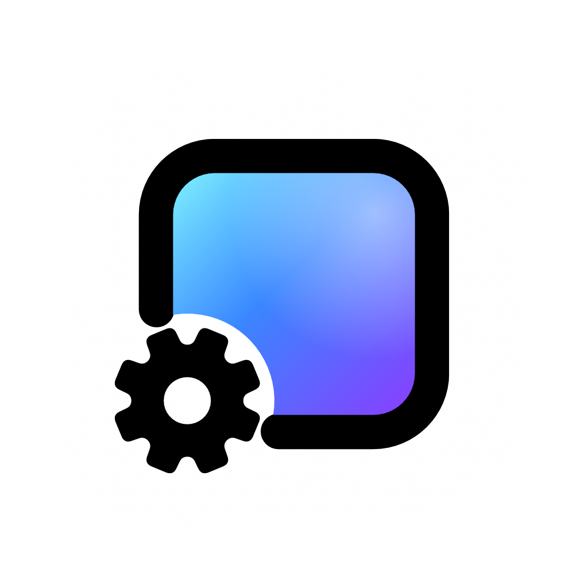

<!-- README.zh-CN.md is this page in 简体中文, README.ko.md in 한국어 and README.pt-BR.md in Português: change them together.
     The hero is six real WallpaperMachine renders on a macOS 27 desktop (menu bar and Dock drawn from
     system assets), uploaded as a GitHub attachment. When it changes, update the alt text below and the
     wallpaper credits at the end. -->
<p align="center"><sub><b>English</b>&ensp;·&ensp;<a href="README.zh-CN.md">简体中文</a>&ensp;·&ensp;<a href="README.ko.md">한국어</a>&ensp;·&ensp;<a href="README.pt-BR.md">Português</a></sub></p>

<a href="https://www.wallpapermachine.app">
  
</a>

<h3 align="center">Wallpaper Engine wallpapers, now on macOS.</h3>

<p align="center">
  A free, open-source Mac app that plays Wallpaper Engine scene, video and web wallpapers<br>
  on your desktop, straight from the Steam Workshop. For anyone who wanted Wallpaper Engine on a Mac.
</p>

<p align="center">
  <a href="https://github.com/WallpaperMachine/WallpaperMachine/releases/latest"></a>
  <a href="https://github.com/WallpaperMachine/WallpaperMachine/actions/workflows/version.yml"></a>
  <a href="LICENSE"></a>
  
  <a href="https://github.com/WallpaperMachine/WallpaperMachine/stargazers"></a>
</p>

<p align="center">
  <a href="https://www.wallpapermachine.app/download"></a>
  &ensp;
  <a href="https://www.wallpapermachine.app/#app"></a>
</p>

<p align="center">
  <sub>macOS 15 Sequoia or later&ensp;·&ensp;Apple silicon (M1 or later)&ensp;·&ensp;<a href="https://github.com/WallpaperMachine/WallpaperMachine/releases/latest">Release notes and checksums</a></sub>
</p>

<p align="center">
  <a href="#quick-start">Quick start</a>&ensp;·&ensp;
  <a href="#the-app">The app</a>&ensp;·&ensp;
  <a href="#why-you-can-trust-it">Why trust it</a>&ensp;·&ensp;
  <a href="#good-to-know">FAQ</a>&ensp;·&ensp;
  <a href="#open-source-free-to-build">Build it</a>&ensp;·&ensp;
  <a href="https://www.wallpapermachine.app/guides/">Guides</a>&ensp;·&ensp;
  <a href="docs/README.md">Documentation</a>&ensp;·&ensp;
  <a href="SPONSORS.md">Sponsor</a>
</p>

<!-- The screenshot is a GitHub attachment, hosted by issue #37 ("README app screenshot"). When it
     changes, upload the new one there and update the alt text and caption below, here, in
     README.zh-CN.md, in README.ko.md and in README.pt-BR.md. -->
<p align="center">
  
</p>

<p align="center">
  <sub>Your library in the middle, the selected wallpaper’s options on the right, what is playing along the bottom. Apply wallpaper and it becomes your desktop.</sub>
</p>

<p align="center">
  If WallpaperMachine earns a place on your desktop, a ⭐ helps other Mac users discover it.
</p>

## Quick start

1. **Download** the [free disk image](https://www.wallpapermachine.app/download) for the latest version.
2. **Install**: open it and drag WallpaperMachine to Applications.
3. **Open it.** Releases after 1.8.2 are notarized by Apple and open right away.
   1.8.2 and older aren't, so macOS holds their first launch: click **Open Anyway**
   in System Settings → Privacy & Security, once.

A first-run guide takes it from there, and the app updates itself from then on.
The [install guide](https://www.wallpapermachine.app/guides/install/) walks through
every step with pictures.

- **Works right away:** the bundled video wallpaper Aurora Drift, pixiv illustrations,
  your own videos and pictures, and browsing the whole Workshop without signing in.
- **With a Steam account that owns Wallpaper Engine:** Workshop downloads, and scene
  wallpapers, which use shared resources from the Wallpaper Engine you own.

Rather build it yourself? It takes two commands: see
[Open source. Free to build.](#open-source-free-to-build)

## The app

One window with tabs across the top: your library (all wallpapers, favorites and your
collections), Steam Workshop and pixiv to browse, and Settings, with what is playing in a bar
along the bottom. The website has a demo of it on a
sample library, so you can
[try it in your browser](https://www.wallpapermachine.app/#app). Close the
window and the app keeps running in the menu bar, where you can pause, resume, mute
or go to the previous, next or a random wallpaper, on each display separately when you have more than one. When it launches at login, it starts there
without opening the window.

| Feature | What it does |
| --- | --- |
| [**Apply**](docs/features/control-panel.md#selection-versus-apply) | Scene, video or [web](docs/features/web-wallpapers.md): Apply wallpaper and it becomes your desktop. Choosing a wallpaper only selects it. |
| [**Preview**](docs/features/wallpaper-properties.md#live-preview) | Try an installed scene, video or web wallpaper in its own window, with the current options and separate playback controls, before changing the desktop. Sliders, colours and switches show in it as you change them. |
| [**Workshop**](docs/features/workshop-downloads.md) | The live Steam Workshop, no sign-in to browse, with [collections and each author's wallpapers, plus your subscriptions and favorites once you sign in to Steam](docs/features/workshop-downloads.md#collections-authors-and-subscriptions); signed in, subscribe or unsubscribe from the app, and read an item's newest [comments](docs/features/workshop-downloads.md#comments). Downloads run in the app, several at once, with a Steam account that owns Wallpaper Engine. [Updates](docs/features/workshop-downloads.md#updates) to the wallpapers you have are found once a day and installed in one click. |
| [**pixiv**](docs/features/pixiv.md) | pixiv's illustration rankings and tag search. Save any page of a work as a still wallpaper; sign in to pixiv for members-only works and, if your account allows them, R-18. |
| [**Settings**](docs/features/wallpaper-properties.md#properties) | Every option its artist made, plus [Wallpaper Engine’s own colour adjustments, image filters, flip, mouse parallax and playback rate](docs/features/wallpaper-properties.md#wallpaper-engine-options) for scenes and videos, saved when you apply your changes; [named property presets](docs/features/wallpaper-properties.md#property-presets) keep several versions and can be exported or imported. An optional switch in Settings [shows your edits on the desktop](docs/features/wallpaper-properties.md#showing-edits-on-the-desktop) as you make them. |
| [**Music**](docs/features/audio-response.md) | Turn on Audio response and wallpapers made for sound move with what your Mac plays. [Media integration](docs/features/media-integration.md) is on by default, so ones with a music display show the song that's on. |
| [**Playlists**](docs/features/playlists.md) | Let each display rotate through all wallpapers, favorites, its own list or a [local collection](docs/features/control-panel.md#local-collections), on a timer or each time the Mac is unlocked; Play or Shuffle on a collection starts one in a click. Reorder a list, save named playback plans, or switch between a day and a night wallpaper. Failed applications are skipped temporarily. |
| [**Displays**](docs/features/control-panel.md#target-display) | Every display gets its own wallpaper, or mirrors another, with its own scaling, position, frame rate and volume. [Fit with blurred backdrop](docs/features/wallpaper-properties.md#fit-with-blurred-backdrop) shows a wallpaper whole on a screen of another shape and fills the edges with a blurred copy instead of black bars. [Apply one wallpaper to every display, copy or swap wallpapers and save multi-display arrangements](docs/features/display-layouts.md) to restore their wallpaper choices from Settings or Shortcuts. |
| [**Battery**](docs/features/performance.md#playback) | On battery, keep running, drop to a render scale and frame rate you choose, pause, or pause only while you work in other apps. Low Power Mode, a hot Mac and a low battery can lower quality the same way instead of pausing. Off until you pick it. The rest of playback and quality is on [Performance](docs/features/performance.md). |
| [**Energy**](docs/features/performance.md#energy-use) | Settings → Performance shows the power the app draws and, on a laptop, its share of a full charge per hour. Change a setting there and it compares before and after. Each installed wallpaper gets its own rating once it has been measured. |
| [**Native**](docs/features/appearance.md) | Light, dark and your accent colour, like the rest of macOS, in English, [简体中文, 繁體中文, 日本語, 한국어 or Português](docs/features/control-panel.md#language). |
| [**Import**](docs/features/control-panel.md#downloads-and-import) | Bring the Wallpaper Engine folders you already have, or your own videos and pictures. Drop them on the Dock icon or use Import; the app copies them and leaves the originals alone. |
| [**Keep your setup**](docs/features/backup-restore.md#local-backup-and-restore) | Export settings and retained files, optionally the whole wallpaper library; preview conflicts before a recoverable restore at the next launch. Sign-ins and passwords stay on this Mac. |
| [**External drive**](docs/features/library-location.md) | Keep the wallpaper library and downloads on an external drive or in another folder, and move them back to this Mac at any time. Settings and Steam sign-ins stay on this Mac. |
| [**Picture placement**](docs/features/wallpaper-properties.md#image-placement) | Drag, position and zoom imported pictures and saved pixiv pages separately for each display, without changing the original image. |
| [**Out of sight, paused**](docs/architecture.md#desktop-wallpaper-windows-and-private-api-handling) | A covered display stops its own wallpaper, and sleep or lock pauses them all. [Playback rules](docs/features/performance.md#playback) can also pause or mute them while another app plays sound, while any other app or one you choose is in front, while an app you choose is running, when the battery is low, in Low Power Mode, when the Mac runs hot, during a Focus, or once nobody has touched the keyboard, mouse or trackpad for a while. With several displays, you can also keep only the one you are using playing. Your own pause stays yours. |
| [**Automation**](docs/features/automation.md) | Weekday and time schedules, local sunrise/sunset calculations, light/dark appearance choices, [a different wallpaper for each desktop](docs/features/spaces.md), and temporary Focus wallpapers or playlists. Keyboard shortcuts, Shortcuts, Siri, Spotlight and links can control playback, mute every wallpaper, pick a random wallpaper, and apply wallpapers, saved playlists or property presets. |
| [**Lock screen**](docs/features/lock-screen.md) | Scene, video, web and still wallpapers can animate the lock screen too. Experimental and off by default. |
| [**Screen saver**](docs/features/lock-screen.md#use-wallpaper-as-screen-saver) | Use each display’s applied scene, video, web or still wallpaper as its screen saver. Independent of lock-screen animation; experimental on macOS 26+. |

## Why you can trust it

- **Open source, all of it.** The app, its renderer and its scene engine are all in
  this repository under GPL-3.0-only. There is no closed core and no paid features: the app
  is the same for everyone.
- **Built in public.** Every release is built and tested by
  [GitHub Actions](docs/release.md#build-buildyml) from a tagged commit, then
  published with a SHA-256 checksum and a build provenance attestation. Check a
  download came from this repository's workflow:
  ```sh
  gh attestation verify WallpaperMachine-*-arm64.dmg --repo WallpaperMachine/WallpaperMachine
  ```
- **No tracking.** The app goes online for what you ask of it: Steam for the
  Workshop, pixiv when you open it, GitHub for update checks, and, only if you turn
  on [Send performance data](docs/features/telemetry.md), one small report a day
  with load times, frame rates and your Mac's model. That report has no names, files
  or account details, and turning it off deletes what was sent. Apart from that,
  the app sends a [daily count](docs/features/telemetry.md#daily-active-count) that
  it ran that day, with its version and no install ID, so we know how many Macs use
  it. Sign-ins and passwords stay on your Mac.
- **Updates it can check.** The built-in updater installs only a disk image whose
  SHA-256 matches the release; one it can't verify is
  [refused, never installed unchecked](docs/features/updates.md#downloading).
  Where GitHub can't be reached, as in mainland China without a VPN, it fetches the
  same files through [public GitHub download proxies](docs/features/updates.md#what-a-check-reads),
  which can't change what installs.
- **Actively maintained.** New versions ship often, and every one is written up
  in the [changelog](CHANGELOG.md), in English and 简体中文.
- **Problems get a real path.** **Not working? Report on GitHub** in any
  wallpaper's details opens a prefilled
  [issue](https://github.com/WallpaperMachine/WallpaperMachine/issues), and
  [diagnostics reports](docs/features/diagnostics.md) remove your home folder,
  Mac user name and Steam account names before you share them.

## Rust core · Metal graphics

| Layer | What it does |
| --- | --- |
| **Swift shell** | The AppKit app. Its control panel is native SwiftUI ([`App/Views/ControlPanel`](App/Views/ControlPanel)), and [web wallpapers](docs/features/web-wallpapers.md) run in web views of their own. |
| **Rust core** | The renderer ([`Renderer/`](Renderer)): displays, wallpaper windows, video decode and audio capture, bridged to Swift with uniffi. |
| **C++ scene engine** | The project's scene engine ([`Renderer/Engine`](Renderer/Engine)), statically linked into the Rust core, draws scene wallpapers. |
| **Metal** | Scenes render natively on Metal, and a scene the native renderer cannot draw is not drawn: it keeps its last picture and says why in [Settings → Performance](docs/features/performance.md). Video wallpapers play with the app's own players (AVFoundation, and a WebM player for WebM and Matroska files). |
| **Lock screen** | A sandboxed ExtensionKit extension ([`Extension/`](Extension)). |

How the pieces talk to each other: [docs/architecture.md](docs/architecture.md).
Where each file lives: [docs/repository-layout.md](docs/repository-layout.md).

## Good to know.

A few things before your change of scenery.

<details>
<summary><b>What is WallpaperMachine?</b></summary>

WallpaperMachine is a native macOS client for Wallpaper Engine wallpapers. It
brings scene, video and web wallpapers to your desktop, with Steam Workshop
browsing and downloads built in.

</details>

<details>
<summary><b>Can I use Wallpaper Engine on a Mac?</b></summary>

Wallpaper Engine itself is made for Windows. WallpaperMachine is an independent
Mac app built to play its scene, video and web wallpapers, with Steam Workshop
browsing built in; compatibility varies by wallpaper. It is not affiliated with
Wallpaper Engine or Valve. More in
[Wallpaper Engine on a Mac](https://www.wallpapermachine.app/guides/wallpaper-engine-on-mac/).

</details>

<details>
<summary><b>Do I need to own Wallpaper Engine?</b></summary>

You can browse the Workshop without signing in. Workshop downloads require a
Steam account that owns Wallpaper Engine, and scene wallpapers need shared
resources from a purchased Wallpaper Engine installation. The bundled video
wallpaper, Aurora Drift, plays without either. More in
[Workshop browsing and downloads](docs/features/workshop-downloads.md).

</details>

<details>
<summary><b>Which Macs is it built for?</b></summary>

Macs with Apple silicon (M1 or later) running macOS 15 Sequoia or later. The
animated lock screen needs macOS 26 Tahoe or later. Intel Macs aren't supported.

</details>

<details>
<summary><b>Will every wallpaper work?</b></summary>

WallpaperMachine supports scene, video and web rendering. Compatibility varies
by wallpaper; support for these formats does not mean every Workshop item will
render identically, and Application wallpapers don't run. If one looks wrong,
**Not working? Report on GitHub** in its details opens a new
[GitHub issue](https://github.com/WallpaperMachine/WallpaperMachine/issues) with
that wallpaper's information filled in, for you to check and send. To attach
logs, export a [diagnostics report](docs/features/diagnostics.md) from
Settings → Storage → Troubleshooting. Home folder paths, your Mac user name and
Steam account names are replaced first.

</details>

<details>
<summary><b>How do I get it?</b></summary>

Download the signed build free from the
[latest release](https://github.com/WallpaperMachine/WallpaperMachine/releases/latest),
or [build it from the source](#open-source-free-to-build). Releases after 1.8.2
are signed with a Developer ID and notarized by Apple, so they open right away;
1.8.2 and older are not notarized, so macOS holds their first launch until you
click Open Anyway in System Settings → Privacy & Security. The
[install guide](https://www.wallpapermachine.app/guides/install/) walks through
it, from the download to the first-run guide. From then on the app checks for
new versions itself and, where it can replace its own copy, offers
**Restart to Update**.

</details>

<details>
<summary><b>Does it use my proxy?</b></summary>

Yes, the macOS system proxy: browsing, previews and SteamCMD downloads all follow
System Settings → Network → Details → Proxies, so there is no separate setting.
A proxy app in rule mode still decides by host name, so if Steam downloads fail
outside global mode, route `steamserver.net`, `steamcontent.com`,
`steamcommunity.com` and `steampowered.com` through the proxy
([details](docs/features/workshop-downloads.md#proxies)).

</details>

<details>
<summary><b>Is WallpaperMachine really free?</b></summary>

Yes. The signed download is free, and the complete source is here if you
would rather build it yourself. Nothing you can pay for changes the app. To give,
sponsor MMFoundation, which makes WallpaperMachine, on
[Open Collective](https://opencollective.com/mmfoundation).
[Priority Support](https://www.wallpapermachine.app/pricing/) is a paid service on
the website that answers your questions first. It buys no license: the app is the
same with or without it. Both are explained in [SPONSORS.md](SPONSORS.md).

</details>

<details>
<summary><b>Where do I ask a question or suggest a feature?</b></summary>

Questions go to [Discussions](https://github.com/WallpaperMachine/WallpaperMachine/discussions/categories/q-a)
or MMFoundation's [Discord](https://mmfoundation.dev/discord), and ideas to a [feature request](https://github.com/WallpaperMachine/WallpaperMachine/issues/new?template=feature_request.yml).
For a wallpaper that looks wrong, use **Not working? Report on GitHub** in its
details. Security problems are reported privately: see [SECURITY.md](SECURITY.md).

</details>

## Open source. Free to build.

The complete source is here. It builds on a Mac with Apple silicon, Xcode 26 (macOS 15.6 or later), a
full Xcode selected with `xcode-select` and the Homebrew packages listed under
[Prerequisites](docs/build.md#prerequisites); the renderer and scene engine are in
[`Renderer/`](Renderer), and third-party code is vendored under
[`ThirdParty/`](ThirdParty), not pulled in as submodules.

```sh
python3 scripts/build.py --configuration Release   # renderer, bindings, Xcode project, app
```

The app lands in `build/Build/Products/Release/WallpaperMachine.app`.
`python3 scripts/test.py` runs the tests, and
`python3 scripts/package.py --configuration Release --install` makes the bundle
self-contained, wraps it in a disk image and copies it to `~/Applications`.
Scene wallpapers also need shared resources from a Wallpaper Engine you own.

Toolchain, packaging and troubleshooting: [docs/build.md](docs/build.md).
Working on the code: [CONTRIBUTING.md](CONTRIBUTING.md).
Translating the app, or asking for another language: [Crowdin](https://translate.wallpapermachine.app/project/wallpaper-machine),
no code needed ([how it reaches the app](docs/localization.md#contributing-translations)).

## Documentation

| Document | Purpose |
| --- | --- |
| [docs/README.md](docs/README.md) | Index of every document, features included |
| [docs/architecture.md](docs/architecture.md) | Runtime structure and module boundaries |
| [docs/repository-layout.md](docs/repository-layout.md) | Directory map and where new code goes |
| [CONTRIBUTING.md](CONTRIBUTING.md) | Contributor working agreement |
| [CODE_OF_CONDUCT.md](CODE_OF_CONDUCT.md) | How we treat each other in issues, discussions and reviews |
| [SECURITY.md](SECURITY.md) | How to report a vulnerability privately |
| [docs/testing/README.md](docs/testing/README.md) | Test strategy, commands, evidence policy |
| [docs/release.md](docs/release.md) | Versioning, release notes and the CI release pipeline |
| [CHANGELOG.md](CHANGELOG.md) | What changed in each published version |
| [LICENSING.md](LICENSING.md) | License, code origin, Priority Support and component licenses |
| [SPONSORS.md](SPONSORS.md) | Sponsoring on Open Collective, Priority Support and other ways to help |
| [AGENTS.md](AGENTS.md) | Rules for agents working in this repository |

## Thank you. To every Priority Support member.

Priority Support members who choose to be shown are listed here and on the
[thank-you wall](https://www.wallpapermachine.app/#sponsors). Those who bought it
under its earlier name, Supporter, keep the place it promised them. New buyers can
choose to appear on the thank-you wall. It's off by default and isn't part of what
they buy.
[Priority Support](https://www.wallpapermachine.app/pricing/) is a paid service
that answers your questions first; the app and its source stay free for everyone.
To sponsor the project, see [SPONSORS.md](SPONSORS.md).

<!-- supporters:start: written by scripts/update_sponsors.py from the website's thank-you wall; edits here are overwritten -->
<p align="center">
  <a href="https://www.wallpapermachine.app/#sponsors"></a>
</p>
<!-- supporters:end -->

## License

The source is offered under the GNU General Public License, version 3 only
([LICENSE](LICENSE)). Vendored third-party code keeps its own copyright and license notices,
recorded in [ThirdParty/provenance.json](ThirdParty/provenance.json). Every recipient
keeps every right the GPL grants, whether or not they buy Priority Support.

[LICENSING.md](LICENSING.md) is the account of where the code comes from, the license of
each third-party component, Priority Support, and where the source of each download is. The
Apache-2.0 and GPL-3.0 components the build used to link (MoltenVK, the Vulkan loader,
SPIRV-Tools, glslang, the vendored spirv_reflect, and the spirv Rust crate) were removed
on 2026-10-17 under the earlier GPL-2.0-only policy and are GPLv3-compatible. Workshop
wallpapers belong to their creators, and scene resources come from a Wallpaper
Engine you own; the app bundles neither.

## Friend Link

- [linux.do](https://linux.do) —— Where possible begins

## Star History

<a href="https://www.star-history.com/?repos=wallpapermachine%2Fwallpapermachine&type=date&legend=top-left">
 <picture>
   <source media="(prefers-color-scheme: dark)" srcset="https://api.star-history.com/chart?repos=wallpapermachine/wallpapermachine&type=date&theme=dark&legend=top-left" />
   <source media="(prefers-color-scheme: light)" srcset="https://api.star-history.com/chart?repos=wallpapermachine/wallpapermachine&type=date&legend=top-left" />
   
 </picture>
</a>

<br>

<p align="center">
  
</p>

<p align="center">
  <b>A new view.</b><br>
  Now on your Mac.
</p>

<p align="center">
  <sub>
    Made for a more personal Mac.<br>
    A project of <a href="https://mmfoundation.dev/">MMFoundation</a>. Not affiliated with Wallpaper Engine or Valve.<br>
    Wallpapers shown: <a href="https://steamcommunity.com/sharedfiles/filedetails/?id=3632513108">千咲 · 不散的春之花</a> and <a href="https://steamcommunity.com/sharedfiles/filedetails/?id=3276911872">流萤 · 仲夏萤火之约</a> by 夜莺Night, <a href="https://steamcommunity.com/sharedfiles/filedetails/?id=3521337568">Cyberpunk: Edgerunner-Lucy</a> by 凉粥, <a href="https://steamcommunity.com/sharedfiles/filedetails/?id=3648679058">RedBull F1 2026</a> by a bad driver, <a href="https://steamcommunity.com/sharedfiles/filedetails/?id=3288938880">绝区零 · 艾莲乔</a> by BIGDEECK and <a href="https://steamcommunity.com/sharedfiles/filedetails/?id=3626305963">Into The Abyss</a> by Blloopy. All artwork rights remain with their owners.
  </sub>
</p>
