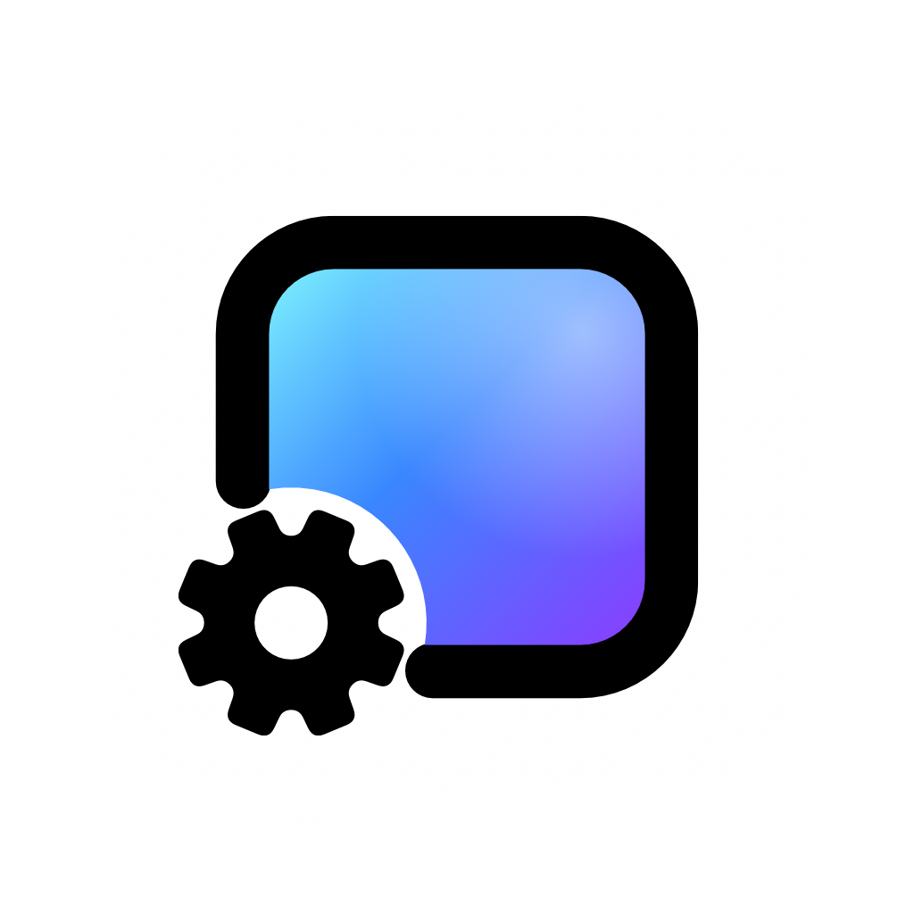

<!-- README.md in Português: change both together. Wording follows the app's pt-BR catalog
     (App/Resources/Localizable.xcstrings); the website has no Portuguese pages, so its links point to the English site.
     The Supporter list between the markers is written by scripts/update_sponsors.py, as in README.md. -->
<p align="center"><sub><a href="README.md">English</a>&ensp;·&ensp;<a href="README.zh-CN.md">简体中文</a>&ensp;·&ensp;<a href="README.ko.md">한국어</a>&ensp;·&ensp;<b>Português</b></sub></p>

<a href="https://www.wallpapermachine.app">
  
</a>

<h3 align="center">Papéis de parede do Wallpaper Engine, agora no macOS.</h3>

<p align="center">
  Um app gratuito e de código aberto para Mac que reproduz papéis de parede de cena, de vídeo e web do Wallpaper Engine<br>
  na sua mesa, direto do Workshop da Steam. Para quem sempre quis o Wallpaper Engine num Mac.
</p>

<p align="center">
  <a href="https://github.com/WallpaperMachine/WallpaperMachine/releases/latest"></a>
  <a href="https://github.com/WallpaperMachine/WallpaperMachine/actions/workflows/version.yml"></a>
  <a href="LICENSE"></a>
  
  <a href="https://github.com/WallpaperMachine/WallpaperMachine/stargazers"></a>
</p>

<p align="center">
  <a href="https://www.wallpapermachine.app/download"></a>
  &ensp;
  <a href="https://www.wallpapermachine.app/#app"></a>
</p>

<p align="center">
  <sub>macOS 15 Sequoia ou posterior&ensp;·&ensp;Apple silicon (M1 ou posterior)&ensp;·&ensp;<a href="https://github.com/WallpaperMachine/WallpaperMachine/releases/latest">Notas da versão e checksums</a></sub>
</p>

<p align="center">
  <a href="#início-rápido">Início rápido</a>&ensp;·&ensp;
  <a href="#o-app">O app</a>&ensp;·&ensp;
  <a href="#por-que-você-pode-confiar">Por que confiar</a>&ensp;·&ensp;
  <a href="#bom-saber">Perguntas frequentes</a>&ensp;·&ensp;
  <a href="#código-aberto-livre-para-compilar">Compile você mesmo</a>&ensp;·&ensp;
  <a href="https://www.wallpapermachine.app/guides/">Guias (em inglês)</a>&ensp;·&ensp;
  <a href="docs/README.md">Documentação (em inglês)</a>&ensp;·&ensp;
  <a href="SPONSORS.md">Patrocine</a>
</p>

<p align="center">
  
</p>

<p align="center">
  <sub>Sua biblioteca no meio, as opções do papel de parede selecionado à direita, o que está tocando embaixo. Clique em Aplicar papel de parede e ele vira a sua mesa.</sub>
</p>

<p align="center">
  Se o WallpaperMachine conquistar um lugar na sua mesa, uma ⭐ ajuda outros usuários de Mac a descobri-lo.
</p>

## Início rápido

1. **Baixe** a [imagem de disco gratuita](https://www.wallpapermachine.app/download) da versão mais recente.
2. **Instale**: abra-a e arraste o WallpaperMachine para Aplicativos.
3. **Abra o app.** As versões posteriores à 1.8.2 são notarizadas pela Apple e abrem direto.
   A 1.8.2 e as anteriores não são, então o macOS bloqueia a primeira abertura: clique em
   **Abrir Mesmo Assim** em Ajustes do Sistema → Privacidade e Segurança, uma única vez.

Usa o [Homebrew](https://brew.sh)? Um só comando faz os dois primeiros passos:

```bash
brew install --cask wallpapermachine
```

A partir daí, um guia de boas-vindas assume, e o app passa a se atualizar sozinho.
O [guia de instalação](https://www.wallpapermachine.app/guides/install/) (em inglês) mostra
cada passo com imagens.

- **Funciona de cara:** o papel de parede de vídeo incluído, Aurora Drift, ilustrações do pixiv,
  seus próprios vídeos e imagens, e navegar por todo o Workshop sem iniciar sessão.
- **Com uma conta Steam que tenha o Wallpaper Engine:** downloads do Workshop e papéis de parede
  de cena, que usam recursos compartilhados do Wallpaper Engine que você comprou.

Prefere compilar você mesmo? São só dois comandos: veja
[Código aberto. Livre para compilar.](#código-aberto-livre-para-compilar)

## O app

Uma janela com abas no topo: sua biblioteca (todos os papéis de parede, favoritos e suas
coleções), o Workshop da Steam e o pixiv para navegar, e os Ajustes, com o que está tocando numa barra
na parte de baixo. O site tem uma demonstração dele com uma
biblioteca de exemplo, para você
[experimentar no navegador](https://www.wallpapermachine.app/#app). Feche a
janela e o app continua rodando na barra de menus, onde você pode pausar, retomar, silenciar
ou ir para o papel de parede anterior, o próximo ou um aleatório, em cada monitor separadamente quando tiver mais de um. Quando ele abre ao iniciar sessão, começa ali
sem abrir a janela.

| Recurso | O que faz |
| --- | --- |
| [**Aplicar**](docs/features/control-panel.md#selection-versus-apply) | Cena, vídeo ou [web](docs/features/web-wallpapers.md): clique em Aplicar papel de parede e ele vira a sua mesa. Escolher um papel de parede apenas o seleciona. |
| [**Pré-visualizar**](docs/features/wallpaper-properties.md#live-preview) | Experimente um papel de parede de cena, de vídeo ou web instalado numa janela própria, com as opções atuais e controles de reprodução separados, antes de mudar a mesa. Controles deslizantes, cores e chaves aparecem nela enquanto você os altera. |
| [**Workshop**](docs/features/workshop-downloads.md) | O Workshop da Steam ao vivo, sem iniciar sessão para navegar, com [coleções e os papéis de parede de cada autor e, depois de iniciar sessão na Steam, suas inscrições e seus favoritos](docs/features/workshop-downloads.md#collections-authors-and-subscriptions); com sessão iniciada, inscreva-se ou cancele a inscrição pelo app e leia os [comentários](docs/features/workshop-downloads.md#comments) mais recentes de um item. Os downloads acontecem no app, vários ao mesmo tempo, com uma conta Steam que tenha o Wallpaper Engine. [Atualizações](docs/features/workshop-downloads.md#updates) dos papéis de parede que você tem são buscadas uma vez por dia e instaladas com um clique. |
| [**pixiv**](docs/features/pixiv.md) | Os rankings de ilustrações e a busca por etiquetas do pixiv. Salve qualquer página de uma obra como papel de parede estático; inicie sessão no pixiv para ver obras exclusivas para membros e, se a sua conta permitir, R-18. |
| [**Opções**](docs/features/wallpaper-properties.md#properties) | Todas as opções que o artista criou, mais [os ajustes de cor, filtros de imagem, espelhamento, paralaxe do mouse e velocidade de reprodução do próprio Wallpaper Engine](docs/features/wallpaper-properties.md#wallpaper-engine-options) para cenas e vídeos, salvas quando você aplica suas alterações; [predefinições de propriedades com nome](docs/features/wallpaper-properties.md#property-presets) guardam várias versões e podem ser exportadas ou importadas. Uma chave opcional nos Ajustes [mostra suas edições na mesa](docs/features/wallpaper-properties.md#showing-edits-on-the-desktop) enquanto você as faz. |
| [**Música**](docs/features/audio-response.md) | Ative Resposta ao áudio e os papéis de parede feitos para som se movem com o que o seu Mac toca. A [Integração de mídia](docs/features/media-integration.md) vem ativada, então os que têm um mostrador de música exibem a canção que está tocando. |
| [**Playlists**](docs/features/playlists.md) | Deixe cada monitor alternar entre todos os papéis de parede, os favoritos, uma lista própria ou uma [coleção local](docs/features/control-panel.md#local-collections), por tempo ou sempre que o Mac for desbloqueado; Reproduzir ou Ordem aleatória numa coleção começa uma com um clique. Reordene uma lista, salve planos de reprodução com nome ou alterne entre um papel de parede de dia e um de noite. Aplicações que falham são puladas temporariamente. |
| [**Monitores**](docs/features/control-panel.md#target-display) | Cada monitor ganha seu próprio papel de parede, ou espelha outro, com escala, posição, taxa de quadros e volume próprios. [Ajustar com fundo desfocado](docs/features/wallpaper-properties.md#fit-with-blurred-backdrop) mostra o papel de parede inteiro numa tela de outro formato e preenche as bordas com uma cópia desfocada em vez de faixas pretas. [Aplique um papel de parede a todos os monitores, copie ou troque papéis de parede e salve arranjos de vários monitores](docs/features/display-layouts.md) para restaurar suas escolhas pelos Ajustes ou pelos Atalhos. |
| [**Bateria**](docs/features/performance.md#playback) | Na bateria, continue rodando, reduza para uma escala de renderização e uma taxa de quadros que você escolher, pause, ou pause só enquanto você trabalha em outros apps. O Modo de Pouca Energia, um Mac quente e a bateria fraca podem reduzir a qualidade da mesma forma em vez de pausar. Desativado até você escolher. O restante da reprodução e da qualidade fica em [Desempenho](docs/features/performance.md). |
| [**Energia**](docs/features/performance.md#energy-use) | Ajustes → Desempenho mostra a energia que o app consome e, num notebook, quanto de uma carga completa ele usa por hora. Mude um ajuste ali e ele compara o antes e o depois. Cada papel de parede instalado ganha sua própria classificação depois de medido. |
| [**Nativo**](docs/features/appearance.md) | Claro, escuro e a sua cor de destaque, como o resto do macOS, em English, [简体中文, 繁體中文, 日本語, 한국어 ou Português](docs/features/control-panel.md#language). |
| [**Importar**](docs/features/control-panel.md#downloads-and-import) | Traga as pastas do Wallpaper Engine que você já tem, ou seus próprios vídeos e imagens. Solte-os na biblioteca ou no ícone do Dock, ou use Importar; o app faz uma cópia e deixa os originais intactos. |
| [**Guarde sua configuração**](docs/features/backup-restore.md#local-backup-and-restore) | Exporte os ajustes e os arquivos mantidos, e opcionalmente toda a biblioteca de papéis de parede; veja os conflitos antes de uma restauração reversível na próxima abertura. Suas sessões e senhas ficam neste Mac. |
| [**Disco externo**](docs/features/library-location.md) | Mantenha a biblioteca de papéis de parede e os downloads num disco externo ou em outra pasta, e traga-os de volta para este Mac quando quiser. Os ajustes e as sessões da Steam ficam neste Mac. |
| [**Posição da imagem**](docs/features/wallpaper-properties.md#image-placement) | Arraste, posicione e amplie imagens importadas e páginas salvas do pixiv separadamente em cada monitor, sem alterar a imagem original. |
| [**Longe dos olhos, em pausa**](docs/architecture.md#desktop-wallpaper-windows-and-private-api-handling) | Um monitor coberto para o próprio papel de parede, e o repouso ou o bloqueio pausam todos. As [regras de reprodução](docs/features/performance.md#playback) também podem pausá-los ou silenciá-los enquanto outro app toca som, enquanto qualquer outro app ou um que você escolher estiver em primeiro plano, enquanto um app que você escolher estiver aberto, quando a bateria estiver fraca, no Modo de Pouca Energia, quando o Mac esquentar, durante um Foco ou depois de um tempo sem uso do teclado, mouse ou trackpad. Com vários monitores, você também pode manter tocando só aquele que está usando. A pausa que você fizer continua sendo sua. |
| [**Automação**](docs/features/automation.md) | Agendamentos por dia da semana e horário, cálculos locais de nascer e pôr do sol, escolhas pela aparência clara ou escura, [um papel de parede diferente para cada mesa](docs/features/spaces.md) e papéis de parede ou playlists temporários para o Foco. Atalhos de teclado, o app Atalhos, a Siri, o Spotlight e links podem controlar a reprodução, silenciar todos os papéis de parede, escolher um papel de parede aleatório e aplicar papéis de parede, playlists salvas ou predefinições de propriedades. |
| [**Tela Bloqueada**](docs/features/lock-screen.md) | Papéis de parede de cena, de vídeo, web e estáticos também podem animar a tela bloqueada. Experimental e desativado por padrão. |
| [**Protetor de Tela**](docs/features/lock-screen.md#use-wallpaper-as-screen-saver) | Use o papel de parede de cena, de vídeo, web ou estático aplicado a cada monitor como o protetor de tela dele. Independente da animação da tela bloqueada; experimental no macOS 26 ou posterior. |

## Por que você pode confiar

- **Código aberto, por inteiro.** O app, o renderizador e o motor de cenas estão todos
  neste repositório sob GPL-3.0-only. Não há núcleo fechado nem recursos pagos: o app
  é o mesmo para todo mundo.
- **Feito às claras.** Cada versão é compilada e testada pelo
  [GitHub Actions](docs/release.md#build-buildyml) a partir de um commit com tag, e então
  publicada com um checksum SHA-256 e um atestado de procedência da compilação (build provenance
  attestation). Confira se um download veio do workflow deste repositório:
  ```sh
  gh attestation verify WallpaperMachine-*-arm64.dmg --repo WallpaperMachine/WallpaperMachine
  ```
- **Sem rastreamento.** O app só se conecta à internet para o que você pede: a Steam para o
  Workshop, o pixiv quando você o abre, o GitHub para verificar atualizações e, apenas se você
  ativar [Enviar dados de desempenho](docs/features/telemetry.md), um pequeno relatório por dia
  com tempos de carregamento, taxas de quadros e o modelo do seu Mac. Esse relatório não tem nomes,
  arquivos nem dados de conta, e desativá-lo apaga o que já foi enviado. Fora isso,
  o app envia uma [contagem diária](docs/features/telemetry.md#daily-active-count) de que
  foi usado naquele dia, com a versão e sem ID de instalação, para sabermos quantos Macs o
  usam. Suas sessões e senhas ficam no seu Mac.
- **Atualizações verificáveis.** O atualizador integrado só instala uma imagem de disco cujo
  SHA-256 corresponde ao da versão; uma que ele não consegue verificar é
  [recusada, nunca instalada sem verificação](docs/features/updates.md#downloading).
  Onde o GitHub não é acessível, como na China continental sem VPN, ele baixa os
  mesmos arquivos por [proxies públicos de download do GitHub](docs/features/updates.md#what-a-check-reads),
  que não podem mudar o que é instalado.
- **Mantido ativamente.** Novas versões saem com frequência, e cada uma é descrita
  no [changelog](CHANGELOG.md), em inglês e 简体中文.
- **Problemas têm um caminho de verdade.** **Não funciona? Relatar no GitHub**, nos detalhes de
  qualquer papel de parede, abre uma
  [issue](https://github.com/WallpaperMachine/WallpaperMachine/issues) já preenchida, e os
  [relatórios de diagnóstico](docs/features/diagnostics.md) removem sua pasta pessoal, seu
  nome de usuário do Mac e os nomes das contas Steam antes de você compartilhá-los.

## Núcleo em Rust · Gráficos Metal

| Camada | O que faz |
| --- | --- |
| **Shell em Swift** | O app AppKit. O painel de controle é SwiftUI nativo ([`App/Views/ControlPanel`](App/Views/ControlPanel)), e os [papéis de parede web](docs/features/web-wallpapers.md) rodam em web views próprias. |
| **Núcleo em Rust** | O renderizador ([`Renderer/`](Renderer)): monitores, janelas de papel de parede, decodificação de vídeo e captura de áudio, ligado ao Swift com uniffi. |
| **Motor de cenas em C++** | O motor de cenas do projeto ([`Renderer/Engine`](Renderer/Engine)), vinculado estaticamente ao núcleo em Rust, desenha os papéis de parede de cena. |
| **Metal** | As cenas são renderizadas nativamente em Metal, e uma cena que o renderizador nativo não consegue desenhar não é desenhada: ela mantém a última imagem e explica o motivo em [Ajustes → Desempenho](docs/features/performance.md). Os papéis de parede de vídeo tocam com os players do próprio app (AVFoundation e um player de WebM para arquivos WebM e Matroska). |
| **Tela Bloqueada** | Uma extensão ExtensionKit em sandbox ([`Extension/`](Extension)). |

Como as partes conversam entre si: [docs/architecture.md](docs/architecture.md).
Onde fica cada arquivo: [docs/repository-layout.md](docs/repository-layout.md).

## Bom saber.

Algumas coisas antes de você mudar de paisagem.

<details>
<summary><b>O que é o WallpaperMachine?</b></summary>

O WallpaperMachine é um cliente nativo do macOS para papéis de parede do Wallpaper Engine. Ele
leva papéis de parede de cena, de vídeo e web para a sua mesa, com navegação e downloads do
Workshop da Steam integrados.

</details>

<details>
<summary><b>Dá para usar o Wallpaper Engine num Mac?</b></summary>

O Wallpaper Engine em si é feito para Windows. O WallpaperMachine é um app independente
para Mac criado para reproduzir os papéis de parede de cena, de vídeo e web dele, com navegação
no Workshop da Steam integrada; a compatibilidade varia de um papel de parede para outro. Ele não
tem vínculo com o Wallpaper Engine nem com a Valve. Saiba mais em
[Wallpaper Engine on a Mac](https://www.wallpapermachine.app/guides/wallpaper-engine-on-mac/) (em inglês).

</details>

<details>
<summary><b>Preciso ter o Wallpaper Engine?</b></summary>

Você pode navegar pelo Workshop sem iniciar sessão. Os downloads do Workshop exigem uma
conta Steam que tenha o Wallpaper Engine, e os papéis de parede de cena precisam de recursos
compartilhados de uma instalação comprada do Wallpaper Engine. O papel de parede de vídeo
incluído, Aurora Drift, funciona sem nenhum dos dois. Saiba mais em
[Workshop browsing and downloads](docs/features/workshop-downloads.md) (em inglês).

</details>

<details>
<summary><b>Para quais Macs ele foi feito?</b></summary>

Macs com Apple silicon (M1 ou posterior) com macOS 15 Sequoia ou posterior. A
tela bloqueada animada precisa do macOS 26 Tahoe ou posterior. Macs com Intel não são compatíveis.

</details>

<details>
<summary><b>Todo papel de parede vai funcionar?</b></summary>

O WallpaperMachine é compatível com renderização de cena, de vídeo e web. A compatibilidade varia
de um papel de parede para outro; ser compatível com esses formatos não significa que todo item do Workshop
vai ser renderizado de forma idêntica, e papéis de parede do tipo Aplicativo não rodam. Se algum parecer errado,
**Não funciona? Relatar no GitHub**, nos detalhes dele, abre uma nova
[issue no GitHub](https://github.com/WallpaperMachine/WallpaperMachine/issues) com
as informações daquele papel de parede preenchidas, para você conferir e enviar. Para anexar
registros, exporte um [relatório de diagnóstico](docs/features/diagnostics.md) em
Ajustes → Armazenamento → Solução de problemas. Os caminhos da pasta pessoal, seu nome de usuário do Mac e
os nomes das contas Steam são substituídos antes.

</details>

<details>
<summary><b>Como eu consigo o app?</b></summary>

Baixe a versão assinada de graça na
[versão mais recente](https://github.com/WallpaperMachine/WallpaperMachine/releases/latest),
instale a mesma imagem de disco assinada com o
[Homebrew](https://formulae.brew.sh/cask/wallpapermachine)
(`brew install --cask wallpapermachine`) ou
[compile a partir do código-fonte](#código-aberto-livre-para-compilar). As versões
posteriores à 1.8.2 são assinadas com um Developer ID e notarizadas pela Apple, então abrem
direto; a 1.8.2 e as anteriores não são notarizadas, então o macOS bloqueia a primeira abertura
até você clicar em Abrir Mesmo Assim em Ajustes do Sistema → Privacidade e Segurança. O
[guia de instalação](https://www.wallpapermachine.app/guides/install/) (em inglês) acompanha
tudo, do download até o guia de boas-vindas. A partir daí o app procura
novas versões sozinho e, quando consegue substituir a própria cópia, oferece
**Reiniciar para Atualizar**. Uma cópia instalada pelo Homebrew se atualiza do mesmo jeito.

</details>

<details>
<summary><b>Ele usa o meu proxy?</b></summary>

Sim, o proxy do sistema macOS: a navegação, as pré-visualizações e os downloads do SteamCMD seguem
Ajustes do Sistema → Rede → Detalhes → Proxies, então não há um ajuste separado.
Um app de proxy em modo de regras ainda decide pelo nome do host; então, se os downloads da Steam falharem
fora do modo global, encaminhe `steamserver.net`, `steamcontent.com`,
`steamcommunity.com` e `steampowered.com` pelo proxy
([detalhes](docs/features/workshop-downloads.md#proxies)).

</details>

<details>
<summary><b>O WallpaperMachine é mesmo gratuito?</b></summary>

Sim. O download assinado é gratuito, e o código-fonte completo está aqui se você
preferir compilar você mesmo. Nada que você pague muda o app. Para contribuir,
patrocine a MMFoundation, que faz o WallpaperMachine, no
[Open Collective](https://opencollective.com/mmfoundation). O
[Suporte Prioritário](https://www.wallpapermachine.app/pricing/) é um serviço pago no
site que responde às suas perguntas primeiro. Não compra nenhuma licença: o app é o
mesmo com ou sem ele. Os dois estão explicados em [SPONSORS.md](SPONSORS.md) (em inglês).

</details>

<details>
<summary><b>Onde faço uma pergunta ou sugiro um recurso?</b></summary>

Perguntas vão para as [Discussions](https://github.com/WallpaperMachine/WallpaperMachine/discussions/categories/q-a)
ou para o [Discord](https://mmfoundation.dev/discord) da MMFoundation, e ideias para um [pedido de recurso](https://github.com/WallpaperMachine/WallpaperMachine/issues/new?template=feature_request.yml).
Para um papel de parede que parece errado, use **Não funciona? Relatar no GitHub** nos
detalhes dele. Problemas de segurança são relatados em particular: veja o [SECURITY.md](SECURITY.md).

</details>

## Código aberto. Livre para compilar.

O código-fonte completo está aqui. Ele compila num Mac com Apple silicon, Xcode 26 (macOS 15.6 ou posterior), um
Xcode completo selecionado com `xcode-select` e os pacotes do Homebrew listados em
[Prerequisites](docs/build.md#prerequisites); o renderizador e o motor de cenas ficam em
[`Renderer/`](Renderer), e o código de terceiros fica incluído em
[`ThirdParty/`](ThirdParty), não puxado como submódulos.

```sh
python3 scripts/build.py --configuration Release   # renderer, bindings, Xcode project, app
```

O app fica em `build/Build/Products/Release/WallpaperMachine.app`.
`python3 scripts/test.py` roda os testes, e
`python3 scripts/package.py --configuration Release --install` torna o pacote
autossuficiente, coloca-o numa imagem de disco e o copia para `~/Applications`.
Os papéis de parede de cena também precisam de recursos compartilhados de um Wallpaper Engine que você tenha.

Ferramentas, empacotamento e solução de problemas: [docs/build.md](docs/build.md).
Para trabalhar no código: [CONTRIBUTING.md](CONTRIBUTING.md).
Para traduzir o app ou pedir outro idioma: [Crowdin](https://translate.wallpapermachine.app/project/wallpaper-machine),
sem precisar de código ([como a tradução chega ao app](docs/localization.md#contributing-translations)).

## Documentação

Os documentos abaixo estão em inglês.

| Documento | Finalidade |
| --- | --- |
| [docs/README.md](docs/README.md) | Índice de todos os documentos, incluindo os recursos |
| [docs/architecture.md](docs/architecture.md) | Estrutura em tempo de execução e limites entre módulos |
| [docs/repository-layout.md](docs/repository-layout.md) | Mapa de diretórios e onde entra o código novo |
| [CONTRIBUTING.md](CONTRIBUTING.md) | Acordo de trabalho para quem contribui |
| [CODE_OF_CONDUCT.md](CODE_OF_CONDUCT.md) | Como nos tratamos em issues, discussões e revisões |
| [SECURITY.md](SECURITY.md) | Como relatar uma vulnerabilidade em particular |
| [docs/testing/README.md](docs/testing/README.md) | Estratégia de testes, comandos e política de evidências |
| [docs/release.md](docs/release.md) | Versionamento, notas da versão e o pipeline de lançamento no CI |
| [CHANGELOG.md](CHANGELOG.md) | O que mudou em cada versão publicada |
| [LICENSING.md](LICENSING.md) | Licença, origem do código, Suporte Prioritário e licenças dos componentes |
| [SPONSORS.md](SPONSORS.md) | Patrocínio no Open Collective, Suporte Prioritário e outras formas de ajudar |
| [AGENTS.md](AGENTS.md) | Regras para agentes que trabalham neste repositório |

## Obrigado. A cada membro do Suporte Prioritário.

Os membros do Suporte Prioritário que escolhem aparecer estão listados aqui e no
[mural de agradecimentos](https://www.wallpapermachine.app/#sponsors). Quem comprou como
Apoiador mantém o lugar que lhe foi prometido. Novos compradores podem escolher aparecer no
mural de agradecimentos; isso vem desativado por padrão e não faz parte do que compram. O
[Suporte Prioritário](https://www.wallpapermachine.app/pricing/) é um serviço pago que
responde às suas perguntas primeiro; o app e o seu código-fonte continuam gratuitos para
todo mundo. Para patrocinar o projeto, veja [SPONSORS.md](SPONSORS.md) (em inglês).

<!-- supporters:start: written by scripts/update_sponsors.py from the website's thank-you wall; edits here are overwritten -->
<p align="center">
  <a href="https://www.wallpapermachine.app/#sponsors"></a>
</p>
<!-- supporters:end -->

## Licença

Esta seção é uma tradução; em caso de divergência, prevalecem o [README](README.md#license) em inglês e a [LICENSE](LICENSE).

O código-fonte é oferecido sob a GNU General Public License, somente a versão 3
([LICENSE](LICENSE)). O código de terceiros incluído mantém seus próprios avisos de direitos autorais e de licença,
registrados em [ThirdParty/provenance.json](ThirdParty/provenance.json). Todo destinatário
mantém todos os direitos que a GPL concede, tendo ou não comprado o Suporte Prioritário.

O [LICENSING.md](LICENSING.md) descreve de onde vem o código, a licença de
cada componente de terceiros, o Suporte Prioritário e onde está o código-fonte de cada download. Os
componentes Apache-2.0 e GPL-3.0 aos quais a compilação era vinculada (MoltenVK, o Vulkan loader,
SPIRV-Tools, glslang, o spirv_reflect incluído e o crate Rust spirv) foram removidos
em 2026-10-17 sob a política anterior GPL-2.0-only e são compatíveis com a GPLv3. Os papéis de parede
do Workshop pertencem aos seus criadores, e os recursos de cena vêm de um Wallpaper
Engine que você tenha; o app não inclui nenhum dos dois.

## Link amigo

- [linux.do](https://linux.do) —— Onde o possível começa

## Histórico de estrelas

<a href="https://www.star-history.com/?repos=wallpapermachine%2Fwallpapermachine&type=date&legend=top-left">
 <picture>
   <source media="(prefers-color-scheme: dark)" srcset="https://api.star-history.com/chart?repos=wallpapermachine/wallpapermachine&type=date&theme=dark&legend=top-left" />
   <source media="(prefers-color-scheme: light)" srcset="https://api.star-history.com/chart?repos=wallpapermachine/wallpapermachine&type=date&legend=top-left" />
   
 </picture>
</a>

<br>

<p align="center">
  
</p>

<p align="center">
  <b>Uma nova paisagem.</b><br>
  Agora no seu Mac.
</p>

<p align="center">
  <sub>
    Feito para um Mac mais a sua cara.<br>
    Um projeto da <a href="https://mmfoundation.dev/">MMFoundation</a>. Sem vínculo com o Wallpaper Engine nem com a Valve.<br>
    Papéis de parede exibidos: <a href="https://steamcommunity.com/sharedfiles/filedetails/?id=3632513108">千咲 · 不散的春之花</a> e <a href="https://steamcommunity.com/sharedfiles/filedetails/?id=3276911872">流萤 · 仲夏萤火之约</a>, de 夜莺Night, <a href="https://steamcommunity.com/sharedfiles/filedetails/?id=3521337568">Cyberpunk: Edgerunner-Lucy</a>, de 凉粥, <a href="https://steamcommunity.com/sharedfiles/filedetails/?id=3648679058">RedBull F1 2026</a>, de a bad driver, <a href="https://steamcommunity.com/sharedfiles/filedetails/?id=3288938880">绝区零 · 艾莲乔</a>, de BIGDEECK, e <a href="https://steamcommunity.com/sharedfiles/filedetails/?id=3626305963">Into The Abyss</a>, de Blloopy. Todos os direitos das obras pertencem aos seus donos.
  </sub>
</p>
