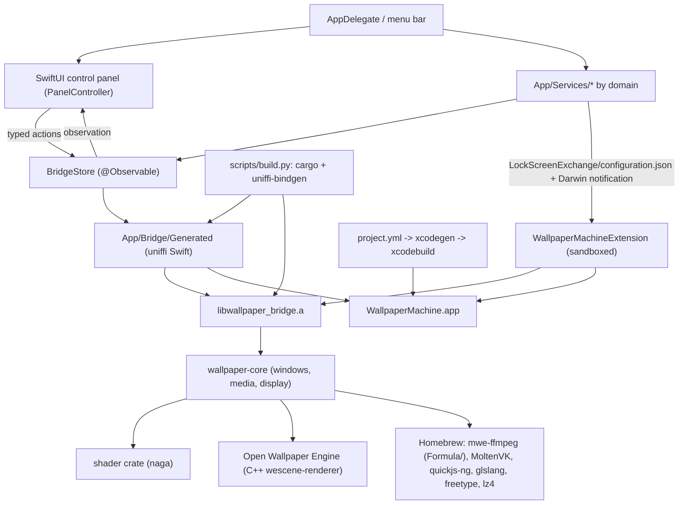

# Architecture

WallpaperMachine is a native macOS wallpaper client built on a vendored Rust/C++ renderer.
One application bundle embeds one ExtensionKit extension (lock screen and screen saver) and an
unlinked MediaRemote helper framework, and links a Rust static library that in turn statically
links a C++ scene renderer.

This document covers module boundaries and the runtime contracts between them. Product
behavior is documented per feature under [features/](README.md#product-features); the directory
map and placement rules are in [repository-layout.md](repository-layout.md).

## Component map

## Layers

### AppKit shell

`App/WallpaperEngineApp.swift` is the `@main` entry point and plain AppKit: there is no SwiftUI
`App` scene. Before AppKit starts it handles the internal `--wallpaper-import-picker` mode
(`WallpaperImportPickerHelper`, see [localization.md](localization.md#which-language-the-app-shows))
and applies a pending backup restore (`WallpaperBackupService.applyPendingRestore`); then it
installs `AppDelegate` and runs the loop.

`App/AppDelegate.swift` owns process lifecycle. It configures the Vulkan ICD
(`App/Bridge/BridgeEnvironment.swift` points `VK_ICD_FILENAMES` at the bundled
`MoltenVK_icd.json` when the variable is unset), prepares the app-support tree
(`ClientPaths.prepare()`), constructs `BridgeStore`, installs the status item, the application
menu and the screen-parameters observer, opens the control-panel window, and starts the
long-lived services (lock screen, desktop poster sync, presentation policy, playlist and
automation schedulers, the web and native-video wallpaper hosts, system media).

- **Activation policy.** `.regular` while one of the four ordinary windows (control panel,
  What's New, wallpaper preview, web sign-in) is on screen or minimized to the Dock,
  `.accessory` otherwise. Opening one raises the policy; every place that lowers it (a window
  closing, the status-item re-assert at launch, a quit) asks `ActivationPolicyRule`
  (`App/Services/Lifecycle/`) about `NSApp.windows`. Alerts, open and save panels and wallpaper
  windows never count, sign-in windows are matched through `WebSignInWindowController`'s own
  list, and the panel and What's New a quit puts away stop counting even when minimized.
- **Spaces and minimizing.** The four ordinary windows (control panel, What's New, wallpaper
  preview, web sign-in) call `ControlPanelWindow.moveToActiveSpace`, which inserts
  `.moveToActiveSpace` into their collection behavior, so opening one shows it on the Space the
  person is on instead of switching back to the Space it was left on. It inserts and removes
  flags and never assigns them, so full-screen capability and cycle flags survive, and it drops
  `.canJoinAllSpaces`, which AppKit rejects beside it. Wallpaper, overlay and probe windows keep
  their all-Spaces behavior. `ControlPanelWindow.bringForward` restores a minimized panel
  before fronting it; `showControlPanel` (menu bar, Dock click, Command-comma) and
  `applicationDidBecomeActive` use it.
- **Menus.** The status item (`rebuildMenu`) offers Control Panel, playback and
  wallpaper-navigation actions, **Lock Screen** and Exit. `StatusMenuModel`
  (`App/Services/Automation/`) decides the layout without AppKit: one display that can show
  its own wallpaper keeps the flat Previous / Next / Recently used, and two or more get a
  submenu each (main display first, then left to right) holding that display's own commands
  (Previous, Next, **Random Wallpaper**, Recently used),
  **Remove from Display** or **Start Again**, and **Open in Control Panel**. While Workshop
  downloads run, one line under Control Panel counts them and gives their combined progress
  (`StatusMenuModel.DownloadActivity`, read from `WorkshopDownloadManager.inProgressTransfers` when
  the menu opens, so it needs no timer); choosing it opens Discover. **Mute Wallpapers**
  is one ticked item after Play/Pause in both layouts: it flips `PlaybackPreferences.wallpapersMuted`
  (`AutomationCommand.toggleMute`) and takes no queue turn, since the presentation policy
  hears the preference change and delivers it. Random Wallpaper
  is `AutomationCommand.random`, like a link, a Shortcuts action or a shortcut key: it takes the
  display's turn in `BridgeStore.commands` and picks from the library and favorites then
  (`BridgeStore.activateRandomWallpaperAsync`), with its round kept by `PlaylistStore`. `AppDelegate`
  gathers its input (`statusMenuInput`), renders the entries and runs the chosen command
  through `AppAutomation`, so a menu choice shares the display's queue slot with the panel
  and a failure shows at the foot of the menu. Lock Screen calls the private
  `SACLockScreenImmediate` in login.framework, resolved with `dlsym` and left out when missing
  (`App/Services/Desktop/ScreenLock.swift`). The application menu holds the app menu
  (Settings…, Check for Updates…, Quit), **File → Close** (Command-W sends `performClose` to the
  key window) and **Edit**. What the navigation actions do is owned by
  [playlists](features/playlists.md) and [automation](features/automation.md).
- **Closing the panel.** `windowWillClose` drops the window's hosting controller, which releases
  the SwiftUI root and its `PanelController`; reopening builds a fresh view around the existing
  stores and navigation, which also keeps Installed's filters and the grids' scroll offsets in
  memory ([control panel](features/control-panel.md#reopening-the-panel)).
- **Shutdown.** `applicationShouldTerminate` returns `.terminateLater` and hands an ordered
  asynchronous teardown to `QuitSupervisor`: lock-screen and desktop-poster restoration first,
  then the services, import, update, SteamCMD, Workshop and pixiv work, and the renderer bridge
  last. Every stage has a deadline. Restoration gets 20 seconds, and a failure or a stall
  cancels the quit: the panel comes back, an alert says why, a pending update install is
  called off and the menu shows the error. The other stages share 10 seconds; one that
  outlives its time is named, left behind and the rest still run, and the bridge keeps at
  least 2 seconds whatever is left. Once the app has replied it arms an exit fuse (5 seconds,
  1 second if a stage was left behind) that ends the process if a slow exit has hung. A quit
  the system asked for (`QuitMode.powerOff`: logout, restart, shutdown) uses shorter limits
  (3 s, 1.5 s with a 1 s floor for the bridge, a 2 s fuse) and never cancels: whatever
  restoration does not finish stays in the originals journal for the next launch
  ([logout, restart and shutdown](features/desktop-picture.md#logout-restart-and-shutdown)). The
  bridge's `Shutdown` also ends the load journal's in-flight record, so quitting during a
  load is not counted as a crash ([crash recovery](features/crash-recovery.md)). Each quit logs
  who asked for it (`QuitReason`: the user, an update, logout, restart, shutdown, a signal) and
  how long each stage took (`QuitTimings`)
  ([diagnostics](features/diagnostics.md#why-the-app-quit)); the deadlines and the visible
  failure are in [desktop picture](features/desktop-picture.md#quitting). SIGTERM and SIGHUP
  reach the same path through `TerminationSignalRelay`, started at the end of launching: its
  C handler only writes to a pipe, a second signal or a deadline ends the app by the
  signal's default action ([signals](features/crash-recovery.md#signals)).
- **Broken pipes.** The first statement of `WallpaperEngineApp.main`, ahead of the import
  picker's helper mode, is `ProcessSignals.ignoreBrokenPipes()`. A write to a pipe or socket
  whose reader is gone then fails with `EPIPE`, which the throwing writes already handle,
  instead of raising SIGPIPE and ending the process unlogged. The handler is a caught no-op,
  not `SIG_IGN`, so children started with `posix_spawn` get the default action back
  ([broken pipes](features/crash-recovery.md#broken-pipes)).
- **One copy per library.** `SingleInstance.claim()` runs in `WallpaperEngineApp.main` before the
  backup restore and the session record. It takes an exclusive `flock` on the support folder's
  `.instance.lock`; a second copy of the same bundle reopens the running one and exits, a copy
  from another location shows an alert and exits, a copy that finds the first one quitting waits
  for it, and a lock that cannot be trusted never keeps the app from starting.
  `applicationShouldTerminate` records `quitting` in the lock and `cancelQuit` puts `running`
  back ([single instance](features/crash-recovery.md#single-instance)).
- **Hosted tests.** Under a hosted test run (`NSClassFromString("XCTestCase") != nil`) the
  delegate short-circuits: no services are created against the user's real app-support folder.

An explicitly opened preview window (`WallpaperPreviewWindowController`) is a regular window.
`App/Services/Preview/` gives it one isolated surface through `WallpaperPreviewSession`: a
separate WebKit page or a private Compatibility renderer attached to an ordinary `CAMetalLayer`
view (`App/Bridge/WallpaperPreviewBridge.h` imports the scene C API), never an engine display
assignment. The bridge's read-only preview export supplies the draft inputs, and preview
shutdown precedes renderer shutdown. Playback limits are in
[live preview](features/wallpaper-properties.md#live-preview).

### Control panel: SwiftUI

The control panel is native SwiftUI in `App/Views/ControlPanel/`, hosted in one AppKit window.
It has no web view, and renderer content is never drawn into it. Coding rules for the panel
(typed actions, string literals, symbols, accessibility, cost) are in
[conventions.md](conventions.md#swiftui-control-panel); what it looks like and does is in
[features/control-panel.md](features/control-panel.md).

| Piece | Responsibility |
|---|---|
| `ControlPanelView.swift` | The root `AppDelegate` builds (six store arguments; `defaults` and `appLanguage` are test seams). Creates the window's `PanelController` in `@State`, starts it on appear and stops it on disappear, reports its window to `PanelPresentation`, and sets the image pipeline in the environment. Also declares `ControlPanelNavigation` (selection, target display, Settings section and reveal token, the last `PanelViewState`), shared with native menu commands, the status item and links |
| `ControlPanelWindow.swift` | Builds the window, owns its 760×560 size floor, `moveToActiveSpace` and `bringForward` |
| `PanelViewState.swift` | Installed's filters and the grids' scroll offsets as a `Codable` value, kept in memory on `ControlPanelNavigation` for the next window; `normalized()` applies the limits |
| `Model/` | `PanelController` and its `PanelController+<Group>.swift` extensions (typed actions and derived state), `PanelPresentation`, `PanelStoreRevisions`, `PanelErrorState`, `PanelActionCoordinator`, `PanelDialogs`, `PanelPreferences`, `ExternalLink`, `TransferFormat`, `DisplayOptionsLoader`, `DragStepPump`, and the typed values views read (`LibraryRow`, `UpdatePresentation`, `TileDownloadState`, ...) |
| `Shell/` | `PanelRootView` (theme, language, the page over the Now Playing bar, the guide overlay), `PanelTabs`, `PanelDetail` (page router, banners, the full-width host of the page, its Filters sidebar and its `InspectorColumn`, title, toolbar), `FilterSidebar`, the Now Playing bar, and `ShellModel` (navigation, inspector state, popovers, Escape, Command-F) |
| `Library/`, `Inspector/`, `Discover/`, `Downloads/`, `Pixiv/`, `Settings/`, `Welcome/` | One area each: its views and its `@Observable` view model, which hangs off the controller as a lazy property (`library`, `inspector`, `workshopBrowser`, `downloads`, `pixivBrowser`, `settings`, `displaysSettings`, `welcome`, `supportPrompt`, and `shell`) |
| `Components/`, `Theme/`, `Localization/`, `Images/` | Shared views (`TileGrid`, `WallpaperTile`, `ProgressRing`, `Equalizer`, `FilterPanel`, `InspectorCard`, `PanelEmptyState`, `SymbolTile`, the button styles), the palettes, `PanelLocale` and `L()`, the image pipeline |
| `WebSignInWindow.swift` | Separate sign-in window for pixiv and Steam: a private website data store, of which the app reads only the session cookie |
| `WallpaperPreviewWindow.swift`, `WhatsNewViewController.swift` | AppKit preview window and release-notes window |

- **Window hosting.** `AppDelegate.showControlPanel` wraps `ControlPanelView` (or
  `BridgeUnavailableView` when the bridge failed to start) in an `NSHostingController` with
  `sizingOptions = []`, so AppKit owns the window's bounds and no label or ideal column width
  becomes a window minimum, and `sceneBridgingOptions = [.toolbars, .title]`, so the root's
  `.toolbar`, `.navigationTitle` and `.navigationSubtitle` become the window's toolbar, title
  and subtitle. `ControlPanelWindow.make` sets the style mask (with `.fullSizeContentView`: the
  page scrolls under the title bar's tabs), `isReleasedWhenClosed =
  false`, a 1240×800 first size and the active-Space behavior; it adds no toolbar or backdrop of
  its own. The hosting controller resets `contentMinSize` once it attaches, so
  `windowWillResize` clamps every resize with `ControlPanelWindow.clampedFrameSize`. The app has
  no SwiftUI `Scene`.
- **Controller and lifetime.** `PanelController` (`@MainActor @Observable`) is created once per
  window. It holds the stores (each injectable, the app's own by default) and what the panel
  owns itself: favorites and the first-run flags (`PanelPreferences`), the error banner, the
  per-display options, measured property files, letterbox and image-placement staging. Nothing
  runs until `start()`, which subscribes the store revisions, points the Workshop's and pixiv's
  prefetch hooks at the image caches, looks for SteamCMD once and starts the error and
  visibility observations. `stop()` runs when the window closes (`PanelPresentation.onClose`) or
  the root disappears: it cancels the import picker, energy sampling, the login-item read, the
  per-display fetch and the letterbox probes, and unsubscribes. Imports, downloads, SteamCMD
  setup and queued commands belong to app-owned stores and keep running. `windowWillClose`
  then drops the content view controller, releasing the root and the controller.
- **Observation.** Views read typed computed properties of the controller and its area models,
  and SwiftUI tracks the `@Observable` stores behind them. The stores that are not observable
  (`PlaybackPreferences`, `HotKeyPreferences`, `PlaylistStore`, collections, presets, image
  placement, automation, display layouts, Spaces, Focus, power and thermal state, energy,
  library metrics and cover stamps, theme, language, navigation) bump a counter in
  `PanelStoreRevisions` when they post, call back or publish. A getter that reads one of those
  stores reads its counter first; without that read its view silently stops updating. The
  Installed rows, the one derivation that grows with the library, are cached by their inputs
  (`LibraryRowsCache`), so a selection, a playback change or a download tick does not rebuild
  them.
- **Window state.** `PanelPresentation` follows the window's notifications: `isVisible` (on
  screen, not miniaturized, not occluded) and `isKey`. A hidden panel does no model work: the
  energy readout samples ([features/performance.md](features/performance.md#energy-use)) and
  `DisplayOptionsLoader` fetches other displays' options only while the window is visible on
  Settings, the support prompt waits, and the root publishes `\.panelIsVisible` so a spinner,
  an equalizer or an animated preview stops. Becoming key re-reads the Workshop's scene
  resources, a pending Login Items approval and the system readings that post no change.
- **Actions.** Every panel action is an `async throws` method in
  `Model/PanelController+<Group>.swift`. Inside, `run(_:slot:subject:...)` gives it its
  disposition: whether it clears the banner first and whether it waits its turn in
  `BridgeStore.commands`, in a latest-wins slot when it names one. Views start an action with
  `controller.launch(key, policy:) { try await controller.action(...) }`.
  `PanelActionCoordinator` tracks the key so a control can disable itself (`isBusy`):
  `.dropDuplicates` ignores a repeat while one is pending, and `.latestWins` makes the repeat wait
  for the pending one and then run, so the newest value lands last (navigation, the target
  display, properties, wallpaper and display settings, the Workshop and pixiv searches). A thrown
  error goes to the banner; a cancellation is ignored. Confirmations and file panels go through
  `PanelDialogs` (an `NSAlert` sheet, `NSOpenPanel` or `NSSavePanel` on the panel window); with no
  window they answer no, so a gated action does nothing. Live drags of a property or a position
  go through `DragStepPump`: at most one step every 100 ms, never queued and never shown as an
  error, and the release waits for the step in flight before it commits. Setters still clamp or
  refuse out-of-range values (`InvalidControlValue`), because automation and shortcuts reach the
  same stores.
- **Error banner.** `PanelErrorState.message` is the first of the last action's error, a failed
  import, the library failure and the newest bridge error; a Workshop download failure shows when
  none of those does. **Dismiss** hides exactly the message on show; it can appear again once its
  source has cleared and failed anew. The controller reconciles it after each successful action and whenever a source
  changes. The banners sit in the detail column's top inset, with the rows of wallpapers held
  back after a crash ([crash recovery](features/crash-recovery.md#what-the-user-sees)).
- **Images.** Views ask for a `PanelImageSource` (an installed wallpaper's cover or preview file,
  a Steam or pixiv thumbnail, a property label's image), never a free path or URL, and the source
  is checked again when it loads: a file outside the library or over 32 MiB, a URL that is not
  https, a pixiv host other than `i.pximg.net` or a property image off the host list is refused.
  `PanelImagePipeline` reads through the app's caches (`WorkshopThumbnailCache` for Steam, pixiv
  and installed covers, `PropertyImageCache`), decodes with ImageIO off the main thread at the
  size the view draws, and keeps decoded stills in a 128 MiB memory cache. `PanelImage` loads in
  a task tied to the view and never shows the previous source's picture. `AnimatedPreview` plays
  GIF, APNG and animated WebP one frame at a time at the drawn size, decoding the next frame off
  the main thread while the current one shows, only while asked and while
  its window is visible, and shows the first frame under Reduce Motion; nothing reads pixels back.
- **Language and theme.** `ControlPanelView` binds `PanelLocale.shared` to the controller's
  `AppLanguageStore`. The root's `.panelTheme(theme:locale:)` puts the panel's language in
  `\.locale`, so `Text`, `Button`, `Label` and the other views that localize their own literals
  re-render the moment it changes; `L()` gives the same language to APIs that take a `String`
  ([localization.md](localization.md#the-panels-live-language)). The same modifier derives
  `PanelTheme` from `AppThemeStore` and the resolved light or dark appearance: `AccentPalette`
  (the accent, fitted for contrast, also set as the tint) and `SurfacePalette` (the tone's
  backgrounds). `AppDelegate` alone sets `NSApp.appearance`; the panel only reads the result
  ([features/appearance.md](features/appearance.md)).
- **Reaching the desktop.** Opening an address, revealing files in Finder, opening System
  Settings → Login Items and hiding the app go through `DesktopActions.current`
  (`App/Services/Lifecycle/DesktopActions.swift`). Every link goes through `ExternalLink`, whose
  allowlist takes https only, an exact host from its list, no credentials and no port; a link
  built from remote data (an author's label, a profile, a work) is checked the same way.

### Observable state

`App/ViewModels/BridgeStore.swift` is the `@MainActor @Observable` facade over the renderer. It
holds the `WallpaperBridge` handle and the cached snapshot values (`appSnapshot`,
`librarySnapshot`, `wallpaperOptionsSnapshot`, `monitorInformationSnapshot`, `settingsSnapshot`,
`snapshotRevision`, `libraryLoadState`), exposes async mutation calls, and publishes
`onSnapshotApplied` so `AppDelegate` can re-evaluate presentation policy and lock-screen state.
`BridgeStoreDisplayLayouts.swift` extends it with multi-display transfers.

User commands from the panel and the menu bar run one at a time through `BridgeStore.commands`
(`App/ViewModels/UserCommandQueue.swift`). A command given while another runs waits its turn
instead of failing; commands sharing a slot (selecting a wallpaper, switching one display's
wallpaper) keep only the newest waiting request, so rapid clicks apply the last choice. Favorite
and Show in Finder skip the queue, and delete confirmations are asked before queueing. Callers
outside the queue (downloads, imports) that reach an activation-guarded store wait for the
running apply rather than throw. Busy is a state the panel shows, never an error.

`App/ViewModels/WallpaperEditorState.swift` holds transient editor drafts (scaling text,
property text, expanded sections) that must not reach the renderer on every keystroke.
`App/Logging/AppLog.swift` writes Swift log lines straight into the bridge's log from any
thread and holds those logged before the bridge exists; see
[Logs and diagnostics reports](features/diagnostics.md).

### Service layer

Services are grouped by domain under `App/Services/`; each domain has a matching folder in
`Tests/Unit/`.

| Domain | Key types | Responsibility |
|---|---|---|
| `Appearance/` | `AppThemePreferences`, `AppThemeStore` | Mode/accent/tone/icon preferences shared by AppKit and the panel |
| `Automation/` | `AutomationCommand`, `AppAutomation`, `HotKeyPreferences`, `GlobalHotKeys`, `WallpaperFocusFilter`, `WallpaperAutomationStore/Planner/Scheduler/Controller`, `WallpaperSolarTimes`, App Intents in `WallpaperIntents.swift` and `WallpaperConfigurationIntents.swift` | Explicit commands through `AppDelegate.performAutomation`; per-display weekday/solar/appearance rules and temporary Focus choices through the shared command queue; see [features/automation.md](features/automation.md) |
| `Desktop/` | `DesktopSpaceWallpaperAPI`, `DesktopWallpaperLedger`, `DesktopWallpaperSync`, `WallpaperSpaceMonitor`, `WallpaperPresentationPolicy`, `WallpaperCoverageProbes`, `WallpaperWindowAuditor`, `DesktopWindowObservation`, `SystemWakeRevalidator`, `PlaybackPreferences`, `AppRuleMonitor`, `OtherAudioMonitor`, `ActiveDisplayTracker`, `SystemConditionMonitor`, `SystemBatteryLevel`, `PowerSourceMonitor`, `PowerSourceResampler`, `DisplayConfiguration`, `DisplayGeometry`, `WallpaperDisplayTransfer` | Per-Space desktop picture control, original-wallpaper journal, still-poster sync, playback rules, per-display renderer suspension, display refresh, the screen and shape of a renderer display id, and multi-display copy/swap |
| `Diagnostics/` | `RuntimeDiagnosticsSession`, `DiagnosticsBundle`, `SessionLedger`, `EnergyUsageMonitor`, `WallpaperEnergyRecorder`, `MemoryPressureMonitor`, `ProcessFootprint` | Runtime counters, the diagnostics report, how the previous session ended, energy readout, per-wallpaper ratings and memory-pressure logging; see [features/diagnostics.md](features/diagnostics.md) |
| `GitHub/` | `GitHubReleaseClient`, `AppUpdateStore`, `AppUpdateInstaller`, `UpdatePromptGate`, `WhatsNewStore` | GitHub Releases update check, download, in-place install; when the unattended update alert may appear; which what's-new announcements were shown |
| `Library/` | `ClientPaths`, `WallpaperImportService`, `LibraryImportStore`, `LibraryCoverStamps`, `WallpaperDeletionService`, `StillImageWallpaper`, `WallpaperBackupService`, `WallpaperCollectionStore`, `WallpaperPresetStore`, `WallpaperHistoryStore` | App-support layout, non-destructive import (run for the app, not the panel window, so Finder and Dock drops import too), still pictures packaged as `web` wallpapers, guarded deletion, collections, presets, history, backup and restore |
| `Lifecycle/` | `QuitReason`, `QuitSupervisor`, `QuitTimings`, `TerminationSignalRelay`, `ProcessSignals`, `InstanceLock`, `SingleInstance` | Why the app is quitting, the deadline each quit stage gets, SIGTERM and SIGHUP as a quit, broken pipes as write errors, and the one-copy-per-library lock taken before anything else starts with what a second launch does about the copy that owns it; see [features/crash-recovery.md](features/crash-recovery.md) |
| `Localization/` | `AppLanguage`, `AppLanguageStore` | Shipped-language registry and the language preference; see [localization.md](localization.md) |
| `LockScreen/` | `LockScreenWallpaperSelection`, `LockScreenWallpaperService`, `LockScreenExtensionRegistration` | System lock-screen selection overrides and configuration publishing |
| `NativeVideo/` | `NativeVideoAdmission`, `NativeVideoPlayer`, `NativeVideoWallpaperHost`, `NativeVideoWallpaperWindow` | AVFoundation video backend: admission rules (a refusal routes back to the scene engine), player and desktop window |
| `Pixiv/` | `PixivService`, `PixivTransport`, `PixivStore`, `PixivSessionStore`, `PixivDownloadQueue`, `PixivWallpaperPackager` | pixiv browsing, the signed-in session (keychain), downloads and packaging as still `web` wallpapers; see [features/pixiv.md](features/pixiv.md) |
| `Playlist/` | `WallpaperPlaylist`, `PlaylistPlanner`, `PlaylistStore`, `PlaylistScheduler` | Per-display rotation and day/night wallpapers, switched through the display's command slot; see [features/playlists.md](features/playlists.md) |
| `Preview/` | `WallpaperPreviewSession`, `WallpaperPreviewRequest`, `SceneWallpaperPreviewSurface`, `WebWallpaperPreviewSurface` | Isolated live-preview inputs, lifecycle and surfaces |
| `Steam/` | `SteamCMDRuntime`, `SteamCMDSetupStore` | SteamCMD discovery, download, validation, security approval |
| `Support/` | `SupportPromptStore` | The one-time prompts: support after a downloaded wallpaper is applied, a later star request and the performance data question; see [features/first-run.md](features/first-run.md) |
| `SystemMedia/` | `DesktopMediaSession`, `SystemMediaProvider`, `SceneMediaSink` | One system now-playing session (MediaRemote adapter with AppleScript fallback) feeding web and scene wallpapers; see [features/media-integration.md](features/media-integration.md) |
| `Telemetry/` | `TelemetryService`, `TelemetryReport`, `TelemetrySampler`, `TelemetrySpool`, `TelemetryClient`, `TelemetryPreferences` | Send performance data, only while it is on: activation times, energy ratings, how runs ended and 60 s frame windows as numbers and fixed words, sent once a day to the website; see [features/telemetry.md](features/telemetry.md) |
| `UserAssets/` | `UserAssetStore`, `ManagedUserAssetStore`, `UserAssetWorker` | Importing, watching and picking for file/directory wallpaper properties |
| `WebWallpaper/` | `WebWallpaperHost`, `WebWallpaperWindow`, `WebWallpaperPage` | Desktop-level `WKWebView` windows for `type: "web"` projects, driven by the bridge's `webWallpapers()`; see [features/web-wallpapers.md](features/web-wallpapers.md) |
| `Workshop/` | `WorkshopService`, `WorkshopSource`, `WorkshopStore`, `WorkshopDownloader`, `WorkshopDownloadManager`, `WorkshopThumbnailCache`, `LibraryPreviewFetcher`, `WorkshopUpdateStore` | Workshop query model and browse state, SteamCMD-driven downloads and their queue, previews for Discover tiles and still covers for Installed tiles, updates of installed items; see [features/workshop-downloads.md](features/workshop-downloads.md) |

`ClientPaths` fixes the on-disk contract: everything lives under
`~/Library/Application Support/WallpaperMachine` (overridable with `WALLPAPER_MACHINE_HOME`),
with `Library/`, `SceneAssets/`, `SteamCMD/`, `UserAssets/` and `Cache/` beneath it. It exports
`WALLPAPER_MACHINE_SUPPORT_ROOT`, `_LIBRARY_ROOT`, `_ASSETS_ROOT` and `_USER_ASSETS_ROOT` so the
Rust side resolves the same paths.

### Desktop wallpaper windows and private-API handling

Three owners create live desktop windows. Scene wallpapers, and videos on the Compatibility
backend, are drawn by the Rust core: `upstream/renderer/crates/core/src/window.rs` defines the
`NSWindow` subclass `MWEWallpaperDesktopWindow` (a stable Objective-C name, deliberately
depended on by Swift) hosting a `CAMetalLayer` at a wallpaper window level. Web projects
(`MWEWebWallpaperDesktopWindow`, `App/Services/WebWallpaper/`) and videos on the native backend
(`MWENativeVideoDesktopWindow`, `App/Services/NativeVideo/`) get the same window shape from
Swift; the bridge excludes them from engine reconciliation and reports them through
`webWallpapers()` and `nativeVideoWallpapers()`. Every wallpaper window sets `canHide = false`,
so hiding the app (Cmd-H, or the panel hiding itself after an activation) hides only the panel;
with AppKit's default the wallpaper windows left the screen too and occlusion suspended every
display.

Replacing the scene a Rust window shows is a transaction on its `CAMetalLayer`. Each Vulkan
surface needs a layer of its own, so `SceneRuntime::rebuild_for_desc` installs a fresh layer
before the new renderer exists, and `WallpaperWindow::begin_layer_swap` keeps the previous one
(in a `LayerSwap`) until the replacement is built and its settings are applied. If either step
fails, the runtime closes what it built and `revert_layer_swap` puts the previous layer back
under the view with its window, view and layer geometry: the renderer that kept running is on
screen again, and the restore the bridge asks for after a failed reconcile finds the runtime's
descriptor unchanged and rebuilds nothing. On success the previous layer is released and the
picture does not change. A display reconfigure swaps the layer with `update_layer`, which does
not keep the previous one.

Every content layer a Rust window gets is announced to the host before the window is composited
with it. `window.rs` posts `WallpaperMachine.wallpaperLayerInstalled` on the default
`NSNotificationCenter`, synchronously on the main thread (the center the C++ desktop-poster
mailbox already listens on): once from `WallpaperWindowBuilder::open` just before the window is
ordered front, and once from each layer swap right after the new layer is under the view and
shaped, before any renderer exists. `object` is the new `CAMetalLayer`; `userInfo` carries
`displayID` (an `NSNumber`, the CoreGraphics display id, `DisplayDesc.display_id`) and `reason`
(an `NSString`): `open` for a new window, `replace` for a scene replacement
(`rebuild_for_desc`), `reconfigure` for a display reconfigure (`update_layer`). A `reconfigure`
can reach a scene that has not presented its first frame, because the engine actor serves
display refreshes while the apply waits for it, and that scene has no picture to carry over:
an observer that put content on the layer it replaces has to follow it, as
`WallpaperSwitchHold` does with its veil. A host observer
matches the name, the keys and the three strings literally and nothing checks that at compile
time, so `window::tests` pins them on the Rust side. The observer runs inside the window
operation that posts it, which is inside a main-thread dispatch the engine actor is waiting on,
so it must stay cheap and must not call back into the bridge. Nothing is posted when a swap is
reverted, so a layer that was announced and then abandoned leaves the window without a second
notification; whatever a host put on it goes with the layer. With no observer a layer costs one
small dictionary and a no-op post. The first-frame callback thread never posts.

Multi-display user commands are coordinated above these windows by `WallpaperDisplayTransfer`
and `BridgeStoreDisplayLayouts`; `WallpaperDisplayLayoutStore` owns only saved wallpaper
choices, while playlists, properties and display topology stay with their existing owners. See
[display layouts](features/display-layouts.md).

Swift keeps the *system* wallpaper consistent with that window. `DesktopWallpaperSync` encodes real
renderer output into JPEG posters and installs them as the static desktop picture that Mission
Control shows; `DesktopWallpaperLedger` journals the user's original per-Space wallpaper before the
first write and restores it on quit, or at once when Settings turns poster writing off
(`PlaybackPreferences.writesDesktopPicture`). An original whose file has since been deleted
gives way to another desktop's original or macOS's default picture, so it cannot block a quit;
`DesktopSpaceWallpaperAPI` reaches the
per-Space getter and setter through optional private CoreGraphics and HIServices symbols, falling back to the public
`NSWorkspace` API. Timing, refusals, macOS 27 behavior and the quit wait are in
[desktop-picture](features/desktop-picture.md). More behaviors sit above the windows:

- **Presentation policy.** `WallpaperPresentationPolicy` suspends or unloads presentation when no
  wallpaper pixel can reach a display, without altering the user's play/pause choice. The
  strongest global condition wins: display sleep pauses (`setPresentationSuspended`) or stops
  and frees renderer memory (`setPresentationUnloaded`) per
  `PlaybackPreferences.displaySleepAction`; session lock, an active pause rule, or other-app
  audio set to pause suspend; an active stop rule unloads. The lock state comes from
  `CGSessionCopyCurrentDictionary`, a synchronous window-server round trip, so the policy asks
  only at start, on `com.apple.screenIsLocked`/`Unlocked`, on display wake and on a user
  switch, and at every evaluation while the session counts as locked; the evaluation that finds
  it went from locked to unlocked calls `onSessionUnlocked` once, after the presentation it
  settles, which the app delegate hands to `PlaylistScheduler.noteUnlock()` for playlists set
  to change when the Mac is unlocked ([playlists](features/playlists.md#each-time-the-mac-is-unlocked)).
  `AppRuleMonitor` and `OtherAudioMonitor` feed those conditions, and wallpaper audio is
  suppressed separately (`setAudioSuppressed`) for a mute rule, other-app audio set to mute or the
  user's own mute of every wallpaper (`PlaybackPreferences.wallpapersMuted`). The bridge ORs that one
  flag with each wallpaper's saved mute, so the user's mute never rewrites a saved sound setting.
  A third channel, beside presentation and audio, carries the conditions that chose Reduced quality
  (`SystemConditionMonitor.qualityReductions`) to the bridge as `setQualityThrottle`: wallpapers keep
  presenting under the reduced-quality profile's frame-rate ceiling and render scale for as long as
  any cause holds. It is decided and acknowledged on its own, after presentation and audio and before
  the displays, never alters `globalPresentation` or the suspended displays, is sent again by the
  next evaluation after a refusal, and is released by `stop()`. Like the audio flag it takes
  `BridgeStore`'s playback-environment lane, so an automatic change waits for an in-flight Apply
  instead of invalidating it; the snapshot it returns reaches the hosts, the lock-screen export and
  the energy recorder through `onSnapshotApplied`, as a frame-rate cap change does.
  Occlusion is per display (`setDisplayPresentationSuspended`): one covered screen stops only its own decoding,
  simulation and rendering, and a visible screen never resumes a covered one. Neither call returns a
  snapshot, yet both fold into every web and native video descriptor's `paused`, so `AppDelegate`
  has the web and native video hosts read the bridge again (`WallpaperHosts.reconcile`) once the
  bridge has committed the change or failed to; a clip would otherwise stay stopped by a reading
  taken while the desktop was covered. With
  `PlaybackPreferences.desktopCoveredAction` at its default, pause, a display whose working
  area other windows cover counts as hidden too: `WallpaperCoverageProbes` keeps one alpha-0,
  mouse-transparent window per display just above the wallpaper level, over `visibleFrame`
  inset by 32 pt, and the policy reads its occlusion. With
  `PlaybackPreferences.playsOnlyOnActiveDisplay` on, every display but the one under the pointer
  counts as hidden too, once the pointer has been away for 3 s: `ActiveDisplayTracker` follows
  the pointer with event monitors that exist only while the option is on and two displays are
  connected, and reads it on a timer while this app is active, when the monitors miss it; the
  policy never lets it darken every display: while every display in use is hidden anyway (a
  full-screen app, a covered working area that pauses), it pauses none. The bridge keeps
  `suspended_displays` beside the global flag, resolves each scene's and web descriptor's paused
  state from its own display, and re-applies the still-hidden displays after a global resume.
  A global transition also evaluates per-display visibility in that same pass, so waking or
  unlocking releases an old per-display pause without waiting for another window event.
  The bridge also compares live scene pauses with its current policy after a successful
  reconcile, including an unchanged configuration. Core preserves runtime pause through a
  rebuild; the bridge corrects any retained pause that no longer applies, on its actor after
  checking a delegated reconcile's generation. Matching displays receive no extra command.
  System audio capture follows visible consumers, not the global pause flag.
- **Display changes.** Screen-parameter changes refresh displays through
  `DisplayRefreshCoalescer`: one refresh runs at a time and a burst that arrives meanwhile gets
  one more. A change that leaves `DisplayConfiguration` (AppKit's in-process copy of what
  `DisplayDesc::all()` reads from CoreGraphics: the screens in order, main first, and each
  one's display ID, frame, backing scale and refresh rate) as the last successful refresh read
  it refreshes nothing, so an XDR display's stream of EDR headroom changes does no bridge work.
  A reading that is the last refresh with displays missing and every remaining display exactly
  as it was waits one fixed 0.8 s before refreshing, because the bridge closes the wallpaper of
  a display that is not listed and reopens it (a full scene load or decoder rebuild) when the
  display returns. The wait is never extended, so a display that keeps posting changes cannot
  hold the refresh off; a reading equal to the last refresh ends it with no bridge work; and
  any other difference (a display added, moved, rescaled, re-rated or promoted to main)
  refreshes at once, since the renderer's picture of the displays that remain is stale until it
  does. A display that returns without a refresh is announced instead (`displayReturned`, once
  per absence, also when it returns in the turn the wait ends): the web and native video hosts
  draw on the screens AppKit lists, so a snapshot applied while it was missing closed its
  window, and with no refresh there is no snapshot to open it again, so both reconcile. The
  first refresh and the retry of a failed one never wait. A screen without a display
  ID leaving is an ordinary change. Whether real hot-plugs and wakes produce such blips, and
  whether 0.8 s covers them, has not been measured on a desktop.
  The native video host draws on the screens AppKit lists, so a wallpaper the bridge offers for
  a display ID that list lacks (the bridge reads CoreGraphics' active displays, which can differ
  for a hardware mirror set, an AirPlay or Sidecar screen or a closed lid) is not shown and is
  logged once; nothing is retried, and the pass that finds the display listed opens it. A
  screen without a display number is never drawn on by the Swift hosts. See
  [display layouts](features/display-layouts.md#mirror-sets-airplay-and-a-closed-lid).
  The Space monitor rereads Spaces only when `DisplayConfiguration` moved, and the presentation
  policy re-evaluates only when a screen frame or working area moved. A refresh reopens a scene
  only when its saved configuration changed: the frame-rate ceiling, transient mute, pause and
  system-audio gating are applied live and never count as a different wallpaper. Window-only
  updates compare the native geometry before writing it and commit without implicit layer
  animations, so moving a display or changing the primary does not redraw a window or reset an
  unchanged Metal drawable. Renderer windows and Metal layers default to opaque black rather
  than white, matching the native-video and web hosts. A display that CoreGraphics lists while
  it still reports no pixels (0x0, as a display can while it connects) is left as it was and
  picked up on the next refresh, which the display reconfiguration watcher schedules when it
  settles: one that already runs a scene keeps its previous descriptor, so the scene is not
  closed and reloaded, and a new one gets no window yet. If the primary display reports no
  pixels, the whole refresh waits. When another display becomes the main one, the renderer
  keeps every scene the bridge reconciled on the display it was opened for (its window only
  moves), so the refresh itself opens or reloads nothing before the bridge's reconcile.
- **Switch hold.** `WallpaperSwitchHold` keeps the previous picture on a display while a
  switched wallpaper loads. `BridgeStore.performActivation` calls three optional hooks around
  the bridge apply (`willSwitchWallpaper`, then `didSettleWallpaperSwitch` or
  `didAbandonWallpaperSwitch`) with the live display ids the switch changes, mirrors
  included. Before the apply the hold asks each display's frontmost wallpaper window for a still
  through the poster request (`DesktopPosterNotification`, context `switch-hold:<uuid>`, 250 ms
  at most), wraps it in a `SwitchHoldVeil` sublayer and moves that onto the layer the renderer
  announces with `WallpaperMachine.wallpaperLayerInstalled` (reasons `open` and `replace`; the
  observer is synchronous on the main thread, so it only moves a layer and never calls the
  bridge). The apply returning, which waits for the first presented frame, fades the veil out.
  `adopt` and `contentReady` are the entry points for a host window; a host that closes one
  with none to follow calls `windowClosed`. `AppDelegate` creates the
  hold before the hosts and gives it to `NativeVideoWallpaperHost`, which decides a replacement
  clip's admission before it stops the old surface, calls `adopt` just before it presents the
  new window, `contentReady` on `isReadyForDisplay`, `cancel` when the clip fails to play and
  `engineSettled` once the bridge has answered a refusal, and to `WebWallpaperHost`, which
  calls `adopt` after `page.load()` and before it presents a new page's window, `contentReady`
  500 ms after the page finishes loading (or at once when it fails) and `windowClosed` when it
  closes a window that has no web successor, which ends a veil on that window and leaves one
  that waits for the native video host or sits on a scene. A 30 s ceiling and an 8 s grace for
  a host window release a veil nothing ends, and `AppDelegate` stops the hold before the hosts
  shut down. See [wallpaper switching](features/wallpaper-switching.md).
- **Window audit.** `WallpaperWindowAuditor` checks that every wallpaper window is ordered in on
  the active Space, listed on screen by the window server and inside its display (the
  `DesktopWindowState` classifier the diagnostics report also uses). It looks only after an event
  that can move windows: a Space change, `didWake`, `screensDidWake`, a screen change that moved
  `DisplayConfiguration`, the presentation policy resuming (a wake usually lands on a locked
  session, where the wake itself expects nothing on screen), and a wallpaper window number it has
  not seen, which `AppDelegate` reports from the snapshot, web and native-video callbacks. It
  looks at +1 s and +3 s (+1, +2 and +5 s for a new window) and stops at the first look where
  nothing is wrong. A later trigger replaces an earlier schedule, and nothing polls. It stays
  silent while `globalPresentation` is not `.running` (display sleep, session lock, an app rule),
  and for the two Space faults on a display whose current Space is a full-screen app's, where
  desktop windows are legitimately off screen. A fault is logged with its diagnostics line;
  repairing it is off unless a hidden preference is set
  ([desktop window audit](features/diagnostics.md#desktop-window-audit)).
- **Wake check.** `SystemWakeRevalidator` asks the bridge, once per wake, whether every scene
  that should be drawing still is (`WallpaperBridge.revalidate_scene_presentation`). The bridge
  reads each continuous, unpaused scene's always-on `frames_completed`, waits three seconds on
  its own runtime (outside the actor, so no request queues behind it), reads again, and passes
  only a scene whose counter did not move, or one that stopped itself, to
  `WallpaperEngine::recover_surface` with `RecoveryReason::Stalled`: the engine's budgeted ladder,
  so the check cannot loop. Two checks never overlap. The revalidator starts a pass 0.65 s after
  `didWake` or `screensDidWake` (the two for one wake are one pass), only while
  `globalPresentation` is `.running` and after the command queue is idle; a wake that lands on a
  locked session stays owed until `WallpaperPresentationPolicy.onResumed` announces the resume.
  See [performance](features/performance.md#playback).

### Renderer bridge (generated uniffi)

`App/Bridge/Generated/` holds `WallpaperBridge.swift`, `WallpaperBridgeFFI.h` and
`WallpaperBridgeFFI.modulemap`, generated by `uniffi-bindgen` from the Rust `wallpaper-bridge`
crate. Swift sees a `WallpaperBridge` object plus the `Bridge*` value types
(`BridgeAppSnapshot`, `BridgeLibrarySnapshot`, `BridgeSettingsSnapshot`,
`BridgeWallpaperOptionsSnapshot`, `BridgeMonitorInformationSnapshot`, `BridgePropertyDescriptor`,
`BridgeScalingMode`, `BridgeLockScreenScene`, `BridgeError`, …). The `WallpaperMachine` and
`WallpaperMachineTests` targets consume it through `SWIFT_INCLUDE_PATHS`, `HEADER_SEARCH_PATHS`
and `-Xcc -fmodule-map-file=…/WallpaperBridgeFFI.modulemap`; the two generated FFI files are
excluded from the compile sources and reached through the module map instead. Regeneration and
the never-edit rule are in [conventions.md](conventions.md#swift) and [build.md](build.md).

Every snapshot the bridge returns carries the launch-at-login status, which the bridge's
`LaunchAtLoginController` reads from `SMAppService` (a round trip to the system's service
manager) and keeps for two seconds. A login item the user switched off in System Settings
reads `RequiresApproval`: the snapshot reports launch at login as available but not enabled,
with `launch_at_login_needs_approval` set. Asking to enable it then does not call `register`,
which leaves that choice in place; only the user can allow it. The panel's
**Open Login Items…** calls `SMAppService.openSystemSettingsLoginItems()` through
`DesktopActions.current`, so tests never open System Settings. System Settings does not tell the
app when the user allows the item, so while the approval is pending the panel reads every
snapshot again each time its window becomes key (`PanelController.windowDidBecomeKey`).

`preview_wallpaper_properties(wallpaper_id, show, pending)` shows a wallpaper's pending property edits on
every scene that draws it, mirrors included, without applying them (the Revert and drag-follow
counterpart of `preview_display_position`). The document is built from the whole draft by the
function that builds a scene descriptor's, except that a texture, a file and a folder keep their
saved value, so it is what Apply would load. The call saves nothing, keeps the draft, bumps no
generation and builds no snapshot; the lock-screen export follows the saved configuration, and
the app keeps the Mission Control picture at the saved look by not taking it from a display that
may be showing an edit (`DesktopWallpaperSync.showsUnsavedLook`) and by taking it again when the
edit ends (`BridgeStore.onPropertyEditsOnDesktopEnded`). The actor remembers only which
wallpapers it showed an edit on (`previewed_properties`): `show` false and Revert
(`cancel_wallpaper_options`) put the saved look back on them, an untouched wallpaper whose saved
look is asked for sends the engine nothing, and Apply forgets the mark because the scenes are
opened again from the saved configuration. What each scene shows is the engine's to know, not the
actor's: the renderer records the document it was last shown and loses the record whenever it is
replaced or loads the scene again, so a scene that already shows the document is not told again
and one that does not is, whatever rebuilt it (a reconcile, a shader cache clear, a surface
recovery after a wake or a failed frame, none of which the actor sees all of). Each call also names
the wallpaper's project file, and the engine declines a scene that draws another wallpaper when it
handles the call, so a call that overlaps a reconcile moving a display to another wallpaper does
not put one wallpaper's document on the other. A wallpaper that is a video or a web page, or that
no display shows, is a silent no-op. `pending` is a list of values a host is showing without having saved them (a slider being
dragged): each is checked by the function `edit_property` uses and made to a copy of the draft for
that call alone, and `wallpaper_preview` takes the same list. See [scene
rendering](features/scene-rendering.md#live-property-edits).

### Rust crates and the C++ scene engine

`upstream/renderer` is a Cargo workspace (`resolver = "2"`, edition 2024, GPL-2.0-only) with
three members:

| Crate | Output | Role |
|---|---|---|
| `crates/bridge` (`wallpaper-bridge`, lib name `wallpaper_bridge`) | `staticlib` + `rlib`, plus the `uniffi-bindgen` binary | uniffi API surface (`api/`), kameo actor (`actor/`), engine facade (`engine/`), config store (`config/`), library scanner (`library/`), display rows (`display/`), user assets, logging, login item, power |
| `crates/core` (`wallpaper-core`) | `rlib` | Runtime state machine (`engine/`): scene reconciliation, display discovery and watching, wallpaper windows, media decode (`media/video`, `media/audio` capture for audio response), render cache, and the `owe` FFI wrappers |
| `crates/shader` (`shader`) | `rlib` + `staticlib` | GLSL parsing/translation via `naga`, exposed to C++ through the `ffi` feature |

`crates/core/build.rs` drives the C++ layer: it runs `bindgen` over
`upstream/renderer/external/open-wallpaper-engine/src/Platform/Apple/SceneWallpaperBindings.h`,
then CMake-builds the `wescene-renderer` target of Open Wallpaper Engine with `BUILD_TESTING`
and `BUILD_TESTS` off and `RUST_SHADER_FFI` on, and emits the static link flags. Open Wallpaper
Engine is only the statically linked renderer backend behind bindgen-generated
`extern "C-unwind"` calls; `core/src/owe/` is deliberately not a runtime layer, and runtime
state lives in `WallpaperEngine` (`core/src/engine/`).

Per-display configuration (`[[monitors]]` and `[[monitor_settings]]` in `config.toml`) is keyed
by a selector: the primary display, a live display id, or an identity (UUID, vendor, model,
serial, unit number, name). `DisplayIdentity::match_score` in core is the one rule for whether
an identity names a display. A UUID both sides carry decides on its own, then vendor, model and
serial; the unit number is a last resort that never overrides a UUID or serial that disagrees.
macOS renumbers displays and renames identical models ("Name (1)", "Name (2)") across reboots
and reconnects, so display sync (`AppConfig::sync_known_monitors`) keeps one block per display,
renamed to its current selector, and settings entries and mirror targets follow. The `primary`
block is a role: sync records the display it describes (`primary_display`), and when macOS
makes another display the main one it writes the block's wallpaper back to the previous main
display's own block and loads the new main display's own block into it, so a wallpaper stays
on its display and a display switched off stays off. The renderer agrees: its `Primary` record
follows the main display, but a scene reconciled for a concrete display (`bound_to_display`)
stays with that display's record, so a main-display change costs no scene load or flash.

The bridge also keeps a load journal (`engine/load_journal.rs`, `load-journal.json` beside
`config.toml`) of the scenes `reconcile_with` is about to open. A wallpaper that was being
opened when the process died in two launches in a row is left out of every activation plan
(`ActivationInputs::held`) until the user applies it again or the build changes; nothing is
deleted. `ClientPaths.prepare()` names the build for it through `WALLPAPER_MACHINE_BUILD`.
`BridgeAppSnapshot.held_wallpaper_ids` lists the held wallpapers a display is assigned to, which
`BridgeStore.heldWallpaperIDs` hands to the panel banner and the menu-bar line, and
`WallpaperBridge.release_held_wallpaper` is the panel's **Try again**.
See [crash recovery](features/crash-recovery.md).

Pointer polling follows committed native scene capability, not a manifest or a first-frame
notification. Pure video projects publish no pointer consumer, ordinary and not-yet-committed
scenes remain conservative, and a paused scene (user, policy or its own display covered) is not
a consumer. A bounded, event-driven relay carries a retained renderer-instance identity into
the core actor. The bridge's single-in-flight poller is armed by the engine's global and local
`NSEvent` monitors (buttons, moves, drags), a new consumer, a resume or a reset of a runtime's
pointer delivery, and samples at most once per 16 ms; while the app is active, or when a
monitor could not be installed, it probes the cursor with `CGEventCreate` every 16 ms instead
and skips the actor round trip when nothing changed. One sample delivers enter, position and
ordered button transitions in one actor turn. These are Rust/native runtime contracts, not
persisted or uniffi snapshot fields.

A button press reaches scenes only when it lands on the desktop, as in Wallpaper Engine,
which sets its pointer-down flag only while the window under the cursor is the desktop or
its own wallpaper. `MouseButtonTracker` (`core/src/window.rs`) learns a press from whichever
sees it first, the global monitor's edge or a sample's level, and asks its injected hit test
once, on the main thread: `press_lands_on_desktop` takes the window
`windowNumberAtPoint:belowWindowWithWindowNumber:` names at the cursor and its
`kCGWindowLayer`. A window below layer 0 (the system wallpaper, Finder's icons, desktop
widgets, our wallpaper windows), no window, or one gone before its layer is read counts as
the desktop, the rule `WebWallpaperMouseRouting` routes web wallpapers by; any other
window, this app's own included, withholds the press, its held level and its release. A
delivered press is always released, wherever the pointer ends. Motion, held samples and
releases never hit-test. A button first seen already held after a monitor gap is adopted as
a level only if the cursor is over the desktop then; a press seen before the gap keeps its
verdict.

Each renderer also reports whether its committed scene reads system audio through
`owe_scene_wallpaper_set_audio_requirement_callback`. The report travels like pointer
capability: a latest-value relay per renderer object into the core actor, an observer on
snapshot publication, and a bridge relay that re-evaluates capture. The system-audio tap runs
only for `audio_response_enabled && scene reads audio && !paused`, or for a subscribed web page,
so plain video wallpapers never open it; see [audio response](features/audio-response.md).

A renderer also reports `owe_scene_wallpaper_set_render_failure_callback` when a scene that
had presented a frame fails one and stops (no payload; never for a failure before the first
frame, never replayed on install). It travels through the same kind of relay, a per-renderer
watch signal into the core actor, tagged with the renderer-instance token. The actor spends
one rung of that renderer's recovery budget (`engine/surface_recovery.rs`, pure state with
injected instants) and schedules the attempt on itself after its delay; the attempt re-checks
the token, so a scene replaced meanwhile is left alone. A rebuild done by recovery keeps the
budget and the render scale in force (a new renderer starts at full size, so `SceneRuntime`
hands it the scale again) and is watched by the actor until the new renderer has presented a
frame, because that renderer reports a failed frame only after its first present
(`surface_recovery::settle`); a different wallpaper starts a fresh budget.
`WallpaperEngine::recover_surface` is the same ladder asked for from outside; see
[scene rendering](features/scene-rendering.md#a-scene-that-stops-drawing).

### Lock-screen extension

`Extension/` builds `WallpaperMachineExtension`, an `extensionkit-extension` target for the
`com.apple.wallpaper` extension point (`Extension/Info.plist`). It is a separate, sandboxed
process; the app cannot call into it directly. The protocol it speaks is private and is verified
only on macOS 26 and later (`LockScreenConfiguration.isSupportedBySystem`).

| File | Responsibility |
|---|---|
| `WallpaperExtension.swift` | `@main AppExtension`; XPC handler for the whole system protocol (21 requests on macOS 27.0): `acquire`/`update`/`invalidate`/`snapshot`/`provideSettingsViewModels`/`isChoiceDownloaded`/`selectedChoicesDidChange`/`handleNotification` do the work, the rest reply "nothing to do"; connection acceptance |
| `WallpaperRuntime.swift` | Loads and checks the private hosting ABI, verifies the caller's code signature via its audit token, resolves `CAContext`, compares the exported XPC protocol with the system's (`verifyXPCProtocol`), reads the published configuration and asset paths, logging |
| `WallpaperController.swift` | Singleton surface registry; screen and system sleep/wake, `com.apple.screenIsLocked`/`Unlocked` and the wallpaper service's `hostDidWake` notice each start a bounded re-check burst of every surface (display power and lock state are read from the system, never remembered); reloads on the Darwin notification `app.wallpapermachine.lock-screen.changed` |
| `WallpaperSurface.swift` | One `WallpaperID` to one `CAContext` with a scene/video `CAMetalLayer` or live WebKit layer tree; bounded geometry, readiness and snapshots |
| `WallpaperSettingsProvider.swift` | Encodes the private wallpaper settings view-model payload |
| `WallpaperExtensionBridge.h` | Objective-C bridging header declaring the private `CAContext`, `NSXPCConnection.auditToken` and the XPC protocol, selector for selector as the system declares it; also includes `SceneWallpaperBindings.h` |

The process boundary is a file boundary. `Shared/` compiles into both targets and holds the
contracts they must agree on:

- `LockScreenConfiguration` defines the published contract: the app writes a complete immutable
  `LockScreenConfiguration` (version, revision, `[LockScreenScene]` with paths relative to the
  exchange directory) as `configuration.json` into
  `~/Library/Application Support/WallpaperMachine/LockScreenExchange/`, then posts
  `LockScreenConfiguration.changedNotification`. The extension reloads and writes
  `LockScreenReadiness` back once a GPU-ready non-preview surface exists, or with the error when
  acquiring or replacing that surface's renderer failed. A scene field added later is optional
  (for example `framing`, the picture's position), so the version stays and an extension copy that
  predates it ignores the key; `LockScreenScene.sharesRenderer(with:)` names which differences
  make the extension replace a renderer rather than update it.
- `LockScreenExtensionStatus` is a separate diagnostic exchange (`activation-request.json`,
  `extension-status.json`) that reports a configuration error even when the scene schema cannot
  be decoded; configuration success never substitutes for a rendered-frame acknowledgement. See
  [When activation fails](features/lock-screen.md#when-activation-fails).
- `WallpaperPresentationAuthority` decides which surface roles may keep presenting, and why not,
  so a preview or lock-screen instance cannot render for nobody; `RuntimeCounters` holds
  time-limited, per-surface runtime counters for power work, off by default (see
  [testing/power-benchmark.md](testing/power-benchmark.md)).
- `ScreenSaverWebSurface` and `WebWallpaperProtocol` host and describe web wallpapers for the
  screen saver (selected by `LockScreenScene.webEntryFile`); `LockScreenSurfaceRegistry`,
  `LockScreenFrameBacking` and `LockScreenIdleExit` manage surface lifecycle, pixel backing and
  the extension process's exit once nothing uses it, so the next launch runs the registered copy.
- `DisplayPowerProbe` answers whether a surface's display is asleep (`CGDisplayIsAsleep`, or
  every online display for a surface with none) each time `WallpaperPresentationAuthority` is
  asked, and `LockScreenReevaluationBurst` turns a sleep, wake, lock or unlock signal into
  checks now and 0.25, 0.75 and 2 seconds later that a newer signal replaces, so a signal that
  arrives early, late or never cannot leave a surface in the wrong state.
- `LockScreenXPCDrift` reads the extension's and the system's XPC protocol declarations and
  reports requests or reply types that differ; the extension logs the result once per launch
  (see [After a macOS update](features/lock-screen.md#after-a-macos-update)).
- `LockScreenFirstFrameTiming`, `LockScreenRequestShape` and `LockScreenConnectionTrace` only
  measure: how long an acquire took to reply, which field names a private request carries
  (never their values) and how many requests each service connection served. The extension
  and the app write them to their logs (see
  [What the logs record](features/lock-screen.md#what-the-logs-record)); nothing reads them back.

Rules of the exchange:

- The version-2 manifest carries independent `lockScreenEnabled` and `screenSaverEnabled` flags.
  The single service journals Desktop and Idle ownership separately; only Desktop ownership
  suspends desktop poster sync, and an Idle-only selection is committed without waiting for an
  unshown surface to be acquired. The bridge exports committed scenes, videos and web projects
  independently of desktop routing or suspension.
- A scene's `paused` carries only the user's Play/Pause and power policy: the desktop display
  being suspended, which locking causes by covering it, is not a reason for the lock screen to
  hold still.
- The app never touches the extension's sandbox container: on macOS 15+ an ad-hoc-signed app
  reaching into another app's container triggers the "would like to access data from other apps"
  prompt on every launch. The extension never reads draft options or the app's private
  configuration files, and it publishes no external URLs.
- `Extension/WallpaperExtension.entitlements` enables the App Sandbox with network-client
  access, a read-only exception for `/opt/homebrew/` (which lets the sandboxed process load the
  Homebrew-provided renderer dylibs) and a read-write home-relative exception for the exchange
  directory only (`LockScreenConfiguration.exchangeRelativePath` must match it). Packaging reads the
  signed extension back against that file, so a dropped entitlement fails packaging instead of
  showing as a lock screen that never starts ([bundle contract](build.md#bundle-contract)).
- Web wallpapers in the extension get a project-specific WebKit file grant, never the common
  revisions directory. Network-client access allows wallpaper resources, but capture, audio and
  author dialogs are disabled. The page's un-ordered scheduling window does not present on the
  desktop; the existing remote context owns the live layer tree, and suspension freezes it,
  accelerated content included. Web surface errors enter the existing readiness channel.

User-facing behaviour: [features/lock-screen.md](features/lock-screen.md).

## Build and linking

`scripts/build.py` runs the whole chain: `cargo build --workspace --release` in
`upstream/renderer` (which also bindgen-generates the Open Wallpaper Engine bindings and
CMake-builds `wescene-renderer`), `uniffi-bindgen generate` into `App/Bridge/Generated`,
`xcodegen generate`, then `xcodebuild`. The environment, modes (`--swift-only`,
`--renderer-only`), outputs and packaging are owned by [build.md](build.md).

Both the app and the extension link the same renderer flag set (`project.yml` anchors
`rendererLibraryPaths` and `rendererLinkerFlags`): `-lwallpaper_bridge`, the C++ runtime, Vulkan
(`-lvulkan`), `-llz4`, `-lfreetype`, the FFmpeg libraries, `-lqjs` (quickjs-ng), the glslang and
SPIRV libraries, `-liconv` and the system frameworks. Library search paths point at
`upstream/renderer/target/release` and the Homebrew prefixes. The FFmpeg libraries come from
`Formula/mwe-ffmpeg.rb`, not Homebrew's GPLv3 `ffmpeg@8`; `libSPIRV` loads Apache-2.0
SPIRV-Tools and `libvulkan` opens the Apache-2.0 MoltenVK ICD, which keeps the bundle from being
distributable ([../LICENSING.md](../LICENSING.md#remaining-blockers)). A freshly built app
therefore still depends on Homebrew until `scripts/package.py` bundles those libraries
([build.md](build.md#packaging-and-installing)).

## Ours versus vendored

| Path | Origin |
|---|---|
| `App/`, `Extension/`, `Shared/`, `Tests/`, `scripts/`, `Formula/`, `project.yml` | This project, GPL-2.0-only (root `LICENSE`); `App/` is a derived work of the renderer's former `app/WallpaperEngine` |
| `App/Bridge/Generated/` | Build output of the vendored bridge crate |
| `upstream/renderer/` | Fork of `bigsaltyfishes/wallpaper-engine-for-macos`, GPL-2.0-only, modified |
| `upstream/renderer/external/open-wallpaper-engine/` | Fork of `bigsaltyfishes/open-wallpaper-engine`, modified; vendors Apache-2.0 `spirv_reflect` and public-domain/MIT-0 `miniaudio` under `third_party/` |
| `upstream/mediaremote-adapter/` | `ungive/mediaremote-adapter`, BSD-3-Clause, modified (see `upstream/provenance.json`) |

`upstream/provenance.json` records the repositories, pinned revisions, modification status and
the current `distributionStatus`. The Workshop browser is recorded there and in
[../LICENSING.md](../LICENSING.md) as independently implemented. Licence policy, the Supporter
model and the open distribution blockers live in `LICENSING.md`; which notices `scripts/package.py`
bundles is in [build.md](build.md#packaging-and-installing).

## Targets

| Target | Type | Sources | Notes |
|---|---|---|---|
| `WallpaperMachine` | application | `App/`, `Shared/`, `Resources/StarterWallpaper`, `Resources/ReleaseBanners` and `CHANGELOG.md` as resources, the MediaRemote adapter's Perl script and license | Embeds the extension and `MediaRemoteAdapter.framework`; uses `App/Resources/Info.plist` verbatim; `App/Resources/InfoPlist.xcstrings` is excluded from the build |
| `MediaRemoteAdapter` | framework | `upstream/mediaremote-adapter/src` and `include` | Embedded in the app but not linked; the app runs its Perl entry point only while a wallpaper has media integration on |
| `WallpaperMachineExtension` | extensionkit-extension | `Extension/`, `Shared/`, the starter preview image | Sandboxed, `APPLICATION_EXTENSION_API_ONLY`, Objective-C bridging header |
| `WallpaperMachineTests` | bundle.unit-test | `Tests/Unit/` | Hosted in the app binary (`TEST_HOST`/`BUNDLE_LOADER`) |
| `WallpaperMachineUITests` | bundle.ui-testing | `Tests/UI/` | Separate runner, `TEST_TARGET_NAME: WallpaperMachine` |

Schemes: `WallpaperMachine` (run + unit tests) and `WallpaperMachineUI` (UI tests).

## Invariants and constraints

Repository rules (`project.yml` as the source of truth, generated bindings, what `Shared/` may
contain, version bumps) are in [conventions.md](conventions.md) and `AGENTS.md`. The runtime
invariants:

- The extension is sandboxed and API-extension-only. Its only inputs are the published
  `configuration.json` and assets in the exchange directory, and its read-only Homebrew
  exception. It never reads draft state or app-private files.
- The extension accepts an XPC connection only after verifying the caller's code signature, and
  every private-ABI assumption is checked against the loaded system classes: no fallback
  offsets, no process injection, no lock-screen window impersonation.
- Private desktop/Space APIs are resolved with `dlsym` and are always optional: failure falls
  back to the public `NSWorkspace` API.
- The user's original wallpaper is journalled before replacement, and the lock-screen selection
  edits only explicit per-display overrides.
- The control panel is native: renderer content is never drawn into it, and untrusted text
  (titles, descriptions, labels, errors) reaches it only as text.
- A closed panel holds nothing, and a hidden one does no model work: energy sampling and the
  per-display options fetch run only while the window is visible on Settings, and nothing in the
  panel animates or polls while it is hidden.
